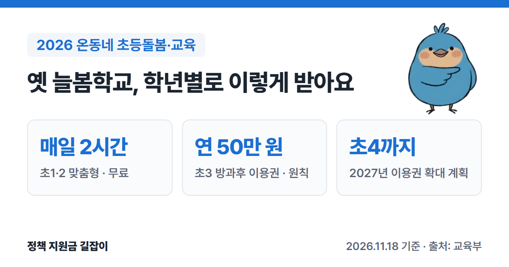
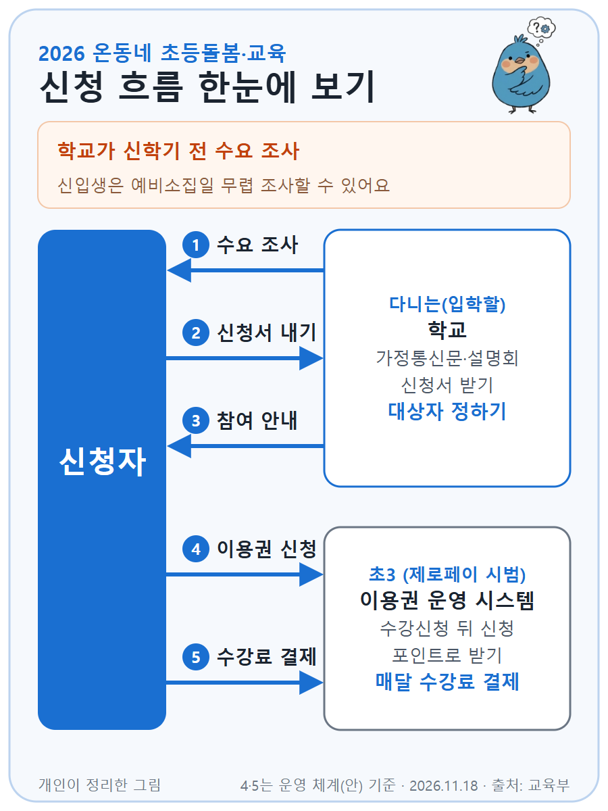

2024년부터 운영한 **늘봄학교**가 2026년부터 **온동네 초등돌봄·교육**으로 이름과 방식이 바뀌었어요.
학교와 지역사회가 함께 돌봄을 맡고, 초등학교 3학년에게는 방과후 프로그램 이용권을 새로 줘요.
교육부 추진 방안과 2026 운영 길라잡이를 바탕으로 학년별로 무엇을 받는지, 어떻게 신청하는지 정리했어요.

{: .summary-card}

> 💡 **핵심 요약**
> - 초등학교 1·2학년 중 희망 학생은 학교에서 맞춤형 프로그램을 **매일 2시간 무료**로 들을 수 있어요. 교육부는 이걸로 '사실상 3시 하교'를 계속 보장한다고 밝혔어요. (출처②③)
> - 초등학교 3학년 중 희망 학생에게는 **연 50만 원**의 방과후 프로그램 이용권을 줘요. (출처①③) 교육부는 **2027년에 초4까지** 넓힐 계획이에요. (출처③)
> - 돌봄이 필요한 학생은 학년과 상관없이 선택형 돌봄을 신청할 수 있어요. 지역(시도) 여건과 수요에 따라 방과 후부터 **17~20시까지** 운영해요. (출처②)

> **출처 표시 방법**: 본문의 (출처①) 같은 표시는 글 끝 출처 목록의 번호와 같아요.
> 출산·육아 지원 전체는 [2026 출산지원금 총정리]()에서 함께 확인하세요.

목차

* 목차
{:toc}

## 한눈에 보기

| 항목 | 내용 |
|---|---|
| 지원 대상 | 초등학교 **1~6학년** 중 희망 학생 |
| 지원 내용 | 초1·2 맞춤형 프로그램 매일 **2시간 무료** 초3 방과후 이용권 연 **50만 원** 초1~6 선택형 돌봄·선택형 교육 프로그램 |
| 신청 기간 | 학교가 **신학기 전**에 수요 조사 신입생은 **예비소집일** 무렵 조사할 수 있음 |
| 신청 방법 | 다니는(입학할) **학교**의 가정통신문·안내에 따라 신청 |

(출처①②)

---

## 무엇이 달라졌나요?

교육부는 2026년부터 늘봄학교를 '온동네 초등돌봄·교육'으로 발전시켜 두 가지에 힘을 준다고 밝혔어요. (출처①)

| 구분 | 2025년 | 2026년 |
|---|---|---|
| 돌봄 | 학교 중심 초1·2 집중 | 학교·지역사회 협력 초1·2 집중 + 초3 이상 사각지대도 |
| 무료 프로그램 | 매일 **2시간** 초1·2 집중 | 초3 이용권 **50만 원** 초1·2는 기존대로 |

(출처①)

- 학교만으로 돌봄이 부족한 곳은 **지역 돌봄기관**과 함께 맡아요. 학기 중 오후는 학교가, 저녁·방학·주말과 갑자기 맡길 곳이 필요한 상황은 지역 돌봄기관이 주로 맡는 방식이 예로 나와 있어요. (출처①)
- 지역 돌봄기관은 다함께돌봄센터, 지역아동센터, 청소년방과후아카데미 등이에요. (출처①)
- 교육(지원)청이 여러 학교 학생을 함께 돌보는 **온동네 돌봄·교육센터**도 늘려요. 2025년 3월 기준 58개였고, 2026년에 15개를 더 설치할 계획이에요. (출처①)

> 이 길라잡이는 교육부와 17개 시도교육청이 함께 만든 기준이에요. 시도교육청이 고친 길라잡이가 있으면 **그쪽이 먼저**예요. 그래서 운영 시간이나 비용은 지역·학교마다 다를 수 있어요. (출처②)

---

## 누가 받을 수 있나요?

대상은 **희망 학생**이에요. 길라잡이의 참여 대상에 소득 조건은 적혀 있지 않아요. 학년에 따라 이용할 수 있는 프로그램이 달라요. (출처②)

| 프로그램 | 대상 |
|---|---|
| 맞춤형 프로그램 | 초**1~2**학년 희망 학생 |
| 선택형 돌봄 | 초**1~6**학년 희망 학생 |
| 선택형 교육 | 초**1~6**학년 희망 학생 |
| 방과후 이용권 | 초**3**학년 희망 학생 (2026년) |

(출처①②)

- 초1·2학년의 돌봄·교육 희망은 **모두 받아 주는 것**이 원칙이에요. (출처②)
- 다른 학교 학생도 참여 대상에 넣을 수 있어요. (출처②)

### 선택형 돌봄 자리가 모자라면

희망 학생이 준비된 교실보다 많으면, 길라잡이는 아래 학생을 먼저 고려하는 반 편성 예시를 들어요. 예시라서 학교마다 다를 수 있어요. (출처②)

- 실제로 학교에 머무르려는 시간이 많은 학생
- 저학년 학생 (초1~2 우선, 또는 초3 > 초4 > 초5 > 초6 순)
- 법정 수급(저소득층)·맞벌이·한부모·다자녀·이주배경 가정, 담임교사 추천 학생 등

---

## 얼마나 받을 수 있나요?

### 초1·2 맞춤형 프로그램: 매일 2시간 무료

- 초1·2학년 희망 학생에게 학교 적응, 놀이·체험, 학습 활동을 **매일 2시간(차시) 이상** 무료로 해 줘요. (출처②)
- 학기 중과 방학 중에 모두 운영해요. 방학 중에는 오전이나 오후로 편성해요. (출처②)
- 교육부는 2026년 4월 대책에서도 초1·2 매일 2시간 맞춤형 프로그램을 계속 지원해 **'사실상 3시 하교'**를 보장한다고 밝혔어요. (출처③)

### 초3 방과후 프로그램 이용권: 연 50만 원

- 2026년 1학기부터 초3 희망 학생에게 **연 50만 원**의 이용권을 줘요. 학부모가 고른 방과후 프로그램의 **수강료**를 내는 데 써요. (출처①)
- 1인당 연 50만 원이 원칙이고, 교육(지원)청 여건에 따라 대상·금액이 일부 달라질 수 있어요. (출처②)
- 2026년에는 주로 **학교 안 방과후 수강료**에 써요. 여건이 되는 교육청은 학교와 연계한 공공·비영리기관 프로그램 수강료까지 넓힐 수 있어요. (출처①)
- 부산, 인천, 세종, 충북, 전북, 전남 6개 교육청은 3월부터 **제로페이** 포인트로 주는 방식을 시범 도입한다고 밝혔어요. 다른 교육청은 자체 방식을 마련해요. (출처①)
- 2026년 3월 기준 초3의 **57.2%**가 이용권을 받고 있어요. 교육부는 희망하는 지역은 2026년 연말까지 초3의 **70%**까지 지원할 수 있게 한다고 밝혔어요. (출처③)
- 교육부는 **2027년에 초4까지** 지원 대상을 넓힌다고 밝혔어요. 2027년 세부 방식은 아직 공지를 기다려야 해요. (출처③)

### 선택형 돌봄·선택형 교육

| 구분 | 내용 |
|---|---|
| 선택형 돌봄 | 늘봄교실에서 돌봄 전담 인력(늘봄전담사)이 돌봐 줘요 방과 후부터 **17~20시**까지 (시도 여건에 따라) |
| 아침 돌봄(예시) | 일찍 등교하는 학생을 **정규수업 전**까지 |
| 저녁 돌봄(예시) | **17시(또는 18시)~20시** 수요에 따라 **22시**까지 연장 가능 |
| 선택형 교육 | 특기·적성, 교과 관련 방과후 프로그램 |

(출처②) 아침·저녁 돌봄 시간은 길라잡이의 운영 예시예요.

- 초등돌봄·교육은 학교 돈으로 하는 **무료 프로그램**과 학부모가 비용을 내는 **유료 프로그램**으로 나뉠 수 있어요. 수강료 같은 프로그램별 비용은 학교가 수요 조사 때 알려 줘요. (출처②)
- 급식·간식은 시도교육(지원)청 지침에 따라 무료이거나 유료예요. (출처②)
- 2026년부터 농식품부 어린이과일간식 사업으로 초1·2 돌봄 참여 학생 등에게 **주 1회 안팎** 과일간식을 무료로 줘요. (출처①)

---

## 어떻게 신청하나요?

{: .flow-chart}

1. **수요 조사·안내 받기**: 학교가 신학기 전에 가정통신문으로 참여 희망을 조사하고, 설명회를 열기도 해요. 초등 저학년은 **신입생 예비소집일** 무렵에 조사할 수 있어요. (출처②)
2. **신청서 내기**: 맞춤형 프로그램, 선택형 돌봄, 선택형 교육 중 원하는 프로그램과 시간을 골라 학교에 내요. (출처②)
3. **참여 안내 받기**: 학교가 대상자를 정하고 확정된 프로그램을 누리집, 가정통신문, 문자 등으로 알려 줘요. (출처②)
4. **이용권 신청하기 (초3)**: 추진 방안의 운영 체계(안)에 따르면 제로페이 시범 교육청은 학교 방과후 수강신청이 끝난 뒤 학부모가 이용권 운영 시스템에서 이용권을 신청하면 포인트로 받아요. 다른 지역은 교육청 방식에 따라요. (출처①)
5. **수강료 결제하기 (초3)**: 시범 교육청은 매달 초 학교가 알려 준 수강료를 이용권 포인트로 내요. (출처①)

> 💡 정확한 신청 기간은 학교마다 달라요. 길라잡이에도 단계별 시기는 학교 상황과 시도교육(지원)청 지침에 따라 다를 수 있다고 적혀 있어요. (출처②)

---

## 놓치기 쉬운 점

- **맞춤형과 같은 시간대 선택형은 함께 못 들어요.** 길라잡이 신청서 예시에는 초1·2가 맞춤형 프로그램을 고르면 같은 시간대의 선택형 돌봄·교육 프로그램에는 참여할 수 없다고 적혀 있어요. (출처②)
- **초1·2는 보호자와 함께 귀가하는 게 원칙이에요.** 초등돌봄·교육에 참여한 초1·2와 늦은 시간에 귀가하는 학생은 보호자(또는 대리인) 동행 귀가가 원칙이고, 보호자가 동의하면 혼자 귀가할 수 있어요. (출처①)
- **이용권은 2026년에 초3만 받아요.** 2026년 초4~6은 이용권 대상이 아니에요. (출처①) 초4 확대는 2027년 계획이에요. (출처③)
- **희망자가 적은 선택형 교육 프로그램은 안 열릴 수 있어요.** 길라잡이 수요 조사 예시에는 희망자가 매우 적거나 강사를 구하기 어려우면 개설되지 않을 수 있다고 적혀 있어요. (출처②)

> 이런 경우는 다니는(입학할) **학교**나 **시도교육청**에 먼저 물어보세요: 우리 학교 프로그램 시간표와 비용, 이용권 신청 방법이 궁금할 때.

---

## 자주 묻는 질문

**Q. 늘봄학교가 없어진 건가요?**
A. 아니에요. 늘봄학교를 '온동네 초등돌봄·교육'으로 **발전시킨** 거예요. 초1·2는 기존 방식대로 지원하고, 초3 이용권과 지역사회 협력이 더해졌어요. (출처①)

**Q. 초3 이상은 학교 돌봄에 못 들어가나요?**
A. 들어갈 수 있어요. 교육부는 학교 여건에 맞게 초3 이상도 학교돌봄에 참여할 수 있고, 학교만으로 어려우면 지역사회와 함께 지원한다고 답했어요. (출처①)

**Q. 아침·저녁 돌봄은 없어졌나요?**
A. 아니에요. 학교 여건에 맞게 아침·저녁 돌봄·교육이 계속 제공된다고 안내했어요. (출처①) 저녁 돌봄 수요가 아주 적은 학교는 아이돌봄서비스와 연계하는 방식도 예로 나와 있어요. (출처②)

**Q. 내년(2027년)에 초등학교에 입학하면 언제 신청하나요?**
A. 2026 길라잡이 기준으로는 학교가 신학기 전에 수요 조사를 하고, 저학년은 신입생 예비소집일 무렵에 조사할 수 있어요. (출처②) 2027학년도 일정은 입학할 학교의 안내문을 확인하세요.

**Q. 방학에도 하나요?**
A. 네. 맞춤형 프로그램과 선택형 돌봄은 학기 중과 방학 중에 모두 운영해요. (출처②)

---

## 함께 보면 좋은 글

- [2026 유치원 유아학비 지원 총정리](): 초등학교 입학 전 3~5세 유치원비 지원
- [2026 아이돌봄서비스 총정리](): 학교 돌봄이 끝난 뒤나 갑자기 맡길 곳이 필요할 때 집으로 오는 돌봄
- [2026 초중고 교육급여·교육비 지원](): 저소득 가구 학생의 방과후학교 자유수강권과 교육활동지원비
- [2026 출산지원금 총정리](): 출산·육아 지원 전체

---

## 출처

1. [교육부 보도자료 - 2026년 온동네 초등돌봄‧교육 추진 방안 발표 (방과후돌봄정책과, 2026.2.3.)](https://www.moe.go.kr/boardCnts/viewRenew.do?boardID=294&lev=0&statusYN=W&s=moe&m=020402&opType=N&boardSeq=105261) - 달라지는 점 비교표, 초3 이용권 연 50만 원·1학기 시작, 제로페이 시범 6개 교육청, 학교 안 수강료 사용(Q7), 지역 돌봄기관 역할 분담, 온동네 돌봄·교육센터 58개·15개 추가, 초1·2 동행 귀가, 과일간식, Q&A(초3 이상 학교돌봄·아침·저녁돌봄·초4 확대 검토) (보도자료와 별첨 추진 방안 확인, 확인일: 2026-11-18)
2. [교육부 - 2026 초등돌봄·교육(늘봄학교) 운영 길라잡이 (교육부·17개 시도교육청·한국교육개발원)](https://www.moe.go.kr/boardCnts/viewRenew.do?boardID=72782&boardSeq=105180&lev=0&m=030215&s=moe&opType=N) - 프로그램 정의(맞춤형 매일 2시간 이상 무상), 대상, 초1·2 희망 수요 모두 수용 원칙, 선택형 돌봄 운영 시간·반 편성 예시, 아침·저녁 돌봄, 이용권 원칙·교육청별 조정, 무상·유상 구분, 급·간식, 수요 조사 시기·운영 절차, 시도교육청 길라잡이 우선, 서식편 신청서 예시 (확인일: 2026-11-18)
3. [대한민국 정책브리핑 - 사교육비 경감을 위한 정책 방안 발표 (교육부 보도자료, 2026.4.1.)](https://www.korea.kr/briefing/pressReleaseView.do?newsId=156752309) - 초3 이용권 57.2%·연말까지 70%, 2027년 초4 확대, 초1·2 매일 2시간·사실상 3시 하교 (첨부 보도자료 원문 확인, 확인일: 2026-11-18)

> 이 글은 **2026년 11월 18일** 기준이에요. 운영 시간과 비용은 시도교육청과 학교마다 다를 수 있으니, 신청 전에 학교 안내문을 꼭 확인하세요.
