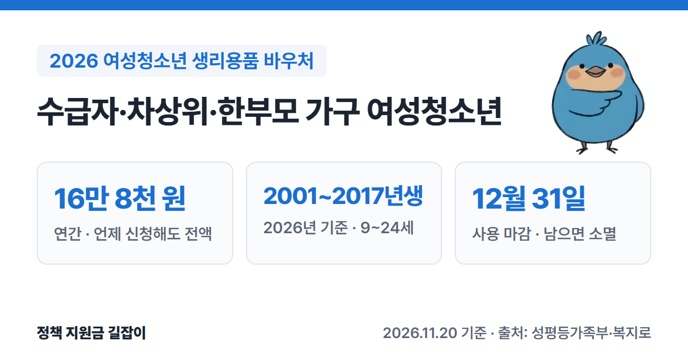
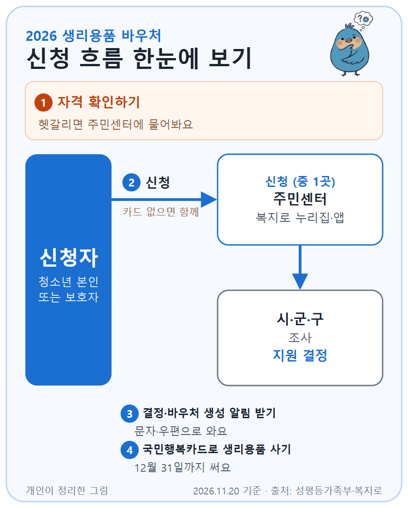

**여성청소년 생리용품 바우처**는 형편이 어려운 가정의 여성청소년이 생리대 같은 생리용품을 살 수 있도록 국민행복카드에 포인트를 넣어 주는 제도예요.
2026년부터는 **언제 신청해도 1년치 전액**을 한 번에 받아요. 다만 받은 바우처는 **12월 31일**까지 써야 해요.

성평등가족부 사업 안내와 정책브리핑, 복지로 자료를 바탕으로 대상, 금액, 신청 방법을 정리했어요.

{: .summary-card}

> 💡 **핵심 요약**
> - **기초생활수급자, 차상위계층, 한부모가족 지원대상** 가구의 **여성청소년**(2026년은 **2001~2017년생**)은 생리용품 바우처를 1년에 **16만 8천 원**(월 1만 4천 원) 받아요. (출처①③④⑤)
> - 2026년부터는 **언제 신청해도 1년치 전액**을 받아요. 신청한 달에 1년치 바우처가 한꺼번에 생겨요. (출처①②③)
> - 바우처는 **12월 31일**까지 써야 하고, 남은 금액은 다음 해 **1월 1일**에 모두 사라져요. 결정과 바우처 처리가 12월 넷째 주 금요일까지 끝나야 하니 12월에는 서두르세요. (출처①④⑤)

> **출처 표시 방법**: 본문의 (출처①) 같은 표시는 글 끝 출처 목록의 번호와 같아요.

목차

* 목차
{:toc}

## 한눈에 보기

| 항목 | 내용 |
|---|---|
| 대상 | **2001~2017년생** 여성청소년(2026년 기준) 수급자·차상위계층·한부모가족 지원대상 가구 |
| 지원 금액 | 연 **16만 8천 원**(월 **1만 4천 원**) 언제 신청해도 1년치 전액 |
| 신청 기간 | 2026년 **1월~12월** 12월 넷째 주 금요일까지 결정·바우처 처리 완료 필요 |
| 사용 기한 | 그해 **12월 31일**까지 |
| 신청 방법 | 주민센터 방문, 복지로 누리집·앱 |

(출처①③④⑤)

---

## 누가 받을 수 있나요?

**9~24세 여성청소년** 가운데 아래 가구에 해당하면 받을 수 있어요. (출처①③⑤)

- 「국민기초생활보장법」에 따른 **생계·의료·주거·교육급여 수급자**
- 「국민기초생활보장법」에 따른 **차상위계층**(차상위자활, 차상위 본인부담경감 대상자, 차상위장애인, 차상위계층 확인서 발급)
- 「한부모가족지원법」 제5조·제5조의2에 따른 **한부모가족 지원대상자**

(출처①⑤)

**나이는 태어난 해로 따져요.** 9세가 되는 해의 1월 1일부터 24세가 끝나는 해의 12월 31일까지 지원해요. 2026년에는 **2001년 1월 1일~2017년 12월 31일**에 태어난 사람이 대상이에요. (출처⑤)

내가 대상인지 헷갈리면 주민등록 주소지의 **주민센터(행정복지센터)**에 물어보면 돼요. (출처①)

---

## 얼마나 받을 수 있나요?

| 구분 | 내용 |
|---|---|
| 금액 | 월 **1만 4천 원**, 1년 **16만 8천 원** |
| 지급 방식 | 신청한 달에 1년치 **전액**이 한 번에 생겨요 |
| 사용 기한 | 그해 **12월 31일**까지 |

(출처①③④)

- **2026년부터 바뀌었어요.** 예전에는 신청한 달부터 연말까지 남은 달만큼만 줬는데, 이제는 신청 시기와 상관없이 **12개월 금액 전액**을 줘요. (출처②③)
- 받은 바우처는 한 번에 다 쓰거나 나눠 써도 돼요. (출처①)
- 다 쓰지 못한 바우처는 다음 해 **1월 1일**에 모두 사라져요. (출처①④)

---

## 어떻게 신청하나요?

1. **자격 확인하기**: 우리 집이 수급자·차상위계층·한부모가족 지원대상 가구인지, 아이가 대상 나이(2026년은 2001~2017년생)인지 확인해요. 헷갈리면 주민센터에 물어봐요. (출처①⑤)
2. **신청하기**: 청소년 본인이나 주로 키우는 보호자(부모, 법정대리인 등)가 **주민센터**에 가거나 **복지로 누리집·앱**에서 신청해요. (출처①) 국민행복카드가 없으면 이때 함께 신청할 수 있어요. (출처②③)
3. **결정·바우처 생성 알림 받기**: 시·군·구가 조사해서 접수일부터 14일 안에 지원 여부를 결정하고, 바우처가 생겼다는 알림이 문자나 우편으로 와요. (출처①④⑤)
4. **생리용품 사기**: 국민행복카드로 카드사별 가맹점에서 생리대, 탐폰, 생리컵을 사요. 온라인에서는 결제할 때 **'바우처 결제'**를 고르면 돼요. (출처①)

{: .flow-chart}

**주민센터는 실제 사는 곳에서도 돼요.** 주민등록 주소지와 실제 사는 곳이 다르면, 실제 사는 곳 주민센터에서도 신청할 수 있어요. (출처①⑤)

**필요한 서류**는 신청서, 개인정보 수집·이용 동의서, 신청인 신분증 사본이에요. 가족이 대신 신청하면 대리인 신분증과 가족관계증명서 같은 관계 확인 서류를 챙겨요. (출처①⑤)

**14세 미만** 청소년이 직접 신청하면 개인정보 수집·이용 동의서에 법정대리인 서명이 필요해요. (출처⑤)

---

## 어디서 살 수 있나요?

- 국민행복카드를 만든 **카드사별 가맹점**에서 생리용품을 살 수 있어요. 국민행복카드는 BC, 삼성, 롯데, 신한, KB국민, 현대카드에서 발급해요. (출처①④)
- 온·오프라인 구매처가 2026년에 크게 늘었어요. 카드사별 가맹점 목록은 성평등가족부 안내 페이지에서 볼 수 있어요. (출처①②)
- 바우처 잔액과 사용 방법은 **한국사회보장정보원 바우처 콜센터(1566-3232)**에서 확인할 수 있어요. (출처①③)

---

## 놓치기 쉬운 점

- **12월에 신청하면 늦을 수 있어요.** 결정 통보와 바우처 처리는 12월 넷째 주 금요일까지 끝나야 하고, 그 뒤에 접수된 신청은 바우처가 생기지 않아요. 정확한 마감 날짜는 주민센터에 확인하세요. (출처⑤)
- **지금 신청해도 1년치를 받지만, 12월 31일까지 다 써야 해요.** 남은 바우처는 다음 해 1월 1일에 사라져요. (출처①④)
- **알림을 받은 뒤부터 쓸 수 있어요.** 지원 결정과 바우처 생성 알림(문자·우편)을 받아야 사용할 수 있어요. (출처①)
- **신청인이 아닌 보호자 카드로 쓰려면 주민센터에 가야 해요.** 신청인 외 보호자 이름의 국민행복카드를 쓰려면 주민센터에서 카드 사용자를 바꿔야 해요. (출처①)
- **자격이 없어지면 남은 바우처도 사라져요.** 수급자·차상위 등 자격이 바뀌어 대상에서 빠지면, 쓴 것과 상관없이 남은 바우처가 모두 사라져요. (출처①④)

> 이런 경우는 **주민센터**(자격 여부)나 **바우처 콜센터 1566-3232**(잔액·사용 방법)에 먼저 물어보세요. (출처①)

---

## 자주 묻는 질문

**Q. 11월이나 12월에 신청해도 16만 8천 원을 다 받나요?**
네. 2026년부터는 신청 시기와 상관없이 1년치 전액이 신청한 달에 생겨요. 다만 12월 31일까지 써야 하고, 결정과 바우처 처리가 12월 넷째 주 금요일까지 끝나야 하니 일찍 신청하세요. (출처①②③⑤)

**Q. 올해 만 25세가 됐는데 받을 수 있나요?**
2026년에는 2001년 1월 1일~2017년 12월 31일에 태어났으면 대상이에요. 24세가 끝나는 해의 12월 31일까지 지원하기 때문이에요. (출처⑤)

**Q. 아이가 직접 신청해도 되나요?**
네. 청소년 본인이나 주로 키우는 보호자(부모, 법정대리인 등)가 신청할 수 있어요. 14세 미만이 직접 신청하면 법정대리인 서명이 필요해요. (출처①⑤)

**Q. 국민행복카드가 없어도 되나요?**
갖고 있는 국민행복카드가 있으면 그대로 쓸 수 있어요. (출처①) 없으면 바우처를 신청할 때 함께 신청할 수 있어요. (출처②③)

**Q. 어떤 물건을 살 수 있나요?**
생리대, 탐폰, 생리컵이에요. (출처①)

---

## 함께 보면 좋은 글

- [2026 생활비 지원 총정리](): 수급자·차상위 가구가 받을 수 있는 생활비 지원 상황별로 찾기
- [2026 한부모가족 아동양육비 총정리](): 한부모가족 지원대상이면 자녀 1인당 받는 양육비
- [2026 문화누리카드 총정리](): 이것도 12월 31일이 지나면 남은 돈이 사라지는 수급자·차상위 지원

---

## 출처

1. [성평등가족부 - 여성청소년 생리용품 바우처 지원](https://www.mogef.go.kr/sp/yth/sp_yth_f017.do) - 대상(9~24세), 자격 기준, 월 1만 4천 원, 연 1회 일괄 지급, 신청권자, 신청 방법, 대리 신청 서류, 국민행복카드, 사용처, 사용 기한·소멸, 문의처 (확인일: 2026-11-20)
2. [대한민국 정책브리핑 - 여성청소년 생리용품 지원, 이렇게 달라졌습니다 (성평등가족부, 2026.11.10.)](https://www.korea.kr/multi/visualNewsView.do?newsId=148975358) - 언제 신청해도 1년치 전액, 바우처·국민행복카드 동시 신청, 구매처 확대 (확인일: 2026-11-20)
3. [국민콜110 - 2026년 여성청소년 생리용품 지원 사업 (2026.1.30.)](https://110.go.kr/data/counselView.do?num=A01_720889) - 지원 대상, 연 16만 8천 원, 기존·변경 지급 방식, 바우처·국민행복카드 동시 신청, 신청 방법, 문의처 (확인일: 2026-11-20)
4. [복지로 - 여성청소년 생리용품 지원](https://www.bokjiro.go.kr/ssis-tbu/twataa/wlfareInfo/moveTWAT52011M.do?wlfareInfoId=WLF00000781) - 연 16만 8천 원, 사용 기한·소멸, 자격 변동 시 소멸, 국민행복카드 카드사, 시·군·구 조사·결정 (확인일: 2026-11-20)
5. [성평등가족부 - 「2026년 청소년사업 안내」 2권(2026.1.19.), 여성청소년 생리용품 지원 대상자 선정(인쇄 849쪽)](https://bokjiro.go.kr/ssis-tbu/CmmFileUtil/getDownload.do?atcflId=20260129UUWBM1312300173459504&atcflSn=1) - 연령 기준(2026년 2001.1.1.~2017.12.31. 출생), 차상위계층 범위, 신청 기간(1~12월)·12월 넷째 주 금요일 이후 바우처 생성 불가, 실거주지 신청, 신청 서류, 14세 미만 동의 (확인일: 2026-11-20, 복지로 첨부 PDF)

> 이 글은 **2026년 11월 20일** 기준이에요. 지원 조건은 바뀔 수 있으니 신청 전에 주민센터나 복지로에서 꼭 확인하세요.
