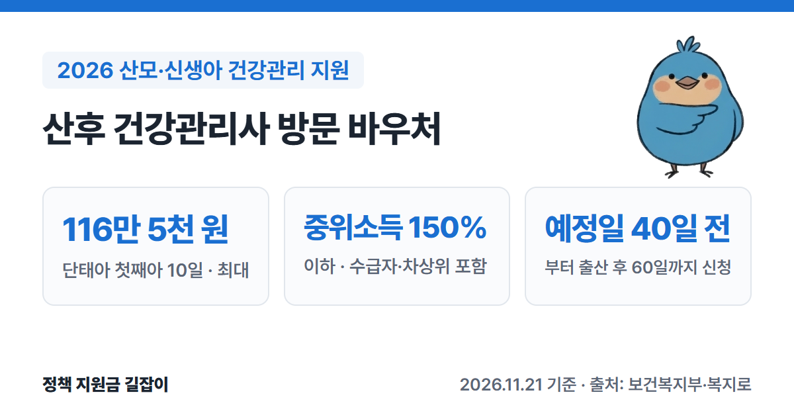
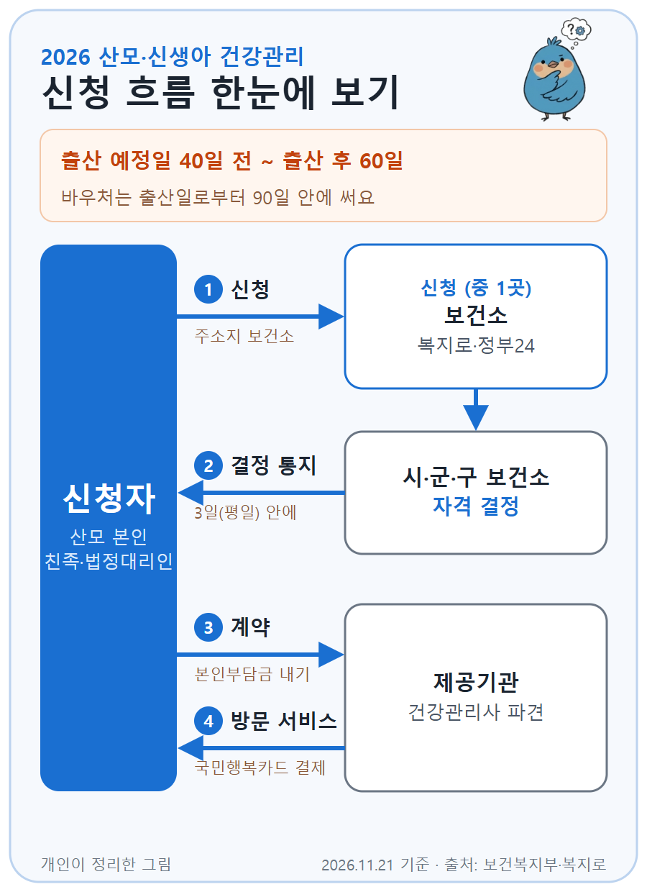

**산모·신생아 건강관리 지원사업**은 흔히 "산후도우미 지원"이라고 부르는 제도예요. 아이를 낳은 뒤 **산모·신생아 건강관리사**가 집으로 찾아와 산모 회복과 아기 돌보기를 도와주고, 그 비용의 일부(단태아 첫째아 표준 10일 기준 100만 2천~116만 5천 원)를 정부가 바우처로 내 줘요.
신청은 **출산 예정일 40일 전부터** 할 수 있어요.

보건복지부 「2026년 산모신생아 건강관리 지원사업 안내」를 바탕으로 대상, 금액, 신청 방법을 정리했어요.

{: .summary-card}

> 💡 **핵심 요약**
> - 산모 또는 배우자가 **수급자·차상위계층**이거나, 가구 건강보험료 본인부담금 합산액이 **기준중위소득 150% 이하**인 출산가정이 기본 대상이에요. (출처①②)
> - 첫째아(단태아) **표준 10일** 기준 서비스 가격 **146만 4천 원** 가운데 정부가 **100만 2천~116만 5천 원**을 지원해요. 나머지는 본인부담이에요. (출처①)
> - 신청은 **출산 예정일 40일 전부터 출산일로부터 60일까지**, 보건소나 복지로·정부24에서 해요. (출처①②)

> **출처 표시 방법**: 본문의 (출처①) 같은 표시는 글 끝 출처 목록의 번호와 같아요.

목차

* 목차
{:toc}

## 한눈에 보기

| 항목 | 내용 |
|---|---|
| 대상 | 수급자·차상위 출산가정 건강보험료 기준 **중위소득 150% 이하** 출산가정 (150% 초과는 지자체가 정한 예외지원만) |
| 지원 내용 | 건강관리사 방문 서비스 이용권(바우처) 단태아 첫째아 **5·10·15일** 중 선택 |
| 신청 기간 | 출산 예정일 **40일 전** ~ 출산일로부터 **60일** |
| 신청 방법 | 주소지 시·군·구 보건소 방문 복지로·정부24 온라인 |
| 사용 기한 | 출산일로부터 **90일** 이내 |

(출처①②)

---

## 누가 받을 수 있나요?

국내에 주민등록(재외국민 포함)이나 외국인 등록을 한 **출산가정**이 신청할 수 있어요. 부부가 모두 외국인이면 각자 체류자격이 거주(F-2)·영주(F-5)·결혼이민(F-6)일 때만 돼요. (출처①)

**기본지원 대상**은 아래 둘 중 하나예요. (출처①②)

- 산모 또는 배우자가 **생계·의료·주거·교육급여 수급자**나 **차상위계층**(차상위본인부담경감, 차상위자활, 차상위장애인, 차상위자격확인)
- 산모와 배우자 등 가구의 **건강보험료 본인부담금 합산액**이 **기준중위소득 150% 이하** 금액에 해당

임신 16주 이후 유산·사산한 경우도 지원 대상에 들어가요. (출처①)

### 150% 이하인지 보는 건강보험료 기준 (2026)

소득은 실제 월급이 아니라 **가구의 건강보험료 본인부담금**으로 판단해요. 가구원 수에는 출생 신생아(태아 포함)도 들어가요. (출처①)

| 가구원 수 | 직장가입자 건강보험료(월) |
|---|---|
| 2인 | **229,357원** 이하 |
| 3인 | **290,169원** 이하 |
| 4인 | **360,410원** 이하 |
| 5인 | **410,439원** 이하 |

(출처①, 「건강보험료 산정기준표(2026)」. 지역가입자·혼합 기준과 6인 이상은 원문 표에서 확인하세요)

### 150%를 넘으면요?

기준중위소득 150%를 넘어도 **시·도가 따로 소득 기준을 정해 승인한 경우**에는 예외로 지원받을 수 있어요. 시·군·구가 자체 예산으로 대상을 더 넓히기도 해요. 원문에 예외지원 가능 유형으로 희귀·중증난치질환 산모, 장애인 산모·장애 신생아, 쌍생아 이상, 둘째아 이상, 셋째아 이상, 미혼모, 미숙아 출산 가정, 150% 초과 출산가정 등이 적혀 있어요. (출처①)

예외지원은 **지방자치단체 예산 범위 안에서** 하기 때문에 지역마다 대상과 소득 기준이 달라요. (출처①) 예를 들어 구리시보건소는 "2026년 10월 1일부터 기준중위소득 150% 초과 출산가정은 지원 대상에서 제외"한다고 안내하고 있어요. (출처③) 소득이 150%를 넘으면 신청 전에 사는 곳 보건소에 꼭 물어보세요.

---

## 얼마나 받을 수 있나요?

정부지원금은 **태아 유형, 출산 순위, 소득 구간, 서비스 기간**에 따라 달라요. 이용자는 서비스 가격에서 정부지원금을 뺀 금액을 **본인부담금**으로 내요. (출처①)

### 서비스 기간

| 구분 | 단축 · 표준 · 연장 |
|---|---|
| 단태아 첫째아 | 5일 · **10일** · 15일 |
| 단태아 둘째아 | 10일 · **15일** · 20일 |
| 단태아 셋째아 이상 | 10일 · **15일** · 20일 |

쌍태아는 10·15·20일, 삼태아 이상은 15·25·40일이에요. 중증 장애인 산모는 단태아면 쌍태아, 쌍태아 이상이면 삼태아 이상 기간을 적용받아요. 어느 기간을 쓸지는 제공기관과 계약할 때 골라요. (출처①)

### 단태아 첫째아 (표준 10일, 서비스 가격 146만 4천 원)

| 소득 구간 | 정부지원 / 본인부담 |
|---|---|
| 수급자·차상위 (가형) | **116만 5천 원** / 29만 9천 원 |
| 150% 이하 (통합형) | **100만 2천 원** / 46만 2천 원 |
| 150% 초과 예외지원 (라형) | **76만 4천 원** / 70만 원 |

### 단태아 둘째아 (표준 15일, 서비스 가격 219만 6천 원)

| 소득 구간 | 정부지원 / 본인부담 |
|---|---|
| 수급자·차상위 (가형) | **179만 4천 원** / 40만 2천 원 |
| 150% 이하 (통합형) | **152만 5천 원** / 67만 1천 원 |
| 150% 초과 예외지원 (라형) | **119만 3천 원** / 100만 3천 원 |

### 단태아 셋째아 이상 (표준 15일, 서비스 가격 219만 6천 원)

| 소득 구간 | 정부지원 / 본인부담 |
|---|---|
| 수급자·차상위 (가형) | **183만 8천 원** / 35만 8천 원 |
| 150% 이하 (통합형) | **154만 8천 원** / 64만 8천 원 |
| 150% 초과 예외지원 (라형) | **123만 6천 원** / 96만 원 |

(출처①, 「산모･신생아 건강관리 지원사업 서비스가격 및 정부지원금」 표. 본인부담은 서비스 가격에서 정부지원금을 뺀 계산값)

서비스 가격은 1일 기준가격(단태아 일반 **14만 6,400원**)으로 정한 값이에요. 제공기관이 경력·자격이 높은 건강관리사 등으로 가격을 따로 정하면 본인부담이 더 늘 수 있어요. (출처①)

### 어떤 도움을 받나요?

건강관리사가 집으로 와서 아래 일을 해요. (출처①)

- **산모 건강관리**: 유방관리·산후 부종관리(안마·마사지는 빠짐), 좌욕 지원, 산후 체조 지원
- **신생아 건강관리**: 건강상태 확인, 목욕 등 청결관리, 수유 지원, 예방접종 지원
- **가사 지원**: 산모 식사 준비, 산모·신생아 생활공간 청소, 산모·신생아 옷 세탁
- 수유·산후회복·신생아 돌보기 교육, 정서 지지

---

## 어떻게 신청하나요?

1. **신청**: 출산 예정일 40일 전부터 출산일로부터 60일까지, 산모 주민등록 주소지 시·군·구 **보건소**에 가거나 **복지로·정부24**에서 신청해요. 주민센터에 내면 보건소로 옮겨 처리해요. 산모 본인뿐 아니라 친족(배우자 등)이나 법정대리인도 신청할 수 있어요. (출처①)
2. **결정 통지**: 보건소가 수급자·차상위 여부나 건강보험료를 확인해, 신청 접수일부터 **3일(주말·공휴일 제외)** 안에 결과를 알려 줘요. (출처①)
3. **제공기관 고르기·계약**: 서비스를 줄 제공기관과 상담해 서비스 기간(단축·표준·연장)을 고르고 계약한 뒤 **본인부담금**을 미리 내요. (출처①)
4. **서비스 이용**: 건강관리사가 집으로 와서 서비스를 하고, 비용은 산모의 **국민행복카드**(이용자 카드)로 결제해요. (출처①)

{: .flow-chart}

신청할 때는 사회보장급여(사회서비스이용권) 신청서나 임신서비스 통합처리 신청서를 내고, 필요하면 자격 확인 서류를 더 내요. 공무원이 시스템으로 확인할 수 있는 서류는 따로 내지 않아도 돼요. (출처①)

---

## 놓치기 쉬운 점

- **출산 후 60일이 지나면 신청할 수 없어요.** 신청 기한은 출산 예정일 40일 전부터 출산일로부터 60일까지예요. 미숙아·선천성 이상아로 아기가 입원했다면 아기 퇴원일부터 30일 안에 신청할 수 있어요. (출처①)
- **바우처는 출산일로부터 90일 안에 써야 해요.** 남은 바우처가 있어도 기간이 지나면 사라져요. 아기가 입원한 경우는 퇴원일부터 90일이지만, 출산일부터 2년이 지나면 사라져요. (출처①)
- **결정 뒤 100일 안에 제공기관에 등록해야 해요.** 자격 결정 정보가 보내진 날부터 100일 안에 제공기관이 이용자를 등록하지 않으면 자격이 자동으로 멈춰요. (출처①)
- **150% 초과 지원은 지역마다 달라요.** 예외지원은 지자체가 정하고 예산 범위 안에서 해서, 같은 소득이라도 사는 곳에 따라 받을 수도, 못 받을 수도 있어요. (출처①③)

> 이런 경우는 **주소지 보건소**나 **보건복지상담센터 129**에 먼저 물어보세요: 건강보험료 기준을 넘는지 헷갈릴 때, 우리 지역 예외지원 대상인지 궁금할 때. 바우처 관련 문의는 **사회서비스 전자바우처(1566-3232)**로 할 수 있어요. (출처②)

---

## 자주 묻는 질문

**Q. 제왕절개 날짜가 정해졌으면 언제부터 신청할 수 있나요?**
A. 제왕절개일을 확정했다면 보통 그날을 출산 예정일로 봐서, **제왕절개일 40일 전부터** 신청할 수 있어요. 의사소견서·확인서로 확인해요. (출처①)

**Q. 출산 순위는 산모가 몇 번째 낳은 건지로 따지나요?**
A. 아니에요. 산모의 출산 횟수가 아니라, 그 아이가 **해당 가정에서 몇 번째 아이인지**로 따져요. (출처①)

**Q. 유산·사산한 경우도 받을 수 있나요?**
A. 임신 16주 이후 유산·사산했다면 대상이에요. 확인일부터 **30일 안에** 의사 소견서·확인서나 사산(사태)증명서를 붙여 신청하고, 바우처는 확인일부터 60일 안에 써요. (출처①)

**Q. 다른 지원과 같이 받을 수 없는 경우가 있나요?**
A. 국고로 같거나 비슷한 서비스를 받은 경우, 예를 들어 **입양숙려기간 모자지원**을 받았다면 지원에서 빠져요. 여성장애인 출산비용 지원은 중복으로 보지 않고, 장애인활동지원도 함께 받을 수 있어요. (출처①)

---

## 함께 보면 좋은 글

- [2026 출산지원금 총정리](): 첫만남이용권·부모급여·아동수당 등 출산 직후 받는 지원 전체
- [미숙아·선천성이상아 의료비 지원 총정리](): 아기가 신생아중환자실에 입원했을 때 의료비
- [신생아 선천성 대사이상·난청 검사비 지원 총정리](): 출산 직후 아기 검사비 지원
- [2027 기준 중위소득 정리](): 중위소득 150%가 우리 집 기준으로 얼마인지

## 출처

1. [보건복지부 - 「2026년 산모신생아 건강관리 지원사업 안내」 (출산정책과, 2026.1.2. 게시, 훈령·예규·고시·지침 게시판)](https://www.mohw.go.kr/board.es?mid=a10409020000&bid=0026&list_no=1488490&act=view) - 기본·예외지원 대상, 건강보험료 산정기준표(2026), 신청 기한·장소·신청권자, 결정 통지 3일, 최초 유효기간 100일, 서비스가격 및 정부지원금 표, 기준가격, 서비스 기간, 바우처 유효기간 90일, 표준 서비스 내용, 중복 지원 제외, 출산 순위 산정, 자주 묻는 질문(제왕절개) (확인일: 2026-11-21, 첨부 HWPX·PDF)
2. [복지로 - 산모·신생아 건강관리 지원사업](https://www.bokjiro.go.kr/ssis-tbu/twataa/wlfareInfo/moveTWAT52011M.do?wlfareInfoId=WLF00001188) - 2026년 기준 대상·선정기준, 지자체 별도 기준, 신청 기관(보건소·복지로), 문의처 129·1566-3232 (확인일: 2026-11-21)
3. [구리시보건소 - 산모·신생아 건강관리 지원](https://www.guri.go.kr/health/contents.do?key=3562) - "2026년 10월 1일부터 기준중위소득 150% 초과 출산가정은 지원 대상에서 제외" 안내(지역 예외지원 사례, 최종수정 2026-10-26) (확인일: 2026-11-21)

> 이 글은 **2026년 11월 21일** 기준이에요. 지원 조건은 바뀔 수 있으니 신청 전에 사는 곳 보건소나 복지로에서 꼭 확인하세요.
