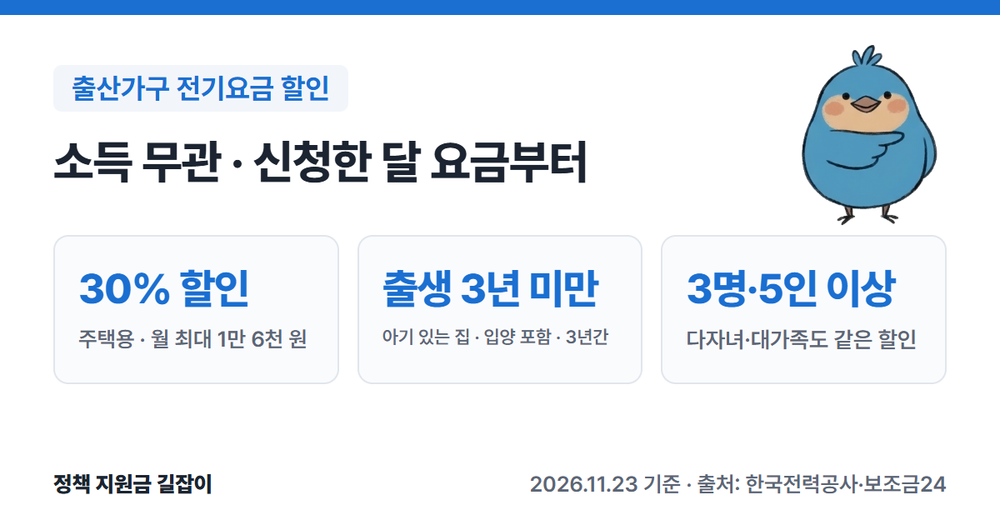
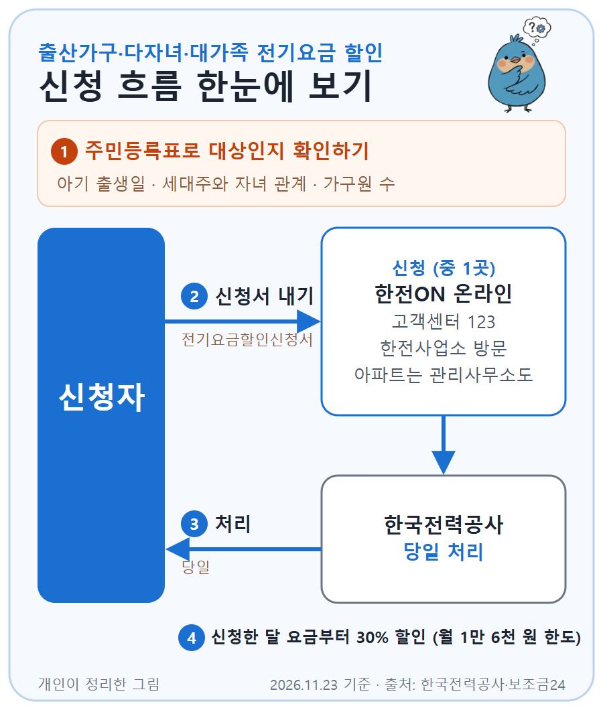

**출산가구 전기요금 할인**은 아기가 태어나거나 입양한 집의 전기요금을 한국전력이 깎아 주는 제도예요.
소득 기준이 없고, **자녀 3명 이상(다자녀)**이나 **5인 이상(대가족)** 가구도 같은 할인을 받아요.
다만 **직접 신청해야 하고 신청한 달 요금부터** 적용돼요. 한전 사이버지점 안내와 보조금24를 바탕으로 정리했어요.

{: .summary-card}

> 💡 **핵심 요약**
> - 출생일로부터 **3년이 안 된 아기**가 있는 집(입양 포함)은 소득과 관계없이 주택용 전기요금을 **30%**, 월 최대 **1만 6천 원**까지 할인받아요. (출처①②)
> - 세대주의 자녀(또는 손자녀)가 **3명 이상**인 집, 주민등록표상 가구원이 **5명 이상**인 집도 같은 **30%(월 1만 6천 원 한도)** 할인이에요. (출처①②)
> - 할인은 **신청한 날이 속한 달 요금부터** 적용돼요. 한전ON·고객센터 **123**·한전사업소에서 신청하고, 아파트는 관리사무소로도 신청할 수 있어요. (출처①③)

> **출처 표시 방법**: 본문의 (출처①) 같은 표시는 글 끝 출처 목록의 번호와 같아요.

목차

* 목차
{:toc}

## 한눈에 보기

| 항목 | 내용 |
|---|---|
| 대상 | 주택용 전력을 쓰는 주거용 고객 중 ① 출생 **3년 미만** 아기가 있는 집(출산가구) ② 자녀 **3명 이상**인 집(다자녀) ③ 가구원 **5명 이상**인 집(대가족) |
| 소득 | 기준 없음 |
| 할인 | 전기요금 **30%**, 월 **1만 6천 원** 한도 |
| 기간 | 출산가구는 **3년간** |
| 적용 | 신청한 날이 속한 **달 요금부터** |
| 신청 | 한전ON · 고객센터 **123** · 한전사업소 아파트는 관리사무소도 가능 |

(출처①②③)

## 누가 받을 수 있나요?

먼저 **주택용 전력**으로 계약해 사는 집(주거용 고객)이어야 해요. 그다음 아래 세 가지 중 하나에 맞으면 돼요. (출처①)

### 출산가구

- 출산·입양 등으로 **세대별 주민등록표**에 출생일로부터 **3년 미만**인 아기가 **1명 이상** 올라 있는 집이에요. (출처①)
- 할인은 **3년간** 받아요. (출처②)

### 다자녀 가구 (자녀 3명 이상)

- 세대별 주민등록표에서 세대주와의 관계가 **'자(子)' 3명 이상** 또는 **'손(孫)' 3명 이상**으로 표시된 집이에요. (출처①)
- 예를 들어 조부모가 세대주이고 손자녀 3명이 함께 올라 있는 집도 해당돼요. (출처①)

### 대가족 (5인 이상)

- **주민등록표상 가구원 수가 5명 이상**인 집이에요. (출처①②)

### 공통

- 한전 안내의 대상 요건에 소득 조건이 없어요. (출처①②③)
- 재외동포·외국인 가구는 국내거소신고증, 외국인등록증 등으로 주민등록표를 갈음할 수 있어요. (출처①)

## 얼마나 받을 수 있나요?

| 구분 | 할인 |
|---|---|
| 출산가구 (3년간) | 전기요금 **30%** 월 **1만 6천 원** 한도 |
| 자녀 3명 이상·대가족 | 전기요금 **30%** 월 **1만 6천 원** 한도 |

(출처①②)

- 여름철(6월 1일~8월 31일)에도 한도는 똑같이 **월 1만 6천 원**이에요. 여름에 한도가 올라가는 건 장애인·유공자·기초생활수급자·차상위계층 할인이에요. (출처②)
- 한도액은 **사용일수에 따라** 나눠 계산한다고 안내돼 있어요. (출처①)

### 저소득·장애인 가구 할인은 따로 있어요

같은 한전 복지할인 안에 아래 할인도 있어요. 이 가구에 해당하면 함께 확인해 보세요. (출처②③)

| 대상 | 월 한도 (여름철 6~8월) |
|---|---|
| 장애의 정도가 심한 장애인, 1~3급 상이유공자, 독립유공자, 기초생활수급자(생계·의료) | **1만 6천 원** (**2만 원**) |
| 기초생활수급자(주거·교육) | **1만 원** (**1만 2천 원**) |
| 차상위계층 | **8천 원** (**1만 원**) |

(출처②) 독립유공자·차상위계층 등 세부 자격은 한전 안내 기준을 따라요.

다른 할인과 겹칠 때 어떻게 적용되는지는 복지로 안내에 "주소지 한전 지사에 문의"하라고 되어 있어요(출처④). 신청할 때 고객센터(**123**)에 같이 물어보세요. (출처③)

## 어떻게 신청하나요?

1. **대상인지 확인하기**: 주민등록표(등본)에 아기 출생일, 세대주와 자녀의 관계, 가구원 수가 어떻게 올라 있는지 확인해요. (출처①)
2. **신청하기**: 아래 중 한 곳에서 **전기요금할인신청서**를 내요. (출처①③)
   - 온라인: **한전ON**(online.kepco.co.kr) 가입 뒤 신청
   - 전화: 한전 고객센터 **123**
   - 방문: 가까운 **한전사업소**
   - 아파트에 산다면 **관리사무소**로도 신청할 수 있어요.
3. **처리**: 한전 사이버지점 안내에 적힌 처리 기간은 **당일**이에요. (출처①)
4. **할인 적용**: 신청한 날이 속한 **달 요금부터** 30% 할인돼요. (출처①)

{: .flow-chart}

### 서류

| 구분 | 서류 |
|---|---|
| 내야 하는 서류 | **전기요금할인신청서** (외국인·재외동포) 외국인증명서, 국내거소신고증 |
| 안 내도 되는 서류 | 주민등록등본 |

(출처①)

## 놓치기 쉬운 점

- **신청한 달부터 할인돼요.** 할인은 신청일이 속한 달 요금부터 적용되니, 출생신고나 입양신고로 주민등록표에 아기가 올라간 뒤 바로 신청하는 게 좋아요. (출처①)
- **주택용 전력이어야 해요.** 출산가구·다자녀·대가족 할인은 '주택용'에만 적용돼요. 가게처럼 일반용 전력으로 계약된 곳은 이 할인 대상이 아니에요. (출처①②)
- **다자녀는 주민등록표 관계로 세요.** 세대주와의 관계가 '자(子)'나 '손(孫)'으로 3명 이상 표시돼야 해요. 신청 전에 세대별 주민등록표에서 관계 표시를 확인하세요. (출처①)
- **이사하면 한전에 확인하세요.** 2021년 복지로 안내에는 주소지를 옮기면 한국전력공사에 주소지 변경 신청을 하라고 되어 있어요. (출처④)

할인 대상인지, 다른 할인과 같이 받을 수 있는지 헷갈리면 한전 고객센터(**국번 없이 123**)에 먼저 물어보세요. (출처①③)

## 자주 묻는 질문

**Q. 부모 소득이 높아도 받을 수 있나요?**
네. 한전 안내의 출산가구·다자녀·대가족 대상 요건에는 소득 조건이 없어요. 주민등록표상 조건과 주택용 전력 계약이 기준이에요. (출처①②)

**Q. 아기를 입양했어요. 출산가구로 받을 수 있나요?**
네. 한전 안내에 "출산·입양 등으로" 세대별 주민등록표상 출생일로부터 3년 미만인 아기가 1명 이상 있는 가구라고 되어 있어요. (출처①)

**Q. 아이가 3살이 지나면 어떻게 되나요?**
한전 안내에는 "출산가구(3년간)"라고만 되어 있어요. 언제 끝나는지, 그 뒤 다자녀·대가족 할인으로 이어지는지는 고객센터(123)에 확인하세요. (출처②)

## 함께 보면 좋은 글

- [2026 출산지원금 총정리](): 첫만남이용권·부모급여 등 아기가 태어나면 받는 지원 전체
- [2026 생활비 지원 총정리](): 난방비·통신비 등 생활비를 줄이는 지원을 상황별로
- [2026 에너지바우처](): 수급 가구에 영유아가 있으면 난방비·냉방비 바우처

---

## 출처

1. [한국전력공사 사이버지점 - 대가족/다자녀/출산가구 요금 신청](https://cyber.kepco.co.kr/ckepco/front/jsp/CY/F/A/CYFAPP0010102.jsp?sn=32) - 주거용 주택용 고객, 주민등록표상 5인 이상·'자' 또는 '손' 3인 이상·출산·입양 등으로 출생일로부터 3년 미만 영아 1인 이상, 아파트는 관리사무소 신청 가능, 재외동포·외국인 주민등록표 갈음, 30%(16,000원 한도)·신청일이 속하는 월분 요금부터·한도액 사용일수 구분 계산, 신청방법(인터넷/모바일/방문/우편/FAX)·처리기간 당일, 제출 서류(전기요금할인신청서, 외국인·재외동포 증명서)·제출하지 않아도 되는 서류(주민등록등본). 이 쪽에 남아 있는 2022년 말까지 한도 한시 확대 문구는 끝난 내용 (확인일: 2026-11-23)
2. [한국전력공사 사이버지점 - 주요 전기요금제도(복지할인 요금제)](https://cyber.kepco.co.kr/ckepco/front/jsp/CY/H/C/CYHCHP00208.jsp) - 대상별 적용기준(대가족 주민등록표상 5인 이상, 3자녀 이상, 출산가구 주민등록표상 출생일로부터 3년 미만), 할인내용 표(3자녀이상·대가족 주택용 30% 월 16천원 한도, 출산가구(3년간) 주택용 30% 월 16천원 한도, 장애인·유공자·기초 생계의료 16천원/여름철 20천원, 기초 주거교육 10천원/12천원, 차상위 8천원/10천원, 여름철 6.1~8.31), 신청방법 고객센터 123 (확인일: 2026-11-23)
3. [정부24 보조금24 - 전기 요금 복지할인 (한국전력공사, 수정일 2026.8.14.)](https://www.gov.kr/portal/rcvfvrSvc/dtlEx/B41000200003) - 상시신청, (주택용) 30% 할인(월 16,000원 한도) 자녀 3인 이상·5인 이상·출산 가구, 온라인 한전ON(online.kepco.co.kr)·한전사업소 방문, 문의 123 (확인일: 2026-11-23)
4. [복지로 - 대가족·다자녀·출산가구 대상 전기요금 할인 안내 (2021.6.9. 게시)](https://m.bokjiro.go.kr/ssis-tem/cms/mob/news/promotion/1301742_1166.html) - 다른 할인 혜택과 중복 적용은 주소지 한전 지사에 문의, 주소지 이전 시 한국전력공사에 주소지 변경 신청 (확인일: 2026-11-23)

> 이 글은 **2026년 11월 23일** 기준이에요. 할인 조건은 바뀔 수 있으니 신청 전에 한전 고객센터(123)나 한전ON에서 꼭 확인하세요.
