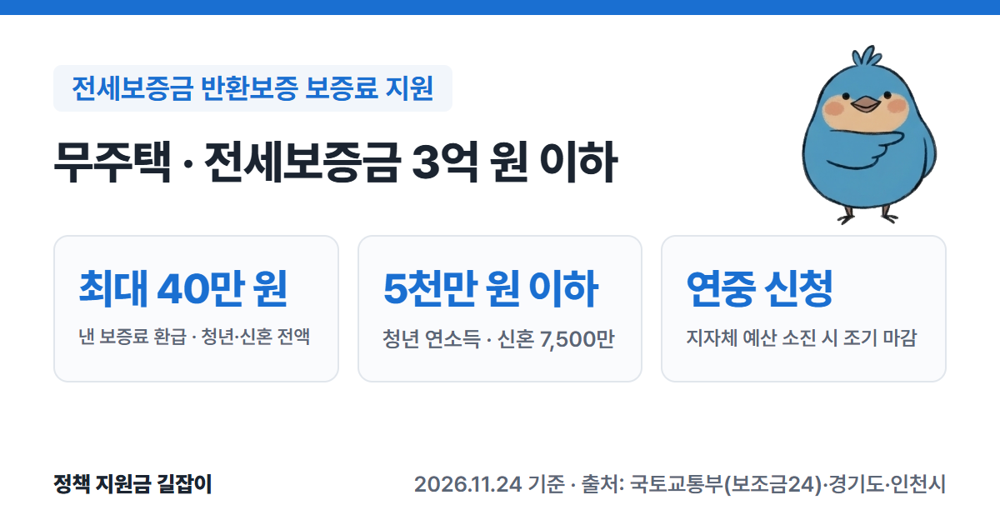
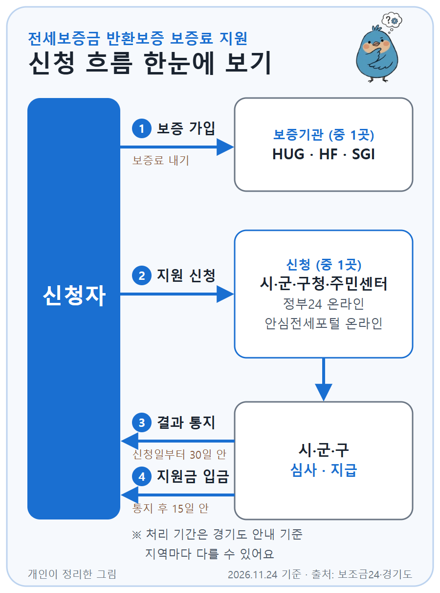

**전세보증금 반환보증 보증료 지원**은 전세 세입자가 보증기관(HUG·HF·SGI)의 반환보증에 가입하면서 낸 보증료를 시·군·구가 돌려주는 제도예요.
국토교통부 사업이고, 신청과 지급은 사는 곳 시·군·구가 맡아요.
이미 낸 보증료를 **나중에 돌려받는 방식**이라 반환보증에 먼저 가입해야 해요. 국토교통부(보조금24)와 경기도·인천시 안내를 바탕으로 정리했어요.

{: .summary-card}

> 💡 **핵심 요약**
> - 전세보증금 **3억 원 이하** 무주택 세입자가 반환보증에 가입해 낸 보증료를 **최대 40만 원**까지 돌려받아요. 청년·신혼부부는 낸 보증료 **전액**, 그 밖의 세입자는 **90%**예요. (출처①②)
> - 연소득 기준은 청년 **5천만 원**, 신혼부부 **7,500만 원**, 그 밖의 세입자 **6천만 원** 이하예요. (출처①②)
> - 신청은 **연중** 받지만 지자체 예산이 떨어지면 **일찍 마감**돼요. 시·군·구청·주민센터나 정부24에서 신청해요. (출처①②③)

> **출처 표시 방법**: 본문의 (출처①) 같은 표시는 글 끝 출처 목록의 번호와 같아요.

목차

* 목차
{:toc}

## 한눈에 보기

| 항목 | 내용 |
|---|---|
| 대상 | 반환보증(HUG·HF·SGI)에 가입한 **무주택** 세입자 전세보증금 **3억 원 이하** |
| 소득 | 연소득 청년 **5천만 원** 신혼부부 **7,500만 원** 그 밖 **6천만 원** 이하 |
| 금액 | 낸 보증료 **최대 40만 원** 청년·신혼부부 전액, 그 밖 **90%** |
| 기간 | **연중** (지자체 예산 소진 시 조기 마감) |
| 신청 | 시·군·구청·주민센터 방문 정부24·안심전세포털 온라인 |

(출처①②③)

## 누가 받을 수 있나요?

아래 조건을 **모두** 갖춘 세입자예요. (출처①②)

- 신청일 기준으로 보증 효력이 남아 있는 **전세보증금 반환보증**에 가입했어요. 보증기관은 주택도시보증공사(**HUG**), 한국주택금융공사(**HF**), 서울보증보험(**SGI**)이에요.
- 임차보증금이 **3억 원 이하**예요.
- **무주택** 세입자예요. 경기도 안내에는 신청자나 배우자가 주택(분양권·입주권 포함)을 갖고 있으면 지원에서 뺀다고 되어 있어요. (출처②)
- 연소득이 아래 기준 이하예요.

| 구분 | 연소득 기준 |
|---|---|
| 청년 | **5천만 원** 이하 |
| 신혼부부 | **7,500만 원** 이하 |
| 그 밖의 세입자 | **6천만 원** 이하 |

(출처①②)

### 청년·신혼부부는 이렇게 봐요

- **청년**: 「청년기본법」에 따라 사는 **지자체 조례**에서 정한 나이예요. 그래서 지역마다 달라요. 경기도는 **19~39세**, 인천시는 **만 18세 이상 39세 이하**로 안내하고 있어요. (출처②③④)
- **신혼부부**: 신청일 기준 **혼인신고일로부터 7년 이내**인 부부예요. 나이는 상관없어요. (출처②)
- 2024년부터 청년이 아닌 세입자도 받을 수 있게 넓어졌어요(경기도 안내: '23년 청년 → '24년 전 연령). (출처②)

### 이런 경우는 못 받아요

- 외국인, 국내에 살지 않는 재외국민 (출처①②)
- 「민간임대주택에 관한 특별법」에 따른 **등록임대사업자의 임대주택**에 사는 세입자 (출처①②)
- 세입자가 **법인**인 경우(회사가 지원하는 숙소 등) (출처①②)
- 이미 지원받은 보증과 **같은 보증서 번호**로 다시 신청하는 경우 (출처①)
- 경기도 안내: 같은 기초지자체에서 **이전 지급일로부터 2년 안에** 다시 신청하는 경우 (출처②)
- 그 밖에 해당 지자체장이 지원이 적합하지 않다고 판단하는 경우 (출처①②)

## 얼마나 받을 수 있나요?

| 구분 | 돌려받는 금액 |
|---|---|
| 청년 세입자 | 낸 보증료 **전액** **최대 40만 원** |
| 신혼부부 세입자 | 낸 보증료 **전액** **최대 40만 원** |
| 그 밖의 세입자 | 낸 보증료의 **90%** **최대 40만 원** |

(출처①②)

- **2025년 3월 30일 이전**에 가입한 보증은 최대 **30만 원**까지예요. (출처①④) 경기도 안내에는 "2025.3.30. 이전 **사업 신청자**"로 적혀 있어 표현이 달라요. 해당하면 시·군·구청에 확인하세요. (출처②)
- 돈은 시·군·구가 **신청인 본인 계좌**로 넣어 줘요. (출처①②)
- 전체 예산 규모는 공식 안내에서 확인하지 못했어요. 지자체마다 예산이 따로 있어서 떨어지면 일찍 마감돼요. (출처①④)

## 어떻게 신청하나요?

1. **반환보증 가입하기**: HUG·HF·SGI 중 한 곳에서 전세보증금 반환보증에 가입하고 보증료를 내요. (출처②)
2. **보증료 지원 신청하기**: 아래 중 한 곳에 신청해요. (출처①②③)
   - 방문: 주소지 **시·군·구청** 또는 **주민센터** (지역마다 접수 창구가 달라 전화하고 가라고 안내돼요. 대구광역시는 온라인 또는 시청 방문이에요)
   - 온라인: **정부24** 또는 **HUG 안심전세포털**
3. **심사 결과 받기**: 경기도 안내 기준으로 시·군·구가 **신청일부터 30일 안에** 결과를 알려 줘요. (출처②)
4. **지원금 받기**: 경기도 안내 기준으로 **결과 통지 후 15일 안에** 본인 계좌로 들어와요. (출처②)

{: .flow-chart}

보조금24에는 접수 후 심사를 거쳐 **30일 안에** 지급하고, 기간 연장이 필요하면 신청인에게 알린 뒤 **15일** 연장할 수 있다고 적혀 있어요(출처①). 구리시는 자격 심사에 **최대 45일**이 걸린다고 안내해서, 지역마다 처리 기간이 달라요. (출처③)

### 서류

| 구분 | 서류 |
|---|---|
| 신청서 | 보증료 지원 신청서, 서약서 |
| 보증 | 반환보증 **보증서**(보증기관 날인) 보증료 납부 증빙(HUG·SGI는 보증서에 보증료가 적혀 있어 따로 안 내도 돼요) |
| 집 | 임대차계약서, 부동산 등기사항전부증명서 |
| 가족 | 주민등록등본, 혼인관계증명서(구리시 안내: 미혼도 내요) |
| 소득 | 소득금액증명원·근로소득 원천징수영수증 등 중 1개 결혼했다면 **배우자 소득 서류도** |
| 계좌 | 본인 명의 통장 사본 |

(출처①②③)

- 모든 서류는 **신청일 기준 3개월 안에** 뗀 것이어야 해요. (출처①②)
- 소득이 없어 소득금액증명이 안 나오면 **'사실증명(신고사실없음)'**을 내요. (출처①)
- 보증 가입 때 이 사업을 위한 **제3자 정보제공에 동의**했다면, 신청서와 서약서만 내면 된다고 안내돼 있어요. (출처①)

## 놓치기 쉬운 점

- **보증에 먼저 가입해야 해요.** 이 제도는 이미 낸 보증료를 돌려주는 방식이에요. 신청일에 보증 효력이 남아 있어야 하니, 보증이 끝나기 전에 신청하세요. (출처①②)
- **예산이 떨어지면 마감돼요.** 신청은 연중이지만 지자체별 예산이 떨어지면 일찍 끝나요. 연말이라면 우리 시·군·구가 아직 받는지 먼저 확인하세요. (출처①④)
- **청년 나이는 지역마다 달라요.** 청년은 지자체 조례에서 정한 나이라서, 같은 나이라도 사는 곳에 따라 청년(전액)인지 청년 외(90%)인지 달라질 수 있어요. (출처②③④)
- **등록임대주택이면 집주인에게 청구해요.** 등록임대사업자는 임대보증금보증 가입이 의무예요. 집주인이 가입하지 않아 세입자가 반환보증에 들었다면, 보증료를 임대인에게 청구할 수 있다고 안내돼 있어요. (출처①)

신청 가능 여부와 접수 창구는 주소지 시·군·구청에, 제도 전반은 국토교통부(**1599-0001**)에 먼저 물어보세요. (출처①)

## 자주 묻는 질문

**Q. 월세(보증부 월세)도 받을 수 있나요?**
공식 안내에는 "전세보증금반환보증에 가입한 임차보증금 3억 원 이하" 세입자라고만 되어 있어요. 내 계약이 해당하는지는 주소지 시·군·구청에 확인하세요. (출처①)

**Q. 결혼했으면 연소득은 누구 기준인가요?**
공식 안내에는 결혼했다면 **배우자 소득 서류도 꼭 내라**고 되어 있어요. 소득을 어떻게 합쳐 보는지는 안내에 적혀 있지 않으니 시·군·구청에 확인하세요. (출처①②)

**Q. 작년에 받았는데 올해 또 받을 수 있나요?**
같은 보증서 번호로는 다시 신청할 수 없어요(출처①). 경기도는 같은 기초지자체에서 이전 지급일로부터 2년 안에 다시 신청하면 지원에서 뺀다고 안내해요. (출처②)

## 함께 보면 좋은 글

- [2026 청년 주거 지원 총정리](): 월세·전세대출·공공임대 등 청년 주거 지원을 한눈에
- [청년전용 버팀목 전세자금대출](): 전세보증금을 낮은 금리로 빌리는 방법
- [신혼부부 전용 전세자금대출](): 혼인 7년 이내 부부의 전세대출
- [전세사기 최소보장제](): 이미 전세사기 피해를 입었다면 볼 제도

---

## 출처

1. [정부24 보조금24 - 국토교통부 전세보증금반환보증 보증료 지원 (수정일 2026.5.8.)](https://www.gov.kr/portal/rcvfvrSvc/dtlEx/161300000103) - 대구광역시는 온라인 접수 또는 시청 방문, 대상(유효한 반환보증 HUG·HF·SGI, 임차보증금 3억 원 이하, 연소득 청년 5천만·청년 외 6천만·신혼부부 7.5천만 원 이하 무주택 임차인), 지원금(기납부 보증료 최대 40만 원, '25.3.30 이전 가입 건 최대 30만 원, 청년 외 90%), 신청시기 연중(지자체별 예산 소진 시 조기 마감), 신청방법(시·군·구청·주민센터 방문 또는 온라인, 방문 전 전화), 지급(접수 후 심사 거쳐 30일 이내, 통지 후 15일 연장 가능, 신청인 계좌), 제외대상, 구비서류(3개월 이내 발급, 제3자 정보제공 동의 시 신청서·서약서, 사실증명), 문의 1599-0001 (확인일: 2026-11-24)
2. [경기주거복지포털 - 전세보증금반환보증 보증료 지원](https://housing.gg.go.kr/html/51502.html) - '23년 청년 → '24년 전연령 확대, 청년·신혼부부 기납부 보증료 최대 40만 원·청년 외 90%, 청년(「청년기본법」 제3조 제1호에 따라 지자체 조례 연령, 경기도 19~39세), 신혼부부(신청일 기준 혼인신고일 7년 이내, 연령 무관), 지원제외(신청자·배우자 주택 소유(분양권·입주권 포함), 법인, 외국인·재외국민, 동일 기초지자체 이전 지급일로부터 2년 이내 재신청, 등록임대주택), 신청(시·군·구청·주민센터, 정부24·안심전세포털), 제출서류, 추진절차(심사·결과 통지 신청일부터 30일 이내, 지급 결과통지 후 15일 이내) (확인일: 2026-11-24)
3. [구리시 - 전세보증금반환보증 보증료 지원](https://www.guri.go.kr/youth/contents.do?key=5716) - 관련근거 주거기본법 제15조, 사업기간 2026.1.1.부터 예산 소진 시까지, 청년(청년기본법 제3조 제1호 단서에 따라 시·도 지자체 조례 연령), 혼인관계증명서(미혼도 해당), 자격요건 심사 최대 45일 소요, 온라인(HUG 안심전세포털 또는 정부24)·방문 접수 (확인일: 2026-11-24)
4. [인천주거포털 - 전세보증금반환보증 보증료 지원사업 (최종 업데이트 2026.2.20.)](https://www.incheon.go.kr/housing/hou030104) - 신청기간 연중(지자체별 예산 소진 시 조기 마감), 청년 만 18세 이상 39세 이하(인천시 조례), 최대 40만 원('25.3.31. 이후 보증 가입자, '25.3.30. 이전 가입자 최대 30만 원), 주소지 관할 군·구 접수·지급 (확인일: 2026-11-24)

> 이 글은 **2026년 11월 24일** 기준이에요. 지원 조건과 접수 여부는 지역마다 다를 수 있으니 신청 전에 주소지 시·군·구청이나 정부24에서 꼭 확인하세요.
