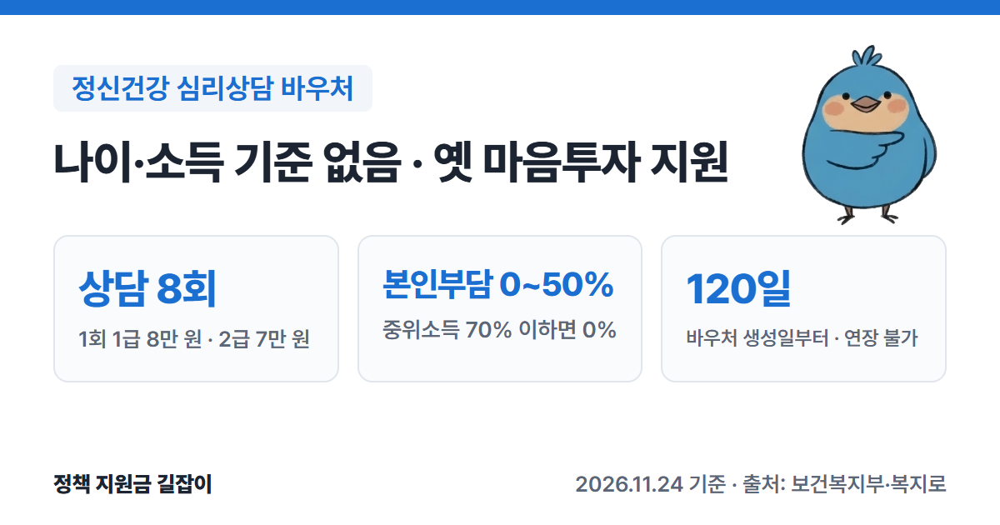
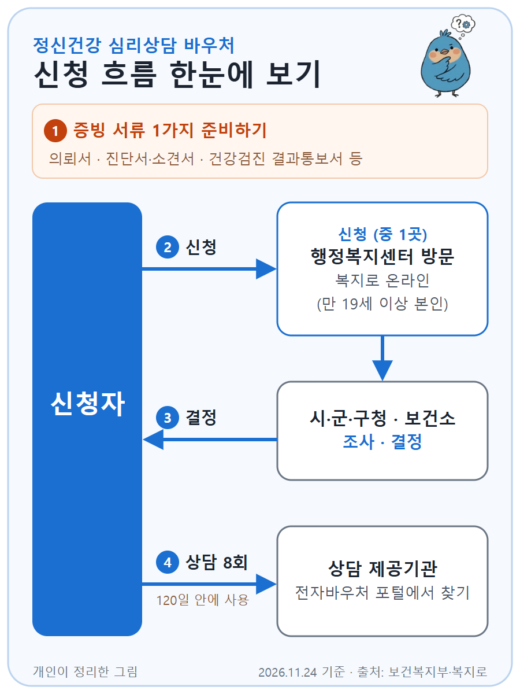

**정신건강 심리상담 바우처**는 우울·불안 같은 마음의 어려움이 있는 사람에게 전문 심리상담 8회를 바우처로 주는 보건복지부 사업이에요.
예전 이름은 **전국민 마음투자 지원사업**이에요(출처④). **나이·소득 기준이 없고**, 소득에 따라 본인부담만 달라져요.
다만 아무나 바로 받는 건 아니고, **의뢰서·소견서·검진 결과** 중 하나로 상담이 필요하다는 걸 보여 줘야 해요. 보건복지부 안내·2026년 사업 지침과 복지로 자료를 바탕으로 정리했어요.

{: .summary-card}

> 💡 **핵심 요약**
> - 우울·불안으로 상담이 필요하다고 인정받으면 **나이·소득과 관계없이** 전문 심리상담 **8회** 바우처를 받아요. 1회 가격은 1급 상담사 **8만 원**, 2급 **7만 원**이에요. (출처①②)
> - 본인부담은 소득에 따라 **0%·10%·30%·50%**예요. 기준 중위소득 **70% 이하**면 본인부담이 없어요. (출처①②)
> - 올해 신청은 **12월 31일**까지이고 지자체 **예산이 떨어지면 일찍 마감**돼요. 바우처는 만들어진 날부터 **120일** 안에 써야 하고 연장되지 않아요. (출처②④)

> **출처 표시 방법**: 본문의 (출처①) 같은 표시는 글 끝 출처 목록의 번호와 같아요.

목차

* 목차
{:toc}

## 한눈에 보기

| 항목 | 내용 |
|---|---|
| 대상 | 우울·불안 등으로 상담이 필요하다고 **인정받은 사람** 나이·소득 기준 **없음** |
| 내용 | 전문 심리상담 **8회** (1회 최소 **50분**) |
| 가격 | 1회 1급 **8만 원** · 2급 **7만 원** |
| 본인부담 | 소득에 따라 **0~50%** |
| 신청 기간 | 2026.1.1.~**12.31.** 예산 소진 시까지 · 선착순 |
| 사용 기간 | 바우처 생성일부터 **120일** |
| 신청 | 주민센터(행정복지센터) 방문 **복지로** 온라인(만 19세 이상 본인) |

(출처①②③④)

## 누가 받을 수 있나요?

우울·불안 등 마음의 어려움이 있는 사람 중 **아래 하나**에 해당하면 돼요. **나이와 소득 기준은 없어요.** (출처①)

| 구분 | 증빙 서류 |
|---|---|
| ① 상담기관이 상담이 필요하다고 인정 | 정신건강복지센터·대학교 상담센터·청소년상담복지센터·Wee센터 등의 **의뢰서** (3개월 이내) |
| ② 정신건강의학과에서 상담이 필요하다고 인정 | 정신건강의학과 의사·한방신경정신과 한의사의 **진단서·소견서** (3개월 이내) |
| ③ 국가건강검진 우울증 검사에서 **10점 이상** | **일반건강검진 결과통보서** (1년 이내) |
| ④ 자립준비청년·보호연장아동 | 보호종료확인서, 시설재원증명서·가정위탁보호확인서 |
| ⑤ 「동네의원 마음건강돌봄 연계 시범사업」으로 의뢰 | 연계의뢰서 (3개월 이내) |
| ⑥ 재난 피해를 입은 본인, 재난으로 사망(실종 포함)한 사람의 유가족 | 피해사실확인서, 피해자 인정결정서 등 |
| ⑦ 정신건강복지센터·자살예방센터 등록회원 | 등록 증명서, 등록 확인서 등 |

(출처①④)

- 재난 피해는 복지로·보조금24 안내에 **신청일로부터 5년 이내**로 적혀 있어요. 유가족은 배우자(사실혼 포함), 직계존비속, 형제자매예요. (출처②③④)
- **19세 미만**은 보호자 동의가 필요해요. (출처④)

### 의뢰서는 어디서 받나요?

- **국가·공공기관이 운영하는 심리상담센터**도 의뢰서를 써 줄 수 있어요. 예: 고용노동부 근로자건강센터, 직업트라우마센터, 고용복지플러스센터(심리안정지원 프로그램). (출처①)
- **국공립·사립 대학교 상담센터** 모두 가능해요. (출처①)
- 이 사업에 **제공기관으로 참여해 상담 중인 기관**은 의뢰서를 써 줄 수 없어요. (출처④)
- **사설 심리상담센터**의 의뢰서는 인정되지 않아요. 스스로 상담을 받고 싶다면 의뢰서를 써 줄 수 있는 센터를 찾아가라고 안내돼 있어요. (출처①)
- 국가건강검진의 우울증 검사는 **20~34세는 2년마다**, **35세부터는 10년마다** 받아요. 결과는 국민건강보험공단 누리집('건강모아')의 건강검진 결과조회에서 뽑을 수 있어요. (출처①④)

### 이런 경우는 못 받아요

- 약물·알코올 중독, 중증 정신질환(예: 조현병), 급박한 자살 위기처럼 **정신건강의학과 진료가 먼저 필요한 경우** (출처①)
- 지역사회서비스 투자사업의 아동청소년 심리지원·정서발달 지원, 정신건강토탈케어, 성인 심리지원서비스, 일상돌봄 서비스, 발달장애인 부모상담서비스를 **이미 받고 있는 경우** (출처①④)

## 얼마나 받을 수 있나요?

상담 **8회**를 바우처로 받고, 1회 가격에서 정부지원금을 뺀 나머지를 본인이 내요. (출처①)

### 소득별 본인부담률

| 기준 중위소득 | 본인부담률 |
|---|---|
| **70% 이하** | **0%** |
| 70% 초과~**120%** 이하 | **10%** |
| 120% 초과~**180%** 이하 | **30%** |
| **180%** 초과 | **50%** |

(출처①②)

- 소득은 **신청일 기준 전달 건강보험료 부과액**으로 따져요. (출처②)
- 자립준비청년·보호연장아동, 법정 한부모가족은 본인부담이 **0%**예요. (출처①) 복지로 안내에는 기초생활수급자·차상위계층·재난 피해자도 0%로 적혀 있어요. 해당하면 신청할 때 주민센터에 확인하세요. (출처②)

### 8회 모두 쓰면 내는 돈

| 소득 구분 | 1급 상담사 (회당 8만 원) | 2급 상담사 (회당 7만 원) |
|---|---|---|
| 70% 이하 | **0원** | **0원** |
| 70~120% | **6만 4천 원** | **5만 6천 원** |
| 120~180% | **19만 2천 원** | **16만 8천 원** |
| 180% 초과 | **32만 원** | **28만 원** |

(출처①②) 8회 전체 가격은 1급 **64만 원**, 2급 **56만 원**이고 나머지는 정부가 내요.

- **1급·2급**은 상담사 자격으로 나눠요. 예를 들어 정신건강전문요원·청소년상담사·전문상담교사 **1급**은 1급 유형, 같은 자격 **2급**과 임상심리사 1급은 2급 유형이에요. (출처①)

## 어떻게 신청하나요?

1. **증빙 서류 준비하기**: 의뢰서, 진단서·소견서, 건강검진 결과통보서 등 내 경우에 맞는 서류 **1가지**를 준비해요. (출처①)
2. **신청하기**: 아래 중 한 곳에서 신청해요. (출처①)
   - 방문: 주민등록상 또는 **실제 사는 곳 읍·면·동 행정복지센터**
   - 온라인: **복지로**(만 19세 이상 **본인만** 가능)
3. **조사·결정**: 시·군·구청이나 보건소 담당 부서가 조사·심사하고 결정해요. 지침에는 **신청일부터 14일 안에** 선정 결과를 알려 준다고 되어 있어요. 예산 범위 안에서 **선착순**이에요. (출처②④)
4. **상담기관 고르고 상담받기**: 사회서비스 전자바우처 포털에서 제공기관을 찾아 상담을 받아요. 바우처는 만들어진 날부터 **120일** 안에 써야 해요. (출처①②)

{: .flow-chart}

### 서류

| 구분 | 서류 |
|---|---|
| 신청서 | 사회보장급여(사회서비스이용권) 신청(변경)서 |
| 동의서 | 사회서비스 이용자 준수사항 안내확인 동의서 |
| 증빙 | 대상 구분에 맞는 증빙서류 **1개** |

(출처①)

- 본인이 아니어도 **친족**(배우자, 8촌 이내 혈족, 4촌 이내 인척), **법정대리인**이 신청할 수 있고, **담당 공무원**이 직권으로 신청할 수도 있어요. (출처①)

## 놓치기 쉬운 점

- **사설 상담센터 의뢰서는 안 돼요.** 의뢰서는 정신건강복지센터, 대학교 상담센터, 공공기관 상담센터 등에서 받아야 해요. 사설 심리상담센터는 의뢰서 발급기관에서 빠져 있어요. (출처①)
- **서류 유효기간을 확인하세요.** 의뢰서·진단서·소견서는 신청일 기준 **3개월 이내**, 건강검진 결과통보서는 **1년 이내**여야 해요. (출처①)
- **예산이 떨어지면 일찍 마감돼요.** 올해 신청 기간은 12월 31일까지지만 예산 소진 시까지라서, 연말에는 주민센터에 아직 받는지 먼저 확인하세요. (출처④)
- **120일이 지나면 남은 회차가 사라져요.** 바우처는 생성일부터 120일간이고 연장되지 않아요. 기간이 지나면 바우처가 소멸돼 결제할 수 없어요. (출처②④)
- **한 해에 한 번만 신청할 수 있어요.** 복지로 안내에 "당해연도 사업은 1회만 신청 가능(재신청 불가)"이라고 되어 있어요. (출처②)

내가 대상인지, 의뢰서를 어디서 받을지 모르겠다면 보건복지상담센터(**129**)에 먼저 물어보세요. (출처②③)

## 자주 묻는 질문

**Q. 소득이 높으면 못 받나요?**
아니요. 나이·소득 기준은 없어요. 소득은 본인부담률을 정하는 데만 쓰여서, 기준 중위소득 180%를 넘으면 본인부담이 50%예요. (출처①②)

**Q. 상담센터는 아무 곳이나 가도 되나요?**
바우처 제공기관으로 등록된 곳이어야 해요. 제공기관은 사회서비스 전자바우처 포털(socialservice.or.kr) 서비스안내에서 찾을 수 있어요. (출처①④)

**Q. 정신건강의학과 치료를 받고 있어도 되나요?**
보건복지부 안내에 정신건강의학과 치료 중이거나 치료가 끝난 뒤에도 의사가 심리상담이 필요하다는 소견을 주면 신청할 수 있다고 되어 있어요. (출처①)

## 함께 보면 좋은 글

- [2026 생활비 지원 총정리](): 생활비·의료비 부담을 줄이는 지원을 상황별로
- [2027 기준 중위소득 정리](): 기준 중위소득이 무엇인지 확인 (올해 신청은 2026년 기준, 건강보험료로 판정)
- [국민취업지원제도](): 구직 중이라면 생활비와 취업 지원을 함께

---

## 출처

1. [보건복지부 - 정신건강 심리상담 바우처사업 (정책 > 건강 > 정신건강정책)](https://www.mohw.go.kr/menu.es?mid=a10706040800) - 사업 목적, 서비스 대상 ①~⑤와 증빙서류(나이 및 소득 기준 없음, 국가·공공기관 상담센터·국공립·사립 대학교 상담센터 의뢰서 가능, 사설 심리상담센터 제외, 정신건강의학과 치료 중·종료 후 의사 소견 시 신청 가능, 우울증 선별검사 20~34세 2년·35세부터 10년 주기, 건강iN 결과조회), 지원대상 제외, 8회 바우처, 1회 1급 8만 원·2급 7만 원, 본인부담률 가 0%·나 10%·다 30%·라 50%, 자립준비청년·보호연장아동·법정한부모가족 0%, 1급·2급 정부지원금·본인부담금 표(8회 640,000원/560,000원), 서비스 유형별 자격, 제공기관(사회서비스 전자바우처 포털), 신청권자, 신청방법(읍·면·동 행정복지센터 또는 복지로, 온라인은 만 19세 이상 본인만), 신청서류 (확인일: 2026-11-24)
2. [복지로 - 정신건강 심리상담 바우처사업 (보건복지부 자살예방정책과, 2026년)](https://www.bokjiro.go.kr/ssis-tbu/twataa/wlfareInfo/moveTWAT52011M.do?wlfareInfoId=WLF00005567) - 1회 최소 50분 8회, 바우처 생성일로부터 120일(연장 불가), 당해연도 1회만 신청 가능, 본인부담률 기준 중위소득 70% 이하 0%·70% 초과~120% 이하 10%·120% 초과~180% 이하 30%·180% 초과 50%, 기초생활수급자·차상위계층·자립준비청년·보호연장아동·법정한부모가족·재난피해자 0%, 신청일 기준 전월 건강보험료 부과액으로 산정, 재난피해자 대상, 시·군·구청·보건소 조사·결정, 문의 129 (확인일: 2026-11-24)
3. [정부24 보조금24 - 전국민 마음투자 지원 (보건복지부, 수정일 2026.4.21.)](https://www.gov.kr/portal/rcvfvrSvc/dtlEx/135200005045) - 나이 및 소득 기준 없음, 재난 피해자 대상(신청일로부터 5년 이내), 상시신청, 문의 129. 이 쪽의 본인부담 "0%~30%" 문구는 보건복지부·복지로 2026년 안내(0~50%)와 달라 글에 쓰지 않음 (확인일: 2026-11-24)
4. [보건복지부 - (지침) 2026년 정신건강 심리상담 바우처사업 안내 (자살예방정책과, 2026.1.21. 게시)](https://mohw.go.kr/board.es?act=view&bid=0026&list_no=1488771&mid=a10409020000) - 게시글 "2026년 정신건강 심리상담 바우처사업(구 전국민 마음투자 지원사업)", 신청 기간 '26.1.1.~12.31.(예산 소진 시까지), 예산 범위 내 선착순, 대상 ⑥ 재난피해자·⑦ 정신건강복지센터·자살예방센터 등록회원, 19세 미만 보호자 동의, 제공기관 참여 기관 의뢰서 발급 제외, 건강모아 결과조회, 일상돌봄·발달장애인 부모상담서비스 이용자 제외, 신청일로부터 14일 내 선정 결과 통지, 120일 이후 바우처 소멸, 제공기관 등록 (확인일: 2026-11-24)

> 이 글은 **2026년 11월 24일** 기준이에요. 지원 조건은 바뀔 수 있으니 신청 전에 주민센터나 보건복지상담센터(129)에서 꼭 확인하세요.
