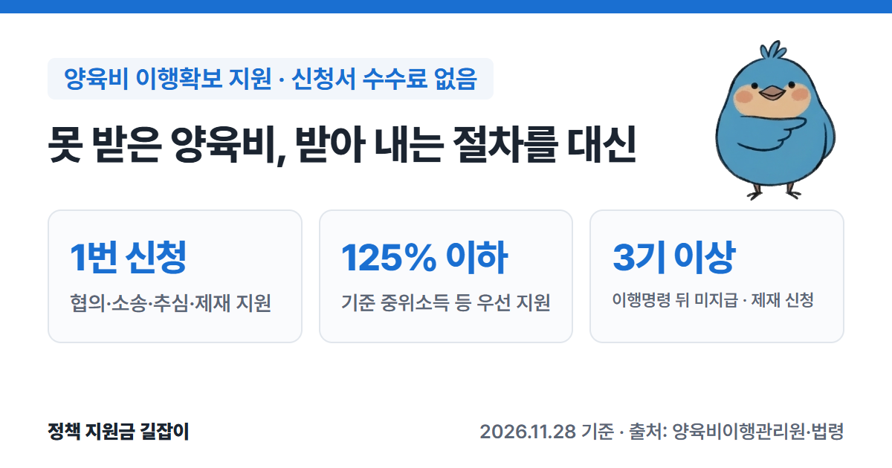
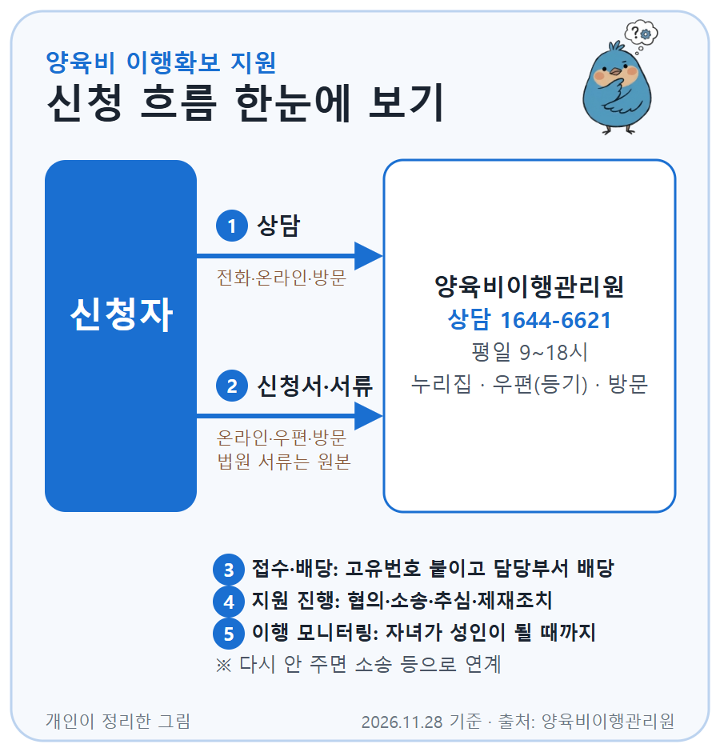

**양육비 이행확보 지원**은 따로 사는 부모(비양육부·모)가 양육비를 주지 않을 때, 양육비이행관리원이 협의부터 소송, 재산 추심, 제재조치까지 대신 진행해 주는 서비스예요.
법원 판결이 아직 없어도 신청할 수 있어서, 양육비 선지급을 받기 전 단계에서도 쓸 수 있어요. 법령과 양육비이행관리원 안내를 바탕으로 대상, 지원 내용, 서류, 신청 방법을 정리했어요.

{: .summary-card}

> 💡 **핵심 요약**
> - 양육비를 못 받고 있는 양육부·모는 양육비이행관리원에 **한 번 신청**하면 협의, 양육비 소송, 추심, 제재조치까지 지원받을 수 있어요. 신청서 **수수료는 없어요**. (출처①②⑤)
> - 수급자·차상위계층·한부모가족 지원대상자, 가구 소득 **기준 중위소득 125% 이하**인 사람을 **우선** 지원해요. (출처③④)
> - 이행명령을 받고도 **3기 이상** 안 주거나 밀린 돈이 **3천만 원 이상**이면 운전면허 정지·출국금지·명단공개를 신청할 수 있어요. (출처⑥⑦)

> **출처 표시 방법**: 본문의 (출처①) 같은 표시는 글 끝 출처 목록의 번호와 같아요.

목차

* 목차
{:toc}

## 한눈에 보기

| 항목 | 내용 |
|---|---|
| 대상 | 만 19세 미만 자녀를 키우는 **양육부·모**(양육비 채권자) 이혼·비혼 한부모, 조손가족 등 |
| 지원 | 협의, **양육비 소송**, **추심**, **제재조치** 상담, 면접교섭, 이행 모니터링 |
| 기간 | **상시 신청** (출처⑨) |
| 방법 | 양육비이행관리원 누리집, 우편(등기), 방문 상담 **1644-6621** |

(출처①②)

## 누가 받을 수 있나요?

**양육비를 받지 못하고 있는 양육부·모**(양육비 채권자)가 신청해요. 양육비이행관리원은 아래처럼 안내해요. (출처①)

- **만 19세 미만 자녀**를 키우는 한부모·조손가족·그 밖의 실질적 양육자 (출처①)
- 「한부모가족지원법」 지원대상인 한부모·조손가족은 **취학 중인 만 22세 미만 자녀**도 포함돼요. 군 복무 뒤 복학했다면 22세에 복무기간을 더해요. (출처①)
- **이혼한 부모뿐 아니라 미혼모·미혼부**도 지원해요. 미혼모는 친자 확인 소송(인지청구)부터 지원해요. (출처①)
- 상담은 비양육부·모나 일반인도 받을 수 있지만, 신청에 따른 이행확보 지원은 **양육부·모와 양육비 채권자**만 받아요. (출처②③)

### 소득 기준: 우선 지원 대상

법에는 아래 사람을 **우선** 지원하도록 정해져 있어요. 신청이 너무 많거나 절차가 늦어지는 등 정당한 사유가 있으면 예외예요. (출처④)

| 우선 지원 | 확인 방법 |
|---|---|
| 기초생활 **수급자** | 수급자증명서 |
| **차상위계층** | 차상위계층확인서 |
| **한부모가족** 지원대상자 | 한부모가족증명서 |
| 가구 소득 **중위소득 125% 이하** | 성인 가구원 건강보험료 등 |

(출처③④⑤)

양육비이행관리원 누리집 지원대상 안내에도 "기준 중위소득 125% 이하(단, 한부모/차상위/국민기초생활수급자는 지원 대상)"라고 적혀 있어요. 한부모·차상위·수급자 증명서를 내면 125% 이하로 판단해요. (출처①③)

소득이 125%를 넘는다면 신청 전에 상담센터(1644-6621)에 지원 가능 여부를 먼저 물어보세요. (출처②)

## 얼마나 받을 수 있나요?

돈을 직접 주는 제도가 아니라, **양육비를 받아 내는 절차를 대신 해 주는** 서비스예요. 한 번 신청하면 단계마다 다른 기관을 찾아다니지 않아도 돼요. (출처①)

| 지원 | 하는 일 |
|---|---|
| 협의 성립 | 양쪽 부모가 양육비를 합의하도록 지원 |
| 법률지원 | 판결이 없으면 **양육비 청구 소송**, 비혼이면 **인지청구 소송** 친권자·양육자 지정(변경) 청구도 |
| 추심지원 | 이행명령·직접지급명령 등 신청 재산(급여·예금·보험·보증금 등) **압류·강제경매** |
| 제재조치 | 채무불이행자명부 등재 신청, **세금 환급금 압류** 운전면허 정지·출국금지·명단공개 신청 |
| 조사 | 상대방 주소·근무지, 소득·재산 조사 |
| 면접교섭 | 가족센터와 함께 아이와 비양육부·모의 만남 지원 |
| 모니터링 | 자녀가 **만 19세**가 될 때까지 지급 여부 점검 |

(출처②⑤⑥)

### 비용은 드나요?

- 법정 신청서 서식에 **수수료 "없음"**으로 적혀 있고, 신청 서류에 **무료 법률지원 계약서**가 들어 있어요. (출처⑤)
- 법에는 국가가 법률지원 등에 드는 비용의 **전부 또는 일부**를 예산 범위에서 지원할 수 있다고 정해져 있어요. (출처④)
- 신청인이 지원대상이 아니거나, 상의 없이 다른 변호사를 선임하는 등 계약서에 적힌 사유로 법률지원이 끝나면, 이미 쓴 소송비용 등의 전부 또는 일부를 청구할 수 있다고 계약서에 적혀 있어요. (출처⑤)
- 예산이 부족하거나 소진되면 수급자·차상위·한부모가족 지원대상자·중위소득 125% 이하 신청인을 우선 지원할 수 있어요. (출처⑤)

### 상대방이 계속 안 주면: 제재조치

법원에서 **이행명령** 또는 **일시금 지급명령** 결정을 받고도 양육비를 안 주는 사람 중 아래에 해당하면, 성평등가족부가 심의를 거쳐 제재를 요청할 수 있어요. (출처⑦)

- 일시금 지급명령을 받고 **30일 안에** 주지 않은 사람 (출처⑦)
- 이행명령에 따라 줘야 할 양육비 중 안 준 돈이 **3천만 원 이상**인 사람 (출처⑦)
- 정기적으로 주라는 이행명령을 받고 **3기 이상** 주지 않은 사람 (출처⑦)

예전에 감치결정을 받은 경우도 신청 요건으로 안내돼 있으니 1644-6621에 물어보세요. (출처⑥)

| 제재 | 내용 |
|---|---|
| 운전면허 정지 | 경찰청 · **100일** |
| 출국금지 | 법무부 · **6개월 이내**(연장 가능) |
| 명단공개 | 성평등가족부 · **3년** |

(출처⑥⑦)

- 운전면허를 직접적인 생계유지에 쓰고 있어 정지하면 생계가 어려운 경우에는 운전면허 정지를 요청하지 않아요. (출처⑦)
- 양육비를 전부 주면 제재가 풀려요. 명단은 채무자가 사망하거나 회생·파산 결정을 받은 경우 등에도 공개하지 않거나 지워요. (출처⑥⑦)

### 예시로 계산해 보면

아래는 위 공식 기준표와 시행령 기준을 그대로 대입한 예시예요. 실제 판단은 양육비이행관리원과 위원회 심의로 정해요.

- **엄마와 아이 1명(2인 가구), 엄마가 직장가입자**: 2026년 소득판정기준표에서 중위소득 125%는 직장가입자 건강보험료 월 **188,706원**이에요. 이 금액 이하면 우선 지원 소득 기준에 들어요. (출처③)
- **엄마와 아이 2명(3인 가구), 직장가입자**: 기준은 건강보험료 월 **240,822원**이에요. (출처③)
- **이행명령으로 매달 50만 원을 받기로 했는데 3번 연속 안 준 경우**: 밀린 돈은 150만 원이라 3천만 원에는 못 미치지만, "3기 이상 미이행" 기준에 해당해 제재 신청을 검토할 수 있어요. (출처⑦)
- **같은 경우 3천만 원 기준만 본다면**: 월 50만 원 × 60번 = 3천만 원이 밀려야 해요. 월 50만 원이라면 3기 기준에 먼저 해당돼요. (출처⑦)

## 어떻게 신청하나요?

1. **상담하기**: 양육비 상담센터 **1644-6621**(평일 9~18시), 누리집 온라인 상담, 예약 방문 상담 중 편한 방법으로 상담해요. (출처②)
2. **신청서·서류 내기**: 누리집에서 회원가입 후 온라인으로 신청하거나, 우편(등기)·방문으로 내요. 지원 유형(협의 성립·법률지원·추심지원)을 고르거나 관리원에 맡길 수 있어요. (출처①⑤)
   - 법원에 내야 하는 기본증명서, 혼인관계증명서, 가족관계증명서, 집행권원, 집행문, 송달증명원, 확정증명원은 **원본**을 우편이나 방문으로 내야 해요. (출처①)
3. **접수·배당**: 양육비이행관리원이 신청 건에 고유번호를 붙이고 담당부서에 배당해 지원을 시작해요. (출처①)
4. **지원 진행**: 협의, 소송, 추심, 제재조치 등을 상황에 맞게 진행해요. 신청서에서 원한다고 표시하면 법원 절차 전에 상대방과 합의부터 시도해요. (출처②⑤⑥)
5. **이행 모니터링**: 양육비를 주기로 약속받은 뒤에도 자녀가 성인이 될 때까지 지급 여부를 점검하고, 다시 안 주면 소송 등으로 연계해요. (출처②)

{: .flow-chart}

### 준비할 서류

| 구분 | 서류 |
|---|---|
| 공통 | 신청서식 일체, 신분증 사본, 통장 사본 기본증명서(신청인·자녀), 혼인관계증명서 가족관계증명서(신청인·자녀), 주민등록등본 |
| 소득 | 건강보험료 납부확인서 등 한부모·차상위·수급자 증명서를 내면 생략 |
| 판결 있으면 | 집행권원(판결문·양육비부담조서 등) 정본 집행문, 송달·확정증명원 |

(출처①⑤)

- 주민센터에서 떼는 서류는 '상세'로, 주민등록번호 뒷자리가 보이게, 발급일부터 3개월 안 된 것을 내요. (출처①)
- 2009년 8월 이전에 협의 이혼해서 집행권원이 없다면 집행권원은 내지 않아도 돼요. (출처①)

## 놓치기 쉬운 점

- **법원 서류는 원본을 우편이나 방문으로 내야 접수가 끝나요.** 온라인 신청만으로는 부족해요. 기본증명서·혼인관계증명서·가족관계증명서·집행권원·집행문·송달증명원·확정증명원이 여기에 해당해요. (출처①)
- **연락이 끊기면 신청을 취하한 것으로 볼 수 있어요.** 보완 요청에 응하지 않거나 3개월 이상 연락이 안 되면 사건을 진행하지 않을 수 있어요. 연락처·주소가 바뀌면 바로 알려야 해요. (출처⑤)
- **승소 가능성이나 받아 낼 재산이 없으면 지원이 중단될 수 있어요.** 사실조사 결과 지원의 실익이나 타당성이 없으면 법률지원·추심지원을 멈출 수 있어요. (출처④⑤)
- **추심지원과 법률지원(증액 청구)은 동시에 받을 수 없어요.** 판결이 있는데 밀린 돈 추심과 양육비 증액을 같이 원하면, 신청서에서 먼저 받을 서비스를 골라요. 고르지 않으면 추심지원을 먼저 해요. (출처⑤)

상대방 정보(주소, 직장, 재산, 주거래 은행 등)를 아는 만큼 신청서 진술서에 자세히 적을수록 절차가 빨라져요. 궁금한 점은 양육비 상담센터 **1644-6621**에 먼저 물어보세요. (출처②⑤)

## 자주 묻는 질문

**Q. 판결이나 양육비부담조서가 없어도 신청할 수 있나요?**
네. 집행권원이 없으면 양육비 청구 소송(비혼이면 인지청구 소송 포함)부터 지원해요. 신청서에서 집행권원 "무"를 고르면 돼요. (출처②⑤)

**Q. 양육비 선지급과 같은 제도인가요?**
아니에요. 선지급은 국가가 자녀 1명당 매달 양육비를 먼저 주는 제도이고, 이행확보 지원은 상대방에게서 양육비를 받아 내는 절차를 지원해요. 선지급은 양육비 집행권원(양육비부담조서, 판결문 등)이 있어야 하고, 이행관리원에 법률지원·추심지원을 신청했거나 소송 등이 끝났거나 진행 중이어야 해요. 그래서 판결이 없다면 이행확보 법률지원을 먼저 상담해 보세요. 자세한 내용은 [양육비 선지급제 글]()에서 확인하세요. (출처⑧)

**Q. 상대방이 어디 사는지 몰라도 되나요?**
양육비이행관리원은 관계기관에 자료를 요청해 상대방의 주소·근무지와 소득·재산을 조사할 수 있어요. 상대방이 조회에 동의하지 않으면 법원에 재산명시·재산조회를 신청해요. (출처②)

## 함께 보면 좋은 글

- [2026 양육비 선지급제](): 판결은 있는데 양육비를 못 받을 때 국가가 자녀 1인당 월 최대 20만 원을 먼저 주는 제도
- [한부모가족 아동양육비](): 중위소득 65% 이하 한부모·조손가족 자녀 1인당 월 23만 원
- [기저귀·조제분유 지원](): 한부모 가정 등 만 2세 미만 아기 기저귀·분유값 바우처

---

## 출처

1. [양육비이행관리원 - 양육비 이행확보 지원이란?](https://www.childsupport.or.kr/lay1/S1T8C9/contents.do) · [지원대상](https://www.childsupport.or.kr/lay1/S1T10C11/contents.do) · [지원 신청 방법](https://www.childsupport.or.kr/lay1/S1T10C12/contents.do) · [제출서류](https://www.childsupport.or.kr/lay1/S1T10C13/contents.do) - 1회 신청 종합지원, 만 19세 미만 자녀 양육 한부모·조손가족·실질적 양육자, 한부모가족지원법 대상 취학 중 만 22세 미만(군 복무 기간 가산), 미혼모·미혼부 지원·인지청구부터, 기준 중위소득 125% 이하(한부모/차상위/수급자는 지원 대상), 온라인·우편(등기)·방문 신청, 고유번호 부여·담당부서 배당, 법원 제출 서류 원본 등기우편, 주민센터 서류 상세·뒷자리 표기·3개월 미만, 2009년 8월 이전 협의이혼 집행권원 미제출 (확인일: 2026-11-28)
2. [양육비이행관리원 - 사업안내: 법률지원](https://www.childsupport.or.kr/lay1/S1T15C16/contents.do) · [추심지원](https://www.childsupport.or.kr/lay1/S1T15C17/contents.do) · [상담지원](https://www.childsupport.or.kr/lay1/S1T15C19/contents.do) · [양육지원(면접교섭·모니터링)](https://www.childsupport.or.kr/lay1/S1T15C20/contents.do) · [조사정보지원](https://www.childsupport.or.kr/lay1/S1T15C120/contents.do) - 양육비·인지청구·친권자 및 양육자 지정(변경) 소송, 이행명령·직접지급명령 등, 부동산·급여·예적금·보험·임대차보증금 압류·강제경매, 채무불이행자명부 등재·세금환급금 압류, 상담 1644-6621(월~금 9~18시)·방문(예약, 9~11시·13~17시, 하루 30분)·온라인(접수 다음 날부터 7일 이내 답변), 이행확보 지원은 양육부·모와 양육비 채권자만, 가족센터 면접교섭, 자녀 성인까지 모니터링, 주소·근무지·소득·재산 조사(부동의 시 법원 재산명시·재산조회) (확인일: 2026-11-28)
3. [양육비이행관리원 - 자주 묻는 질문(기준 중위소득 125% 이하 계산, 2026년 건강보험 납부자료에 따른 소득판정기준표)](https://www.childsupport.or.kr/lay1/bbs/S1T43C48/E/6/list.do) - 성인 세대원 건강보험료 등으로 계산, 한부모/차상위/수급 증명서 제출 시 125% 이하로 판단, 125% 직장가입자 2인 188,706원·3인 240,822원, 신청에 의한 지원은 양육부·모와 양육비 채권자 대상 (확인일: 2026-11-28)
4. [국가법령정보센터 - 양육비 이행확보 및 지원에 관한 법률](https://www.law.go.kr/법령/양육비이행확보및지원에관한법률) · [시행규칙](https://www.law.go.kr/법령/양육비이행확보및지원에관한법률시행규칙) - 법 제11조(법률지원·추심지원 신청, 제3항 비용 전부 또는 일부 예산 범위 지원), 제22조(수급자·차상위·한부모가족 지원대상자 등 우선 제공, 정당한 사유 예외), 시행규칙 제2조(신청서·첨부서류·문서·팩스·정보통신망 신청), 제4조제2항(승소 가능성 없는 등 실익·타당성 없으면 법률지원 중단), 제10조(가구 소득 기준 중위소득 125% 이하) (2026.10.29. 시행본, 확인일: 2026-11-28)
5. [양육비이행관리원 - 서식 다운로드: 양육비 이행확보 지원 신청서(일체)](https://www.childsupport.or.kr/lay1/S1T23C26/contents.do) - 시행규칙 별지 제1호서식(수수료 없음, 협의성립·법률·채권추심 지원 선택), 무료 법률지원 계약서(종료 사유·이미 지출된 비용 청구 가능·예산 부족 시 우선 지원 대상), 유의사항(3개월 이상 연락 두절 시 취하 간주 가능, 법 제11조제3항 비용 지원, 시행규칙 제4조·제5조 지원 중단, 성년 도달 시 원칙적 중단), 진술서(추심지원과 법률지원 동시 지원 불가, 미선택 시 추심지원 먼저, 법원 절차 전 상대방과 합의 시도 희망 여부 선택), 신청자 제출서류 체크리스트 (확인일: 2026-11-28)
6. [양육비이행관리원 - 제재조치 안내](https://www.childsupport.or.kr/lay1/S1T15C121/contents.do) - 운전면허정지(경찰청 100일), 출국금지(법무부 6개월 이내 연장 가능), 명단공개(성평등가족부 3년), 양육비 전부 이행 시 해제, 신청 서류는 양육비이행관리원에 등기우편 (확인일: 2026-11-28)
7. [국가법령정보센터 - 양육비 이행확보 및 지원에 관한 법률 제21조의3~제21조의5](https://www.law.go.kr/법령/양육비이행확보및지원에관한법률) · [시행령 제17조의2~제17조의4](https://www.law.go.kr/법령/양육비이행확보및지원에관한법률시행령) - 일시금 지급명령·이행명령 결정 뒤 미이행자 중 30일 이내 미이행·미이행액 3천만 원 이상·정기 지급 이행명령 3기 이상 미이행, 생계유지 목적 운전면허 예외, 명단 공개 3년·사망·회생·파산 등 제외·삭제 (2026.10.29. 시행본, 확인일: 2026-11-28)
8. [양육비이행관리원 - 선지급제 안내](https://www.childsupport.or.kr/lay1/S1T134C136/contents.do) - 자녀 1인당 최대 20만 원 매월, 만 18세까지, 요건: 만 18세 이하 자녀 양육 양육비 채권자·양육비 집행권원(양육비부담조서, 판결문 등)·직전 3개월 평균 이행액이 선지급금 미만·이행확보 노력(법률지원, 채권추심지원 등을 받았거나 소송 등 절차 종료 또는 진행 중) (확인일: 2026-11-28)
9. [정부24 보조금24 - 양육비 이행 지원 서비스 (성평등가족부, 수정일 2026.8.5.)](https://www.gov.kr/portal/rcvfvrSvc/dtlEx/138300000066) - 신청기한 상시신청 (확인일: 2026-11-28)

> 이 글은 **2026년 11월 28일** 기준이에요. 지원 내용과 기준은 바뀔 수 있으니 양육비이행관리원 누리집이나 1644-6621에서 꼭 확인하세요.
