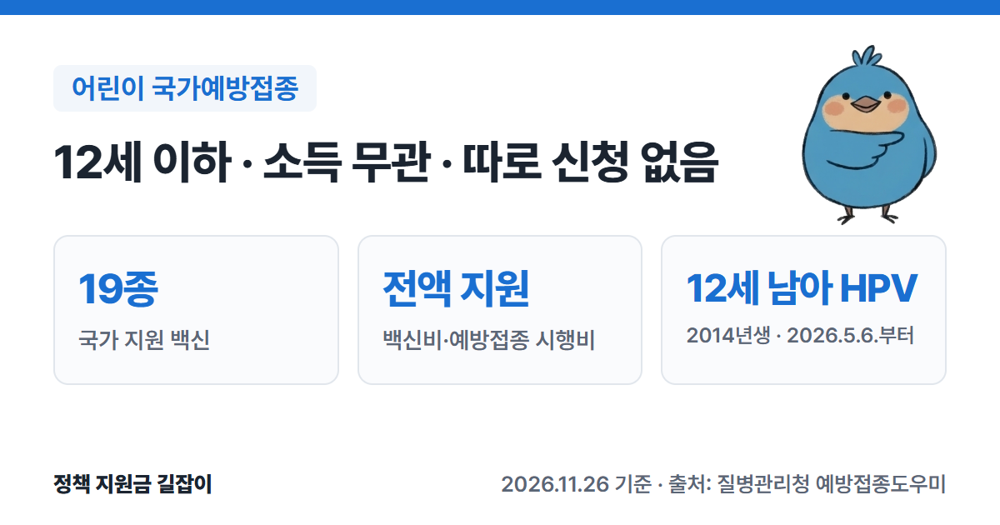
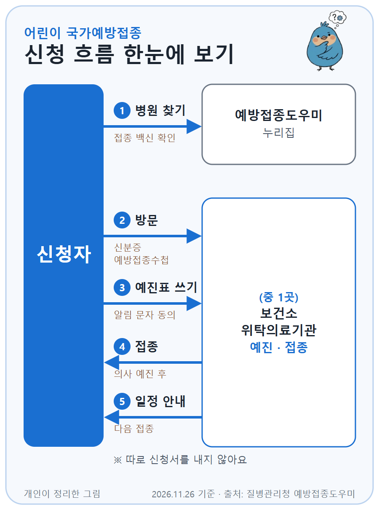

**어린이 국가예방접종**은 꼭 필요한 예방접종을 가까운 병원에서 비용 없이 맞도록 국가가 접종 비용을 내주는 사업이에요. 질병관리청이 운영해요.
따로 신청하지 않고, 신분증과 예방접종수첩을 챙겨 **위탁의료기관이나 보건소**에 가면 돼요.
질병관리청 예방접종도우미 안내와 보도자료를 바탕으로 2026년 기준으로 정리했어요.

{: .summary-card}

> 💡 **핵심 요약**
> - **12세 이하 어린이(2013.1.1. 이후 출생자, 2026년 기준)**는 국가 지원 백신 **19종**을 보건소와 위탁의료기관에서 비용 부담 없이 맞을 수 있어요. 백신비와 예방접종 시행비를 **전액** 지원해요. (출처①)
> - **2026년 5월 6일**부터 **12세 남성 청소년(2014년생)**도 HPV(사람유두종바이러스) 백신을 무료로 맞아요. 여성 청소년은 12~17세가 대상이에요. (출처②③)
> - **위탁의료기관이 아닌 곳**에서 맞거나 국가 지원 밖의 백신(BCG 경피용, 이모젭, HPV 9가)을 고르면 비용을 내야 해요. (출처①③)

> **출처 표시 방법**: 본문의 (출처①) 같은 표시는 글 끝 출처 목록의 번호와 같아요.

목차

* 목차
{:toc}

## 한눈에 보기

| 항목 | 내용 |
|---|---|
| 대상 | **12세 이하** 어린이(2013.1.1. 이후 출생자) 소득 기준 없음 |
| 지원 | 국가 지원 백신 **19종** 백신비·예방접종 시행비 **전액** |
| 기간 | **상시** (백신마다 지원 나이가 달라요) |
| 방법 | 보건소·**위탁의료기관** 방문 신분증·예방접종수첩 지참 |

(출처①)

## 누가 받을 수 있나요?

**12세 이하 어린이(2013.1.1. 이후 출생자, 2026년도 기준)**가 대상이에요. 소득 기준은 없어요. 주소지와 상관없이 전국 보건소와 위탁의료기관에서 맞을 수 있어요. (출처①④)

다만 백신에 따라 지원 나이가 따로 정해져 있어요. (출처①)

| 백신 | 지원 나이 |
|---|---|
| 결핵(BCG 피내용) | 생후 **59개월**까지 3개월 이상은 TST 결과 음성일 때 |
| Hib·폐렴구균 | 생후 **59개월**까지 고위험군 소아는 59개월 넘어도 지원 |
| 로타바이러스 | 생후 **8개월 0일**까지 1차 접종은 생후 **14주 6일**까지 |
| HPV | 아래 따로 정리 |
| 인플루엔자 | 그해 사업 대상·기간을 따로 안내 |

(출처①)

### HPV(사람유두종바이러스) 대상

| 대상 | 2026년 출생연도 |
|---|---|
| 12세 남성 청소년 | 2014년생 (**2026.5.6.**부터) |
| 12~17세 여성 청소년 | 2008~2014년생 |
| 18~26세 저소득층 여성 | 1999~2007년생 기초수급자·차상위계층 |

(출처②③)

- 지원 백신은 **HPV 4가**예요. HPV 9가는 국가 지원 백신이 아니에요. (출처②③)
- 12~14세에 첫 접종하면 **2회**, 15세 이후에 첫 접종하면 **3회** 맞아요. (출처③)
- 나이는 접종 당일 주민등록상 생년월일(실제 나이)로 봐요. (출처③)
- 저소득층 여성은 시스템으로 자격이 확인되지 않으면 수급자 증명서·차상위계층 확인서 등 **자격 확인 서류 1부**를 가져가야 하고, 접종 당일 자격이 있어야 지원돼요. (출처③)

## 얼마나 받을 수 있나요?

국가예방접종 대상 백신은 **백신비와 예방접종 시행비를 전액** 지원해요. 접종하는 날 비용을 내지 않아요. (출처①④)

국가 지원 백신은 **19종**이에요. (출처①)

- **영아기 기본**: B형간염, 결핵, 디프테리아·파상풍·백일해(DTaP), 폴리오, b형헤모필루스인플루엔자(Hib), 폐렴구균, 로타바이러스
- **돌 무렵부터**: 홍역·유행성이하선염·풍진(MMR), 수두, A형간염, 일본뇌염(불활성화·약독화 생백신)
- **학령기·청소년**: Tdap, Td, HPV
- **혼합백신**: DTaP-IPV, DTaP-IPV/Hib, DTaP-IPV-Hib-HepB
- **매년**: 인플루엔자

(목록은 출처①, 시기별 묶음은 출처⑦ 일정표를 보고 나눈 것)

- 국가예방접종에 들어가지 않는 **BCG 경피용, 일본뇌염 약독화 생백신(이모젭), HPV 9가**는 접종비 전액을 본인이 내요. (출처①)
- 폐렴구균은 **2025년 10월 1일**부터 새 백신 **PCV20**도 국가접종에 들어갔어요. 대상은 생후 59개월 이하 영아와 18세 이하 고위험군이에요. (출처⑥)

### 언제 맞나요? (2026 표준 일정)

| 감염병 | 표준 접종 시기 |
|---|---|
| 결핵 | 생후 **4주 이내** 1회 |
| B형간염 | 출생 시 · 1개월 · 6개월 |
| 디프테리아·파상풍·백일해 | 2·4·6개월, 15~18개월 4~6세, 11~12세 |
| 폴리오 | 2·4개월, 6~18개월, 4~6세 |
| Hib | 2·4·6개월, 12~15개월 |
| 폐렴구균 | 2·4·6개월, 12~15개월 |
| 로타바이러스 | 2·4개월(RV1) 또는 2·4·6개월(RV5) |
| MMR | 12~15개월, 4~6세 |
| 수두 | 12~15개월 |
| A형간염 | 12~35개월에 2회 |
| 일본뇌염 불활성화 | 12~23개월 2회, 24~35개월 6세, 12세 |
| 일본뇌염 생백신 | 12~23개월, 24~35개월 |
| HPV | 11~12세에 2회 |
| 인플루엔자 | 6개월~12세 **매년** 무료 대상 나이는 절기마다 따로 안내 |

(출처⑦, 인플루엔자 무료 대상 안내는 출처①)

### 일정표로 세어 보면

아래는 질병관리청 2026 표준 일정표를 보고 직접 세어 본 예시예요.

- **생후 6개월까지** 일정표에 있는 접종 차수는 결핵 1, B형간염 3, DTaP 3, 폴리오 2, Hib 3, 폐렴구균 3, 로타바이러스 2(RV1) 또는 3(RV5)으로 **모두 17~18차례**예요. 6개월에도 맞을 수 있는 폴리오 3차(6~18개월)와 인플루엔자(6개월부터)는 빼고 센 숫자예요.
- 이 접종을 모두 **보건소나 위탁의료기관에서 국가 지원 백신으로** 맞으면 백신비·시행비를 따로 내지 않아요. 이모젭처럼 지원 밖 백신을 고른 차수만 본인이 내요.

(출처①⑦)

## 어떻게 신청하나요?

따로 신청서를 내지 않아요. 아래 순서대로 병원에 가면 돼요. (출처①)

1. **위탁의료기관 확인하기**: 예방접종도우미 누리집에서 접종 일정과 가까운 위탁의료기관, 그 병원에서 맞을 수 있는 백신을 확인해요.
2. **병원 방문하기**: 보호자 신분증(주민등록증, 건강보험증 등)과 예방접종수첩을 챙겨 가요.
3. **예진표 쓰기**: 다음 접종 알림 문자를 받고 싶으면 문자 수신 '동의함'에 체크해요.
4. **예진 후 접종받기**: 담당 의사의 예진을 받은 뒤 접종해요.
5. **다음 일정 안내받기**: 다음 예방접종 일정을 안내받아요.

{: .flow-chart}

접종 뒤에는 **20~30분** 동안 접종기관에 머물러 이상반응이 없는지 보고 귀가하라고 안내돼요. (출처⑥) 맞은 기록은 예방접종도우미 누리집 [아이 예방접종 내역조회]에서 볼 수 있고, 예방접종증명서(국문·영문)도 무료로 뗄 수 있어요. (출처①④)

## 놓치기 쉬운 점

- **위탁의료기관이 아니면 지원이 안 돼요.** 위탁의료기관이 아닌 곳에서 맞으면 비용을 지원받을 수 없어요. 병원마다 갖춘 백신도 달라서 가기 전에 전화나 누리집으로 확인하라고 안내돼요. (출처①)
- **로타바이러스는 1차 시기가 짧아요.** 1차 접종은 생후 **14주 6일**까지만 지원돼요. 결핵·Hib·폐렴구균도 생후 59개월이 지나면 일반 아이는 지원 대상이 아니에요. (출처①)
- **늦어지면 횟수가 달라질 수 있어요.** DTaP, 폴리오, Hib, 폐렴구균, 일본뇌염 불활성화 백신은 접종이 늦어지면 일정(횟수)이 달라져요. 처음부터 다시 맞을 필요는 없고, 의사와 상의해 지연접종 일정대로 마치면 돼요. (출처①⑦)
- **맞았는데 기록이 안 보이면** 접종기관이 전산 등록을 안 한 것일 수 있어요. 접종한 병원이나 보건소에 등록을 요청하면 돼요. (출처⑤)

접종 일정이나 위탁의료기관이 헷갈리면 보건소나 질병관리청 콜센터(**1339**, 평일 9~18시)에 먼저 물어보세요. (출처①)

## 자주 묻는 질문

**Q. 주소지 보건소에서만 맞아야 하나요?**
아니요. 주소지와 상관없이 전국 보건소와 위탁의료기관에서 맞을 수 있어요(출처①④). 병원마다 갖춘 백신이 다르니 가기 전에 전화나 누리집으로 확인하세요. HPV 안내에는 지자체 상황에 따라 보건소에서 접종이 안 될 수 있다고도 적혀 있어요. (출처①③)

**Q. 2014년생 아들이 올해 HPV 2회를 다 못 맞으면요?**
질병관리청 Q&A는 "가능하다"고 답하면서, 2027년엔 2014~2015년생, 2028년엔 2014~2016년생으로 해마다 한 살씩 넓혀 17세까지 늘릴 **예정**이라고 안내해요. 아직 계획 단계예요. (출처⑤)

**Q. 보호자가 같이 못 가면 접종을 못 하나요?**
HPV는 보호자 동행이 어려우면 보호자가 미리 쓴 '예방접종 시행 동의서 및 예진표'를 가지고 병원에 가도록 안내돼요. (출처③)

## 함께 보면 좋은 글

- [독감 무료 예방접종](): 어린이·임신부·어르신 인플루엔자 무료접종 대상과 기간
- [영유아 건강검진](): 생후 14일~71개월 무료 검진 8번, 접종 시기와 함께 챙기기
- [2026 출산지원금 총정리](): 첫만남이용권·부모급여 등 아이 낳은 뒤 받을 지원 한눈에

---

## 출처

1. [질병관리청 예방접종도우미 - 국가예방접종사업 사업소개 (최종검토일 2026.7.14.)](https://nip.kdca.go.kr/irhp/infm/goVcntInfo.do?menuLv=1&menuCd=131) - 국가 지원 백신 19종 예방접종비용 지원, 12세 이하 어린이(2013.1.1. 이후 출생자, 2026년도 기준), 지원 대상 감염병 19종 목록, 지원 연령이 다른 백신(BCG 59개월·TST, Hib·PCV 59개월·고위험군, RV 8개월 0일·1차 14주 6일, 인플루엔자 별도), 백신비 및 예방접종 시행비 전액 지원, 국가 미포함 백신(BCG 경피용·이모젭·HPV 9가) 본인 부담, 전국 보건소 및 위탁의료기관, 위탁의료기관 아닌 곳 지원 불가, 방문 전 백신 확인, 보호자 신분증·예방접종수첩, 이용 절차 STEP 01~05, 지연 시 접종일정(횟수) 변경, 내역 조회(누리집), 보건소 및 콜센터 1339(평일 09~18시) (확인일: 2026-11-26)
2. [질병관리청 보도자료 - 남학생도 이제 무료접종, 5월부터 12세 남성 청소년 대상 사람유두종바이러스 백신 무료접종 시작 (2026.4.16.)](https://www.kdca.go.kr/bbs/kdca/42/310762/artclView.do) - 2026.5.6.(수)부터 12세 남성 청소년(2014년생) HPV 국가예방접종, 위탁의료기관·보건소 HPV 4가 무료 (확인일: 2026-11-26)
3. [질병관리청 예방접종도우미 - HPV 국가예방접종 (최종검토일 2026.4.14.)](https://nip.kdca.go.kr/irhp/infm/goVcntInfo.do?menuLv=1&menuCd=132) - 사업대상(12세 남성 2014년생 2026.5.6.~, 12~17세 여성 2008~2014년생, 18~26세 저소득층 여성 1999~2007년생), HPV 4가 지원·9가 비지원, 12~14세 2회·15~26세 3회, 저소득층 자격확인서류·접종 당일 자격, 접종 당일 주민등록상 생년월일 기준, 보건소 접종 불가 가능·방문 전 확인, 보호자 동행 어려울 때 동의서 및 예진표 (확인일: 2026-11-26)
4. [복지로 - 국가예방접종 사업 (질병관리청 예방접종관리과)](https://www.bokjiro.go.kr/ssis-tbu/twataa/wlfareInfo/moveTWAT52011M.do?wlfareInfoId=WLF00003242) - 주소지와 상관없이 보건소 및 지정 의료기관 국가예방접종 비용(백신비 및 시행비용) 전액 무료, 예방접종증명서 무료 발급(국문·영문), 문의 1339 (확인일: 2026-11-26)
5. [질병관리청 보도자료(2026.4.16.) 붙임 「HPV 남성 청소년 국가예방접종 Q&A」](https://www.kdca.go.kr/bbs/kdca/42/310762/artclView.do) - 2회 접종(0, 6개월), 2014년생 미완료 시 다음 해 가능·2027년 2014~2015년생, 2028년 2014~2016년생, 17세까지 단계적 확대 예정, 전산 등록 안 된 경우 접종기관·보건소 등록 요청 (확인일: 2026-11-26)
6. [질병관리청 보도참고자료 - 어린이 폐렴구균 국가예방접종, 10월 1일부터 신규 백신으로 접종 시작 (2025.10.1.)](https://www.kdca.go.kr/bbs/kdca/42/215425/artclView.do) - 10월 1일부터 PCV20 도입, 생후 59개월 이하 영아 및 18세 이하 고위험군, 2·4·6개월 3회+12~15개월 추가, 접종 후 20~30분 관찰 (확인일: 2026-11-26)
7. [질병관리청 예방접종도우미 - 표준예방접종일정표(2026) 그림](https://nip.kdca.go.kr/irhp/images/egovframework/rte/infm/Immunization_Schedule_for_Children_2026.jpg) · [표준 예방접종 일정표 안내 쪽](https://nip.kdca.go.kr/irhp/infm/goVcntInfo.do?menuLv=1&menuCd=115) - 감염병별 표준 접종 시기(그림 원본 대조), 지연접종 안내(접종간격이 길어져도 처음부터 다시 시작하거나 부가 접종할 필요 없음, 의사와 상의 후 지연접종일정) (확인일: 2026-11-26)

> 이 글은 **2026년 11월 26일** 기준이에요. 지원 백신과 나이는 바뀔 수 있으니 접종 전에 예방접종도우미 누리집이나 1339에서 꼭 확인하세요.
