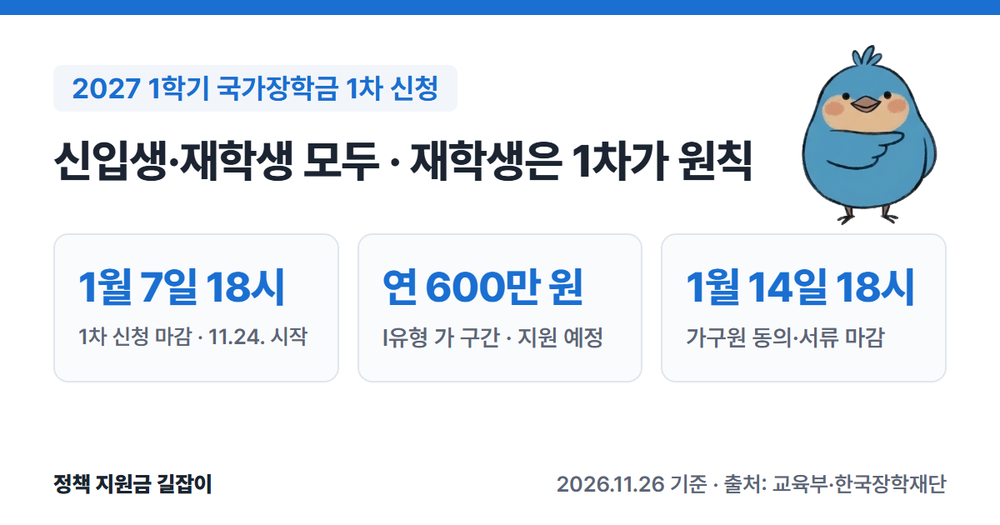
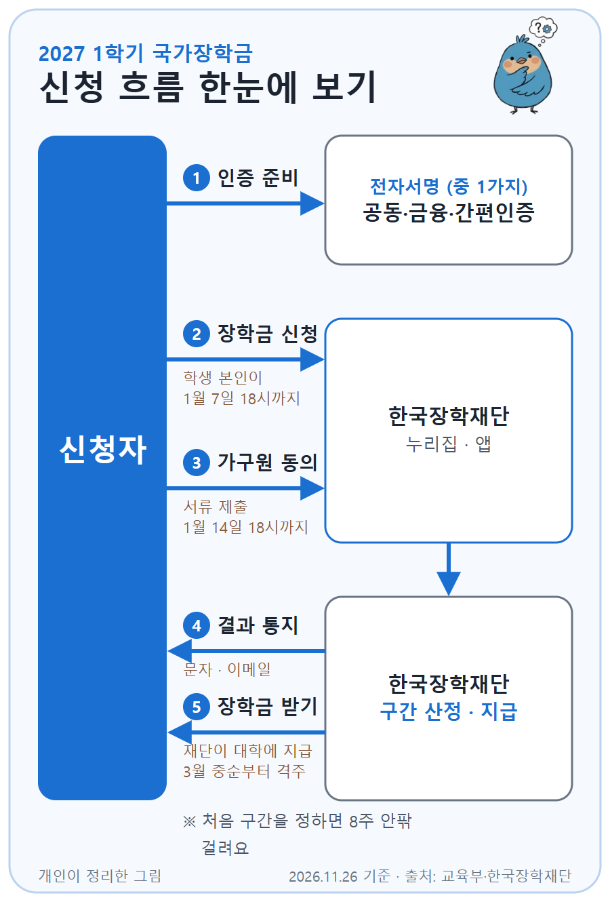

**국가장학금**은 가구 소득·재산에 따라 대학 등록금을 정부가 지원하는 장학금이에요. 교육부와 한국장학재단이 함께 안내하고, 신청 접수와 지원구간 산정은 한국장학재단이 맡아요.
2027학년도 1학기 **1차 신청**이 시작됐어요. 재학생은 1차에 신청해야 하고, 2027학년도부터 학자금 지원구간이 10구간에서 5구간으로 바뀌어요.
교육부 보도자료(2026.11.24.)와 한국장학재단 안내를 바탕으로 정리했어요.

{: .summary-card}

> 💡 **핵심 요약**
> - 2027학년도 1학기 국가장학금 1차 신청은 **2026년 11월 24일 9시부터 2027년 1월 7일 18시까지**예요. 재학생은 **1차 신청이 원칙**이고, 가구원 동의·서류 제출은 **1월 14일 18시까지**예요. (출처①②)
> - 2027년 Ⅰ유형 연간 지원 예정 금액은 **가 구간 600만 원**, 나 440만 원, 다 360만 원, 라 100만 원이에요. 기초·차상위는 **등록금 전액**이에요. (출처①②)
> - 2027년부터 지원구간이 **10구간 → 5구간(가~마)**으로 바뀌고, 이에 따라 **라 구간(옛 9구간)**까지 받을 수 있어요. (출처①④)

> **출처 표시 방법**: 본문의 (출처①) 같은 표시는 글 끝 출처 목록의 번호와 같아요.

목차

* 목차
{:toc}

## 한눈에 보기

| 항목 | 내용 |
|---|---|
| 대상 | 국내 대학에 다니는 **대한민국 국적** 대학생 학자금 지원구간 **라 구간 이하**·성적기준 충족 |
| 금액 | Ⅰ유형 연간 최대 **600만 원**(가 구간) 기초·차상위 **등록금 전액** |
| 기간 | 1차 신청 **2026.11.24.~2027.1.7. 18시** 가구원 동의·서류 **1.14. 18시**까지 |
| 신청 | 한국장학재단 **누리집·앱** 학생 본인이 직접 |

(출처①②)

## 누가 받을 수 있나요?

**국가장학금 Ⅰ유형**은 아래 조건을 갖춘 대학생이 받아요. (출처②)

- **대한민국 국적**으로 **국내 대학**에 다니는 대학생
- 학자금 지원구간 **라 구간 이하**
- **성적기준**을 채운 학생(아래 표)
- 그 학기 신청 절차(**가구원 동의, 서류 제출**)를 마쳐 소득 수준이 확인된 학생

이번 1차 신청은 **신입생(고3·재수생 등 입학예정자), 재학생, 복학생, 편입생, 재입학생** 모두 할 수 있어요. 신입생은 대학 합격 여부나 어느 대학에 갈지 정해지지 않았어도 신청할 수 있어요. (출처①)

### 성적기준

| 구분 | 기준 |
|---|---|
| 신입·편입·재입학생 | **첫 학기**는 성적기준 없음 |
| 재학생 | 직전 학기 **12학점** 이수, **80점** 이상(100점 만점) |
| 기초·차상위 | 직전 학기 12학점 이수, **70점** 이상 |
| 장애인 | 이수학점·성적 기준 없음 |

(출처②)

- **C학점 경고제**: 가 구간 학생은 직전 학기 70점 이상 80점 미만이어도 **2회까지** 경고 후 받을 수 있어요. 적용 여부는 학생이 고를 수 없어요. (출처②)
- 자립준비청년(보호아동 포함)·가정밖청소년은 성적(백분위) 기준은 빼고 **이수학점 기준만** 봐요. (출처②)
- 성적에는 F학점과 이수 후 포기한 과목도 들어가요. (출처②)

### 못 받는 경우

- 학자금 지원구간 **마 구간**(옛 10구간) (출처①)
- 받은 횟수가 학과 정규학기 수를 넘은 경우(4년제 8회, 2년제 4회 등) (출처②)
- 국가장학금을 받고 **등록휴학**한 학생은 복학 첫 학기에 받을 수 없어요. (출처②)
- '27년도 학자금 지원 가능 대학이 아닌 곳의 **'27학년도 신입·편입생** (출처②)
- 부모님 명의로 신청한 경우 (출처②)

## 얼마나 받을 수 있나요?

2027년 **연간 지원 예정 금액**이에요. 한 학기에는 이 금액의 절반까지, **그 학기 등록금(필수경비)을 넘지 않는 범위**에서 받아요. (출처①②)

| 지원구간 | Ⅰ유형 연간 | 한 학기 최대 |
|---|---|---|
| 기초·차상위 | **전액** | 등록금 범위 안 전액 |
| 가 (옛 1~3구간) | **600만 원** | **300만 원** |
| 나 (옛 4~6구간) | **440만 원** | **220만 원** |
| 다 (옛 7~8구간) | **360만 원** | **180만 원** |
| 라 (옛 9구간) | **100만 원** | **50만 원** |
| 마 (옛 10구간) | 지원 없음 | 지원 없음 |

(출처①②)

- 이 금액은 **2027년도 정부 예산(안) 기준**이라 바뀔 수 있어요. 교육부 표 이름도 "지원 예정 단가"예요. (출처①②)
- 구간을 10개에서 5개로 묶은 것은 **같은 지원 금액끼리 합친 것**이라고 재단은 안내해요. (출처④)

### 다자녀 국가장학금

자녀가 **3명 이상**(본인 포함, 대한민국 국적)인 다자녀 가구의 미혼 대학생은 Ⅰ유형 대신 **다자녀 국가장학금**을 받아요. 둘 다 받을 수는 없고 다자녀가 우선이에요. (출처③)

| 지원구간 | 첫째·둘째 연간 | 셋째 이상 연간 |
|---|---|---|
| 기초·차상위 | **전액** | **전액** |
| 가 | **610만 원** | **전액** |
| 나 | **505만 원** | **전액** |
| 다 | **465만 원** | **전액** |
| 라 | **135만 원** | **200만 원** |

(출처①③)

- 여기서 "전액"은 등록금 범위 안 필수경비 전액이에요. (출처③)
- '23년 2학기 이후 입학(신입·편입)한 학생은 **입학 당시 만 39세 이하**여야 다자녀 장학금을 받아요. 만 40세 이상은 Ⅰ유형으로 지원해요. (출처③)

### 예시로 계산해 보면

아래는 공식 금액표로 직접 계산한 예시예요. 등록금은 예로 든 금액이고, 실제 지원액은 재단 심사 결과로 정해져요.

- **나 구간 재학생, 한 학기 등록금 400만 원**: 한 학기 최대 220만 원 → 직접 낼 돈은 약 **180만 원**
- **다 구간 다자녀 둘째, 한 학기 등록금 400만 원**: 한 학기 최대 232만 5천 원(연 465만 원의 절반) → 직접 낼 돈은 약 **167만 5천 원**
- **가 구간 재학생, 한 학기 등록금 250만 원**: 한 학기 최대 300만 원이지만 **등록금을 넘을 수 없어서** 250만 원까지

(금액 출처①②③)

### 내 지원구간은 어떻게 정해지나요?

재단이 사회보장정보시스템으로 가구원의 **소득, 재산, 금융자산, 부채**를 확인해 **소득인정액**을 계산하고 구간을 정해요. (출처②④)

재단이 미리 보여 주는 **2026년 기준 경곗값**(월 소득인정액)이에요. 2027년 경곗값은 재단이 **추후 확정해 안내**할 예정이라, 아래는 가늠용으로만 보세요. (출처⑤)

| 구간 | 월 소득인정액 | 기준 중위소득 |
|---|---|---|
| 가 | **454만 6,317원** 이하 | 70% |
| 나 | **844만 3,159원** 이하 | 130% |
| 다 | **1,298만 9,476원** 이하 | 200% |
| 라 | **1,948만 4,214원** 이하 | 300% |
| 마 | 1,948만 4,214원 초과 | - |

(출처⑤)

- 기초생활수급자·차상위계층은 **수급 자격**으로 확인해요. (출처⑤)
- 처음 구간을 정하면 가구원 동의를 마친 뒤 **8주 안팎**이 걸려요. 전에 쓰던 구간을 계속 쓰면 신청일부터 약 **1~2주**예요. (출처②)

## 어떻게 신청하나요?

1. **전자서명 준비하기**: 공동인증서, 금융인증서, 간편인증 중 하나를 준비해요. (출처①)
2. **장학금 신청하기**: **학생 본인이** 한국장학재단 누리집이나 '한국장학재단' 앱에서 신청해요. 기간 중엔 주말·공휴일 포함 24시간 되지만, **마감일(1월 7일)은 18시까지**예요. (출처①②)
3. **가구원 동의·서류 내기**: 가구원이 재단 누리집·앱·민간 앱(웰로)에서 동의해요. 서류를 내야 하는지는 신청 **1~3일(휴일 제외) 뒤** 누리집의 [서류제출현황]에서 확인하고(교육부 포스터는 2~3일 뒤로 안내), 대상이면 **온라인으로** 내요. 마감은 **1월 14일 18시**예요. (출처①②)
4. **지원구간 결과 받기**: 재단이 소득인정액으로 구간을 정해 **휴대폰 문자와 이메일**로 알려 줘요. 만 35세 이하 미혼 신청인은 부모님께도 문자가 가요. (출처②④)
5. **장학금 받기**: 1학기는 **3월 중순부터** 재단이 격주로 **대학에** 지급해요. (출처②)

{: .flow-chart}

기초·차상위 학생은 학자금 신청일 기준으로 본인이 기초·차상위이면 **가구원 동의가 필요 없어요**. (출처④) 이번 1차 기간에는 **국가근로장학금**도 같이 신청할 수 있어요. (출처①)

## 놓치기 쉬운 점

- **재학생은 1차에 신청해야 해요.** 2차에 신청한 재학생은 지원이 제한되고, 재학 중 **2번까지만** 구제 신청이 자동 적용돼 심사받을 수 있어요. 교환학생·해외실습, 병(입원), 군 입대 후 퇴소 같은 사유로 1차 기간 내내 신청할 수 없었던 경우는 대학이 입증·요청하면 심사를 거쳐 구제받을 수 있어요. (출처②)
- **신청만 하고 끝내면 안 돼요.** 가구원 동의와 서류 제출까지 마쳐야 소득 수준이 확인돼 심사를 받아요. 동의·서류 마감은 신청 마감보다 1주일 늦은 **1월 14일 18시**예요. (출처①②)
- **마감 뒤에는 신청할 수 없어요.** 마감일에는 18시에 끝나요. 구간 산정에 8주 안팎이 걸려 등록금 낼 때 미리 감면받으려면 일찍 신청하라고 재단은 안내해요. (출처①④)
- **지방 국립대 진학 예정이면 꼭 1차에.** 2027학년도부터 도입 예정인 '지방 국립대 전액 장학금(지역균형 발전 장학금)'도 국가장학금 신청을 해야만 받을 수 있다고 교육부가 안내했어요. 이 장학금의 조건·금액은 아직 공식 자료에서 확인하지 못했어요. (출처①)

내 구간이나 서류가 헷갈리면 한국장학재단 콜센터(**1599-2000**, 상담원 평일 9~18시)에 먼저 물어보세요. (출처①⑥)

## 자주 묻는 질문

**Q. 아직 대학에 합격하지 않았는데 신청해도 되나요?**
네. 2027년 1학기 입학예정자는 최종 합격 여부나 입학할 대학이 정해지지 않았어도 이번 1차 기간에 신청할 수 있어요. (출처①)

**Q. 구간 경곗값이 2027년 기준 중위소득으로 바뀌나요?**
재단은 지금 보여 주는 경곗값이 2026년 기준이고, 2027년 경곗값은 추후 확정해 안내한다고 밝혔어요. 경곗값은 기준 중위소득에 구간별 비율을 곱해 정해요. (출처⑤)

**Q. 지원구간 결과가 실제와 다르면요?**
고칠 정보가 있으면 학생이 통지를 받은 날부터 **10영업일 안에** 최신화를 신청할 수 있어요. (출처④)

## 함께 보면 좋은 글

- [2027 기준 중위소득](): 장학금 구간 경곗값의 바탕이 되는 기준 중위소득 정리
- [국민내일배움카드](): 대학 밖 직업훈련비를 지원받는 방법

---

## 출처

1. [교육부 보도자료 - 신청은 미리! 등록금 걱정은 멀리! 2027학년도 1학기 국가장학금 신청하세요 (2026.11.24. 조간)](https://www.moe.go.kr/boardCnts/viewRenew.do?boardID=294&boardSeq=107785&lev=0&statusYN=W&page=2&s=moe&m=020402&opType=N) - 1차 신청 11.24.(화) 9시~1.7.(목) 18시, 24시간 신청·마감일 18시, 대상(신입생·재학생·복학생·편입생·재입학생, 재학생 1차 원칙, 입학예정자 합격 무관), 10구간→5구간 개편으로 라 구간까지 지원, 지방 국립대 전액 장학금, 근로장학금 동시 신청, 1599-2000, 붙임 포스터(가구원 동의·서류 1.14. 18시, 전자서명수단, 가구원 동의 방법, 신청 2~3일 후 서류 확인, 마감 이후 신청 불가), 2027년 연간 지원 예정 단가 표 (확인일: 2026-11-26)
2. [한국장학재단 - 국가장학금 Ⅰ유형(학생직접지원형)](https://www.kosaf.go.kr/ko/scholar.do?pg=scholarship05_12_01_01&naviParam=JH,02,02,05) - 지원대상(대한민국 국적·국내 대학·라 구간 이하·성적기준·가구원 동의·서류 제출), 신청·서류·가구원동의 일정, 학기별 최대 지원금액(가 300·나 220·다 180·라 50만 원, 2027년도 정부예산(안) 기준 변경 가능), 성적기준·C학점 경고제, 수혜횟수·등록휴학, 지원 제외 대학, 부모 명의 신청 불가, 재학생 2차 신청 제한·구제신청 2회·예외 사유, 구간 산정(8주 내외·1~2주), 지급(3월 중순부터 격주 대학 지급) (확인일: 2026-11-26)
3. [한국장학재단 - 다자녀 국가장학금](https://www.kosaf.go.kr/ko/scholar.do?pg=scholarship05_12_10&naviParam=JH,02,05,05) - 다자녀 가구(대한민국 국적 자녀 3명 이상) 미혼 대학생, '23-2학기 이후 입학자 입학 당시 만 39세 이하, 학기별 금액(첫째·둘째 가 305·나 252.5·다 232.5·라 67.5만 원, 셋째 이상 다 구간까지 전액·라 학기 100만·연 200만 원), Ⅰ유형과 중복 시 다자녀 우선·중복 불가 (확인일: 2026-11-26)
4. [한국장학재단 - 한눈에 보는 학자금 지원구간](https://www.kosaf.go.kr/ko/tuition.do?pg=tuition04_09_01&type=scholar&naviParam=JH,01,01,02) - 2027년 1학기부터 10구간→5구간 통합(동일 지원금액 기준), 소득인정액 산정식, 약 8주 내외·조기 신청, 학생·부모(만 35세 이하 미혼) 통지, 통지일부터 10영업일 이내 최신화, 기초·차상위 본인 가구원 동의 불필요 (확인일: 2026-11-26)
5. [한국장학재단 - 학자금 지원구간 경곗값 확인](https://www.kosaf.go.kr/ko/tuition.do?pg=tuition04_09_07&naviParam=JH,01,01,03) - 2026년 학자금 지원구간 경곗값(5구간 체계 적용, 가 4,546,317원·나 8,443,159원·다 12,989,476원·라 19,484,214원, 기준 중위소득 70·130·200·300%), 2027년 경곗값 추후 확정 안내, 기초·차상위 수급자격으로 확인 (확인일: 2026-11-26)
6. [한국장학재단 누리집 하단 안내](https://www.kosaf.go.kr) - 콜센터 1599-2000(유료, ARS 365일 24시간, 상담원 평일 09~18시) (확인일: 2026-11-26)

> 이 글은 **2026년 11월 26일** 기준이에요. 2027년 지원 금액은 정부 예산(안) 기준이라 바뀔 수 있으니 신청 전에 한국장학재단 누리집에서 꼭 확인하세요.
