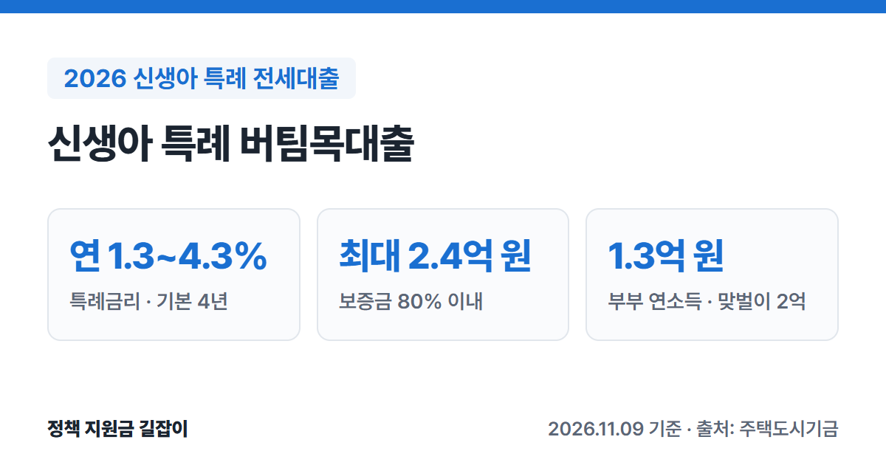

**신생아 특례 버팀목대출**은 최근 2년 안에 아이를 낳거나 입양한 무주택 가구에 주택도시기금이 낮은 금리로 빌려주는 전세대출이에요.
부부합산 연소득 1.3억 원(맞벌이 2억 원)까지 신청할 수 있고, 처음 4년은 특례금리가 적용돼요. (출처①)
주택도시기금 공식 상품 안내를 바탕으로 자격 조건, 한도, 금리, 신청 방법을 정리했어요.

{: .summary-card}

> 💡 **핵심 요약**
> - 대출 접수일 기준 **2년 안에 출산·입양**한 무주택 세대주, 부부합산 연소득 **1.3억 원 이하**(맞벌이 **2억 원 이하**), 순자산 **3.45억 원 이하**면 신청할 수 있어요. (출처①)
> - 특례금리는 소득과 보증금에 따라 **연 1.3~4.3%**이고, 기본 **4년** 적용돼요. (출처①)
> - 한도는 **최대 2.4억 원**(보증금의 80% 이내)이고, 보증금 수도권 **5억 원**·수도권 외 **4억 원** 이하 집만 가능해요. (출처①)

> **출처 표시 방법**: 본문의 (출처①) 같은 표시는 글 끝 출처 목록의 번호와 같아요.

목차

* 목차
{:toc}

## 한눈에 보기

| 항목 | 내용 |
|---|---|
| 대상 | 대출 접수일 기준 **2년 안에** 출산·입양한 무주택 세대주 |
| 소득·자산 | 부부합산 연소득 **1.3억 원 이하** (맞벌이 **2억 원 이하**) 순자산 **3.45억 원 이하** (2026년 기준) |
| 대상 주택 | 전용 **85㎡ 이하** 보증금 수도권 **5억 원**, 수도권 외 **4억 원** 이하 |
| 대출 한도 | **최대 2.4억 원** (보증금의 80% 이내) |
| 대출 금리 | 특례금리 **연 1.3~4.3%** (기본 4년) |
| 대출 기간 | **2년** (연장해서 최장 12년) |
| 신청 | 기금e든든 비대면 신청 후 은행 방문, 또는 은행 대면 신청 |

(출처①)

---

## 누가 받을 수 있나요?

아래 조건을 **모두** 갖춰야 해요. (출처①)

### 기본 조건

| 조건 | 내용 |
|---|---|
| 출산 | 대출 접수일 기준 **2년 안에** 출산·입양한 가구 |
| 세대주 | 대출 접수일 기준 성년인 **세대주** |
| 주택 | 세대주와 세대원 **모두 무주택** |
| 계약 | 임대차계약을 맺고 보증금의 **5% 이상**을 낸 상태 |
| 소득 | 부부합산 **1.3억 원 이하** 맞벌이는 **2억 원 이하** |
| 자산 | 본인과 배우자 합산 순자산 **3.45억 원 이하** |

(출처①)

- **출산 범위**: 2023년 1월 1일 이후에 태어난 아이부터예요. **배 속 아이(임신 중)는 해당하지 않아요.** (출처①)
- **입양**: 2023년 1월 1일 이후 태어난 아이를 입양한 경우도 돼요. 다만 대출 접수일에 아이가 **만 2살 미만**이어야 해요. (출처①)
- **혼인신고를 하지 않은 부모**도 신청할 수 있어요. 이때 소득·자산은 아이의 가족관계증명서에 올라간 **부모 두 사람을 합쳐서** 보고, 무주택은 **두 사람 모두** 집이 없어야 해요. (출처①)
- **맞벌이**는 부부 모두 소득이 있고, **각자의 소득이 1.3억 원 이하**인 경우예요. (출처①)
- 순자산 기준은 통계청 조사의 소득 3분위 가구 평균 자산으로 정하기 때문에 **최근 통계 발표에 따라 바뀔 수 있어요.** 3.45억 원은 2026년 기준이에요. (출처①)

### 이런 경우는 받을 수 없어요

- 본인이나 배우자(결혼 예정 배우자 포함)가 이미 **전세대출이나 주택담보대출**을 쓰고 있는 경우 (출처①)
- 성년인 세대원 중 누구라도 **주택도시기금 대출**을 쓰고 있는 경우 (출처①)
- 혼인신고를 하지 않은 부모가 **같은 아이로** 각각 대출을 받으려는 경우 (출처①)
- 연체, 대위변제, 부도 같은 **신용 문제 기록**이 남아 있는 경우 (출처①)
- 지금 **공공임대주택**에 살고 있는 경우 (그 공공임대주택에 대해 받거나, 부부가 나가는 경우는 가능) (출처①)

---

## 어떤 집이어야 하나요?

| 조건 | 내용 |
|---|---|
| 면적 | 전용 **85㎡ 이하** (주거용 오피스텔 포함) 수도권 밖 도시지역이 아닌 읍·면은 **100㎡ 이하** |
| 보증금 | 수도권 **5억 원**, 수도권 외 **4억 원** 이하 |

(출처①)

채권양도협약기관(LH·SH 등)이 가진 쉐어하우스는 면적 제한이 없어요. (출처①)

---

## 얼마나 빌릴 수 있나요?

한도는 아래 세 가지 중 **가장 작은 금액**이에요. (출처①)

| 기준 | 한도 |
|---|---|
| 1집당 한도 | **2.4억 원** |
| 보증금 비율 | 새 계약: 전세금의 **80%** 갱신: 오른 금액 안에서, 오른 뒤 보증금의 80% |
| 보증 기관 | HF·HUG 보증 규정에 따라 달라짐 |

(출처①)

예를 들어 보증금이 2억 원이면 80%인 **1.6억 원**, 보증금이 4억 원이면 80%는 3.2억 원이지만 1집당 한도 때문에 **2.4억 원**까지예요. (출처① 기준으로 계산)
다만 보증 기관 심사에 따라 이보다 적게 나올 수 있어요.

- **2025년 6월 27일 이전에 계약한 경우**에는 3억 원까지 적용돼요. (출처①)
- **회사에 다닌 지 1년이 안 됐다면** 한도가 2천만 원 이하로 줄어들 수 있어요. (출처①)

---

## 금리는 얼마인가요?

처음 **4년**은 아래 특례금리가 적용돼요. 부부합산 연소득과 보증금에 따라 달라요. (출처①)

| 연소득 | 특례금리 |
|---|---|
| 2천만 원 이하 | **연 1.30~1.60%** |
| 2천만~4천만 원 | **연 1.60~1.90%** |
| 4천만~6천만 원 | **연 1.90~2.20%** |
| 6천만~7.5천만 원 | **연 2.20~2.50%** |
| 7.5천만~1억 원 | **연 2.55~2.85%** |
| 1억~1.3억 원 | **연 2.90~3.20%** |
| 1.3억~1.5억 원 | **연 3.25~3.55%** (맞벌이) |
| 1.5억~1.7억 원 | **연 3.60~3.90%** (맞벌이) |
| 1.7억~2억 원 | **연 4.00~4.30%** (맞벌이) |

(출처①, 부부합산 연소득 기준)

같은 소득 구간 안에서는 **보증금이 클수록** 금리가 0.1%p씩 높아져요. 보증금 구간은 5천만 원 이하, 5천만~1억 원, 1억~1.5억 원, 1.5억 원 초과 네 단계예요. (출처①)
예를 들어 부부합산 연소득이 5,000만 원이고 보증금이 2억 원이면 **연 2.20%**예요. (출처① 금리표 기준)

- 집이 **지방**에 있으면 위 금리에서 **0.2%p** 내려가요. (출처①)
- 대출 접수일 기준 2년 안에 **아이를 더 낳으면** 1명당 특례금리 기간을 **4년씩** 늘릴 수 있어요. 최장 **12년**까지예요. (출처①)

### 4년이 지나면 금리가 어떻게 되나요?

특례금리가 끝나면 대출받을 때 산정된 부부합산 연소득에 따라 금리가 바뀌어요. (출처①)

- **7.5천만 원 이하**: 신혼부부 전용 전세자금 대출 금리 수준으로 올라가요. (출처①)
- **7.5천만 원 초과**: 한국은행이 고시하는 은행 전세대출 금리와 시중은행 전세대출 최저금리 중 낮은 값이 적용돼요. 다만 하한이 있어요. 연소득 1.3억 원 이하면 7.5천만 원 이하 구간 종료 후 금리 중 가장 높은 금리, 1.3억 원 초과면 기존 특례금리에 0.2%p를 더한 금리보다 낮아지지 않아요. (출처①)

대출을 접수한 달별 금리표는 주택도시기금 '특례금리 적용 종료 후 적용금리' 페이지에서 볼 수 있어요. (출처②)

### 금리를 더 낮추는 방법 (우대금리)

아래는 **함께** 받을 수 있어요. (출처①)

| 대상 | 우대 |
|---|---|
| 추가 출산 | 대출 접수일 기준 2년 안에 더 낳은 자녀 1명당 **0.2%p** (1명당 최대 4년, 최장 12년) |
| 2년 넘은 자녀 | 태어난 지 2년이 넘은 미성년 자녀 1명당 **0.1%p** |
| 전자계약 | 부동산 전자계약 **0.1%p** (첫 대출기간 1회, 2026.12.31. 신규 접수분까지) |
| 적게 빌림 | 심사 금액의 30% 이하만 신청 **0.2%p**, 최대 4년 |

(출처①)

- 대출 기간 중에 아이를 더 낳아도 은행에 가서 조건 변경을 신청하면 우대를 받을 수 있어요. (출처①)
- 우대금리는 합쳐서 **최대 0.5%p**까지만 적용돼요. 우대를 받아도 최종 금리는 **연 1.0%보다 낮아지지 않아요.** (출처①)

---

## 얼마나 오래 빌릴 수 있나요?

- 기본 **2년**이고, 임대차 계약이 끝나는 날을 넘을 수 없어요. (출처①)
- 연장해서 **최장 12년**까지 쓸 수 있어요. (출처①)
- 12년을 쓴 뒤에도 **미성년 자녀 1명당 2년**씩 더 늘려서 **최장 20년**까지 가능해요. (출처①)
- 갚는 방식은 **일시상환** 또는 **혼합상환** 중에서 골라요(자세한 방식은 은행에 확인하세요). **중도상환수수료는 없어요.** (출처①)

---

## 어떻게 신청하나요?

1. **조건 확인하기**: 주택도시기금 누리집이나 은행 상담으로 조건을 확인해요. (출처③)
2. **전세 계약하기**: 임대차계약을 맺고 보증금의 **5% 이상**을 내요. (출처①)
3. **기한 안에 신청하기**: 잔금 지급일과 전입신고일 중 **빠른 날부터 3개월 안**에 신청해야 해요. 갱신 계약이면 갱신일부터 3개월 안이에요. (출처①)
4. **대출 신청하기**: '기금e든든'에서 비대면으로 신청하거나 은행 지점을 찾아가 신청해요. (출처③)
5. **자산 심사 받기**: 주택도시보증공사(HUG)가 자산을 심사하고, 결과를 문자로 보내 줘요. (출처③)
6. **서류 내고 대출받기**: 은행 지점에 서류를 내면 소득·담보 심사를 거쳐 대출이 실행돼요. (출처③)

**보증도 기한 안에** 신청해야 해요. HF(한국주택금융공사)나 HUG 보증은 대출과 따로 기한이 있으니, 은행에서 같이 챙기세요. (출처①)

### 준비 서류

| 확인 | 서류 |
|---|---|
| 본인 | 주민등록증, 운전면허증, 여권 중 하나 |
| 대상자 | 주민등록등본 (단독세대주·배우자 분리세대는 가족관계증명원 추가) |
| 출산·입양 | 출생증명서(병원 발급) 입양은 입양관계증명서 또는 친양자입양관계증명서 |
| 재직 | 건강보험 자격득실 확인서 |
| 소득 | 소득금액증명원, 원천징수영수증 등 중 하나 (소득이 없으면 신고사실없음 사실증명원) |
| 집 | 확정일자 받은 임대차계약서 사본, 건물 등기사항전부증명서 |

(출처③)

심사 중에 다른 서류를 더 달라고 할 수 있어요. (출처③)

### 신청할 수 있는 은행

우리·신한·국민·농협·하나은행에서 신청해요. (출처③)

---

## 놓치기 쉬운 점

- **임신 중에는 신청할 수 없어요.** 아이가 태어난 뒤(2023년 1월 1일 이후 출생)부터 대상이에요. (출처①)
- **출산 후 2년이 기준이에요.** 아이가 **두 돌이 되기 전에** 대출 접수까지 마쳐야 하니, 계약·잔금 날짜를 먼저 따져 보세요. (출처①)
- **신청 기한 3개월을 넘기기 쉬워요.** 잔금일과 전입일 중 **빠른 날**이 기준이라, 먼저 이사하고 늦게 신청하면 기한이 지날 수 있어요. (출처①)
- **대출 후 집을 사면 갚아야 해요.** 대출을 받은 뒤 집을 산 사실이 확인되면 대출금을 상환해야 해요. (출처①)

> 대출 심사는 **주택도시보증공사 콜센터 1566-9009**나 은행 지점에, 자산 심사는 **자산심사 전용 상담센터 1551-3119**에 먼저 물어보세요. (출처①)

자산 심사는 신청 절차 안내 페이지에 주택도시보증공사 콜센터(1566-9009)로도 안내돼 있어요. (출처③)

---

## 자주 묻는 질문

**Q. 혼인신고를 안 했는데 받을 수 있나요?**
네. 혼인신고 없이 출산·입양한 경우에도 받을 수 있어요. 다만 소득·자산·무주택은 아이의 가족관계증명서에 올라간 부모 두 사람을 합쳐서 심사해요. (출처①)

**Q. 지금 임신 중인데 미리 받을 수 있나요?**
아니요. 임신 중인 태아는 출산 범위에 들어가지 않아요. (출처①)

**Q. 신혼부부 전세대출과 무엇이 다른가요?**
신생아 특례는 혼인기간 대신 **출산**이 조건이고, 부부합산 연소득 **1.3억 원**(맞벌이 2억 원)까지 신청할 수 있어요. (출처①) 신혼부부전용 전세자금은 **7.5천만 원 이하**예요. (출처④) 신혼부부전용 전세자금 조건은 [2026 신혼부부 전세자금대출 총정리]()에서 볼 수 있어요.

**Q. 계약한 뒤 마음이 바뀌면 취소할 수 있나요?**
네. 대출계약서를 받은 날, 계약일, 대출 실행일 등 가장 늦은 날부터 **14일 안**에 철회할 수 있어요. 원금과 이자, 부대비용을 모두 돌려줘야 철회가 끝나요. (출처①)

---

## 함께 보면 좋은 글

- [2026 출산지원금 총정리](): 부모급여·첫만남이용권 등 출산 가구가 받을 수 있는 지원 전체
- [2026 신혼부부 전세자금대출 총정리](): 아이가 없거나 2년이 지났다면, 혼인 7년 이내 신혼부부 전세대출과 비교

---

## 출처

1. [주택도시기금 - 신생아 특례 버팀목대출 대출안내](https://nhuf.molit.go.kr/FP/FP05/FP0502/FP05021401.jsp) - 대출 대상, 출산 범위, 소득·자산 기준, 신청 시기, 대상 주택, 한도, 특례금리표, 특례금리 종료 후 금리, 우대금리, 기간, 유의사항 (확인일: 2026-11-09)
2. [주택도시기금 - 신생아 특례 버팀목대출 특례금리 적용 종료 후 적용금리](https://nhuf.molit.go.kr/FP/FP05/FP0502/FP05021408.jsp) (확인일: 2026-11-09)
3. [주택도시기금 - 신생아 특례 버팀목대출 이용절차 및 준비서류](https://nhuf.molit.go.kr/FP/FP05/FP0502/FP05021406.jsp) - 신청 방법, 이용 절차, 준비 서류, 취급 은행, 상담 전화 (확인일: 2026-11-09)
4. [주택도시기금 - 신혼부부전용 전세자금 대출안내](https://nhuf.molit.go.kr/FP/FP05/FP0502/FP05020401.jsp) - 비교용 소득 기준 (확인일: 2026-11-09)
5. [기금e든든 (주택도시기금 대출 신청)](https://enhuf.molit.go.kr)

> 이 글은 **2026년 11월 9일** 기준이에요. 금리와 자산 기준은 국토교통부 고시에 따라 바뀔 수 있으니 신청 전에 주택도시기금 누리집과 은행에서 꼭 확인하세요.
