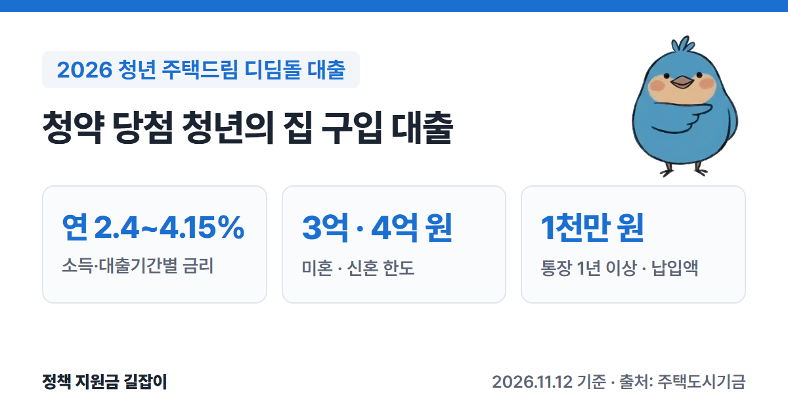
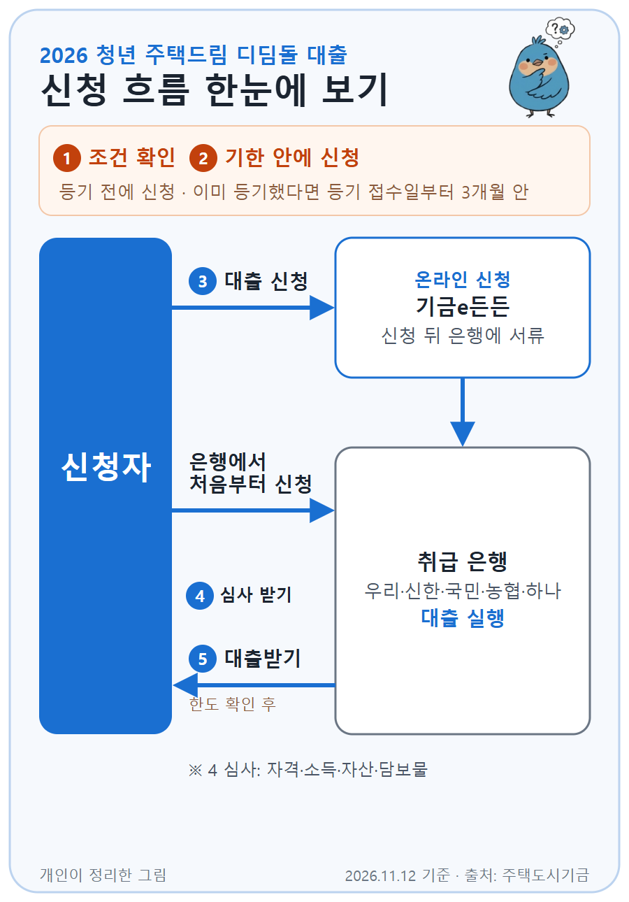

**청년 주택드림 디딤돌 대출**은 청년 주택드림 청약통장으로 청약에 당첨된 청년이 그 집을 살 때 주택도시기금이 빌려주는 주택구입대출이에요.
통장을 1년 이상, 1천만 원 이상 부은 경우에만 신청할 수 있고, 대출 뒤 결혼·출산하면 금리를 더 낮춰 줘요. (출처①)
주택도시기금 공식 상품 안내를 바탕으로 자격 조건, 한도, 금리, 신청 방법을 정리했어요.

{: .summary-card}

> 💡 **핵심 요약**
> - 청년 주택드림 통장으로 청약에 당첨(당첨 때 **만 39세 이하**)되고, 통장을 **1년 이상** 가입해 **1천만 원 이상** 넣은 무주택 세대주가 신청할 수 있어요. (출처①)
> - 금리는 소득과 대출기간에 따라 **연 2.4~4.15%**이고, 대출 뒤 결혼·출산하면 최대 **1%p**까지 우대받아요. (출처①)
> - 한도는 미혼 **3억 원**, 신혼가구 **4억 원**이고, 평가액 **6억 원 이하**·전용 **85㎡ 이하**(일부 읍·면 100㎡) 집이어야 해요. (출처①)

> **출처 표시 방법**: 본문의 (출처①) 같은 표시는 글 끝 출처 목록의 번호와 같아요.
> 통장 가입 조건과 금리는 [2026 청년 주택드림 청약통장 총정리]()에서 볼 수 있어요.

목차

* 목차
{:toc}

## 한눈에 보기

| 항목 | 내용 |
|---|---|
| 대상 | 청년 주택드림 통장으로 청약 당첨 (당첨 때 **만 39세 이하**) 무주택 세대주 |
| 통장 조건 | **1년 이상** 가입, **1천만 원 이상** 납입 |
| 소득·자산 | 미혼 연소득 **7천만 원 이하** 신혼 부부합산 **1억 원 이하** 순자산 **5.11억 원 이하** (2026년 기준) |
| 대상 주택 | 전용 **85㎡ 이하**, 평가액 **6억 원 이하** |
| 대출 한도 | 미혼 **3억 원**, 신혼 **4억 원** (LTV 70%, 생애최초 80% 수도권·규제지역 70%, DTI 60%) |
| 대출 금리 | **연 2.4~4.15%** |
| 대출 기간 | **10·15·20·30년** (연소득 4천만 원 이하는 40년) |

(출처①)

---

## 누가 받을 수 있나요?

아래 조건을 **모두** 갖춰야 해요. (출처①)

### 기본 조건

| 조건 | 내용 |
|---|---|
| 청약 당첨 | 입주자모집공고일 **전부터 가진** 청년 주택드림 통장으로 당첨, 분양계약 체결 |
| 나이 | 당첨 때 **만 39세 이하** |
| 통장 | 가입(전환)일부터 대출 접수일까지 **1년 이상** 대출 접수일 기준 **1천만 원 이상** 납입 |
| 세대주 | 대출 접수일 기준 성년인 **세대주** |
| 주택 | 세대주와 세대원 **모두 무주택** |
| 소득 | 미혼 **7천만 원 이하** 신혼가구 부부합산 **1억 원 이하** |
| 자산 | 본인과 배우자 합산 순자산 **5.11억 원 이하** |

(출처①)

- **무주택**을 따질 때는 **분양권과 조합원 입주권도 집으로 쳐요.** (출처①)
- 순자산 기준은 통계청 조사의 소득 4분위 가구 평균 자산으로 정하기 때문에 **해마다 바뀌어요.** 5.11억 원은 2026년 기준이에요. (출처①)
- 상속·증여·재산분할로 집을 얻는 경우는 해당하지 않아요. (출처①)

### 1천만 원 납입은 이렇게 세요

- 한 달에 넣은 돈은 **최대 100만 원까지만** 인정돼요. (출처①)
- 그 집의 **계약금**을 내려고 통장에서 한 번 돈을 꺼냈다면, 대출 접수일에 **잔고가 1천만 원 이상**이어야 해요. (출처①)
- 후분양 등으로 월 100만 원씩만으로는 1천만 원을 채우기 어려우면, 대출 신청 전에 **부족한 만큼 한꺼번에** 넣은 돈도 인정돼요. (출처①)
- 기존 종합저축에서 전환했다면 예전 통장 잔고는 **최대 500만 원**까지 인정돼요. 청년우대형 종합저축에서 전환했다면 잔고를 모두 인정해요. (출처①)
- 청년도약계좌·청년희망적금·군장병 내일적금 등의 만기금을 통장에 넣은 경우 **최대 500만 원**까지 인정돼요. (출처①)

### 신혼가구 부부합산 소득이 1억 원을 넘는 경우

부부합산 소득이 1억 원을 넘어도 **대출 신청인 한 사람의 소득이 7천만 원 이하**면 신청할 수 있어요. (출처①)
이 경우 대출기간별 **최고 금리에 0.3%p**를 더하고, DTI(갚을 능력 심사)는 신청인 한 사람의 소득과 빚만으로 봐요. (출처①)

### 이런 경우는 받을 수 없어요

- 성년인 세대원 전원을 대상으로 **주택도시기금 대출** 이용 여부를 봐서, 기금 대출을 쓰고 있는 경우. 다만 기금 전세자금대출은 대출 실행일에 갚는 조건이면 가능해요. (출처①)
- 본인이나 배우자(결혼 예정·분리된 배우자 포함)가 **다른 집으로 주택담보대출(중도금대출 포함)**을 쓰고 있는 경우 (출처①)
- 연체, 대위변제, 부도 같은 **신용 문제 기록**이 남아 있거나, 개인신용평가 점수가 기준에 못 미치는 경우 (출처①)

---

## 어떤 집이어야 하나요?

| 조건 | 내용 |
|---|---|
| 면적 | 전용 **85㎡ 이하** 수도권 밖 도시지역이 아닌 읍·면은 **100㎡ 이하** |
| 집값 | 대출 접수일 기준 평가액 **6억 원 이하** |

(출처①)

평가액은 **분양가격**을 먼저 쓰고, 분양가격을 쓸 수 없으면 가격정보(시세), 국토교통부 공시가격, 감정가 순서로 정해요. (출처①)

---

## 얼마나 빌릴 수 있나요?

한도는 아래 중 **가장 작은 금액**이에요. (출처①)

| 기준 | 한도 |
|---|---|
| 1집당 한도 | 미혼 **3억 원**, 신혼가구 **4억 원** |
| LTV | 집 평가액의 **70%** 생애최초 구입자 **80%** (수도권·규제지역은 생애최초도 **70%**) |
| DTI | 연간 원리금 상환액이 소득의 **60%** 이내 |
| 분양가 | 분양가격 이내 |

(출처①)

예를 들어 미혼 청년이 규제지역이 아닌 지방에서 분양가 4억 원인 집을 처음 산다면 LTV 80%로 3.2억 원이지만, 1집당 한도 때문에 **3억 원**까지예요. 같은 집이 수도권이면 70%인 **2.8억 원**까지예요. (출처① 기준으로 계산)
실제 한도는 DTI와 먼저 잡힌 대출·임대보증금을 빼고 정해져서 이보다 적을 수 있어요. (출처①)

---

## 금리는 얼마인가요?

소득 수준과 대출기간에 따라 달라요. (출처①)

| 소득 수준 | 금리 (10년 → 30년) |
|---|---|
| 미혼 2천만 원 이하 | **연 2.40~2.70%** |
| 미혼 2천만~4천만 원 | **연 2.80~3.10%** |
| 미혼 4천만~7천만 원 | **연 3.20~3.50%** |
| 신혼 7천만~8.5천만 원 | **연 3.55~3.85%** |
| 신혼 8.5천만~1억 원 | **연 3.90~4.15%** |

(출처①)

공식 금리표는 7천만 원 이하 세 구간을 '미혼', 7천만 원 초과 두 구간을 '신혼가구'로 묶어 두었어요. 신혼가구의 부부합산 소득이 7천만 원 이하일 때 어느 금리가 적용되는지는 표에 따로 나와 있지 않으니 은행에 확인하세요. (출처①)

- 집이 **지방**에 있으면 위 금리에서 **0.2%p** 내려가요. (출처①)
- 금리 방식에 따라 더해지는 금리가 있어요. **5년 단위 변동금리 0.1%p**, **10년 고정금리 0.2%p**, **순수 고정금리 0.3%p**예요. (출처①)
- 연소득 4천만 원 이하가 **40년**으로 빌리면 30년 금리에 **0.1%p**를 더해요. (출처①)

### 금리를 더 낮추는 방법 (우대금리)

아래는 **함께** 받을 수 있어요. (출처①)

| 대상 | 우대 |
|---|---|
| 결혼 | 대출 실행일 **이후 결혼**하면 **0.1%p** (5년간) |
| 첫 출산 | 대출 실행일 **이후 첫 출산**이면 **0.5%p** |
| 추가 출산 | 그 뒤 자녀 1명당 **0.2%p** 더 |

(출처①)

- 출산 우대는 적용일부터 **자녀 1명당 5년**씩, 최대 15년까지 적용돼요. (출처①)
- 우대금리는 합쳐서 **최대 1%p**까지예요. 우대를 받아도 최종 금리는 **연 1.5%보다 낮아지지 않아요.** (출처①)

---

## 얼마나 오래, 어떻게 갚나요?

- 대출기간은 **10년, 15년, 20년, 30년** 중에서 골라요. 연소득 4천만 원 이하는 **40년**도 가능해요. (출처①)
- **1년 거치**(이자만 내는 기간) 또는 비거치로, 원리금균등·원금균등·체증식 분할상환 중에서 골라요. (출처①)
- 중도상환수수료는 원래 3년 안에 갚은 원금에 최대 0.6%예요. 다만 **2026년 12월 31일까지 갚는 원금은 면제**예요. (출처①)

---

## 어떻게 신청하나요?

{: .flow-chart}

1. **조건 확인하기**: 주택도시기금 누리집이나 은행 상담으로 통장·소득·집 조건을 확인해요. (출처②)
2. **기한 안에 신청하기**: **소유권이전등기 전**에 신청해요. 이미 등기를 했다면 등기 접수일부터 **3개월 안**에 신청해야 해요. (출처①)
3. **대출 신청하기**: '기금e든든'에서 온라인으로 신청한 뒤 은행에 서류를 내거나, 처음부터 은행에서 신청해요. (출처②)
4. **심사 받기**: 자격, 소득, 자산, 담보물 심사를 거쳐요. (출처②)
5. **대출받기**: 대출 가능 여부와 한도가 확인되면 은행에서 대출이 실행돼요. (출처②)

### 준비 서류

| 확인 | 서류 |
|---|---|
| 본인 | 주민등록증, 운전면허증, 여권 중 하나 |
| 대상자 | 주민등록등본, 가족관계증명원 (1개월 이내 발급분) |
| 결혼 예정 | **예식장 계약서** 또는 **청첩장** |
| 재직 | 건강보험 자격득실 확인서 |
| 소득 | 소득금액증명원, 원천징수영수증 등 중 하나 (소득이 없으면 신고사실없음 사실증명원) |
| 집·청약 | 분양계약서, 인감증명서, **청약당첨사실확인서**, **청약통장 거래내역서** 등 |

(출처②)

심사 중에 다른 서류를 더 달라고 할 수 있어요. (출처②)

### 신청할 수 있는 은행

우리·신한·국민·농협·하나은행에서 신청해요. (출처②)

---

## 놓치기 쉬운 점

- **공고일 전에 만든 통장이어야 해요.** 입주자모집공고일 **이전부터** 가진 청년 주택드림 통장으로 당첨돼야 해요. (출처①)
- **한 달 100만 원 넘게 넣은 돈은 세지 않아요.** 1천만 원을 채우려고 한 번에 많이 넣어도 월 100만 원까지만 인정돼요. 후분양 등 예외는 위 '1천만 원 납입' 부분을 보세요. (출처①)
- **1개월 안에 이사해서 2년 살아야 해요.** 대출받은 날부터 1개월 안에 그 집에 전입하고 2년 이상 살아야 해요. 정당한 사유 없이 지키지 않으면 대출금을 갚아야 해요. 기존 세입자 퇴거 지연 같은 사정이 있으면 사유서를 내고 전입을 2개월 늦출 수 있어요. (출처①)
- **대출 기간에는 1주택을 유지해야 해요.** 대출 후 다른 집을 얻으면 6개월 안에 처분해야 하고, 처분하지 않으면 대출금을 돌려줘야 해요. 혼인신고 전에 배우자가 갖고 있던 집은 국토교통부 확인을 받은 날부터 **3년 안에** 처분하면 돼요. (출처①)

> 대출 심사는 **주택도시보증공사 콜센터 1566-9009**나 은행 지점에, 자산 심사는 **자산심사 전용 상담센터 1551-3119**에 먼저 물어보세요. (출처①)

---

## 자주 묻는 질문

**Q. 일반 청약통장으로 당첨됐는데 받을 수 있나요?**
아니요. 이 대출은 **청년 주택드림 통장**으로 당첨된 경우에만 신청할 수 있어요. 기존 종합저축에서 청년 주택드림 통장으로 전환했다면 전환일부터 가입 기간을 세요. (출처①)

**Q. 대출받은 뒤 결혼하면 한도가 늘어나나요?**
이 상품 안내 페이지에는 대출 뒤 결혼하면 **금리 0.1%p 우대**가 나와 있고, 한도를 다시 정한다는 내용은 없어요. 자세한 건 은행에 확인하세요. (출처①)

**Q. 지금 청년 버팀목 전세대출을 쓰고 있어요.**
기금 전세자금대출은 디딤돌 대출 **실행일에 갚는 조건**이면 신청할 수 있어요. (출처①) 전세대출 조건은 [2026 청년 전세자금대출(청년전용 버팀목) 총정리]()에서 볼 수 있어요.

**Q. 계약한 뒤 마음이 바뀌면 취소할 수 있나요?**
네. 대출계약서를 받은 날, 계약일, 대출 실행일 등 가장 늦은 날부터 **14일 안**에 철회할 수 있어요. 원금과 이자, 부대비용을 모두 돌려줘야 철회가 끝나요. (출처①)

---

## 함께 보면 좋은 글

- [2026 청년 주택드림 청약통장 총정리](): 이 대출의 전제인 청약통장 가입 조건과 금리
- [2026 청년 주거 지원 총정리](): 월세 지원·전세대출·공공임대까지 상황별로 정리한 안내
- [2026 청년 전세자금대출(청년전용 버팀목) 총정리](): 당첨 전까지 전세로 산다면 청년전용 버팀목 조건 확인

---

## 출처

1. [주택도시기금 - 청년 주택드림 디딤돌 대출 일반대출 안내](https://nhuf.molit.go.kr/FP/FP05/FP0503/FP05030901.jsp) - 대출 대상, 통장 납입 인정 기준, 소득·자산 기준, 신청 시기, 대상 주택, 한도, 금리표, 우대금리, 기간·상환, 중도상환수수료, 유의사항, 상담 전화 (확인일: 2026-11-12)
2. [주택도시기금 - 청년 주택드림 디딤돌 대출 이용절차 및 제출서류](https://nhuf.molit.go.kr/FP/FP05/FP0503/FP05030904.jsp) - 신청 방법, 이용 절차, 제출 서류, 취급 은행 (확인일: 2026-11-12)
3. [기금e든든 (주택도시기금 대출 신청)](https://enhuf.molit.go.kr) (확인일: 2026-11-12)

> 이 글은 **2026년 11월 12일** 기준이에요. 금리와 자산 기준은 국토교통부 고시에 따라 바뀔 수 있으니 신청 전에 주택도시기금 누리집과 은행에서 꼭 확인하세요.
