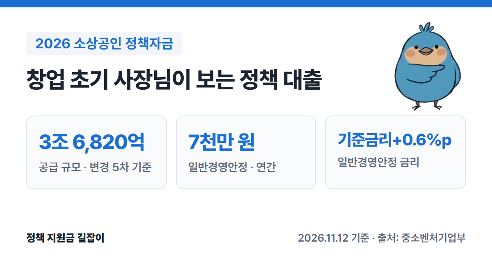
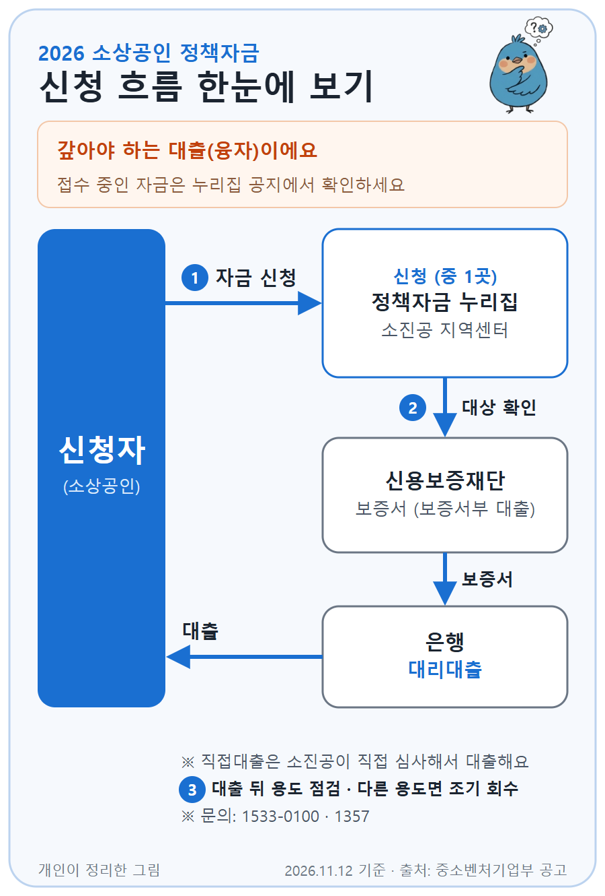

**소상공인 정책자금**은 정부가 소상공인에게 낮은 금리로 빌려주는 **융자(대출)** 예요. 창업 초기에 운영자금이 필요할 때 가장 먼저 찾아보는 제도이기도 해요.
중소벤처기업부·소상공인시장진흥공단의 「2026년 중소벤처기업부 소상공인 정책자금 융자사업 공고」 원문을 바탕으로 정리했어요.

{: .summary-card}

> 💡 **핵심 요약**
> - 정책자금은 **갚아야 하는 대출**이에요. 2026년 공급 규모는 변경 5차 공고 기준 **3조 6,820억 원**이에요(당초 3조 3,620억 원). (출처①②)
> - 업력과 관계없이 신청할 수 있는 **일반경영안정자금**은 연간 **7천만 원**까지, 금리는 **정책자금 기준금리 + 0.6%p**예요. (출처①)
> - 공고는 연중에 여러 번 바뀌었고, 2026년 11월 12일 기준 가장 최근 변경은 **10월 1일(5차)** 이에요. 신청 전에 최신 공고를 확인하세요. (출처②)

> **출처 표시 방법**: 본문의 (출처①) 같은 표시는 글 끝 출처 목록의 번호와 같아요.
> 이 글의 대상·한도·금리는 **당초 공고(2025.12.29.)** 를 기준으로, 10월 1일 변경 5차 공고와 대조해 바뀐 곳을 고쳤어요. 변경 공고로 자금별 예산과 일부 자금 구성(홈플러스 피해 소상공인 자금 신설 등)이 바뀌었어요. (출처①②)

목차

* 목차
{:toc}

## 한눈에 보기

| 항목 | 내용 |
|---|---|
| 성격 | **융자(대출)** - 원금과 이자를 갚아야 해요 |
| 대상 | 「소상공인기본법」상 **소상공인** |
| 기업당 한도 | 운전자금 **5억 원** 이내 (시설자금 포함 시 10억 원) 소진공 대출 잔액 합산 |
| 금리 | 정책자금 기준금리(분기별 변동) + 자금별 가산금리 일부 자금은 고정금리 |
| 신청 | [소상공인정책자금 누리집](https://ols.semas.or.kr) 또는 소진공 지역센터(전국 80곳, 변경 5차 기준) |
| 문의 | 중소기업통합콜센터 1357, 소상공인통합콜센터 1533-0100 |

(출처①②)

---

## 1. 창업 초기라면 이 자금부터 보세요

창업 초기 소상공인이 많이 확인하는 자금을 골랐어요. 대출 기간은 모두 **5년 이내(거치 2년 포함)** 예요. (출처①)

| 자금 | 대상 · 한도 · 금리 |
|---|---|
| 일반경영안정자금 | 업력과 관계없이 모든 소상공인 연간 **7천만 원**, 기준금리 **+0.6%p** (대리대출) |
| 청년고용연계자금 | **업력 3년 미만 청년(만 39세 이하)** 소상공인 등 **7천만 원**, **기준금리** (대리대출) |
| 신용취약소상공인자금 | 중·저신용(NCB **839점 이하**), 신용관리 교육 이수 **3천만 원**, 기준금리 **+1.6%p** (직접대출) |
| 재도전특별자금(일반형) | 재창업 준비·초기 단계, 채무조정 소상공인 **7천만 원**, 기준금리 **+1.6%p** (직접대출) |
| 일시적 경영애로 자금 | 매출 **15% 이상** 감소 등 **7천만 원**, **기준금리** (대리대출) |

(출처①)

### 청년고용연계자금 자세히

다음 중 **하나 이상**에 해당하면 신청할 수 있어요. (출처①)

1. 업력 3년 미만의 청년 소상공인 (만 39세 이하)
2. 상시근로자 중 과반수가 청년 근로자(만 39세 이하)인 소상공인
3. 최근 1년 안에 청년 근로자를 1명 이상 고용하고 유지 중인 소상공인

### 재창업이라면: 재도전특별자금

| 유형 | 대상 · 한도 · 금리 |
|---|---|
| 일반형 | 희망리턴패키지 재창업교육 수료, 재창업 초기, 채무조정 소상공인 등 7천만 원, 기준금리 +1.6%p |
| 희망형 | 희망리턴패키지 재기사업화 완료·선정 소상공인 1억 원, 기준금리 +0.6%p |
| 도약형 | 재창업 후 업력 2년 이상, 매출 증가·고용 유지 등 성장성이 인정되는 성실상환 소상공인 2억 원, 기준금리 +0.4%p |

(출처①)

---

## 2. 그 밖의 주요 자금

| 자금 | 대상 · 한도 · 금리 |
|---|---|
| 대환대출 | 중·저신용(NCB 919점 이하) 소상공인의 **7% 이상 고금리 대출**을 바꿔 줌 5천만 원, **연 4.5% 고정**, 10년 |
| 장애인기업지원자금 | 장애인기업 1억 원, **연 2.0% 고정**, 7년 |
| 긴급경영안정자금(재해) | 재해 확인증을 받은 소상공인 1억 원, **연 2.0% 고정** |
| 소공인특화자금 | 제조업 소공인 운전 1억·시설 5억 원, 기준금리 +0.6%p |
| 혁신성장촉진자금 | (혁신형) 수출, 2년 연속 매출 10% 이상 신장 등: 운전 2억·시설 10억 원 (일반형) 스마트기술, 신사업창업사관학교 수료생 등: 운전 1억·시설 5억 원 모두 기준금리 +0.4%p |

(출처①②)

---

## 3. 금리는 어떻게 정해지나요?

- 금리는 **정책자금 기준금리**(분기마다 바뀌는 변동금리)에 자금별 **가산금리**를 더해요. 기준금리와 분기별 대출금리는 [소상공인시장진흥공단 누리집](https://www.semas.or.kr)에 공지돼요. (출처①)
- 이미 대출받은 사람도 기준금리가 바뀌면 금리가 같이 바뀌어요(일부 자금 제외). (출처①)

### 우대금리 (최대 0.8%p)

| 유형 | 대상 · 우대 |
|---|---|
| 정책 우대 | 컨설팅 받은 업체, 제로페이·디지털 온누리상품권 가맹점 **0.1%p** |
| 정책 배려 | 여성기업, 장애인기업 등 **0.1%p** |
| 사회안전망 | 자영업자 고용보험, 노란우산공제 등 가입 **0.1%p** |
| 성실상환 | 소진공 직접대출을 최근 3년간 연체 없이 상환 중이거나 완제 **0.3%p** |
| 지역 격차해소 | **비수도권** 소재 (수도권 인구감소지역 포함) **0.2%p** |

(출처①)

> 같은 유형 안에서는 중복 적용되지 않고, 고정금리 상품은 우대금리 대상이 아니에요. (출처①)

---

## 4. 신청할 수 없는 경우

- 세금을 체납 중인 소상공인 (압류·매각 유예 등을 받은 경우 직접대출은 예외)
- 신용정보원에 '신용도판단정보' 등이 등록된 소상공인
- 휴업·폐업 중인 소상공인 (재해로 인한 휴업은 예외)
- 금융·보험업, 부동산업(일부 예외), 유흥주점, 법무·세무 등 **융자 제외 업종**
- 최근 5년 안에 정책자금을 **3회 이상** 받은 소상공인 (특별경영안정자금은 횟수에서 제외, 시설자금·직접대출 성실상환 소상공인은 1회 추가 가능)

(출처①)

---

## 5. 어떻게 신청하나요?

### 직접대출과 대리대출

| 방식 | 진행 |
|---|---|
| 직접대출 | 소진공이 신청을 받고 **직접 심사**해서 대출해요. |
| 대리대출 | 소진공이 대상 여부를 확인하면, **은행**(금융기관)이 평가해서 대출해요. 보증서로 대출받는 경우에는 **신용보증재단 등의 보증서**를 받아요. |

(출처①)

### 신청 순서

1. [소상공인정책자금 누리집](https://ols.semas.or.kr)에서 온라인으로 신청하거나, 소진공 지역센터를 방문해요.
2. 자금별로 직접대출 또는 대리대출 절차를 거쳐요.
3. 대출을 받은 뒤에는 정해진 용도대로 썼는지 점검받을 수 있어요. 다른 용도로 쓰면 **조기 회수**될 수 있어요.

(출처①)

{: .flow-chart}

### 접수 시기

2026년에는 대리대출이 **1월 5일**, 직접대출이 **1월 12일**부터 접수를 시작했어요. (출처①) **현재 접수 중인 자금**은 소상공인정책자금 누리집 공지에서 확인하세요.

> ⚠️ **불법 브로커에 주의하세요.** 정책자금 신청은 본인이 하는 것이 원칙이에요. 대출을 받아 주겠다며 수수료를 요구하거나 공무원을 사칭하는 경우 소상공인정책자금 누리집(ols.semas.or.kr)이나 1533-0100으로 신고할 수 있어요. (출처②)

---

## 6. 놓치기 쉬운 점

- **세금을 체납 중이면 신청할 수 없어요.** 압류·매각 유예 등을 받은 경우 직접대출만 예외예요. (출처①)
- **최근 5년 안에 3번 받았다면 원칙적으로 막혀요.** 특별경영안정자금은 횟수에서 빠지고, 시설자금·직접대출을 성실히 갚은 소상공인은 1회 더 받을 수 있어요. (출처①②)
- **기준금리는 분기마다 바뀌고, 이미 받은 대출도 같이 바뀌어요.** 일부 자금은 제외돼요. (출처①)
- **수수료를 요구하는 대행은 피하세요.** 정부 지원사업은 본인 신청이 원칙이에요. (출처②)

이런 경우는 소상공인통합콜센터 **1533-0100**에 먼저 물어보세요: 내 업종이 융자 제외 업종인지, 지금 접수 중인 자금이 무엇인지.

---

## 7. 자주 묻는 질문

**Q. 창업 전에도 받을 수 있나요?**
정책자금 대상은 「소상공인기본법」상 **소상공인**이에요. 사업자등록 전 예비창업자라면 [예비창업패키지]() 같은 창업지원사업을 먼저 확인해 보세요. (출처①)

**Q. 기준금리가 몇 %인가요?**
정책자금 기준금리는 **분기마다 바뀌어요.** 공고문에는 숫자가 없고, 소상공인시장진흥공단 누리집에 분기별로 공지돼요. (출처①)

**Q. 소상공인이 전기화물차를 사면 혜택이 있나요?**
2026년 전기차 보조금 지침에는 소상공인이 **소형·경형 전기화물차**를 살 때 추가 지원이 있어요. 금액과 조건은 [전기차 구매보조금 글]()에서 확인하세요.

---

## 함께 보면 좋은 글

- [2026 창업지원사업 총정리](): 창업지원 예산의 41.1%가 융자·보증이에요
- [창업중소기업 세액감면 총정리](): 창업 후 5년간 소득세·법인세 감면
- [2026 전기차 구매보조금 총정리](): 소상공인 전기화물차 추가 지원

---

## 출처

1. [중소벤처기업부 공고 제2025-656호 - 2026년 중소벤처기업부 소상공인 정책자금 융자사업 공고 (2025.12.29.)](https://www.mss.go.kr/site/smba/ex/bbs/View.do?cbIdx=310&bcIdx=1064354&parentSeq=1064354) - 중소벤처기업부 사업공고 (확인일: 2026-11-12)
2. [중소벤처기업부 공고 제2026-576호 - 2026년 중소벤처기업부 소상공인 정책자금 융자사업 공고(변경 5차) (2026.10.1.)](https://www.mss.go.kr/site/smba/ex/bbs/View.do?cbIdx=310&bcIdx=1071565&parentSeq=1071565) - 첨부 「제3자 부당개입 주의 안내문」 포함 (확인일: 2026-11-12)
4. [소상공인정책자금 누리집](https://ols.semas.or.kr) - 신청 및 접수 현황

> 이 글은 **2026년 11월 12일** 기준이에요. 자금별 예산과 접수 일정은 변경 공고로 바뀔 수 있으니 신청 전에 최신 공고를 꼭 확인하세요.
> 문의: 소상공인통합콜센터 **1533-0100**, 중소기업통합콜센터 **1357**
