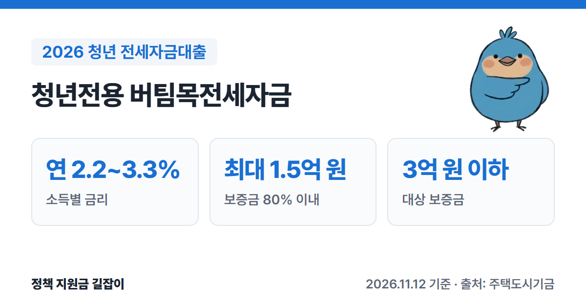
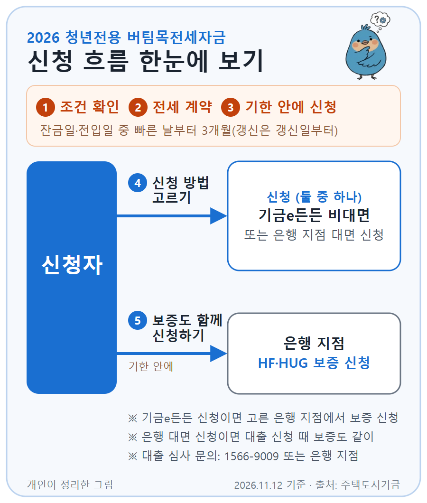

**청년전용 버팀목전세자금**은 전세 보증금이 부족한 청년에게 주택도시기금이 낮은 금리로 빌려주는 전세대출이에요.
은행 일반 전세대출보다 금리가 낮은 대신 나이, 소득, 자산, 집 조건이 정해져 있어요.
주택도시기금 공식 상품 안내를 바탕으로 자격 조건, 한도, 금리, 신청 방법을 정리했어요.

{: .summary-card}

> 💡 **핵심 요약**
> - **만 19~34세** 무주택 세대주, 부부합산 연소득 **5천만 원 이하**, 순자산 **3.45억 원 이하**면 신청할 수 있어요. (출처①)
> - 금리는 소득에 따라 **연 2.2~3.3%**이고, 지방 주택은 **0.2%p** 더 낮아요. (출처①)
> - 한도는 **최대 1.5억 원**(보증금의 80% 이내)이고, 보증금 **3억 원 이하** 집만 가능해요. (출처①)

> **출처 표시 방법**: 본문의 (출처①) 같은 표시는 글 끝 출처 목록의 번호와 같아요.
> 청년 주거 지원 전체는 [2026 청년 주거 지원 총정리]()에서 한눈에 볼 수 있어요.

목차

* 목차
{:toc}

## 한눈에 보기

| 항목 | 내용 |
|---|---|
| 대상 | **만 19~34세** 무주택 세대주 (예비 세대주 포함) |
| 소득·자산 | 부부합산 연소득 **5천만 원 이하** 순자산 **3.45억 원 이하** (2026년 기준) |
| 대상 주택 | 전용 **85㎡ 이하**, 보증금 **3억 원 이하** |
| 대출 한도 | **최대 1.5억 원** (보증금의 80% 이내) |
| 대출 금리 | **연 2.2~3.3%** (변동금리) |
| 대출 기간 | **2년** (연장해서 최장 10년) |
| 신청 | 기금e든든 비대면 신청 후 은행 방문, 또는 은행 대면 신청 |

(출처①)

---

## 누가 받을 수 있나요?

아래 조건을 **모두** 갖춰야 해요. (출처①)

### 기본 조건

| 조건 | 내용 |
|---|---|
| 나이 | 대출 접수일 기준 **만 19~34세** 세대주 |
| 주택 | 세대주와 세대원 **모두 무주택** |
| 계약 | 임대차계약을 맺고 보증금의 **5% 이상**을 낸 상태 |
| 소득 | 본인과 배우자 합산 **5천만 원 이하** |
| 자산 | 본인과 배우자 합산 순자산 **3.45억 원 이하** |

(출처①)

- **예비 세대주**도 신청할 수 있어요. (출처①) 다만 청년전용 상품안내(출처①)에는 예비 세대주로 인정되는 조건이나 언제까지 세대주가 되어야 하는지가 따로 나와 있지 않아요. 지금 부모님 집에 살고 있다면 신청할 은행에 먼저 확인하세요.
- **군대를 다녀왔다면** 나이가 늘어날 수 있어요. 중소·중견기업에 다니거나 정해진 창업 지원을 받는 사람은 병역 복무기간만큼, **최대 만 39세**까지 늘려줘요. (출처①)
- 순자산 기준은 통계청 조사의 소득 3분위 가구 평균 자산으로 정하기 때문에 **해마다 바뀌어요.** 3.45억 원은 2026년 기준이에요. (출처①)

### 소득 기준이 높아지는 경우

| 가구 | 부부합산 연소득 |
|---|---|
| 기본 | **5천만 원 이하** |
| 다자녀·2자녀 가구 등 | **6천만 원 이하** |
| 신혼가구 | **7.5천만 원 이하** |

(출처①)

혁신도시로 옮긴 공공기관 직원, 다른 지역으로 이주하는 재개발 구역 세입자도 6천만 원 기준을 적용받아요. (출처①)
소득은 지금 다니는 직장이나 지금 하는 사업을 기준으로 따져요. (출처①)

### 이런 경우는 받을 수 없어요

- 본인이나 배우자가 이미 **전세대출이나 주택담보대출**을 쓰고 있는 경우 (출처①)
- 성년인 세대원(따로 사는 배우자·자녀, 결혼 예정 배우자 포함)이 **주택도시기금 대출**을 쓰고 있는 경우 (출처①)
- 연체, 대위변제, 부도 같은 **신용 문제 기록**이 남아 있는 경우 (출처①)
- 지금 **공공임대주택**에 살고 있는 경우 (그 집이 대출받으려는 집이거나 나가는 경우는 가능) (출처①)

---

## 어떤 집이어야 하나요?

| 조건 | 내용 |
|---|---|
| 면적 | 전용 **85㎡ 이하** (주거용 오피스텔 포함) |
| 25세 미만 | 단독세대주는 전용 **60㎡ 이하** |
| 보증금 | **3억 원 이하** |

(출처①)

LH·SH 등 협약 기관(채권양도협약기관)이 가진 쉐어하우스는 면적 제한이 없고, 세대주가 아니어도 이용할 수 있어요. (출처①)

---

## 얼마나 빌릴 수 있나요?

한도는 아래 세 가지 중 **가장 작은 금액**이에요. (출처①)

| 기준 | 한도 |
|---|---|
| 1집당 한도 | **1.5억 원** (만 25세 미만 단독세대주는 **1.2억 원**) |
| 보증금 비율 | 새 계약: 전세금의 **80%** 갱신: 오른 금액 안에서, 오른 뒤 보증금의 80% |
| 보증 기관 | HF·HUG 보증 규정에 따라 달라짐 |

(출처①)

예를 들어 보증금이 1억 원이면 80%인 **8천만 원**, 보증금이 2억 원이면 80%는 1.6억 원이지만 1집당 한도 때문에 **1.5억 원**까지예요. (출처① 기준으로 계산)
다만 보증 기관 심사에 따라 이보다 적게 나올 수 있어요.

- **2025년 6월 27일 이전에 계약한 경우**에는 2억 원(만 25세 미만 단독세대주는 1.5억 원)까지 적용돼요. (출처①)
- **회사에 다닌 지 1년이 안 됐다면** 한도가 2천만 원 이하로 줄어들 수 있어요. (출처①)

---

## 금리는 얼마인가요?

국토교통부가 정하는 **변동금리**예요. 부부합산 연소득에 따라 달라요. (출처①)

| 부부합산 연소득 | 금리 |
|---|---|
| 2천만 원 이하 | **연 2.2%** |
| 2천만~4천만 원 | **연 2.5%** |
| 4천만~6천만 원 | **연 2.9%** |
| 6천만~7.5천만 원 | **연 3.3%** |

(출처①, 보증금 3억 원 이하 기준)

- 집이 **지방**에 있으면 위 금리에서 **0.2%p** 내려가요. (출처①)
- 6천만 원이 넘는 구간은 신혼가구(7.5천만 원 이하)에만 해당해요. (출처①)

### 금리를 더 낮추는 방법 (우대금리)

**아래 중 하나만** 적용돼요. (출처①)

| 대상 | 우대 |
|---|---|
| 수급자·차상위 | **1.0%p** (연소득 4천만 원 이하) |
| 한부모가구 | **1.0%p** (연소득 5천만 원 이하) |
| 자녀 | 다자녀 **0.7%p**, 2자녀 **0.5%p**, 1자녀 **0.3%p** |
| 장애인 등 | 장애인·다문화·노인부양·고령자 가구 **0.2%p** |

(출처①)

**아래는 여러 개를 함께** 받을 수 있어요. (출처①)

| 대상 | 우대 |
|---|---|
| 25세 미만 | 단독세대주(60㎡ 이하, 대출 1.2억 원 이하) **0.3%p**, 최대 4년 |
| 중소기업 청년 | 중소·중견기업 재직 또는 청년창업자 **0.3%p**, 최대 4년 |
| 전자계약 | 부동산 전자계약 **0.1%p** (2026.12.31. 신규 접수분까지) |
| 월세 성실납부 | 주거안정 월세대출 성실납부자 **0.2%p** |
| 적게 빌림 | 심사 금액의 30% 이하만 신청 **0.2%p**, 최대 4년 |

(출처①)

우대금리는 합쳐서 **최대 0.5%p**까지만 적용돼요(수급자·차상위·한부모는 1.0%p, 다자녀는 0.7%p까지). 우대를 받아도 최종 금리는 **연 1.0%보다 낮아지지 않아요.** (출처①)

중소기업 재직 청년 우대에서 대기업·공기업·사행성 업종 직원과 공무원은 빠져요. (출처①)

---

## 얼마나 오래 빌릴 수 있나요?

- 기본 **2년**이고, 임대차 계약이 끝나는 날을 넘을 수 없어요. (출처①)
- 연장해서 **최장 10년**까지 쓸 수 있어요. (출처①)
- 10년을 쓴 뒤에도 **미성년 자녀 1명당 2년**씩 더 늘려서 **최장 20년**까지 가능해요. (출처①)
- 갚는 방식은 **일시상환**(만기에 한 번에 갚기) 또는 **혼합상환** 중에서 골라요. **중도상환수수료는 없어요.** (출처①)

---

## 어떻게 신청하나요?

{: .flow-chart}

1. **조건 확인하기**: 나이, 소득, 자산, 집 조건을 먼저 확인해요. 주택도시기금 누리집의 '주택전세자금 계산하기'로 대략 한도를 볼 수 있어요. (출처①)
2. **전세 계약하기**: 임대차계약을 맺고 보증금의 **5% 이상**을 내요. (출처①)
3. **기한 안에 신청하기**: 잔금 지급일과 전입신고일 중 **빠른 날부터 3개월 안**에 신청해야 해요. 갱신 계약이면 갱신일부터 3개월 안이에요. (출처①)
4. **신청 방법 고르기**: '기금e든든'에서 비대면으로 신청하거나, 은행 지점에서 대면으로 신청해요. (출처①)
5. **보증도 함께 신청하기**: HF(한국주택금융공사)나 HUG(주택도시보증공사) 보증도 기한 안에 신청해야 해요. 기금e든든으로 신청했다면 고른 은행 지점에 가서, 은행 대면 신청이면 대출 신청 때 같이 신청해요. (출처①)

### 신청할 수 있는 은행

우리은행, KB국민은행, 하나은행, NH농협은행, 신한은행, iM뱅크, 부산은행 (출처①④)

부산은행·iM뱅크는 지역 은행이라, 주민등록 주소지와 지점이 담당 권역(부산·울산·경남, 대구·경북) 안에 있어야 해요. (출처④)

> 대출 심사 문의는 **주택도시보증공사 콜센터 1566-9009**나 은행 지점에 하면 돼요. (출처①)

---

## 놓치기 쉬운 점

- **잔금일·전입일 중 빠른 날부터 3개월이 지나면 신청할 수 없어요.** 갱신 계약이면 갱신일부터 3개월 안이에요. (출처①)
- **보증 신청도 기한 안에 해야 해요.** 기금e든든으로 대출을 신청했다면 고른 은행 지점에 가서 HF·HUG 보증을 따로 신청해요. (출처①)
- **25세 미만 단독세대주는 전용 60㎡ 이하만 돼요.** 85㎡ 기준은 25세 이상이거나 단독세대주가 아닌 경우예요. (출처①)
- **지금 공공임대주택에 살고 있으면 안 돼요.** 다만 그 집이 대출받으려는 집이거나, 본인과 배우자가 나가는 경우는 가능해요. 성년 세대원(따로 사는 배우자·자녀, 결혼 예정 배우자 포함)의 주택도시기금 대출 이용 여부도 확인해요. (출처①)

이런 경우는 주택도시보증공사 콜센터 **1566-9009**나 은행 지점에 먼저 물어보세요: 예비 세대주로 인정되는지, 군 복무 기간을 더한 나이 계산.

---

## 자주 묻는 질문

**Q. 부모님 집에 살고 있는데 신청할 수 있나요?**
공식 안내에 대상이 '세대주(**예비 세대주** 포함)'로 되어 있어요. (출처①) 다만 예비 세대주로 인정되는 조건은 나와 있지 않으니 신청할 은행에 먼저 확인하세요.

**Q. 35세인데 방법이 없나요?**
기본은 만 34세까지예요. 다만 중소·중견기업에 다니거나 정해진 창업 지원을 받는 사람이 군대를 다녀왔다면, 복무기간만큼 **최대 만 39세**까지 늘어날 수 있어요. (출처①)
나이 상한이 없는(성년 세대주) 일반 버팀목전세자금은 금리와 한도가 달라요. (출처②)

**Q. 청년월세 지원과 함께 받을 수 있나요?**
청년월세 지원은 **월세**를 내는 청년을 위한 사업이라 전세와는 대상이 달라요. 월세로 사는 청년이라면 [2026 청년월세 지원 총정리]()에서 조건을 확인하세요.

**Q. 대출을 받은 뒤 집을 사면 어떻게 되나요?**
대출을 받은 뒤 집을 산 사실이 확인되면 **대출금을 갚아야** 해요. (출처①)

**Q. 계약한 뒤 마음이 바뀌면 취소할 수 있나요?**
네. 대출계약서를 받은 날, 계약일, 대출 실행일 등 가장 늦은 날부터 **14일 안**에 철회할 수 있어요. 원금과 이자, 부대비용을 모두 돌려줘야 철회가 끝나요. (출처①)

---

## 함께 보면 좋은 글

- [2026 청년 주거 지원 총정리](): 월세 지원·대출·공공임대·청약통장을 상황별로 정리한 전체 안내
- [2026 청년월세 지원 총정리](): 월세로 사는 청년이라면 월 최대 20만 원 지원 조건 확인
- [2026 청년전용 보증부월세대출 총정리](): 전세 대신 월세를 고른다면, 보증금과 월세를 낮은 금리로 빌리는 대출
- [2026 신혼부부 전세자금대출 총정리](): 결혼했거나 결혼 예정이라면 나이 상한 없이 수도권 최대 2.5억 원까지

---

## 출처

1. [주택도시기금 - 청년전용 버팀목전세자금 상품안내](https://nhuf.molit.go.kr/FP/FP05/FP0502/FP05020301.jsp) - 대출 대상, 소득·자산 기준, 대상 주택, 한도, 금리, 우대금리, 기간, 신청 시기·방법, 취급 은행 (확인일: 2026-11-12)
2. [마이홈포털 - 주택도시기금 버팀목 전세대출 안내](https://www.myhome.go.kr/hws/portal/cont/selectSupLeaseLoanView.do) - 일반 버팀목전세자금 조건 (확인일: 2026-11-12)
3. [기금e든든 (주택도시기금 대출 신청)](https://enhuf.molit.go.kr) (확인일: 2026-11-12)
4. [주택도시기금 - 청년전용 버팀목전세자금 이용절차 및 제출서류](https://nhuf.molit.go.kr/FP/FP05/FP0502/FP05020302.jsp) - 은행 방문 신청 가능 은행 (확인일: 2026-11-12)

> 이 글은 **2026년 11월 12일** 기준이에요. 금리와 자산 기준은 국토교통부 고시에 따라 바뀔 수 있으니 신청 전에 주택도시기금 누리집과 은행에서 꼭 확인하세요.
