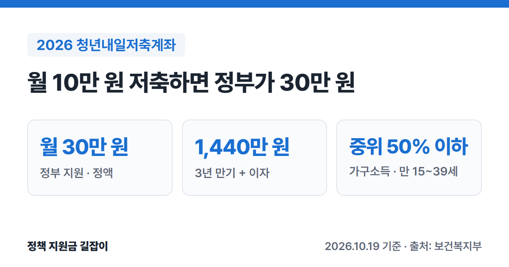

**청년내일저축계좌**는 일하는 저소득 청년이 매달 10만 원 이상 저축하면 정부가 **매달 30만 원**을 더 넣어 주는 통장이에요. 3년을 채우면 **1,440만 원**과 이자를 받아요.
**2026년부터 가입 대상이 바뀌었어요.** 청년미래적금이 새로 생기면서, 이 통장은 기초생활수급자·차상위계층 청년에게 집중해요.
보건복지부 2026년 모집 보도자료를 바탕으로 대상, 혜택, 만기 조건을 정리했어요.

{: .summary-card}

> 💡 **핵심 요약**
> - 가구소득이 기준 중위소득 **50% 이하**이고, 일해서 월 **10만 원 이상** 버는 **만 15~39세** 청년이 대상이에요. (출처①)
> - 매달 10만 원 이상 저축하면 정부가 **월 30만 원**을 더해 줘서, 3년 뒤 **1,440만 원**(본인 저축 360만 원 포함)과 이자를 받아요. (출처①)
> - 2026년 모집(5월 4~20일)은 **끝났어요.** (출처①) 중위소득 200% 이하 만 19~34세 청년 대상인 [청년미래적금]()도 함께 확인하세요. (출처③)

> **출처 표시 방법**: 본문의 (출처①) 같은 표시는 글 끝 출처 목록의 번호와 같아요.

목차

* 목차
{:toc}

## 한눈에 보기

| 항목 | 내용 |
|---|---|
| 나이 | **만 15~39세** |
| 가구소득 | 기준 중위소득 **50% 이하** (수급자·차상위계층) |
| 근로·사업소득 | **월 10만 원 이상** |
| 본인 저축 | 매달 **10만~50만 원** |
| 정부 지원 | **월 30만 원** (정액) |
| 만기 (3년) | **1,440만 원 + 이자** (본인 저축 360만 원 포함) |
| 2026년 모집 | 5.4.~5.20. (**마감**) 모집 2만 5천 명, 최종 선정 **24,145명** |

(출처①④)

---

## 2026년에 무엇이 바뀌었나요?

| 구분 | 2025년까지 · 2026년 |
|---|---|
| 가입 대상 | 기준 중위소득 **100% 이하** 일하는 청년 · 기준 중위소득 **50% 이하** (수급자·차상위) |
| 적립 중지 | 최대 **6개월** · 최대 **12개월** |
| 금융 교육 (만기 해지 예정자) | 오프라인 특강 위주 · **온라인 교육, 비대면 금융상담**, 1:1 컨설팅 |

(출처①)

보건복지부는 **청년미래적금**(중위소득 200% 이하 청년 대상) 도입에 따라, 이 통장은 기초생활수급자·차상위계층 청년 지원에 집중한다고 밝혔어요. (출처①)

---

## 누가 가입할 수 있나요?

아래 조건을 **모두** 갖춰야 해요. (출처①)

| 조건 | 기준 |
|---|---|
| 나이 | **만 15~39세** |
| 가구소득 | 기준 중위소득 **50% 이하** |
| 일하는 소득 | 근로·사업소득 **월 10만 원 이상** |

(출처①)

> **참고**: 2026년 기준 중위소득 50%는 1인 가구 월 약 **128만 2천 원**이에요(1인 가구 중위소득 256만 4,238원의 절반). (출처② 기준으로 계산) 실제 선정은 소득과 재산을 함께 조사해서 정해요. (출처①)

---

## 얼마나 모을 수 있나요?

| 항목 | 금액 (3년) |
|---|---|
| 본인 저축 (월 10만 원 × 36개월) | **360만 원** |
| 정부 지원 (월 30만 원 × 36개월) | **1,080만 원** |
| 합계 | **1,440만 원** + 이자 |

(출처①, 정부 지원 합계는 출처① 기준으로 계산)

- 본인 저축은 매달 **10만 원부터 50만 원까지** 넣을 수 있어요. 정부 지원은 **월 30만 원으로 정해져** 있어서, 더 많이 넣어도 정부 지원은 늘지 않아요. (출처①)
- 적금 이자는 **최대 연 5%** 금리예요. (출처①)

---

## 3년 뒤 모두 받으려면? (유지·만기 조건)

**계좌를 유지하는 동안**
1. **계속 일해야** 해요(근로활동 지속).
2. **매달 본인 저축**을 해야 해요. 만기에 받으려면 본인 저축금을 **최소 24개월 이상** 넣어야 해요. (출처④)
3. 가구소득이 기준 중위소득 **100% 이하**를 유지해야 해요(유지소득기준).

(출처①)

**만기에 받으려면**
1. **자립역량교육 10시간**을 들어야 해요. 자산형성포털(hope.welfareinfo.or.kr) 등에서 들을 수 있어요.
2. **자금활용계획서**를 내야 해요.

(출처①)

> 실직, 질병·사고 등 부득이한 사정이 있으면 저축을 잠시 멈출 수 있어요. 2026년부터 이 **적립 중지** 기간이 최대 **12개월**로 늘었어요. (출처①) 군 입대, 임신·출산·육아로 휴직·퇴사한 경우에는 **특별적립 중지**를 신청해 최대 **2년**까지 납입을 멈추고 만기도 늦출 수 있어요. (출처④)

---

## 어떻게 신청하나요?

2026년 모집은 끝났어요. 아래는 2026년 기준 절차예요. (출처①)

1. **신청**: 모집 기간에 **복지로**(www.bokjiro.go.kr)에서 온라인으로 신청하거나, 주소지 **읍·면·동 행정복지센터**를 방문해요. 필요한 서류와 양식은 복지로와 자산형성포털에서 확인해요.
2. **조사·선정**: 소득·재산 조사를 거쳐 대상자를 정해요.
3. **결과 안내**: 모집 때는 **8월 중** 문자로 안내할 예정이라고 밝혔고, 자산형성포털에서도 확인할 수 있어요. 실제로는 **9월 30일**에 **24,145명** 선정을 마쳤다고 발표했어요. (출처④)
4. **통장 개설**: 선정되면 **하나은행** 지점이나 하나은행 앱(비대면)에서 통장을 만들어요.

(출처①)

**다음 모집**: 보건복지부는 2027년 가입 일정과 선정 규모를 **2027년 1분기**에 확정해 공지할 예정이라고 밝혔어요(2026.9.30. 발표). 2026년 11월 16일 기준으로 모집 공고는 아직 없어요. 2026년에는 5월에 모집했어요. (출처④)

---

## 청년미래적금과 무엇이 다른가요?

| 항목 | 청년내일저축계좌 · 청년미래적금 |
|---|---|
| 나이 | 만 **15~39세** · 만 **19~34세** |
| 대상 소득 | 중위소득 **50% 이하** · 중위소득 **200% 이하** (총급여 7,500만 원 이하 등) |
| 정부 지원 | 월 **30만 원 정액** · 본인 납입액의 **6%(일반형)·12%(우대형)**, 일부 소득 구간은 기여금 없음 |
| 본인 납입 | 월 10만~50만 원 · 월 최대 50만 원 |
| 기간 | 3년 · 3년 |

(출처①③)

예를 들어 매달 10만 원을 넣으면 정부 지원은 청년내일저축계좌가 **월 30만 원**, 청년미래적금은 6~12%인 **월 6천~1만 2천 원**이에요. (출처①③ 기준으로 계산) 두 상품을 함께 가입할 수 있는지는 공식 자료에서 확인하지 못했어요.

---

## 자주 묻는 질문

**Q. 지금 가입할 수 있나요?**
아니요. 2026년 모집은 5월 4~20일에 끝났어요. 2027년 일정은 **2027년 1분기**에 공지될 예정이에요. (출처①④)

**Q. 만 39세인데 가입할 수 있는 청년 적금이 있나요?**
청년내일저축계좌는 **만 15~39세**가 대상이라 39세도 나이 조건에 들어가요. 다만 가구소득 기준 중위소득 50% 이하 같은 다른 조건도 갖춰야 하고, 2026년 모집은 끝났어요. 청년미래적금은 **만 19~34세**가 대상이지만, 병역을 마쳤다면 그 기간(최대 6년)을 나이에서 빼고 계산해요. 청년미래적금 2차 신청도 10월 16일에 끝났어요. (출처①③)

**Q. 이미 가입했는데, 2026년에 소득이 올라서 중위소득 50%를 넘었어요.**
유지 기준은 기준 중위소득 **100% 이하**예요. 계속 일하고 저축하면 유지할 수 있어요. (출처①)

**Q. 일을 잠시 쉬게 됐어요.**
실직, 질병·사고 등 부득이한 사정이 있으면 **최대 12개월**까지 적립을 멈출 수 있어요. (출처①) 자세한 절차는 자산형성지원콜센터(1522-3690)나 행정복지센터에 문의하세요.

**Q. 어디에 물어보면 되나요?**
자산형성지원콜센터 **1522-3690**, 자산형성포털 챗봇, 읍·면·동 행정복지센터에 문의하세요. (출처①)

---

## 함께 보면 좋은 글

- [2026 청년미래적금 총정리](): 중위소득 200% 이하 만 19~34세 청년 대상 자산형성 적금(정부기여금 6~12%)
- [2026 청년 주택드림 청약통장 총정리](): 내 집 마련을 준비하는 청년 전용 청약통장

---

## 출처

1. [보건복지부 보도자료 - 월 10만 원씩 3년 모으면 1,440만 원 받는다 '청년내일저축계좌' 신규 모집 (2026.5.3.)](https://www.mohw.go.kr/board.es?mid=a10503010100&bid=0027&act=view&list_no=1490402) 및 첨부 '청년내일저축계좌 개요(26년 기준)' - 가입 기준, 지원 내용, 유지·만기 조건, 제도 개선, 신청 절차, 문의처 (확인일: 2026-11-16)
2. [보건복지부 보도자료 - 2026년도 기준 중위소득 6.51% 역대 최대로 인상](https://www.mohw.go.kr/board.es?mid=a10503000000&bid=0027&act=view&list_no=1487098) - 2026년 1인 가구 기준 중위소득 (확인일: 2026-10-19)
3. [금융위원회 보도자료 - 10월 7일부터 청년미래적금 2차 가입 신청을 받습니다 (2026.9.16.)](https://fsc.go.kr/no010101/87726) - 청년미래적금 대상(병역 기간 제외)·기여금 비교 (확인일: 2026-11-16)
4. [보건복지부 보도자료 - 2026년 청년내일저축계좌 24,145명 최종 선정 (2026.9.30.)](https://www.mohw.go.kr/board.es?mid=a10503010100&bid=0027&act=view&list_no=1492073) - 최종 선정 인원, 만기 조건(본인 저축금 24개월 이상), 특별적립 중지(최대 2년), 2027년 일정 2027년 1분기 공지 예정 (확인일: 2026-11-16)

> 이 글은 **2026년 11월 16일** 기준이에요. 다음 모집 조건은 달라질 수 있으니 보건복지부·복지로 발표를 꼭 확인하세요.
