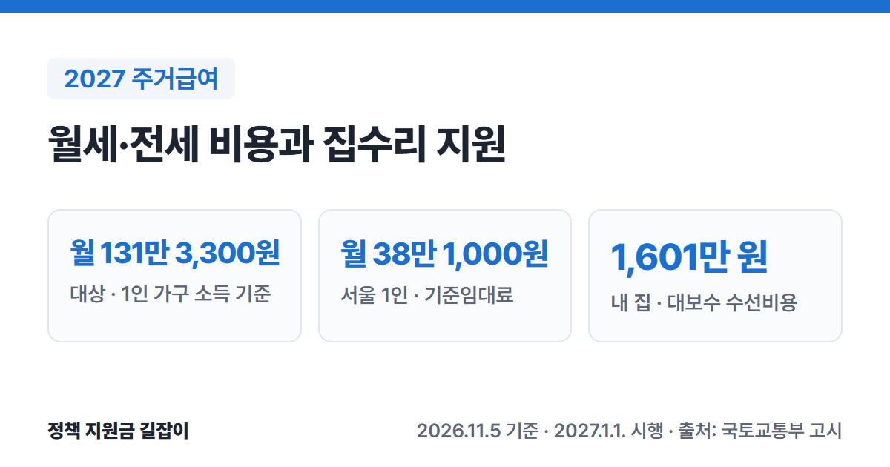

**주거급여**는 소득이 낮은 가구에 월세·전세 비용을 지원하고, 내 집에 사는 가구에는 낡은 집을 고쳐 주는 제도예요.
**2027년 1월 1일**부터 새 기준이 적용돼요. 소득인정액이 **기준 중위소득 48% 이하**인 가구가 받을 수 있고, 1인 가구는 **월 131만 3,300원 이하**예요. (출처①)
2026년 12월까지는 2026년 기준이 그대로 쓰여요. (출처①⑥) 국토교통부 고시 원문을 바탕으로 두 해 기준을 함께 정리했어요.

{: .summary-card}

> 💡 **핵심 요약**
> - 2027년에는 소득인정액이 **기준 중위소득 48% 이하**면 받을 수 있어요. 1인 가구 **월 131만 3,300원**, 4인 가구 **월 332만 6,345원** 이하예요. (출처①)
> - 세 사는 가구는 지역·가구원 수별 **기준임대료**까지 실제 임차료를 받아요. 2027년 서울 1인 가구는 **월 38만 1,000원**이 상한이에요(2026년 36만 9,000원). (출처①②⑥)
> - 내 집에 사는 가구는 집 상태에 따라 수선비용 기준금액 **590만 원~1,601만 원**의 **80~100%**를 수리로 지원받아요. 2026년과 같아요. (출처①⑥)

> **출처 표시 방법**: 본문의 (출처①) 같은 표시는 글 끝 출처 목록의 번호와 같아요.

목차

* 목차
{:toc}

## 한눈에 보기

| 항목 | 내용 |
|---|---|
| 대상 | 소득인정액 **기준 중위소득 48% 이하** 가구 |
| 세 사는 가구 | 기준임대료 안에서 **실제 임차료** 지원 (현금) |
| 내 집 가구 | 경보수·중보수·대보수 **집수리** 지원 |
| 청년 분리지급 | 부모와 따로 사는 **만 19~30세 미만** 미혼 자녀 |
| 2027년 기준 | **2027.1.1.**부터 적용 |
| 신청 | 주소지 **읍·면·동 주민센터** 또는 **복지로** |

(출처①②③⑤)

---

## 누가 받을 수 있나요?

### 소득인정액이 기준 중위소득 48% 이하예요

**소득인정액**은 한 달 소득에 재산을 소득으로 바꾼 금액을 더한 값이에요. (출처⑤) 이 금액이 기준 중위소득 48%인 아래 기준 이하여야 해요. (출처①⑤⑥)

| 가구원 수 | 2027년 (월) | 2026년 (월) |
|---|---|---|
| 1인 | **131만 3,300원** | 123만 834원 |
| 2인 | **215만 710원** | 201만 5,660원 |
| 3인 | **274만 4,684원** | 257만 2,337원 |
| 4인 | **332만 6,345원** | 311만 7,474원 |
| 5인 | **387만 249원** | 362만 7,225원 |
| 6인 | **438만 2,016원** | 410만 6,857원 |
| 7인 | **487만 3,279원** | 456만 7,272원 |

(2027년 출처①, 2026년 출처⑥)

8인 이상 가구는 7인 기준에 '7인과 6인 기준의 차이'를 더해서 정해요. (출처①)

### 받을 수 없는 경우

- 부모·자녀(1촌 직계혈족)와 그 배우자에게 빌린 집은 임대차계약으로 인정하지 않아요. (출처②)
- 보장시설 등 거주시설에 입소한 사람은 원칙적으로 임차급여를 받지 않아요. 임차료를 내는 공동생활가정 등은 예외예요. (출처②)
- 비닐하우스 같은 비주택은 집수리를 하지 않아요. (출처②)

---

## 얼마나 받을 수 있나요?

세 사는 가구는 **임차급여**, 내 집에 사는 가구는 **수선유지급여**를 받아요. 두 가지를 동시에 받지는 않아요. (출처②)

### 세 사는 가구: 2027년 기준임대료 (월 상한)

| 가구원 수 | 서울 / 경기·인천 | 광역시 등 / 그 외 |
|---|---|---|
| 1인 | **38만 1천** / **31만 3천** | **25만 9천** / **23만 4천** |
| 2인 | **43만 1천** / **35만 2천** | **29만 1천** / **26만 5천** |
| 3인 | **51만 4천** / **42만 2천** | **34만 7천** / **31만 8천** |
| 4인 | **59만 6천** / **48만 8천** | **40만 3천** / **36만 9천** |
| 5인 | **61만 8천** / **50만 5천** | **41만 8천** / **38만 2천** |
| 6인 | **73만 1천** / **59만 9천** | **49만 2천** / **45만 2천** |

(출처①, 단위: 원)

- **광역시 등**: 광역시, 세종시, 수도권 밖 특례시예요. (출처①)
- 7인 가구는 6인 기준임대료와 같아요. 8~9인 가구는 6인 기준임대료에 10%를 더해요. (출처①)

2026년 12월까지 적용되는 2026년 기준임대료 보기

| 가구원 수 | 서울 / 경기·인천 | 광역시 등 / 그 외 |
|---|---|---|
| 1인 | **36만 9천** / **30만** | **24만 7천** / **21만 2천** |
| 2인 | **41만 4천** / **33만 5천** | **27만 5천** / **23만 8천** |
| 3인 | **49만 2천** / **40만 1천** | **32만 7천** / **28만 3천** |
| 4인 | **57만 1천** / **46만 3천** | **38만 1천** / **32만 9천** |
| 5인 | **59만 1천** / **47만 9천** | **39만 4천** / **34만** |
| 6인 | **69만 9천** / **56만 8천** | **46만 3천** / **40만 2천** |

(출처⑥, 단위: 원)

### 실제로 받는 금액 계산 방법

1. **실제 임차료**를 구해요. 월세에 보증금을 월세로 바꾼 금액(보증금 × 연 4% ÷ 12)을 더해요. (출처②)
2. 실제 임차료와 기준임대료 중 **적은 금액**이 기본 금액이에요. (출처②)
3. 소득인정액이 **생계급여 선정기준**보다 많으면, 넘는 금액의 **30%**를 빼요. (출처②)

2027년 생계급여 선정기준은 1인 가구 **87만 5,533원**, 4인 가구 **221만 7,563원**이에요. (출처④)

> **예시 (계산해 본 값)**: 2027년, 서울에 사는 1인 가구, 월세 40만 원, 보증금 500만 원, 소득인정액 100만 원
> - 실제 임차료: 40만 원 + (500만 원 × 4% ÷ 12 = 약 1만 6,667원) = 약 41만 6,667원
> - 기준임대료 38만 1,000원이 더 적으므로 기본 금액은 38만 1,000원
> - 자기부담: (100만 원 − 87만 5,533원) × 30% = 약 3만 7,340원
> - 받는 금액: 38만 1,000원 − 3만 7,340원 = **월 약 34만 3,660원** (10원 단위로 올림)
>
> (출처①②④의 기준으로 직접 계산한 예시예요. 실제 금액은 주택조사 결과에 따라 달라져요.)

- 계산한 금액이 1만 원보다 적어도 **1만 원**은 받아요. (출처②)
- 실제 임차료가 기준임대료의 **5배**를 넘으면 1만 원만 받아요. (출처②)

### 내 집에 사는 가구: 집수리 (수선유지급여)

시·군·구가 집 상태(노후도)를 평가해서 경보수·중보수·대보수 중 하나로 정해요. 조사는 LH가 맡아요. (출처②)

| 보수 범위 | 수선비용 / 주기 |
|---|---|
| 경보수 | **590만 원** / 3년 |
| 중보수 | **1,095만 원** / 5년 |
| 대보수 | **1,601만 원** / 7년 |

(출처①, 2026년과 같음)

소득에 따라 수선비용의 일부를 지원해요. (출처①)

- 생계급여 선정기준 이하: **100%**
- 생계급여 선정기준 초과 ~ 중위소득 40% 이하: **90%**
- 중위소득 40% 초과 ~ 48% 이하: **80%**

육로로 갈 수 없는 섬(제주도 본섬 제외)은 수선비용을 10% 더해요. (출처①) 장애인·고령자는 편의시설을 추가로 지원받을 수 있어요. (출처②)

---

## 부모와 따로 사는 청년은 따로 받을 수 있어요

부모님 가구가 주거급여를 받고, 미혼 자녀가 부모와 **다른 시·군**에 따로 살면 자녀 몫의 임차급여를 따로 받을 수 있어요. (출처②)

- **나이**: 만 19세가 되는 해의 1월 1일부터 ~ 만 30세가 되는 달 전까지(출생월 적용) (출처②⑤)
- **조건**: 청년 이름으로 임대차계약을 하고 임차료를 내야 해요. 전입신고도 해야 해요. (출처⑤)
- **같은 시·군**이어도 대중교통 사정이나 장애 등 부득이한 사유가 있으면 인정받을 수 있어요. (출처②)

청년이 받을 수 있는 다른 주거 지원은 [2026 청년 주거 지원 총정리]()에서 한 번에 확인하세요.

---

## 어떻게 신청하나요?

1. **신청하기**: 주소지 **읍·면·동 주민센터**를 찾아가거나 **복지로** 누리집·앱에서 신청해요. (출처⑤)
2. **소득·재산 조사**: 시·군·구가 소득인정액을 조사해요. (출처⑤)
3. **주택조사**: LH가 임대차계약, 임차료, 실제 거주 여부, 집 상태 등을 조사해요. (출처②)
4. **결정·지급**: 시·군·구가 결정하고, 임차급여는 매달 수급자 명의 계좌로 들어와요. (출처③⑤)

> 공공임대주택에 사는 경우에는 임차급여를 임대인(LH 등) 계좌로 바로 보낼 수 있어요. (출처③)

---

## 자주 묻는 질문

### 지금 받고 있으면 2027년에 다시 신청해야 하나요?

2027년 기준은 고시에 따라 **2027년 1월 1일**부터 적용돼요. (출처①) 이미 받고 있는 가구가 따로 다시 신청해야 하는지는 고시에 나와 있지 않아요. 주민센터나 복지로에서 확인하세요.

### 월세를 밀리면 어떻게 되나요?

월세에서 주거급여를 뺀 본인 부담분보다 많이 밀린 달이 3개월 이상이면 임차급여가 중지될 수 있어요. 이때 집주인이 신청하면 집주인 계좌로 바로 지급돼요. (출처②)

### 이사하면 다시 신청해야 하나요?

주소나 임대료가 바뀌어 신고했는데 주택조사가 늦어지면, 그동안은 새 지역 기준임대료의 **60%**를 기준으로 먼저 계산해서 지급해요. (출처②)

### 내 집인데 수리는 언제 해 주나요?

시·군·구가 매년 1월 말까지 그해 수선계획을 세워요. 그해 새로 선정된 가구는 **다음 해부터** 수리할 수 있어요. 화재·누수·동파처럼 급한 경우는 계획과 따로 긴급보수를 할 수 있어요. (출처②)

### 거짓으로 받으면 어떻게 되나요?

속임수나 부정한 방법으로 받으면 **1년 이하의 징역 또는 1천만 원 이하의 벌금**에 처해질 수 있어요. (출처③)

---

## 함께 보면 좋은 글

- [2026 생활비 지원 총정리](): 생계급여·주거급여·기초연금·긴급복지 등 내 상황에 맞는 제도 찾기
- [2027 기준 중위소득 정리](): 생계·의료·주거·교육급여 기준이 2027년에 얼마나 오르는지
- [2026 청년 주거 지원 총정리](): 월세 지원·전세대출·공공임대까지 청년 주거 제도 한눈에
- [2026 생계급여 총정리](): 기준 중위소득 32% 이하 가구가 매달 받는 생활비

---

## 출처

1. [국가법령정보센터 - 국토교통부 고시 「2027년 주거급여 선정기준 및 최저보장수준」(제2026-455호, 2026.8.31., 2027.1.1. 시행)](https://www.law.go.kr/admRulInfoP.do?admRulSeq=2100000284670) - 2027년 가구원 수별 선정기준, 지역별 기준임대료, 보수범위별 수선비용·주기, 소득별 지원율, 시행일(부칙) (확인일: 2026-11-05)
2. [국가법령정보센터 - 국토교통부 고시 「주거급여 실시에 관한 고시」(제2026-379호, 2026.7.16.)](https://www.law.go.kr/admRulInfoP.do?admRulSeq=2100000282666) - 임차급여 산정 방식(제7조), 지급 대상·제외(제6조), 청년 분리지급(제3조의2), 월차임 연체(제10~12조), 수선유지급여(제19~25조), 주택조사(제31조) (확인일: 2026-10-23)
3. [국가법령정보센터 - 「주거급여법」](https://www.law.go.kr/법령/주거급여법) - 선정기준(제5조), 임차료·수선유지비 지급(제7·8조), 벌칙(제24조) (확인일: 2026-10-23)
4. [보건복지부 보도자료 - 내년 기준 중위소득 6.70% 역대 최대 인상, "가장 어려운 국민 생활 더욱 두텁게 보호" (2026.7.28.)](https://www.mohw.go.kr/board.es?mid=a10503010100&bid=0027&act=view&list_no=1491453) - 2027년 생계급여 선정기준 (확인일: 2026-11-04)
5. [복지로 - 주거급여(맞춤형 급여) 서비스 안내](https://www.bokjiro.go.kr/ssis-tbu/twataa/wlfareInfo/moveTWAT52011M.do?wlfareInfoId=WLF00003201) - 소득인정액 뜻, 청년 분리지급 조건(임대차계약·전입신고), 신청 기관과 절차 (확인일: 2026-10-23)
6. [국가법령정보센터 - 국토교통부 고시 「2026년 주거급여 선정기준 및 최저보장수준」(제2025-506호, 2025.9.15., 2026.1.1. 시행)](https://www.law.go.kr/admRulInfoP.do?admRulSeq=2100000264366) - 2026년 선정기준·기준임대료·수선비용 (확인일: 2026-10-23)

> 이 글은 **2026년 11월 5일** 기준이에요(2026.10.23. 처음 작성, 11.5. 2027년 기준으로 갱신). 2026년 12월까지는 2026년 기준, 2027년 1월 1일부터는 2027년 기준이 적용돼요. 신청 전에 주민센터나 복지로에서 꼭 확인하세요.
