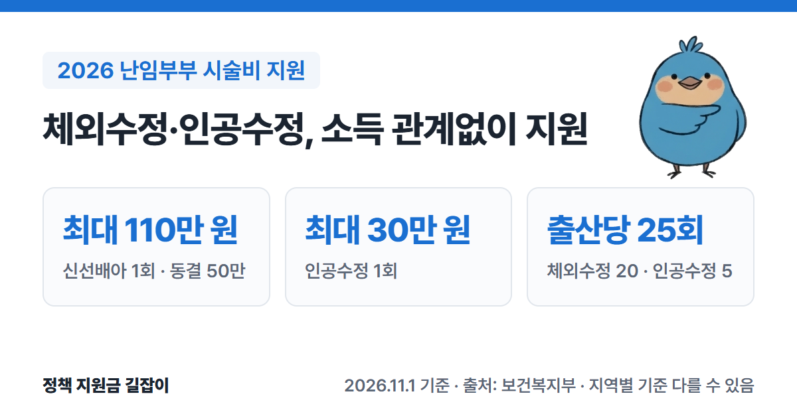

**난임부부 시술비 지원**은 체외수정이나 인공수정 같은 난임 시술을 받는 부부에게 건강보험 본인부담금 등 시술비 일부를 지원하는 제도예요.
2024년부터 **소득과 관계없이** 받을 수 있고, 체외수정 신선배아는 1회 최대 **110만 원**까지 지원해요.
보건복지부 「2026년 모자보건사업 안내」를 바탕으로 대상, 회차별 금액, 계산법, 신청·청구 방법을 정리했어요.

{: .summary-card}

> **핵심 요약**{: .sum-title}
> - 1회 최대 지원금은 체외수정 **신선배아 110만 원**, **동결배아 50만 원**, **인공수정 30만 원**이에요. 소득 기준은 없어요. (출처①)
> - 출산 1번마다 체외수정 **20회**, 인공수정 **5회**까지 지원해요(합계 25회). (출처①)
> - 이 사업은 지자체 사업이라 **지역마다 기준이 다를 수 있어요.** 시술 전에 아내 주소지 보건소에 꼭 확인하세요. (출처①)

> **출처 표시 방법**: 본문의 (출처①) 같은 표시는 글 끝 출처 목록의 번호와 같아요.
> 임신한 뒤 받는 진료비 바우처 등은 [2026 출산지원금 총정리]()에서 확인하세요.

목차

* 목차
{:toc}

## 한눈에 보기

| 항목 | 내용 |
|---|---|
| 대상 | 정부지정 난임시술 의료기관에서 **난임진단서**를 받은 부부 (법적 혼인 또는 1년 이상 사실혼) |
| 소득 기준 | **없음** (2024년 폐지) |
| 1회 최대 | 신선배아 **110만 원** 동결배아 **50만 원** 인공수정 **30만 원** |
| 횟수 | 출산당 체외수정 **20회**, 인공수정 **5회** |
| 신청 | **매 시술마다**, 연중 아내 주소지 **보건소** 또는 **정부24**·**e보건소** |
| 문의 | 아내 주소지 관할 보건소 |

(출처①)

## 먼저 알아 둘 점: 지역마다 다를 수 있어요

이 사업은 2022년부터 **지방자치단체 사업**으로 넘어갔어요. 보건복지부 지침은 최소한의 기준이고, 지자체가 기준이나 지원 내용을 더할 수 있으며 이 경우 **지자체 규정이 먼저** 적용돼요. (출처①)
그래서 이 글은 보건복지부가 정한 표준(최소) 기준을 정리한 것이고, 실제 금액이나 추가 지원은 **아내 주소지 보건소**에서 확인해야 해요. (출처①)

## 누가 받을 수 있나요?

아래 조건을 **모두** 갖춘 부부가 신청할 수 있어요. (출처①)

| 조건 | 내용 |
|---|---|
| 난임진단서 | **정부지정 난임시술 의료기관**의 난임시술 의사가 지침 서식으로 발급한 진단서 |
| 혼인 | 법적 혼인 상태이거나, 신청일 기준 **1년 이상** 사실혼 관계가 보건소에서 확인된 부부 |
| 국적·건강보험 | 부부 중 1명 이상이 주민등록된 대한민국 국적자이고, 부부 모두 건강보험 가입 확인 |

(출처①)

- 비뇨기과 의사는 지원용 난임진단서를 발급할 수 없어요. 남성 요인으로 비뇨기과 진단을 받았다면 그 진단서를 난임시술 의료기관에 내고, 그곳 의사가 난임진단서를 발급해요. (출처①)
- 난임진단서는 처음 낸 것을 계속 쓸 수 있어요. 다만 신청일 기준 **10년**이 지났으면 다시 받아야 해요. (출처①)
- 혼인신고를 막 했다면 접수증을 내고 신청할 수 있어요. 이후 혼인을 증명하는 서류를 추가로 내야 해요. (출처①)
- 국적 조건의 "주민등록된 대한민국 국적자"에 주민등록 말소자와 재외국민 주민등록자는 해당하지 않아요. (출처①)

## 얼마나 받을 수 있나요?

### 회차별 최대 금액

| 시술 | 횟수 (출산당) | 1회 최대 |
|---|---|---|
| 체외수정 신선배아 | **20회** (신선·동결 합산) | **110만 원** |
| 체외수정 동결배아 | 위와 합산 | **50만 원** |
| 인공수정 | **5회** | **30만 원** |

(출처①)

- 2024년 11월부터 횟수가 **부부당**이 아니라 **출산당**으로 바뀌었어요. 아이를 낳으면(임신 20주 이후 사산 포함) 횟수가 다시 채워져요. (출처①)
- 같은 때부터 나이 구분이 없어져서, 45세 이상도 44세 이하와 같은 금액을 받아요. (출처①)

### 지원하는 비용

| 항목 | 지원 |
|---|---|
| 건강보험 본인부담금 (일부·전액) | 합계의 **90%** |
| 배아동결비 | 최대 **30만 원** |
| 착상유도제·유산방지제 | 각각 최대 **20만 원** |
| 냉동난자 해동비 | 최대 **30만 원** (2026년부터) |

(출처①)

위 항목을 합친 금액이 회차별 최대 금액(110만·50만·30만 원)을 넘으면 최대 금액까지만 받아요. (출처①)

### 계산 예시

1회차 신선배아 시술에서 본인부담금 100만 원, 배아동결비 40만 원, 유산방지제 15만 원이 나왔다면 이렇게 계산해요. (출처①)

| 항목 | 지원액 |
|---|---|
| 본인부담금 100만 원 × 90% | 90만 원 |
| 배아동결비 (상한) | 30만 원 |
| 유산방지제 | 15만 원 |
| 합계 135만 원 → 상한 적용 | **110만 원** |

(출처①)

### 지원하지 않는 비용

- 배아동결비, 착상유도제·유산방지제, 냉동난자 해동비 외의 **비급여** 비용은 원칙적으로 지원하지 않아요. (출처①)
- 배아 이식 전 각종 유전자검사·면역력검사, 선택유산 시술 비용은 지원하지 않아요. (출처①)
- 「생명윤리법」이 허용하는 범위의 시술만 지원해요. 매매된 정자·난자를 쓰는 시술이나 대리모는 지원하지 않아요. (출처①)

### 시술이 중간에 멈췄다면

난자를 채취했는데 난자가 없거나(공난포), 미성숙·비정상 난자만 나와 수정할 수 없었던 경우처럼 **의학적 사유로 시술이 중단**되면, 횟수를 차감하지 않고 지원 한도 안에서 지원해요. 이때는 본인부담금 합계의 90%를 지원하고 비급여·약제비는 빠져요. (출처①)

## 어떻게 신청하나요?

### 신청 순서

1. **난임진단서 받기**: 정부지정 난임시술 의료기관에서 지침 서식의 난임진단서를 받아요. (출처①)
2. **지원 신청**: 아내 주소지 관할 보건소를 방문하거나 **정부24**·**e보건소**에서 온라인으로 신청해요. 연중 접수해요. (출처①)
3. **지원결정통지서 받기**: 보건소가 자격을 확인하고 통지서를 발급해요. 통지서 **발급일부터 생긴 시술비**만 지원돼요. (출처①)
4. **병원에 통지서 내기**: 시술받는 정부지정 의료기관에 통지서를 내고 시술을 받아요. 병원이 시술이 끝난 뒤 보건소에 지원금을 청구해요. (출처①)

- 통지서는 **시술 1회에 한 번**만 쓸 수 있어요. 다음 회차 시술은 다시 신청해야 해요. (출처①)
- 통지서 유효기간은 발급일부터 **6개월**이에요(2026년 1월부터 3개월에서 늘어남). 그 안에 시술을 시작하지 않으면 다시 신청해야 해요. (출처①)
- 시술이 끝난 뒤에는 소급 지원이 안 돼요. 시술 시작일이 토요일·공휴일이면 그다음 날(연휴면 연휴 다음 날)까지 통지서를 받으면 인정돼요. 단, 사실혼 부부는 통지서가 있어야 시술을 시작할 수 있어 이 예외가 적용되지 않아요. (출처①)
- 부부 주소지가 다르면 **아내 주소지** 보건소에 신청해요. 아내가 외국인이면 한국인 배우자 주소지에 신청해요. (출처①)
- 부부가 직접 신청하는 게 원칙이고, 어쩔 수 없으면 부부의 부모 등 직계존속이나 형제자매가 신청할 수 있어요. (출처①)
- 사실혼 부부는 처음 신청할 때 보건소에 **방문**해야 해요(온라인 불가). (출처①)

### 준비 서류

| 구분 | 서류 |
|---|---|
| 모두 | 난임부부 시술비 지원 신청서 **난임진단서** (지침 서식) 부부 건강보험증 사본 또는 자격확인서 주민등록등본 (주소지가 다르면 가족관계증명서) |
| 사실혼 | 시술동의서, 제3자와 혼인관계가 없음을 확인하는 서류 1년 이상 사실혼을 증명하는 공문서 또는 사실혼 확인보증서 |

(출처①)

- 건강보험증과 주민등록등본은 행정정보 공동이용에 동의하면 내지 않아도 돼요. (출처①)
- 사실혼 부부는 진단서 없이 먼저 신청할 수 있지만, 시술비 청구 전까지 진단서를 내야 지급돼요. (출처①)

### 약값을 따로 냈다면 (개인 청구)

아래 경우는 **본인이 직접** 청구해요. 병원 청구액과 합쳐서 회차별 최대 금액을 넘지 않는 범위에서 받아요. (출처①)

- **병원 밖 약국에서 시술 관련 약을 산 경우**: 시술이 끝난 뒤 **1개월 안**에 시술비 청구서, 시술확인서, 처방전·영수증, 본인 통장 사본을 보건소나 e보건소로 내요. 늦어진 사유를 보건소장이 인정하면 6개월 안에서 늦게 청구할 수 있어요. (출처①)
- **다른 병원·보건소에서 착상유도제·유산방지제를 맞은 경우**: 시술이 끝난 뒤 **1개월 안**에 같은 서류를 관할 보건소로 내요. **약값만** 지원하고, 주사 놓는 비용과 진료비는 지원하지 않아요. (출처①)

## 자주 묻는 질문

**Q. 소득이 높아도 받을 수 있나요?**
네. 2024년 1월부터 소득 기준(기준 중위소득 180% 이하)이 없어졌어요. (출처①)

**Q. 통지서 하나로 여러 번 시술받을 수 있나요?**
아니요. 통지서는 시술마다 새로 받아야 하고, 유효기간이 남아 있어도 다음 회차에 쓸 수 없어요. (출처①)

**Q. 통지서를 받았는데 시술 전에 자연임신이 됐어요.**
따로 철회하지 않아도 돼요. 유효기간(6개월)이 지나면 자동으로 없어지고, 나중에 새로 신청하면 돼요. (출처①)

**Q. 첫째를 시술로 낳았는데 둘째도 지원되나요?**
네. 출산(임신 20주 이후 사산 포함) 후 다시 시술하면 체외수정 20회, 인공수정 5회가 다시 적용돼요. 건강보험 쪽은 난임시술 재등록이 필요하니 병원에 확인하세요. (출처①)

**Q. 지정 병원이 아닌 곳에서 시술했어요.**
정부지정 시술기관에서 시술한 경우만 지원돼요. 시술 전에 병원이 지정기관인지 확인하세요. (출처①)

**Q. 우리 지역은 더 지원해 준다던데요?**
지자체가 지원 범위나 금액을 더할 수 있어요. 지역마다 다르니 아내 주소지 보건소에 확인하세요. (출처①)

## 함께 보면 좋은 글

- [임신 사전건강관리 지원 총정리](): 20~49세 가임력 검사비 여성 13만·남성 5만 원
- [영구 불임 예상 난자·정자 냉동 지원 총정리](): 항암치료·수술 전후 난자·정자 냉동 비용 50% 지원
- [2026 출산지원금 총정리](): 임신 후 진료비 바우처, 첫만남이용권, 부모급여
- [고위험 임산부 의료비 지원 총정리](): 임신 중 고위험 질환으로 입원했을 때
- [미숙아·선천성이상아 의료비 지원 총정리](): 아기가 신생아중환자실에 입원했을 때

---

## 출처

1. [보건복지부 - 2026년 모자보건사업 안내 (Ⅳ 난임부부 시술비 지원사업 장 124~143쪽, Q&A, PDF)](https://bokjiro.go.kr/ssis-tbu/CmmFileUtil/getDownload.do?atcflId=20260416UUWBM1417530186675526&atcflSn=1) - 지방이양사업·지자체 규정 우선, 2024년 소득기준 폐지, 출산당 체외수정 20회·인공수정 5회, 연령구분 폐지, 회차별 최대 110만·50만·30만 원, 본인부담금 90%·비급여 3종 상한·해동비 30만 원, 계산 예시, 비자발적 시술 중단, 신청 자격(난임진단서·혼인·국적·건강보험), 신청 방법(아내 주소지 보건소·정부24·e보건소), 서류, 통지서 유효기간 6개월·1회 사용, 개인 약제비 청구 1개월, Q&A (확인일: 2026-11-01)

> 이 글은 **2026년 11월 1일** 기준이에요. 이 사업은 지역마다 기준이 다를 수 있으니 시술 전에 아내 주소지 보건소에서 꼭 확인하세요.
