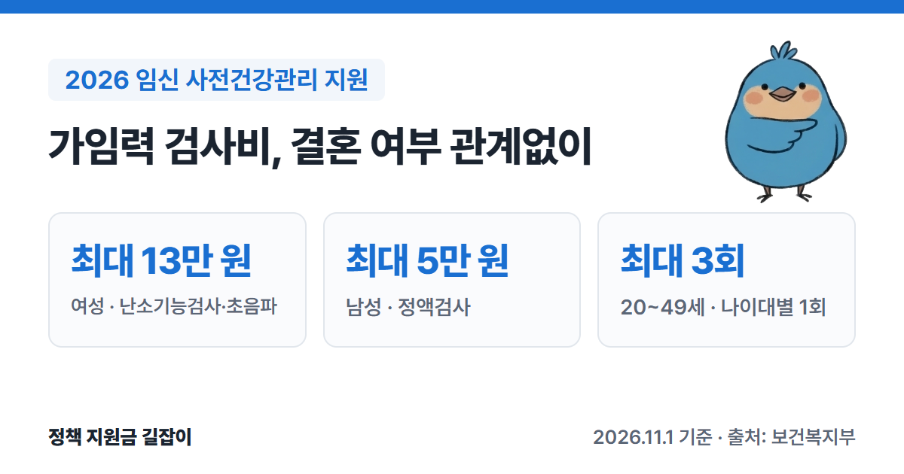

**임신 사전건강관리 지원**은 20~49세 남녀가 가임력 검사를 받을 때 검사비를 지원하는 제도예요.
**결혼이나 자녀 여부와 관계없이** 여성은 최대 **13만 원**, 남성은 최대 **5만 원**까지, 나이대별로 1번씩 최대 3번 받을 수 있어요.
보건복지부 「2026년 모자보건사업 안내」를 바탕으로 대상, 검사 항목, 신청·청구 순서를 정리했어요.

{: .summary-card}

> 💡 **핵심 요약**
> - 20~49세 남녀라면 **결혼·자녀 여부와 관계없이** 가임력 검사비를 나이대별 1회, 최대 **3회** 받을 수 있어요. (출처①)
> - 여성 최대 **13만 원**(난소기능검사·부인과 초음파), 남성 최대 **5만 원**(정액검사)까지 실제 낸 검사비를 돌려줘요. (출처①)
> - 검사 **전에** e보건소나 보건소에서 신청하고, 신청일부터 **3개월 안**에 참여 의료기관에서 검사해요. (출처①)

> **출처 표시 방법**: 본문의 (출처①) 같은 표시는 글 끝 출처 목록의 번호와 같아요.
> 난임 진단을 받고 시술을 받는다면 [난임부부 시술비 지원 총정리]()를 보세요.

목차

* 목차
{:toc}

## 한눈에 보기

| 항목 | 내용 |
|---|---|
| 대상 | **20~49세** 남녀 (결혼·자녀 여부 무관) 15~19세는 부부(예비부부·사실혼 포함)만 |
| 지원 금액 | 여성 최대 **13만 원** 남성 최대 **5만 원** |
| 횟수 | 나이대별 1회, 최대 **3회** |
| 신청 | **검사 전**, 연중 **e보건소** 또는 주소지 **보건소** |
| 검사 | 신청일부터 **3개월 안**, 참여 의료기관 |
| 청구 | 검사일부터 **1개월 안** |

(출처①)

## 누가 받을 수 있나요?

- **20~49세** 남녀 중 검사를 원하는 사람이면 결혼이나 자녀 여부와 관계없이 받을 수 있어요. (출처①)
- **15~19세**는 부부(예비부부, 사실혼 포함)인 경우만 받을 수 있어요. (출처①)
- **50세 이상**은 남녀 모두 지원하지 않아요. (출처①)
- 외국인은 **내국인 배우자가 있을 때만** 받을 수 있어요. 부부가 모두 외국인이면 안 되고, 비자 조건은 따로 없어요. (출처①)
- 같은 검사로 난임부부 시술비, 난임진단비, 신혼(예비)부부 건강검진, 임신·출산 진료비 지원 등 다른 사업의 지원을 이미 받았다면 중복으로 받을 수 없어요. 다른 사업 지원 이력이 있어도 **새로 받은 검사**는 청구할 수 있어요. (출처①)

### 나이대별로 1번씩, 최대 3번

| 구분 | 나이 (만 나이) |
|---|---|
| 1주기 | **29세 이하** |
| 2주기 | **30~34세** |
| 3주기 | **35~49세** |

(출처①)

다음 주기는 그 나이가 되는 **생일부터** 신청할 수 있어요. 예를 들어 10월 1일생은 만 30세가 되는 해 10월 1일부터 2주기를 신청할 수 있어요. (출처①)

## 얼마나 받을 수 있나요?

### 검사 항목과 금액

| 구분 | 필수 검사 | 지원 한도 |
|---|---|---|
| 여성 | 난소기능검사(AMH), 부인과 초음파 | **13만 원** |
| 남성 | 정액검사(정자정밀형태검사) | **5만 원** |

(출처①)

- 한도 안에서 **실제 낸 금액**을 돌려줘요. (출처①)
- 필수 검사와 **같은 날** 낸 진찰료와, 의료기관이 가임력 확인을 위해 판단한 추가 검사비(호르몬 검사 등)도 한도 안에서 함께 지원돼요. (출처①)
- **필수 검사 없이** 다른 검사만 받았다면 지원하지 않아요. 다른 날 받은 검사·진료, 결과를 들으러 다시 갔을 때의 진료비도 본인이 내요. (출처①)

### 내 돈이 들 수도 있어요

참여 의료기관은 필수 검사의 비급여 단가를 여성 **14만 원**(난소기능검사+부인과 초음파 합계), 남성 **5만 5천 원**(정자정밀형태검사, 일반 정액검사는 3만 원) 이하로 받아야 해요. 지원 한도(여성 13만 원, 남성 5만 원)와 차이가 있고 진찰료·추가 검사비가 더해질 수 있어서, 한도를 넘는 금액은 본인이 내요. (출처①)

## 어떻게 신청하나요?

### 신청부터 지급까지

1. **신청**: 검사 **전에** e보건소(e-health.go.kr)에 인증서로 로그인해 신청하거나, 주민등록 주소지 보건소를 방문해 신청해요. 본인만 신청할 수 있어요(대리 신청 불가). (출처①)
2. **검사의뢰서 받기**: 신청이 접수되면 시스템에서 검사의뢰서가 바로 발급돼요. e보건소에서 확인해 출력하거나 휴대폰 화면으로 보여 줘요. (출처①)
3. **검사**: 신청일부터 **3개월 안**에 **사업 참여 의료기관**에서 검사의뢰서를 보여 주고 검사와 결과 상담을 받아요. 검사비는 일단 병원에 **전부 내요**. (출처①)
4. **청구**: 검사일부터 **1개월 안**에 e보건소나 보건소에 청구해요. (출처①)
5. **지급**: 청구일부터 **3개월 안**에 본인 통장으로 들어와요. (출처①)

- 검사를 두 번 이상 나눠 받았다면 **마지막 검사일부터 1개월 안**에 영수증을 모두 모아 한 번에 청구해요(신청 1번에 청구 1번). (출처①)
- **소급 지원은 안 돼요.** 신청 전에 받은 검사는 지원하지 않아요. 단, 검사 **당일**에 신청하면 지원돼요. (출처①)
- 참여하지 않는 병원에서 받은 검사는 지원하지 않아요. 검사 전에 e보건소에서 **참여 의료기관 목록**을 확인하고, 예약이 필요할 수 있으니 전화하고 가세요. (출처①)
- 3개월 안에 검사를 못 받았다면 기존 신청을 지우고 다시 신청해야 해요. (출처①)
- 연중 신청할 수 있지만, 지자체 예산 사정으로 일찍 마감될 수 있어요. (출처①)

### 준비 서류

| 구분 | 서류 |
|---|---|
| 신청 (내국인) | 신청서, 개인정보 동의서, 주민등록등본 (온라인 신청은 제출 서류 없음) |
| 신청 (외국인) | 신청서, 개인정보 동의서, 외국인등록사실증명 등 내국인 배우자의 주민등록등본, 필요하면 혼인 증빙 |
| 청구 | 검사비 청구서, **진료비 영수증**, **진료비 세부내역서**, 본인 명의 통장 사본 |

(출처①)

- 15~19세 부부는 주민등록에서 혼인관계가 확인되지 않으면 혼인 증빙 서류를 내야 해요. (출처①)
- 청구할 때 영수증에 필수 검사(난소기능검사, 부인과 초음파, 정액검사) 중 **1개 이상**이 들어 있어야 해요. (출처①)

## 자주 묻는 질문

**Q. 결혼 안 했는데도 받을 수 있나요?**
네. 20~49세라면 결혼이나 자녀 여부와 관계없이 받을 수 있어요. (출처①)

**Q. 검사 받고 나서 신청해도 되나요?**
아니요. 신청 전에 받은 검사는 지원하지 않아요. 검사 당일 신청까지는 인정돼요. (출처①)

**Q. 아무 산부인과에서나 받으면 되나요?**
아니요. 사업 참여 의료기관에서 받아야 해요. e보건소에서 목록을 확인하세요. (출처①)

**Q. 남편과 같이 받을 수 있나요?**
네. 각자 신청하면 돼요. 여성은 13만 원, 남성은 5만 원 한도로 각각 받아요. (출처①)

**Q. 청구 기한(1개월)을 넘겼어요.**
원칙적으로 지급하지 않아요. 보건소장이 타당한 사유를 인정하면 예산 범위 안에서 지원될 수 있으니 보건소에 문의하세요. (출처①)

## 함께 보면 좋은 글

- [난임부부 시술비 지원 총정리](): 난임 진단 뒤 체외수정·인공수정 시술비 지원
- [2026 출산지원금 총정리](): 임신 후 진료비 바우처, 첫만남이용권, 부모급여

---

## 출처

1. [보건복지부 - 2026년 모자보건사업 안내 (Ⅲ 임신 사전건강관리 지원 장 33~56쪽, Q&A 94~100쪽, PDF)](https://bokjiro.go.kr/ssis-tbu/CmmFileUtil/getDownload.do?atcflId=20260416UUWBM1417530186675526&atcflSn=1) - 지원 대상(20~49세 결혼·자녀 무관, 15~19세 부부, 50세 이상 불가, 외국인 조건), 주기별 1회 최대 3회, 필수 검사 항목, 여성 13만·남성 5만 원 한도(같은 날 진찰료·추가 검사 포함), 필수 검사 비급여 단가 상한(여성 14만·남성 5.5만/3만 원), 2회 이상 검사 시 한 번에 청구, 신청 방법(e보건소·보건소, 대리 불가), 소급 불가·당일 신청 인정, 신청일부터 3개월 내 검사, 검사일부터 1개월 내 청구, 청구일부터 3개월 내 지급, 서류, 중복 지원 불가 (확인일: 2026-11-01)

> 이 글은 **2026년 11월 1일** 기준이에요. 지자체 예산 사정으로 신청이 일찍 마감될 수 있으니 신청 전에 e보건소나 주소지 보건소에서 꼭 확인하세요.
