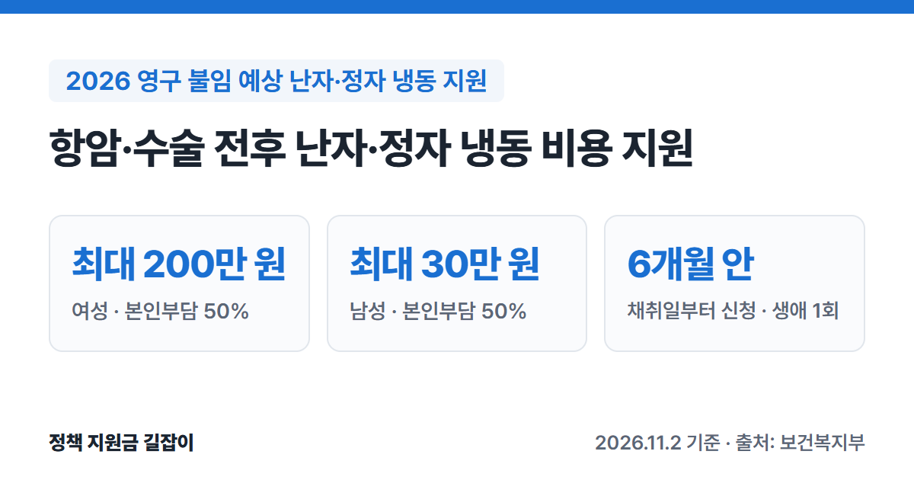

**영구 불임 예상 난자·정자 냉동 지원**은 항암치료나 난소·고환 수술처럼 생식 기능이 손상되는 치료를 받기 전후에, 나중에 아이를 가질 수 있도록 난자·정자를 얼려 두는 비용을 지원하는 제도예요.
**결혼 여부와 관계없이** 본인부담금의 **50%**를 여성 최대 **200만 원**, 남성 최대 **30만 원**까지, 평생 1번 받을 수 있어요.
보건복지부 「2026년 모자보건사업 안내」를 바탕으로 대상, 지원 범위, 신청 방법을 정리했어요.

{: .summary-card}

> 💡 **핵심 요약**
> - 항암치료, 난소·고환 절제 등 법에 정한 사유로 **영구 불임이 예상되는** 사람이 대상이에요. 결혼 여부와 관계없어요. (출처①)
> - 본인부담금의 **50%**를 여성 최대 **200만 원**, 남성 최대 **30만 원**까지, **평생 1번** 지원해요. (출처①)
> - 난임시술 의료기관에서 냉동한 뒤 **채취일부터 6개월 안**에 주소지 보건소나 e보건소로 신청해요. (출처①)

> **출처 표시 방법**: 본문의 (출처①) 같은 표시는 글 끝 출처 목록의 번호와 같아요.
> 나중에 난임 진단을 받고 얼려 둔 난자로 시술을 받으면, [난임부부 시술비 지원]() 대상일 때 해동비를 지원받을 수 있어요.

목차

* 목차
{:toc}

## 한눈에 보기

| 항목 | 내용 |
|---|---|
| 대상 | 법에 정한 수술·치료·염색체 이상으로 **영구 불임이 예상되는** 남녀 (결혼 무관) |
| 지원 금액 | 본인부담금의 **50%** 여성 최대 **200만 원**, 남성 최대 **30만 원** |
| 횟수 | **생애 1회** |
| 신청 기한 | 생식세포 **채취일부터 6개월 안** |
| 신청 | 주민등록 주소지 **보건소** 또는 **e보건소** |
| 지급 | 신청일부터 **1개월 안** |

(출처①)

## 누가 받을 수 있나요?

### 영구 불임이 예상되는 사유

아래 사유로 생식 기능이 손상돼 **영구 불임이 예상되는** 사람이 대상이에요(「모자보건법 시행령」 제14조). (출처①)

| 구분 | 사유 |
|---|---|
| 수술 | 유착성자궁부속기절제술, 부속기종양적출술, 난소부분절제술 고환적출술, 고환악성종양적출술, 부고환적출술 |
| 항암치료 | 항암제 투여, 복부·골반 부위가 포함된 방사선 치료, 면역 억제 치료 |
| 염색체 이상 | 터너증후군, 클라인펠터증후군, 균형전이에 따른 생식기 기능 저하 |

(출처①)

- 위 수술·치료에 해당한다고 인정할 수 있으면 **폭넓게** 인정해요. 항암 목적의 **항호르몬치료**(내분비치료)도 항암치료에 들어가요. (출처①)
- 수술·치료를 **앞둔 경우**뿐 아니라, **이미 받은 뒤**에도 생식 기능 보전이 필요하면 지원받을 수 있어요. (출처①)
- **결혼 여부와 관계없이** 받을 수 있어요. (출처①)

### 그 밖의 조건

- 주민등록이 된 **대한민국 국적자**이고 **건강보험 가입**이 확인돼야 해요. 의료급여 수급자 등 법에 따른 건강보험 가입 제외자도 포함돼요. 주민등록 말소자와 재외국민 주민등록자는 빠져요. (출처①)
- 생식세포 **채취일이 2025년 1월 1일 이후**여야 해요. (출처①)
- 다른 정부·지자체·민간의 비슷한 사업과 **중복으로 받을 수 없어요.** (출처①)

## 얼마나 받을 수 있나요?

| 구분 | 지원 |
|---|---|
| 지원율 | 본인부담금의 **50%** |
| 여성 (난자) | 최대 **200만 원** |
| 남성 (정자) | 최대 **30만 원** |
| 횟수 | **생애 1회** |

(출처①)

### 지원하는 비용

- 난자·정자를 얼리기 위한 **검사**, **과배란 유도**(여성), **채취**, **동결**, **보관** 비용이에요. (출처①)
- 동결·보존과 관련된 비용이면 한도 안에서 지원해요. 동결·보존을 위해 병원 밖 약국에서 산 약값도 서류를 내면 한도 안에서 지원돼요. (출처①)
- 의학적 사유나 개인 사정으로 **어쩔 수 없이** 중간에 멈춘 경우에도 신청할 수 있고, 지원 횟수도 차감되지 않아요. 동결·보존 확인서에 중단 사유가 적혀 있고 불가피하다고 인정돼야 해요. (출처①)

### 지원하지 않는 비용

- **입원료**, 동결·보존과 관계없는 검사료, **연장 보관료** 등은 지원하지 않아요. (출처①)

### 암 환자라면 먼저 확인할 것

만 19~49세 암 환자는 **대한암협회의 청년 암 환자 가임력 보존 의료비 지원사업**을 먼저 안내받아요. 그 사업에서 떨어지면 이 사업으로 지원받을 수 있어요. (출처①)
안내서에 적힌 2025년 기준 대한암협회 사업은 여성 최대 300만 원, 남성 최대 30만 원이고 중위소득 180% 이하 조건이 있어요. 올해 기준은 대한암협회에 확인하세요. (출처①)

## 어떻게 신청하나요?

### 신청 순서

1. **동결·보존 시술**: 정부가 지정한 **난임시술 의료기관**에서 난자·정자를 채취해 얼려요. (출처①)
2. **비용 내기**: 시술비를 병원에 **먼저** 내요. (출처①)
3. **서류 받기**: 병원에서 진단서, 동결·보존 확인서, 영수증, 세부내역서를 받아요. (출처①)
4. **신청**: **채취일부터 6개월 안**에 주민등록 주소지 보건소를 방문하거나 **e보건소**(e-health.go.kr)에서 온라인으로 신청해요. (출처①)
5. **지급**: 신청일부터 **1개월 안**에 본인 통장으로 들어와요. (출처①)

- 본인이 신청하는 게 원칙이고, 어쩔 수 없으면 **배우자나 부모 등 직계존속**이 관계 증명 서류를 갖고 신청할 수 있어요. (출처①)
- 6개월 안에 신청하지 못한 타당한 사유를 보건소장이 인정하면 늦게 신청할 수 있어요. (출처①)
- 난임시술 의료기관 목록은 보건복지부와 건강보험심사평가원 누리집에서 확인할 수 있어요. (출처①)

### 준비 서류

| 구분 | 서류 |
|---|---|
| 직접 준비 | 지원 신청서, 개인정보·행정정보 공동이용 동의서, **본인 명의 통장 사본** |
| 병원에 요청 | 의학적 사유가 적힌 **의사 진단서** **동결·보존 확인서** 진료비 영수증, 진료비 세부내역서 |

(출처①)

행정정보 공동이용에 동의하지 않으면 주민등록등본과 건강보험증 사본(또는 자격확인서)을 더 내야 해요. 건강보험 가입 제외자는 자격증명서나 국가유공자등록증 등 확인서류를 내요. (출처①)

## 자주 묻는 질문

**Q. 결혼하지 않았는데 받을 수 있나요?**
네. 결혼 여부와 관계없이 받을 수 있어요. (출처①)

**Q. 이미 항암치료를 받았어요.**
치료를 받은 뒤에도 생식 기능 보전이 필요하면 지원받을 수 있어요. 다만 채취일이 2025년 1월 1일 이후여야 하고, 채취일부터 6개월 안에 신청해야 해요. (출처①)

**Q. 소득 기준이 있나요?**
안내서의 지원 대상 조건에는 소득 기준이 없어요. 의학적 사유, 국적·건강보험, 채취일(2025년 1월 1일 이후) 조건을 보고, 나이 제한도 없어요. 다만 대한암협회 사업은 소득 조건(중위소득 180% 이하, 2025년 기준)이 있어요. (출처①)

**Q. 나중에 얼린 난자로 임신을 시도하면 비용 지원이 되나요?**
난임 진단을 받고 난임부부 시술비 지원 대상이 되면, 2026년부터 냉동난자 해동비를 시술당 최대 30만 원까지 받을 수 있어요. 자세한 내용은 [난임부부 시술비 지원 총정리]()에서 확인하세요. (출처①)

## 함께 보면 좋은 글

- [난임부부 시술비 지원 총정리](): 냉동난자 해동비 등 체외수정·인공수정 시술비 지원
- [임신 사전건강관리 지원 총정리](): 20~49세 가임력 검사비 여성 13만·남성 5만 원
- [2026 출산지원금 총정리](): 임신 후 진료비 바우처, 첫만남이용권, 부모급여

---

## 출처

1. [보건복지부 - 2026년 모자보건사업 안내 (영구 불임 예상 난자·정자 냉동 지원사업 장 217~228쪽·Q&A 235~238쪽, 난임부부 시술비 지원사업 장 126·131·140·144쪽, PDF)](https://bokjiro.go.kr/ssis-tbu/CmmFileUtil/getDownload.do?atcflId=20260416UUWBM1417530186675526&atcflSn=1) - 모자보건법 제11조의7·시행령 제14조 사유, 지원 대상(결혼 무관, 국적·건강보험, 2025.1.1. 이후 채취), 본인부담금 50%·여성 200만·남성 30만 원·생애 1회, 지원 범위·제외, 중복 지원 불가와 대한암협회 사업 우선 안내(2025년 기준), 신청(채취일부터 6개월, 보건소·e보건소, 대리 신청), 서류, 1개월 내 지급, 냉동난자 해동비 30만 원 (확인일: 2026-11-02)

> 이 글은 **2026년 11월 2일** 기준이에요. 지원 조건은 바뀔 수 있으니 신청 전에 주민등록 주소지 보건소에서 꼭 확인하세요.
