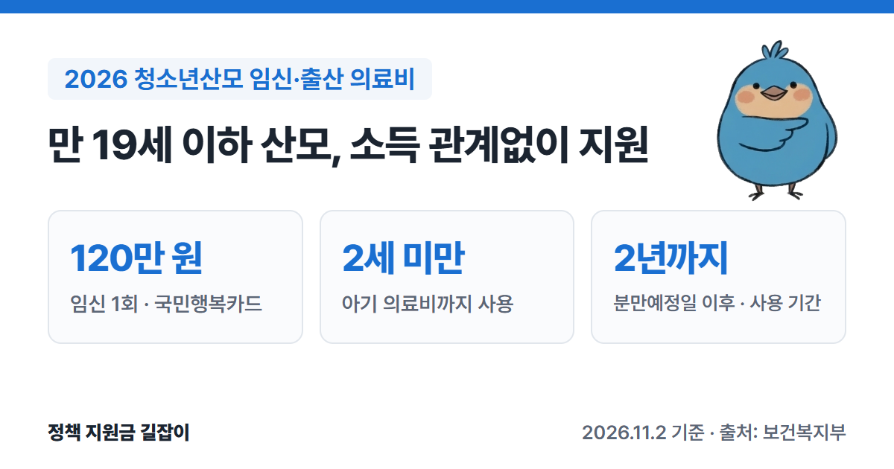

**청소년산모 임신·출산 의료비 지원**은 만 19세 이하에 임신한 산모에게 병원비로 쓸 수 있는 바우처를 주는 제도예요.
**소득·재산과 관계없이** 임신 1회당 **120만 원**을 국민행복카드로 받고, 엄마와 2세 미만 아기의 진료비에 쓸 수 있어요.
보건복지부 「2026년 모자보건사업 안내」를 바탕으로 대상, 쓸 수 있는 곳, 신청 방법을 정리했어요.

{: .summary-card}

> 💡 **핵심 요약**
> - **임신확인일 기준 만 19세 이하** 산모라면 소득·재산과 관계없이 받을 수 있어요. (출처①)
> - 임신 1회당 **120만 원**을 국민행복카드 포인트로 받아요. 누구나 받는 임신·출산 진료비 바우처(단태아 100만 원)와 **함께** 받을 수 있어요. (출처①②)
> - 엄마와 **2세 미만 아기**의 의료비·약값에 쓸 수 있고, 분만예정일 이후 **2년**까지 써요. (출처①)

> **출처 표시 방법**: 본문의 (출처①) 같은 표시는 글 끝 출처 목록의 번호와 같아요.
> 누구나 받는 임신·출산 진료비 바우처와 첫만남이용권은 [2026 출산지원금 총정리]()에서 확인하세요.

목차

* 목차
{:toc}

## 한눈에 보기

| 항목 | 내용 |
|---|---|
| 대상 | 임신확인일 기준 **만 19세 이하** 산모 |
| 소득 기준 | **없음** (소득·재산 무관) |
| 지원 금액 | 임신 1회당 **120만 원** |
| 사용처 | 엄마와 **2세 미만** 아기의 의료비·약값 (산후조리원 제외) |
| 사용 기간 | 카드 받은 날부터 분만예정일 이후 **2년**까지 |
| 신청 | **사회서비스 전자바우처** 누리집 (www.socialservice.or.kr) |
| 문의 | 한국사회보장정보원 바우처사업 콜센터 **1566-3232** (단축 4번) |

(출처①)

## 누가 받을 수 있나요?

- **만 19세 이하** 산모가 받을 수 있어요. 나이는 병원에서 받은 **임신확인서의 임신확인일**을 기준으로 따져요. (출처①)
- **소득·재산 기준은 없어요.** 다만 신청할 때 주민등록이 말소됐거나 국외로 출국한 사람 등 자격상실자는 제외돼요. (출처①)
- 예를 들어 2006년 2월 10일생은 임신확인일이 **2026년 2월 9일까지**여야 해요. (출처①)
- 국민건강보험(또는 의료급여)에 가입된 **외국인**도 받을 수 있어요. 가입 여부를 확인하는 서류를 더 내야 해요. (출처①)
- 임신 횟수 제한은 없어요. 임신할 때마다 120만 원 안에서 받아요. (출처①)

## 얼마나, 어디에 쓸 수 있나요?

### 금액과 사용 기간

| 항목 | 내용 |
|---|---|
| 금액 | 임신 1회당 **120만 원** |
| 사용 시작 | 국민행복카드를 **받은 날**부터 (이미 카드가 있으면 신청 승인 다음 날부터) |
| 사용 끝 | 분만예정일 이후 **2년**까지 (출산·유산 뒤 신청하면 출산·유산일부터 2년) |

(출처①)

- 예를 들어 분만예정일이 2026년 5월 1일이면 **2028년 4월 30일**까지 쓸 수 있어요. (출처①)
- 기간 안에 쓰지 않은 금액은 **자동으로 없어져요.** (출처①)
- 하루나 한 번에 쓸 수 있는 금액 제한은 없어요. (출처①)

### 쓸 수 있는 곳

- 엄마와 **2세 미만 아기**의 **모든 의료비**와 처방받은 약값·치료재료비에 쓸 수 있어요. (출처①)
- 출산할 때 **병실 이용료**에도 쓸 수 있고, 1인실·다인실 제한이 없어요. (출처①)
- 태어난 지 2년 안의 아기라면 국가예방접종에 들어가지 않는 **비급여 예방접종**에도 쓸 수 있어요. (출처①)
- 유산·조산 전후에 생긴 비용에도 쓸 수 있어요. (출처①)
- **산후조리원 비용**에는 쓸 수 없어요. (출처①)

### 다른 지원과 함께 받기

- 국민건강보험(또는 의료급여)에 가입된 만 19세 이하 산모는 이 지원과 **임신·출산 진료비 바우처**를 **둘 다** 받을 수 있어요. 함께 쓰면 건강보험 진료비 바우처가 먼저 빠지고, 그다음 청소년산모 지원금이 빠져요. (출처①)
- 같은 진료비를 다른 국가·지자체 지원과 **겹쳐서** 받으면 안 돼요. 다른 지원으로 다 못 낸 **부족분**만 이 지원금으로 낼 수 있어요. (출처①)

## 어떻게 신청하나요?

### 신청 순서

1. **임신확인서 받기**: 사회서비스 전자바우처 누리집에서 「청소년산모 임신·출산 의료비 지원 신청 및 임신확인서」를 내려받아 병·의원에서 임신 확인을 받아요. (출처①)
2. **온라인 신청**: 사회서비스 전자바우처 누리집(www.socialservice.or.kr)에서 신청하고 국민행복카드 카드사를 골라요. (출처①)
3. **서류 보내기**: 임신확인서와 주민등록등본을 **온라인 신청일부터 15일 안에** 한국사회보장정보원에 도착하도록 우편으로 보내요. (출처①)
4. **카드 받기**: 자격이 결정되면 카드사가 본인 확인 전화를 하고, 보통 7~10일 안에 카드를 보내요. 안내를 받고 **20일 안에** 받지 않으면 카드가 폐기될 수 있어요. (출처①)
5. **병원에서 결제**: 병원·약국에서 국민행복카드로 결제해요. 카드를 받기 **전에** 낸 병원비는 나중에 카드로 바꿔 결제할 수 없어요. (출처①)

- 국민건강보험공단의 **임신·출산 진료비 지원**이나 **맘편한 임신**을 신청할 때 정보 제공에 동의했다면, 전자바우처 누리집 신청과 서류 제출을 **생략**할 수 있어요. (출처①)
- 이미 국민행복카드가 있으면 카드를 새로 만들지 않아도 돼요. (출처①)
- 출산(유산·사산 포함)한 뒤에도 출산일부터 2년 안이면 신청할 수 있어요. 이때는 임신확인서 대신 출산(유산·사산)을 확인할 수 있는 서류, 주민등록등본, 신분증 사본을 내고, 임신확인일은 분만일 10개월 전 날로 봐요. (출처①)
- 국민행복카드를 **가져가지 않으면** 그날 진료비에는 지원을 받을 수 없어요. (출처①)

### 서류 보낼 곳

- 서울특별시 광진구 능동로 400 한국사회보장정보원 바우처사업본부 청소년산모 바우처 사업 담당자 (우편번호 04933) (출처①)

### 준비 서류

| 구분 | 서류 |
|---|---|
| 본인 신청 | **임신확인서**(병·의원 확인), **주민등록등본** (발급 3개월 이내) |
| 만 14세 미만 | 임신확인서 뒷면 **법정대리인 동의 서명** |
| 가족 대리 신청 | 위 서류 + 위임장, 대리인 신분증 사본, 가족관계 증명 서류 |
| 외국인 | 외국인등록증 사본 등, 건강보험 가입 확인 서류 |

(출처①)

- 원칙은 **산모 본인**이 신청하는 거예요. 고위험 임신 등으로 어려우면 가족이 위임장을 갖고 대신 신청할 수 있어요. (출처①)
- 휴대폰 인증이 안 돼서 온라인 신청이 어렵다면 **미혼모자시설**, 권역별 **미혼모·부자 지원기관**, 가까운 **보건소**에 신청할 수 있어요. (출처①)
- 체크카드로 만들려면 본인 명의 계좌가 필요해요. 만 14세 미만이면 보호자가 서류를 챙겨 은행에 가서 계좌를 만들어요. (출처①)

## 자주 묻는 질문

**Q. 부모님 소득이 높아도 되나요?**
네. 소득·재산 기준이 없어요. 임신확인일 기준 만 19세 이하면 되고, 주민등록 말소자·국외 출국자 등 자격상실자만 제외돼요. (출처①)

**Q. 일반 임신·출산 진료비 바우처(100만 원)와 같이 받을 수 있나요?**
네. 국민건강보험(또는 의료급여)에 가입돼 있으면 둘 다 받을 수 있어요. 결제할 때 진료비 바우처가 먼저 빠져요. (출처①②)

**Q. 아기 진료비에도 쓸 수 있나요?**
네. 2세 미만 아기의 의료비와 약값에도 쓸 수 있어요. (출처①)

**Q. 남은 금액은 어디서 확인하나요?**
사회서비스 전자바우처 누리집이나 카드사에 전화하면 확인할 수 있어요. (출처①)

**Q. 카드를 잃어버렸어요.**
카드사 대표전화로 바로 신고하고 다시 발급받아요. 신고하지 않아 다른 사람이 쓴 금액은 돌려받지 못해요. (출처①)

## 함께 보면 좋은 글

- [2026 출산지원금 총정리](): 임신·출산 진료비 바우처, 첫만남이용권, 부모급여
- [한부모가족 아동양육비 총정리](): 청소년 한부모 추가 지원 등 혼자 아이를 키울 때
- [기저귀·조제분유 지원 총정리](): 저소득·한부모 가정 2세 미만 아기 기저귀값

---

## 출처

1. [보건복지부 - 2026년 모자보건사업 안내 (Ⅴ 청소년산모 임신·출산 의료비 지원사업 장 239~269쪽, Q&A 포함, PDF)](https://bokjiro.go.kr/ssis-tbu/CmmFileUtil/getDownload.do?atcflId=20260416UUWBM1417530186675526&atcflSn=1) - 대상(임신확인일 기준 만 19세 이하, 소득·재산 무관, 연령 산정 예시), 임신 1회 120만 원, 사용 범위(임산부·2세 미만 영유아 모든 의료비·약제·치료재료, 산후조리원 제외), 사용 기간(분만예정일 이후 2년), 신청(사회서비스 전자바우처, 서류 15일 이내 우편, 건보 임신출산 진료비 신청 시 생략), 카드 발급·수령, 중복 사용 제한, Q&A(병실료·비급여 예방접종·유산 후 사용·임신출산 진료비와 동시 지원·외국인·분실·자격상실자 제외·출산 후 신청 서류), 바우처사업 콜센터 1566-3232(단축 4번, 같은 안내서 다른 장의 콜센터 안내) (확인일: 2026-11-02)
2. [보건복지부 - 임신·출산진료비 지원사업](https://www.mohw.go.kr/menu.es?mid=a10705020100) - 임신 1회당 100만 원(다태아 별도) (확인일: 2026-11-02)

> 이 글은 **2026년 11월 2일** 기준이에요. 지원 조건은 바뀔 수 있으니 신청 전에 사회서비스 전자바우처 누리집이나 1566-3232에서 꼭 확인하세요.
