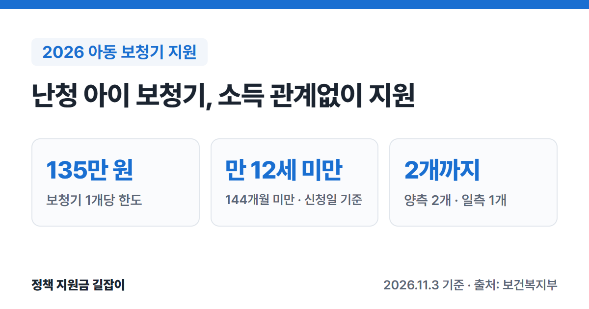

청각장애 등급을 받을 정도는 아니지만 난청이 있는 아이에게 정부가 **보청기 구입비**를 지원해요.
2026년부터 지원 나이가 **만 12세 미만**으로 넓어졌고, 보청기 **개당 135만 원**까지 받을 수 있어요.
보건복지부 「2026년 모자보건사업 안내」를 바탕으로 대상, 청력 기준, 3단계 신청 절차를 정리했어요.

{: .summary-card}

> 💡 **핵심 요약**
> - 신청일 기준 **만 12세(144개월) 미만** 난청 아이가 대상이에요. 2025년에는 만 5세 미만이었어요. (출처①)
> - 보청기 **개당 135만 원** 한도로, 양쪽 귀 난청은 **2개**, 한쪽 귀 난청은 **1개**를 지원해요. (출처①)
> - **가구 소득과 관계없이** 받을 수 있어요. 국가 청각장애 진단을 받은 아이는 대상이 아니에요. (출처①)

> **출처 표시 방법**: 본문의 (출처①) 같은 표시는 글 끝 출처 목록의 번호와 같아요.
> 신생아 청각선별검사·확진검사 비용 지원은 [신생아 선천성 대사이상·난청 검사비 지원 총정리]()에서 확인하세요.

목차

* 목차
{:toc}

## 한눈에 보기

| 항목 | 내용 |
|---|---|
| 대상 | 신청일 기준 **만 12세(144개월) 미만** 난청 아이 |
| 소득 기준 | **없음** |
| 지원 금액 | 보청기 **개당 135만 원** 한도 (1개 또는 2개) |
| 지원 횟수 | 원칙적으로 **1회** (지원 기간 내) |
| 신청 | 주소지와 관계없이 **전국 보건소**, e보건소·아이마중 앱 |
| 진행 | 처방 → 심사 → 구입·착용 → 검수 → 심사 → 지급 |
| 문의 | 보건소, 보건복지상담센터 **129** |

(출처①②)

## 누가 받을 수 있나요?

### 나이와 소득

- 보건소 신청일 기준 **만 12세(만 144개월) 미만** 아이가 대상이에요. (출처①)
- 지원 나이는 2019년 만 3세 기준으로 시작해 2024년 만 5세 미만, **2026년 만 12세 미만**으로 넓어졌어요. (출처①)
- 2024년부터 **가구 소득과 관계없이** 지원해요. (출처①)

### 청력 기준

| 구분 | 기준 | 지원 |
|---|---|---|
| 양측성 | 좋은 귀 평균 청력역치 **40~59dB**, 청각장애 등급을 받지 못함 | **2개** |
| 일측성 | 나쁜 귀 **55dB 이상**, 좋은 귀 **40dB 이하** | **1개** |

(출처①)

- 청력역치는 들을 수 있는 가장 작은 소리 크기예요. 숫자가 클수록 잘 안 들린다는 뜻이에요. (용어 설명)
- 국민연금공단에서 **국가 청각장애 진단**을 받은 아이는 이 지원을 받을 수 없어요. (출처①)
- 청각장애 등록을 신청했다가 **불승인**됐다면, 불승인 사유가 적힌 「장애등급결정서」를 더 내면 지원받을 수 있어요. (출처①)

### 청력검사 조건

1. **대학병원급 병원**에서 청성뇌간반응검사(ABR)나 청성지속반응검사(ASSR)를 **1개월 이상 간격으로 2회 이상** 받아야 해요. ABR은 꼭 들어 있어야 해요. (출처①)
2. 가장 최근 2회 이상의 검사 결과가 **10dB 안**으로 차이 나야 인정돼요. (출처①)
3. **만 4세 이상**이면 ABR 1회와 순음청력검사 3회(2~7일 간격)로 대신할 수 있어요. (출처①)

- 여기서 대학병원급 병원은 아기에게 진정제를 쓰고 ABR을 안전하게 할 수 있고, 나이에 맞는 언어발달 검사와 언어치료가 모두 되는 병원을 말해요. (출처①)
- 처방이 가능한 병원은 신생아청각선별검사 온라인교육 사이트(www.hearingscreening.or.kr)에서 확인할 수 있어요. (출처①)

## 얼마나 받을 수 있나요?

- 보청기 **1개 또는 2개**, **개당 135만 원** 한도로 지원해요. (출처①)
- 양쪽 귀 난청이면 2개라서 최대 **270만 원**이에요. (135만 원 × 2개, 계산)
- 보청기는 먼저 **자비로 사고**, 심사를 거쳐 나중에 지원금을 받아요. (출처①)
- 보건소 신청일 기준 **전후 6개월** 안에 산 보청기만 지원돼요. 이미 산 지 6개월이 넘은 보청기는 지원받을 수 없어요. (출처①)
- 자비로 산 지 6개월이 넘어 지원받지 못했더라도, 나중에 청력 변화나 분실·고장으로 보청기를 바꿀 때 **만 12세 미만**이면 신청할 수 있어요. 지원은 지원 기간 안에 1회예요. (출처①)

## 어떻게 신청하나요?

### 신청 순서

1. **신청서 내기**: 주소지와 관계없이 **전국 어느 보건소**에나 내요. e보건소 공공보건포털, 아이마중 앱으로 온라인 신청도 돼요. (출처①)
2. **청력검사·처방**: 대학병원급 이비인후과에서 청력검사를 받고 **보청기 처방전**, 청력검사 결과지, 외래 진료기록지를 받아 보건소에 내요. (출처①)
3. **1차 심사**: 난청관리 위탁사업단이 지원 대상인지 심사해 **지원확인서**를 보내요. 보건소가 사업단에 서류를 보낸 날부터 1개월 안에 결과를 알려 주는 게 기준이에요. (출처①)
4. **구입·착용**: 처방전을 받은 병원에서 보청기를 사서(자비) 착용해요. 구입 내역서와 보청기·바코드 사진을 챙겨 둬요. (출처①)
5. **검수확인**: 보청기를 산 날부터 **1개월 이상** 지나서 착용한 상태로 같은 병원에서 청력이 좋아졌는지 확인받고 **검수확인서**를 받아요. (출처①)
6. **2차 심사·지급**: 구입 내역서·영수증, 보청기 사진 2장, 검수확인서, 통장 사본을 보건소에 내면 사업단이 다시 심사해 **지원결정서**를 보내요. 심사 결과도 보건소가 서류를 보낸 날부터 1개월 안이 기준이고, 지원금은 보건소를 거쳐 받아요. (출처①)

- 1단계(처방)와 2단계(검수) 서류는 **보건소 신청일 기준 6개월 안에** 내요. (출처①)
- 병원 예약이 밀려 6개월이 지나 청력검사를 했다면, '난청이 고착됨'과 '늦어진 사유'를 처방전이나 검수확인서에 적어 내면 지원받을 수 있어요. (출처①)

### 준비 서류

| 단계 | 서류 |
|---|---|
| 1단계 처방 | **보청기 처방전**, 청력검사 결과지, 외래 진료기록지 |
| 2단계 검수 | 구입 내역서(수량·금액)·결제 영수증, 보청기 사진 2장(보청기, 바코드나 제품 설명), **검수확인서**, 통장 사본 |

(출처①)

- 보청기 지원 서류(처방전, 외래 진료기록지, 검수확인서, 영수증, 바코드, 사진)는 **원본**으로 내요. 온라인 신청은 파일 첨부로 대신해요. (출처①)
- 보건소에서 「보청기 처방전」과 「보청기 검수확인서」 서식을 받아 병원에 가져가요. (출처①)

### 보청기는 어디서 사나요?

- **처방전을 받은 대학병원급 병원**에서 사는 게 원칙이에요. 그 병원에서 청력과 언어 재활을 계속 관리받기 위해서예요. (출처①)
- 병원이 멀거나 이사했거나 관리 병원을 옮긴 경우에는 집 근처 이비인후과나 보청기 판매점에서 살 수 있어요. 이때 검수확인서에 그 사유와 정기적으로 진료받을 병원을 의사가 적어야 해요. (출처①)

## 자주 묻는 질문

**Q. 청각장애 등록이 되어 있어요. 받을 수 있나요?**
아니요. 국민연금공단의 국가 청각장애 진단을 받았다면 이 지원은 받을 수 없어요. 등록 신청이 불승인됐다면 장애등급결정서를 더 내고 지원받을 수 있어요. (출처①)

**Q. 8개월 전에 자비로 보청기를 샀어요.**
신청일 기준 전후 6개월 안에 산 보청기만 지원돼서, 6개월이 넘은 보청기는 지원받을 수 없어요. 나중에 청력 변화나 분실·고장으로 바꿔야 할 때 만 12세 미만이면 신청할 수 있어요. (출처①)

**Q. 한쪽 귀만 잘 안 들려요.**
나쁜 귀가 55dB 이상이고 좋은 귀가 40dB 이하면 일측성 난청으로 보청기 1개를 지원받아요. (출처①)

**Q. 검수확인 때 어떤 검사를 하나요?**
보청기를 낀 상태에서 청력이 좋아졌는지 보는 음장검사와 보청기 성능평가가 원칙이에요. 아기가 검사를 하기 어려우면 그 내용을 적어요. (출처①)

## 함께 보면 좋은 글

- [신생아 선천성 대사이상·난청 검사비 지원 총정리](): 청각선별검사 재검 뒤 확진검사비 7만 원까지
- [미숙아·선천성이상아 의료비 지원 총정리](): 신생아중환자실 입원 의료비
- [2026 출산지원금 총정리](): 출산 뒤 받는 지원 전체

---

## 출처

1. [보건복지부 - 2026년 모자보건사업 안내 (영유아 사전예방적 건강관리 장: 사업 연혁 436~437쪽, 보청기 지원 498~501쪽, Q&A 524·529~530쪽, 주요 변경내용 xxiv~xxv쪽, PDF)](https://bokjiro.go.kr/ssis-tbu/CmmFileUtil/getDownload.do?atcflId=20260416UUWBM1417530186675526&atcflSn=1) - 만 12세(144개월) 미만(2025년 만 5세 미만, 2019년 만 3세), 지원기간 내 1회, 2024년 소득기준 폐지, 양측성 40~59dB 2개·일측성 55dB 이상/40dB 이하 1개, 개당 135만 원 한도, 청력검사 요건(대학병원급, ABR·ASSR 1개월 간격 2회 이상, 10dB 이내, 만 4세 이상 대체검사), 신청일 전후 6개월 구입분, 3단계 절차와 제출서류·기한, 처방 병원 구입 원칙과 예외, hearingscreening.or.kr, Q&A(원본 제출, 청각장애 진단자 제외와 불승인 예외, 8개월 전 구입, 6개월 경과 검사, 검수 검사) (확인일: 2026-11-03)
2. [복지로 - 선천성 난청검사 및 보청기 지원 (복지서비스 정보)](https://www.bokjiro.go.kr/ssis-tbu/twataa/wlfareInfo/moveTWAT52011M.do?wlfareInfoId=WLF00001130) - 보건복지상담센터 129, e보건소 신청 안내 (확인일: 2026-11-03)

> 이 글은 **2026년 11월 3일** 기준이에요. 지원 조건은 바뀔 수 있으니 신청 전에 보건소나 129에서 꼭 확인하세요.
