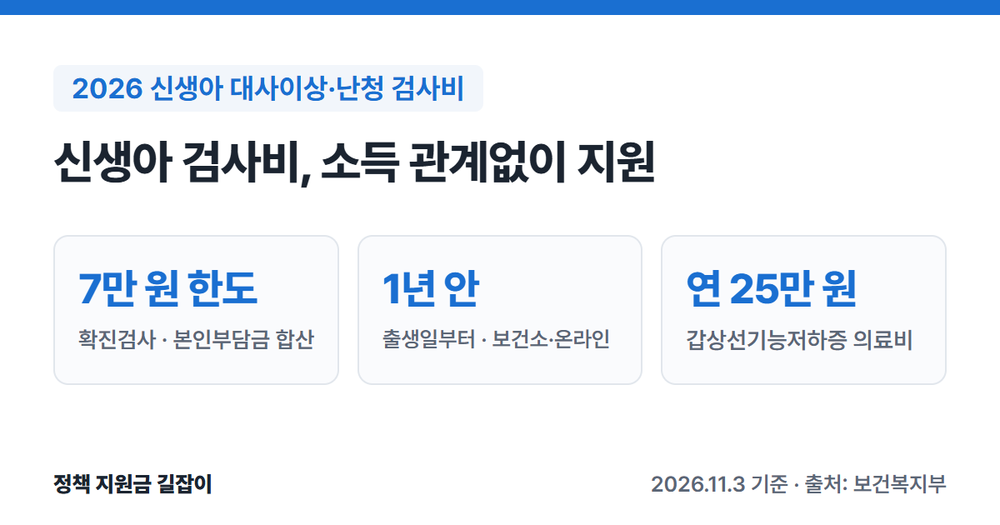

아기가 태어나면 **선천성 대사이상 검사**와 **청각선별검사(난청 검사)**를 받아요.
외래로 받은 검사의 본인부담금은 보건소에서 일부 돌려받을 수 있고, 재검이 나와 받은 **확진검사**는 **7만 원**까지 지원돼요.
보건복지부 「2026년 모자보건사업 안내」를 바탕으로 대상, 금액, 신청 방법과 대사이상 환아 지원까지 정리했어요.

{: .summary-card}

> 💡 **핵심 요약**
> - 2024년부터 **가구 소득과 관계없이** 지원해요. 외래 선별검사의 본인부담금 일부와 확진검사비(**7만 원** 한도)를 지원해요. (출처①)
> - **출생일부터 1년 안에** 보건소나 e보건소·아이마중 앱으로 신청해요. (출처①)
> - 선천성 갑상선기능저하증으로 보건소에 등록한 아이는 의료비를 **연 25만 원**까지 지원받아요. (출처①)

> **출처 표시 방법**: 본문의 (출처①) 같은 표시는 글 끝 출처 목록의 번호와 같아요.
> 아기가 신생아중환자실에 입원했다면 [미숙아·선천성이상아 의료비 지원 총정리]()도 함께 확인하세요.

목차

* 목차
{:toc}

## 한눈에 보기

| 항목 | 내용 |
|---|---|
| 대상 | 선별검사: **외래**로 받은 아기 확진검사: 선별검사에서 이상 소견·재검이 나와 확진검사를 받은 아기 |
| 소득 기준 | **없음** (2024년부터) |
| 선별검사 | 건강보험이 적용된 검사의 **본인부담금 일부** (최대 2회) |
| 확진검사 | 본인부담금 합산 **7만 원** 한도 |
| 신청 기한 | **출생일부터 1년** 안 |
| 신청 | 보건소 방문, **e보건소**, **아이마중 앱** |
| 문의 | 보건소, 보건복지상담센터 **129** |

(출처①②)

## 누가 받을 수 있나요?

### 선별검사비

- **외래로** 선천성 대사이상 선별검사나 청각선별검사를 받은 아기가 대상이에요. (출처①)
- 출생 후 **28일 안에** 받고 건강보험이 적용된 검사가 대상이에요. 28일이 지나서 받았어도 건강보험이 적용됐다면 지원받을 수 있어요. (출처①)
- **입원 중에** 받은 검사는 건강보험공단이 전부 내서 본인부담금이 없어요. 그래서 따로 신청할 것도 없어요. (출처①)
- 가구 소득은 따지지 않아요. 2024년에 소득 기준(기준 중위소득 180% 이하)이 없어졌어요. (출처①)

### 확진검사비

| 구분 | 지원 조건 |
|---|---|
| 대사이상 | 선별검사에서 이상 소견 → 확진검사 결과 **환아로 판정된 경우에만** |
| 난청 | 선별검사에서 **재검(refer)** 판정 → 확진검사 **결과와 관계없이** |

(출처①)

- 난청 확진검사는 **청성뇌간반응검사(ABR)나 청성지속반응검사(ASSR)**가 꼭 들어 있어야 해요. (출처①)
- 부모가 모두 외국인이면 지원받을 수 없어요. 부모 중 한 명이 한국 국적이거나, 부모가 모두 난민협약에 따른 난민이면 받을 수 있어요. (출처①)

## 얼마나 받을 수 있나요?

| 항목 | 지원 내용 |
|---|---|
| 선별검사 | 본인부담금 **일부** 원칙 1회, 재검이 필요해 다시 받으면 **1회 더** (최대 2회) |
| 확진검사 | 본인부담금을 합산해 **7만 원** 한도 여러 번 받았어도 합쳐서 7만 원까지 |
| 제외 | 진찰료 등 **검사비가 아닌 항목** |

(출처①)

- 선별검사비는 지침에 "본인부담금 일부 지원"으로만 나와 있고 금액은 적혀 있지 않아요. 실제 금액은 신청하는 보건소에서 확인하세요. (출처①)
- 확진검사는 대사이상이면 건강보험이 적용된 확진검사, 난청이면 지침에 정한 확진검사(ABR·ASSR 포함)의 본인부담금을 합쳐 7만 원까지 받을 수 있어요. 둘 다 횟수 제한은 없어요. (출처①)

## 대사이상으로 진단받았다면: 환아 지원

선천성 대사이상이나 일부 희귀질환으로 진단받아 특수 분유나 의료비가 필요한 아이는 보건소에 **환아로 등록**하고 지원을 받을 수 있어요. (출처①)

| 항목 | 내용 |
|---|---|
| 대상 | 신청일 기준 **19세 미만** 환아 (19세가 되는 달까지) |
| 특수식이 | 페닐케톤뇨증 등 대사이상 질환: **특수조제분유·저단백햇반** 크론병·단장증후군 등 일부 희귀질환: 특수조제분유 |
| 의료비 | 선천성 **갑상선기능저하증**: 진료비·약값·검사비 **연 25만 원** 한도 |

(출처①)

- 특수식이는 1년에 4번(1월·4월·7월·10월 각 1~10일) 보건소를 통해 신청하고, 집으로 배송돼요. 신청 기간을 놓치면 나중에 몰아서 받을 수 없어요. 새로 등록한 환아는 예외가 있을 수 있어요. (출처①)
- 갑상선기능저하증 의료비는 **보건소에 등록한 날 이후**에 생긴 의료비만 지원돼요. 등록 전 의료비는 소급되지 않으니 진단받으면 바로 등록하세요. (출처①)
- 의료비는 등록일부터 1년 동안 생긴 것을 다음 해 등록일 전날까지 신청하는 게 원칙이에요. 늦었더라도 다음 해 등록일부터 6개월 안에 신청하면 예외로 받을 수 있어요. (출처①)

## 어떻게 신청하나요?

### 검사비 신청 순서

1. **영수증 챙기기**: 병원에서 검사비 영수증과 세부내역서를 받아요. 난청 검사는 검사 결과지도 받아요. (출처①)
2. **신청하기**: 출생일부터 **1년 안에** 아기 주민등록 주소지 보건소에 가거나, **e보건소 공공보건포털**·**아이마중 앱**으로 온라인 신청해요. (출처①)
3. **받기**: 보건소가 서류를 확인하고 신청일부터 한 달 안에 계좌로 보내 주는 게 원칙이에요. 예산 사정에 따라 늦어질 수 있어요. (출처①)

- 난청 검사비는 주소지와 관계없이 **전국 어느 보건소**에서나 신청서를 받아 관할 보건소로 넘겨 줘요. (출처①)
- 출생신고 전에 신청해야 한다면 부모 주소지 보건소에 신청해요. (출처①)
- 1년이 지났더라도 보건소장이 타당한 사유가 있다고 인정하면 예산 범위 안에서 지원받을 수 있어요. (출처①)

### 준비 서류

| 구분 | 서류 |
|---|---|
| 공통 | 지원 신청서, **검사비 영수증·세부내역서**, 통장 사본, 주민등록등본 |
| 대사이상 확진 | 진단서 등 확진 증빙 서류 |
| 난청 | **검사 결과지** (검사명·결과가 적힌 서류로 대신 가능) |
| 필요할 때 | 가족관계증명서 |

(출처①)

- 주민등록등본과 가족관계증명서는 행정정보 공동이용에 동의하면 내지 않아도 돼요. (출처①)
- 온라인으로 신청하면 서류를 파일로 첨부해요. (출처①)

## 난청으로 진단받았다면

난청 진단 뒤에는 보청기 지원을 받을 수 있어요. 만 12세 미만 아이에게 보청기를 개당 135만 원까지 지원해요. 조건과 절차는 [아동 보청기 지원 총정리]()에 정리했어요. (출처①)

지침은 **생후 1개월 안**에 청각선별검사, 재검이면 **3개월 안**에 확진검사, 난청이면 **6개월 안**에 보청기와 언어 치료를 시작하라고 안내해요(신생아 난청 1-3-6 원칙). (출처①)

## 자주 묻는 질문

**Q. 산부인과에 입원해 있을 때 검사를 받았어요. 신청해야 하나요?**
아니요. 입원 중에 받은 선천성 대사이상 선별검사와 청각선별검사는 건강보험공단이 전부 내서 본인부담금이 없어 신청할 것이 없어요. 다만 그 결과로 이상 소견·재검이 나와 **확진검사**를 받았다면 확진검사비는 신청할 수 있어요. (출처①)

**Q. 대사이상 확진검사를 받았는데 정상이 나왔어요.**
대사이상 확진검사비는 **환아로 판정된 경우에만** 지원돼요. 난청 확진검사는 결과와 관계없이 지원되는 것과 달라요. (출처①)

**Q. 부모 소득이 높아도 되나요?**
네. 2024년부터 가구 소득과 관계없이 지원해요. (출처①)

**Q. 미숙아·선천성이상아 의료비 지원과 같이 받을 수 있나요?**
두 사업은 지침에 따로 실려 있어요. 함께 받을 수 있는지는 보건소에 확인하세요. 신생아중환자실 입원비는 [미숙아·선천성이상아 의료비 지원 총정리]()를 확인하세요. (출처①)

## 함께 보면 좋은 글

- [아동 보청기 지원 총정리](): 난청 진단 뒤 만 12세 미만 보청기 개당 135만 원
- [미숙아·선천성이상아 의료비 지원 총정리](): 신생아중환자실 입원 의료비
- [2026 출산지원금 총정리](): 첫만남이용권, 부모급여 등 출산 뒤 받는 지원 전체

---

## 출처

1. [보건복지부 - 2026년 모자보건사업 안내 (영유아 사전예방적 건강관리 장: 사업 연혁 436~437쪽, 선천성 대사이상 검사 및 환아관리 469~477쪽, 선천성 난청검사 및 보청기 지원 495~498쪽, Q&A 524~530쪽, PDF)](https://bokjiro.go.kr/ssis-tbu/CmmFileUtil/getDownload.do?atcflId=20260416UUWBM1417530186675526&atcflSn=1) - 2024년 소득기준 폐지, 선별검사(출생 후 28일 이내·건강보험 적용, 최대 2회, 본인부담금 일부, 입원 중 검사 본인부담 없음), 확진검사 7만 원 한도(대사이상은 환아 판정 시, 난청은 결과 무관·ABR 또는 ASSR 포함), 출생일부터 1년 이내 신청(보건소·e보건소·아이마중 앱), 한 달 이내 지급, 제출서류, 환아관리(19세 미만, 특수식이, 갑상선기능저하증 연 25만 원, 등록 후 의료비만, 신청 기한과 6개월 예외, 특수식이 연 4회 신청), 신생아 난청 1-3-6 원칙, Q&A(출생신고 전 신청, 외국인 부모, 확진검사 횟수 제한 없음), 보청기 만 12세 미만·개당 135만 원 (확인일: 2026-11-03)
2. 복지로 복지서비스 정보 - [선천성대사이상 검사 및 환아관리](https://www.bokjiro.go.kr/ssis-tbu/twataa/wlfareInfo/moveTWAT52011M.do?wlfareInfoId=WLF00000040), [선천성 난청검사 및 보청기 지원](https://www.bokjiro.go.kr/ssis-tbu/twataa/wlfareInfo/moveTWAT52011M.do?wlfareInfoId=WLF00001130) - 보건복지상담센터 129, e보건소 신청 안내 (확인일: 2026-11-03)

> 이 글은 **2026년 11월 3일** 기준이에요. 지원 조건은 바뀔 수 있으니 신청 전에 보건소나 129에서 꼭 확인하세요.
