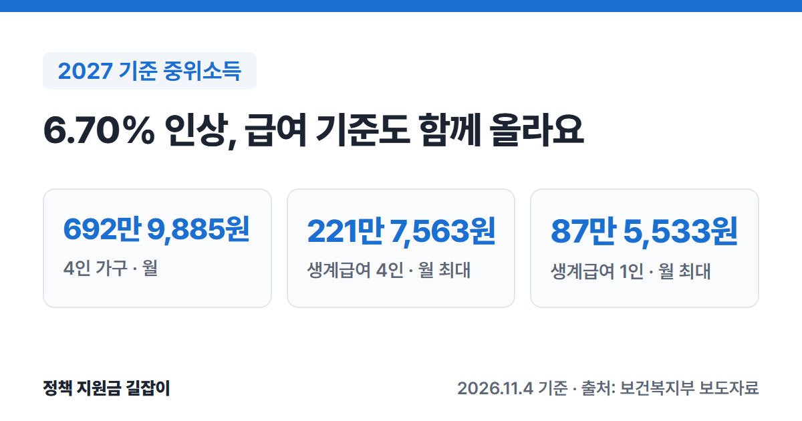

**기준 중위소득**은 기초생활보장 급여를 비롯해 많은 복지 사업이 "소득이 얼마 이하면 받을 수 있다"를 정할 때 쓰는 기준이에요.
2027년 기준 중위소득은 4인 가구 기준 **6.70%** 올라 **월 692만 9,885원**이 됐어요.
보건복지부 보도자료를 바탕으로 가구원 수별 금액과 생계·의료·주거·교육급여 기준이 어떻게 바뀌는지 정리했어요.

{: .summary-card}

> 💡 **핵심 요약**
> - 2027년 기준 중위소득은 4인 가구 **월 692만 9,885원**으로, 2026년보다 **6.70%** 올라요. (출처①)
> - 생계급여 최대 지급액은 1인 가구 **월 87만 5,533원**, 4인 가구 **월 221만 7,563원**이에요. (출처①)
> - 급여별 기준 비율(생계 32%, 의료 40%, 주거 48%, 교육 50%)은 2026년과 같아요. (출처①)

> **출처 표시 방법**: 본문의 (출처①) 같은 표시는 글 끝 출처 목록의 번호와 같아요.

목차

* 목차
{:toc}

## 한눈에 보기

| 항목 | 내용 |
|---|---|
| 결정 | 2026년 7월 28일 제80차 중앙생활보장위원회 (출처①) |
| 인상률 | 4인 가구 기준 **6.70%** (2015년 이후 가장 높음) (출처①) |
| 4인 가구 | **692만 9,885원** (2026년 649만 4,738원) (출처①) |
| 1인 가구 | **273만 6,042원** (2026년 256만 4,238원) (출처①) |
| 급여 기준 | 생계 **32%**, 의료 **40%**, 주거 **48%**, 교육 **50%** (2026년과 같음) (출처①) |

---

## 기준 중위소득이 뭔가요?

기준 중위소득은 보건복지부 장관이 중앙생활보장위원회의 심의·의결을 거쳐 고시하는 **국민 가구소득의 중간값**이에요. (출처①)

기초생활보장제도를 비롯해 **15개 중앙부처 80개 복지사업**이 대상자를 고를 때 이 기준을 써요(2026년 기준). (출처①)
그래서 이 금액이 오르면 "중위소득 ○○% 이하" 조건을 쓰는 사업의 소득 기준도 보통 함께 올라가요. 적용 시점과 비율은 사업마다 다를 수 있어요.

### 계산 방식도 새로 정했어요

2021년부터 2026년까지 쓰던 계산 방식이 끝나서, 이번에 새 방식을 정했어요. (출처①)

- 그해 기준 중위소득에 **가계금융복지조사 중위소득의 최근 3년 평균 증가율**을 적용하는 것이 원칙이에요. (출처①)
- 소비자물가지수, 실질경제성장률 같은 다른 지표로 증가율을 보정할 수 있어요. (출처①)
- 이 방식은 **3년 동안** 적용한 뒤 평가해요. (출처①)

---

## 가구원 수별 2027년 기준 중위소득

| 가구원 수 | 2027년 (월) | 2026년 (월) |
|---|---|---|
| 1인 | **273만 6,042원** | 256만 4,238원 |
| 2인 | **448만 645원** | 419만 9,292원 |
| 3인 | **571만 8,091원** | 535만 9,036원 |
| 4인 | **692만 9,885원** | 649만 4,738원 |
| 5인 | **806만 3,019원** | 755만 6,719원 |
| 6인 | **912만 9,201원** | 855만 5,952원 |

(출처①)

1인 가구는 약 **17만 2천 원**, 4인 가구는 약 **43만 5천 원** 올라요. (출처①)

---

## 급여별 선정기준은 얼마나 오르나요?

기초생활보장 급여를 받으려면 소득인정액(소득과 재산을 함께 따진 금액)이 아래 금액 **이하**여야 해요. 비율은 2026년과 같고, 기준 중위소득이 올라서 금액이 올라요. (출처①)

생계·의료급여는 소득인정액 기준과 함께 **부양의무자 기준**도 충족해야 해요. 주거급여와 교육급여는 부양의무자 기준이 폐지됐고, 생계급여는 예외 기준(부양의무자 연소득 1.3억 원·재산 12억 원)만 남아 있어요. (출처①)

### 생계급여 (중위소득 32%)

| 가구원 수 | 2027년 (월) | 2026년 (월) |
|---|---|---|
| 1인 | **87만 5,533원** | 82만 556원 |
| 2인 | **143만 3,806원** | 134만 3,773원 |
| 3인 | **182만 9,789원** | 171만 4,892원 |
| 4인 | **221만 7,563원** | 207만 8,316원 |
| 5인 | **258만 166원** | 241만 8,150원 |
| 6인 | **292만 1,344원** | 273만 7,905원 |

(출처①)

- 생계급여는 **선정기준이 곧 최대 지급액**이에요. 실제로 받는 돈은 이 금액에서 그 가구의 소득인정액을 뺀 금액이에요. (출처①)
- 최대 지급액이 1인 가구는 약 **5만 5천 원**, 4인 가구는 약 **14만 원** 올라요. (출처①)
- 생계급여 대상과 신청 방법은 [2026 생계급여 총정리]()에 정리했어요.

### 의료급여 (중위소득 40%)

| 가구원 수 | 2027년 (월) | 2026년 (월) |
|---|---|---|
| 1인 | **109만 4,417원** | 102만 5,695원 |
| 2인 | **179만 2,258원** | 167만 9,717원 |
| 3인 | **228만 7,236원** | 214만 3,614원 |
| 4인 | **277만 1,954원** | 259만 7,895원 |
| 5인 | **322만 5,208원** | 302만 2,688원 |
| 6인 | **365만 1,680원** | 342만 2,381원 |

(출처①)

- 의료급여 1종·2종 차이와 병원에서 내는 돈은 [2027 의료급여 총정리]()에 정리했어요.

### 주거급여 (중위소득 48%)

| 가구원 수 | 2027년 (월) | 2026년 (월) |
|---|---|---|
| 1인 | **131만 3,300원** | 123만 834원 |
| 2인 | **215만 710원** | 201만 5,660원 |
| 3인 | **274만 4,684원** | 257만 2,337원 |
| 4인 | **332만 6,345원** | 311만 7,474원 |
| 5인 | **387만 249원** | 362만 7,225원 |
| 6인 | **438만 2,016원** | 410만 6,857원 |

(출처①)

세 들어 사는 가구가 받는 임차급여의 상한인 **기준임대료**도 지역(급지)·가구원 수에 따라 월 **1만 2천 원~5만 원** 올라요. (출처①)

| 가구원 수 | 2027년 기준임대료 (월) |
|---|---|
| 1인 | 서울 **38만 1천 원** 경기·인천 31만 3천 원 광역·세종·특례시 25만 9천 원 그 외 23만 4천 원 |
| 2인 | 서울 **43만 1천 원** 경기·인천 35만 2천 원 광역·세종·특례시 29만 1천 원 그 외 26만 5천 원 |
| 3인 | 서울 **51만 4천 원** 경기·인천 42만 2천 원 광역·세종·특례시 34만 7천 원 그 외 31만 8천 원 |
| 4인 | 서울 **59만 6천 원** 경기·인천 48만 8천 원 광역·세종·특례시 40만 3천 원 그 외 36만 9천 원 |

(출처①)

- 5인은 서울 61만 8천 원, 6인은 서울 73만 1천 원이에요. 7인은 6인과 같고, 8~9인은 6인 금액에 10%를 더해요. (출처①)
- '광역·세종·특례시'는 광역시, 세종시, 수도권 밖 특례시를 말해요. (출처①)
- 집을 가진 가구의 수선비용은 경보수 **590만 원**, 중보수 **1,095만 원**, 대보수 **1,601만 원**으로 2026년과 같아요. (출처①)
- 주거급여 대상과 신청 방법은 [2027 주거급여 총정리]()에 있어요.

### 교육급여 (중위소득 50%)

| 가구원 수 | 2027년 (월) | 2026년 (월) |
|---|---|---|
| 1인 | **136만 8,021원** | 128만 2,119원 |
| 2인 | **224만 323원** | 209만 9,646원 |
| 3인 | **285만 9,046원** | 267만 9,518원 |
| 4인 | **346만 4,943원** | 324만 7,369원 |
| 5인 | **403만 1,510원** | 377만 8,360원 |
| 6인 | **456만 4,601원** | 427만 7,976원 |

(출처①)

2027년 교육활동지원비는 평균 **4.7%** 올라요. (출처①)

| 학교 | 2027년 | 2026년 |
|---|---|---|
| 초등학교 | **51만 3천 원** | 50만 2천 원 |
| 중학교 | **71만 4천 원** | 69만 9천 원 |
| 고등학교 | **94만 5천 원** | 86만 원 |

(출처①)

고등학생은 이와 별도로 교과서비, 입학금·수업료 전액을 지원받아요. (출처①)

---

## 다른 복지 사업에도 영향이 있나요?

보건복지부가 밝힌 기준 중위소득 활용 사업(80개, 2026년 기준)에는 이 블로그에서 다룬 사업도 많이 들어 있어요. (출처①)

| 분야 | 사업 |
|---|---|
| 생활비 | 생계급여, 주거급여, 의료급여, 긴급복지, 장애인연금, 에너지바우처, 통합문화이용권, 스포츠강좌이용권 |
| 청년 | 청년월세 지원, 청년내일저축계좌, 청년미래적금 |
| 일자리 | 국민취업지원제도 |
| 출산·육아 | 아이돌봄 서비스, 한부모가족아동 양육비, 저소득층 기저귀·조제분유 지원, 산모·신생아 건강관리 |

(출처①)

다만 각 사업이 **2027년에 중위소득 몇 %를 기준으로 할지, 언제부터 새 금액을 쓸지**는 사업마다 다를 수 있어요. 신청 전에 그 사업의 2027년 공고를 꼭 확인하세요.

생활비 지원 전체는 [2026 생활비 지원 총정리]()에서 상황별로 찾을 수 있어요.

---

## 자주 묻는 질문

**Q. 우리 집 소득이 기준 중위소득보다 적으면 생계급여를 받나요?**
아니에요. 생계급여는 기준 중위소득의 **32% 이하**여야 하고, 부양의무자 기준도 함께 봐요. (출처①) 그리고 월급만 보는 게 아니라 재산을 소득으로 바꾼 금액까지 더한 **소득인정액**으로 따져요. (출처③) 우리 집이 해당하는지는 주민센터나 복지로에서 확인하세요.

**Q. 2027년 금액은 언제부터 쓰나요?**
이번에 정한 금액은 2027년도 기준 중위소득과 2027년도 급여별 선정기준이에요. (출처①) 주거급여는 2027년 기준을 정한 국토교통부 고시가 **2027년 1월 1일**부터 시행돼요. (출처④) 다른 사업은 사업마다 적용 시점이 다를 수 있으니 그 사업의 공고를 확인하세요.

**Q. 앞으로 부양의무자 기준도 바뀌나요?**
7월 28일 발표 당시 보건복지부 장관은 「제4차 기초생활보장 종합계획」에서 부양의무자 제도 개선 등을 검토하겠다고 밝혔어요. 종합계획은 이 글을 쓰는 지금 아직 확정 전이에요. (출처①)

---

## 함께 보면 좋은 글

- [2026 생활비 지원 총정리](): 상황별로 받을 수 있는 생활비 지원을 한 번에 찾기
- [2026 생계급여 총정리](): 소득인정액 계산과 신청 방법
- [2027 주거급여 총정리](): 임차급여·수선유지급여 대상과 신청 방법

## 출처

1. [보건복지부 보도자료 - 내년 기준 중위소득 6.70% 역대 최대 인상, "가장 어려운 국민 생활 더욱 두텁게 보호" (2026.7.28.)](https://www.mohw.go.kr/board.es?mid=a10503010100&bid=0027&act=view&list_no=1491453) - 산정방식, 가구원 수별 2026·2027년 기준 중위소득, 급여별 선정기준, 기준임대료, 수선비용, 교육활동지원비, 기준 중위소득 활용 사업 80개(붙임 3) (확인일: 2026-11-04)
2. [대한민국 정책브리핑 - 내년 기준 중위소득 역대 최대 6.7% 인상…'K자형 양극화' 대응 (2026.7.28.)](https://www.korea.kr/news/policyNewsView.do?newsId=148968956) - 4인 가구 금액, 생계급여 선정기준 교차 확인 (확인일: 2026-11-04)
3. [복지로 - 주거급여(맞춤형 급여) 서비스 안내](https://www.bokjiro.go.kr/ssis-tbu/twataa/wlfareInfo/moveTWAT52011M.do?wlfareInfoId=WLF00003201) - 소득인정액 뜻 (확인일: 2026-10-23)
4. [국가법령정보센터 - 국토교통부 고시 「2027년 주거급여 선정기준 및 최저보장수준」(2026.8.31. 발령, 2027.1.1. 시행)](https://www.law.go.kr/admRulInfoP.do?admRulSeq=2100000284670) - 2027년 주거급여 기준 시행일 (확인일: 2026-10-23)

> 이 글은 2026년 11월 4일 기준입니다. 지원 조건은 바뀔 수 있으니 신청 전 공식 사이트에서 꼭 확인하세요.
