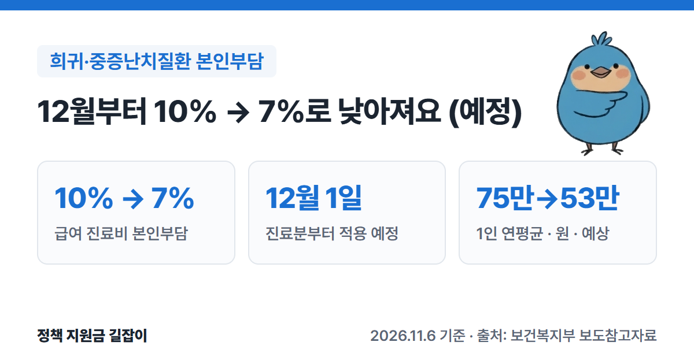

희귀질환이나 중증난치질환으로 치료받는 분은 건강보험 진료비의 **10%**만 내고 있어요. 이 비율이 **2026년 12월 1일 진료분부터 7%**로 낮아질 예정이에요.
보건복지부 보도자료를 바탕으로 누가 해당되는지, 무엇이 바뀌고 무엇은 그대로인지, 산정특례 등록은 어떻게 하는지 정리했어요.

{: .summary-card}

> 💡 **핵심 요약**
> - 산정특례에 등록된 희귀·중증난치질환자의 건강보험 급여 진료비 본인부담률이 **10% → 7%**로 낮아질 예정이에요. (출처①)
> - **2026년 12월 1일 이후 진료분**부터 적용할 계획이에요. 지금은 입법예고 단계예요. (출처①)
> - 약 **136만 명**이 대상이고, 1인당 연평균 본인부담은 약 **75만 원 → 약 53만 원**으로 줄어들 것으로 예상돼요. (출처①)

> **출처 표시 방법**: 본문의 (출처①) 같은 표시는 글 끝 출처 목록의 번호와 같아요.

목차

* 목차
{:toc}

## 한눈에 보기

| 항목 | 내용 |
|---|---|
| 대상 | 산정특례에 등록된 **희귀·중증난치질환자** (약 136만 명) |
| 바뀌는 점 | 해당 질환 급여 진료비 본인부담률 **10% → 7%** |
| 그대로인 것 | **비급여** 진료비, 입원 중 **식대** 본인부담(50%) |
| 적용 시기 | **2026.12.1.** 이후 진료분부터 (예정) |
| 다음 단계 | **2028년 상반기 5%**까지 낮출 계획 |
| 신청 | 기존 등록자의 별도 신청 여부는 발표되지 않았어요 (공단 **1577-1000** 확인) |

(출처①)

---

## 누가 해당되나요?

**산정특례에 등록된 희귀·중증난치질환자**예요. 보건복지부는 약 **136만 명**으로 보고 있어요. (출처①)

**산정특례**는 진료비 부담이 큰 병을 앓는 사람의 건강보험 본인부담률을 낮춰 주는 제도예요. (출처①) 질환별 등록 기준을 충족해 진료 의사가 확진하고, 산정특례로 등록해야 적용돼요. (출처③)

- 적용되는 진료는 **등록한 그 질환**을 치료하는 진료예요. (출처①)
- 참고로 산정특례가 없는 일반 환자의 본인부담률은 입원 20%, 외래 30~60%예요. (출처①)

### 산정특례 기간

| 질환 | 특례 기간 |
|---|---|
| 희귀질환 | **5년** (상세불명 희귀질환은 1년) |
| 중증난치질환 | **5년** |

(출처③)

---

## 무엇이 달라지나요?

### 본인부담률 10% → 7%

해당 질환으로 진료받을 때 **건강보험이 적용되는(급여) 진료비**의 본인부담률이 **10%에서 7%**로 낮아질 예정이에요. (출처①)

> **예시 (계산해 본 값)**: 해당 질환 치료로 급여 진료비가 100만 원 나왔다면
> - 지금(10%): 10만 원
> - 12월 1일 진료분부터(7%): 7만 원
>
> (출처①의 비율로 직접 계산한 예시예요. 비급여 항목과 식대는 따로 계산돼요.)

보건복지부는 1인당 연평균 본인부담이 약 **75만 원에서 약 53만 원**으로 줄어들 것으로 예상했어요. (출처①)

### 그대로인 것

- **비급여 진료비**는 이번 인하와 관계없어요. (출처①)
- **입원 중 식대**의 본인부담 50%도 그대로예요. (출처①)

### 앞으로 5%까지 낮출 계획이에요

지금 희귀·중증난치질환의 본인부담률(10%)은 암·심뇌혈관질환 같은 다른 중증질환(**5%**)보다 높아요. (출처①)
그래서 정부는 9월 건강보험정책심의위원회에서 **10% → 7% → 5%** 단계적 인하를 정했어요. 이번 12월 7%가 첫 단계이고, **2028년 상반기에 5%**까지 낮출 계획이에요. (출처①)

---

## 어떻게 적용받나요?

1. **산정특례에 등록돼 있는지 확인해요.** 희귀·중증난치질환으로 이미 등록돼 있다면, 보도자료에는 따로 신청하라는 내용이 없어요. 정확한 적용 방식은 공단(1577-1000)에 확인해 보세요. (출처①③)
2. **아직 등록하지 않았다면 등록부터 해요.** 질환별 등록 기준(필수 검사 항목 등)을 충족해 진료 의사가 확진하면 등록 대상이에요. (출처③)
3. **등록 신청 방법**: 병원 등 요양기관이 대신 신청해 주거나, 본인·대리인이 방문·우편·팩스로 제출해요. 상시 신청할 수 있어요. (출처③)
4. **12월 1일 이후 진료분**부터 7%가 적용될 예정이에요. 시행 전 법제처 심사와 국무회의 의결이 남아 있어요. (출처①)

---

## 놓치기 쉬운 점

- **아직 확정된 것은 아니에요.** 11월 4일~16일 입법예고 중이고, 법제처 심사와 국무회의 의결을 거쳐 12월 1일에 시행할 계획이에요. (출처①)
- **산정특례 기간이 끝나면 다시 확인해야 해요.** 희귀질환·중증난치질환은 5년, 상세불명 희귀질환은 1년이에요. 기간이 지나면 특례가 적용되지 않을 수 있으니 기간 끝나기 전에 병원·공단에 물어보세요. (출처③)
- **병원비가 모두 7%가 되는 건 아니에요.** 비급여 항목과 입원 식대는 그대로예요. (출처①)
- 등록 여부나 기간이 궁금하면 **국민건강보험공단 1577-1000**에 먼저 물어보세요. (출처③)

---

## 자주 묻는 질문

**Q. 이미 산정특례에 등록돼 있는데 다시 신청해야 하나요?**
A. 보도자료에는 대상을 "산정특례에 등록된 희귀·중증난치질환자"로 적었고, 따로 신청하라는 내용은 없어요. 정확한 적용 방식은 시행 전에 공단(1577-1000)에 확인해 보세요. (출처①③)

**Q. 11월에 받은 진료도 7%로 바뀌나요?**
A. 보도자료는 **2026년 12월 1일 이후 진료분부터** 적용한다고 밝혔어요. 그 전 진료는 지금 본인부담률(10%)이 적용돼요. (출처①)

**Q. 암 환자도 이번에 바뀌나요?**
A. 아니요. 이번 개정은 희귀·중증난치질환자 대상이에요. 암·심뇌혈관질환 등 다른 중증질환은 이미 5%예요. (출처①)

**Q. 개정안에 의견을 낼 수 있나요?**
A. 11월 16일(월)까지 국민참여입법센터(opinion.lawmaking.go.kr)나 보건복지부 보험정책과에 낼 수 있어요. 개정안 원문은 보건복지부 누리집 '정보 → 법령 → 입법/행정예고 전자공청회'에 있어요. (출처①)

---

## 함께 보면 좋은 글

- [2026 생활비 지원 총정리](): 생계급여·주거급여·긴급복지 등 내 상황에 맞는 제도 찾기
- [2026 긴급복지지원 총정리](): 큰 병·부상으로 갑자기 치료비가 필요할 때 받는 의료지원(300만 원 이내)

---

## 출처

1. [보건복지부 보도참고자료 - 희귀·중증난치질환자 건강보험 본인부담률 10% → 7% 인하 추진 (2026.11.4.)](https://www.mohw.go.kr/board.es?mid=a10503010100&bid=0027&act=view&list_no=1492435) - 대상·인하율·시행일·제외 항목·2028년 계획·의견 제출 (확인일: 2026-11-06)
2. [대한민국 정책브리핑 - 희귀·중증난치질환자 건강보험 본인부담률 10%→7% 인하 (2026.11.4.)](https://www.korea.kr/news/policyNewsView.do?newsId=148974989) - 보도자료 내용 교차 확인 (확인일: 2026-11-06)
3. [정부24 보조금24 - 건강보험 산정특례 (국민건강보험공단)](https://www.gov.kr/portal/rcvfvrSvc/dtlEx/B55092800041) - 질환별 특례 기간, 등록 대상, 신청 방법, 문의처, 최종 수정일 2026.10.21. (확인일: 2026-11-06)

> 이 글은 2026년 11월 6일 기준입니다. 지원 조건은 바뀔 수 있으니 신청 전 공식 사이트에서 꼭 확인하세요.
