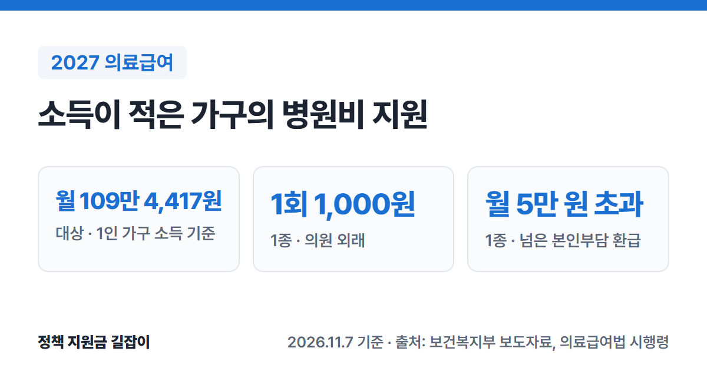

**의료급여**는 소득과 재산이 적은 가구의 병원비를 나라가 대신 내 주는 제도예요. 국민기초생활보장의 4가지 급여(생계·의료·주거·교육) 중 하나예요.
2027년에는 소득인정액이 **기준 중위소득 40% 이하**인 가구가 대상이고, 1인 가구는 **월 109만 4,417원 이하**예요. (출처①)
의료급여법 시행령과 보건복지부 보도자료 원문을 바탕으로 대상, 1종·2종 차이, 병원에서 내는 돈, 신청 방법을 정리했어요.

{: .summary-card}

> 💡 **핵심 요약**
> - 2027년에는 소득인정액이 **기준 중위소득 40% 이하**면 받을 수 있어요. 1인 가구 **월 109만 4,417원**, 4인 가구 **월 277만 1,954원** 이하예요. (출처①)
> - **1종**은 입원 진료비 본인부담이 **없고**(식대 일부 등 제외), 의원 외래는 1회 **1,000원**만 내요. (출처②④)
> - **2종**은 의원 외래 1회 **1,000원**, 입원은 진료비의 **10%**를 내요. (출처②)
> - 본인부담이 1종은 한 달 **5만 원**을 넘으면 넘은 금액을 **전부** 돌려받아요. (출처②)

> **출처 표시 방법**: 본문의 (출처①) 같은 표시는 글 끝 출처 목록의 번호와 같아요.

목차

* 목차
{:toc}

## 한눈에 보기

| 항목 | 내용 |
|---|---|
| 대상 | 소득인정액 **기준 중위소득 40% 이하** 가구 + 부양의무자 기준 |
| 지원 내용 | 건강보험 급여 항목 진료비를 의료급여기금이 부담 |
| 1종 | 근로능력이 없는 사람만 있는 가구 등 · 입원 진료비 **본인부담 없음** |
| 2종 | 1종에 해당하지 않는 수급자 · 입원 **10%** |
| 신청 | 거주지 **읍·면·동 주민센터** |

(출처①②③④⑥)

---

## 누가 받을 수 있나요?

### 소득인정액이 기준 중위소득 40% 이하예요

**소득인정액**은 소득평가액과 재산을 소득으로 환산한 금액을 합한 값이에요. (출처⑤) 이 금액이 아래 기준 이하여야 해요. (출처①)

| 가구원 수 | 2027년 (월) | 2026년 (월) |
|---|---|---|
| 1인 | **109만 4,417원** | 102만 5,695원 |
| 2인 | **179만 2,258원** | 167만 9,717원 |
| 3인 | **228만 7,236원** | 214만 3,614원 |
| 4인 | **277만 1,954원** | 259만 7,895원 |
| 5인 | **322만 5,208원** | 302만 2,688원 |
| 6인 | **365만 1,680원** | 342만 2,381원 |

(출처①)

2026년에는 2026년 기준, 2027년에는 2027년도 기준이 쓰여요. 비율(40%)은 두 해가 같아요. (출처①)

### 부양의무자 기준도 봐요

의료급여는 소득인정액과 함께 **부양의무자 기준**도 충족해야 해요. (출처⑤⑥) 2026년 기준으로 생계급여는 고소득·고재산 부양의무자(연소득 1.3억 원 또는 일반재산 12억 원 초과)만 따지고, 주거급여·교육급여는 이 기준이 없어요. (출처⑥) 부양의무자 제도 개선은 정부가 검토 중이라 2027년에 바뀔 수 있어요. (출처①)
부모·자녀 등 부양의무자가 있는지, 그 소득·재산이 얼마인지에 따라 결과가 달라지니 신청할 때 주민센터에서 확인하세요.

### 1종과 2종은 이렇게 나뉘어요

| 구분 | 누가 해당하나요? |
|---|---|
| 1종 | 18세 미만, 65세 이상, 중증장애인, 근로능력이 없다고 판정받은 사람, 임신 중이거나 분만 후 6개월 미만인 사람 등**만으로** 이루어진 가구 보장시설에서 급여를 받는 사람 고시된 결핵·희귀난치성·중증질환이 있는 사람 |
| 2종 | 기초생활보장 수급자 중 1종에 해당하지 않는 사람 |

(출처②)

가구에 일할 수 있는 사람이 한 명이라도 있으면 보통 2종이 돼요. 다만 위 질환이 있는 사람은 그 사람만 1종이 될 수 있어요. (출처②)

---

## 병원에서 얼마나 내나요?

의료급여는 **건강보험 급여 항목** 진료비를 지원해요. 그래서 비급여 항목은 지원 대상이 아니에요. (출처③) 아래는 급여 항목에서 본인이 내는 돈이에요.

입원 식대 중 보건복지부장관이 정하는 비용과 구급차 이송처치료 등은 아래와 별도로 본인이 내요. (출처④) 2인실·3인실 입원료도 일부를 본인이 내요. (출처②)

### 1종 수급권자

| 진료 | 본인부담 |
|---|---|
| 입원 | **없음** (식대 일부, 2·3인실 입원료 등 제외) |
| 의원 외래 | 1회 **1,000원** |
| 병원·종합병원 외래 | 1회 **1,500원** |
| 상급종합병원 외래 | 1회 **2,000원** |
| CT·MRI·PET 등 | 진료비의 **5%** |
| 약국 | 처방전 1장 **500원** (예외 있음) |
| 보건소·보건지소 | **없음** |

(출처②)

- **18세 미만, 임산부, 노숙인**, 고시된 결핵·희귀난치성·중증질환자 등은 위 외래 본인부담도 내지 않아요. (출처②)
- 종합병원·상급종합병원에서 고시된 가벼운 질환으로 받은 처방전은 약값의 **3%**(최소 500원)를 내요. 보건소 처방전이면 약값을 내지 않아요. (출처②)

### 2종 수급권자

| 진료 | 본인부담 |
|---|---|
| 입원 | 진료비의 **10%** |
| 의원 외래 | 1회 **1,000원** |
| 병원·종합병원 외래 | 진료비의 **15%** (고시된 만성질환은 1회 1,000원) |
| 상급종합병원 외래 | 진료비의 **15%** |
| CT·MRI·PET 등 | 진료비의 **15%** |
| 약국 | 처방전 1장 **500원** (예외 있음) |
| 보건소·보건지소 | **없음** |

(출처②)

- **자연분만·제왕절개 분만**, **6세 미만 아동의 입원**(고시된 진료)은 본인부담이 없어요. (출처②)
- 고시된 중증질환이 있는 사람은 진료비 전액을 기금이 부담해요. (출처②)
- 약국 예외는 1종과 같아요(종합병원·상급종합병원의 고시된 가벼운 질환 처방전은 약값의 3%, 최소 500원). (출처②)

### 한 달에 많이 내면 돌려받아요 (본인부담 상한)

급여 항목 본인부담금이 아래 기준을 넘으면, 넘은 금액의 일부나 전부를 시·군·구가 돌려줘요. 돌려받을 돈이 2,000원 미만이면 돌려주지 않아요. (출처②)

| 구분 | 돌려받는 금액 |
|---|---|
| 1종 | 한 달 **2만 원 초과~5만 원**: 넘은 금액의 **50%** 한 달 **5만 원 초과**: 넘은 금액 **전부** |
| 2종 | 한 달 **20만 원 초과**: 넘은 금액의 **50%** 그 뒤에도 1년 **80만 원 초과**: 넘은 금액 **전부** |

(출처②)

2종이 요양병원에 1년에 240일을 넘게 입원한 경우에는 연간 기준이 **120만 원**이에요. (출처②)

65세 이상 틀니·임플란트, 2인실·3인실 입원료 등은 이 계산에서 빠져요. (출처②)

---

## 어떻게 신청하나요?

1. **신청하기**: 거주지 **읍·면·동 주민센터**에 신청해요. (출처③)
2. **소득·재산 조사**: 시·군·구가 소득인정액과 부양의무자 기준을 조사해요. (출처①③⑥)
3. **결정**: 시·군·구가 대상 여부와 1종·2종을 정해요. (출처②③)
4. **이용하기**: 병원·약국에서 의료급여 수급자로 진료받아요. 급여 항목은 위 본인부담을 내요. (출처②)

생계급여도 함께 받을 수 있는지는 [2026 생계급여 총정리]()에서 확인하세요.

---

## 놓치기 쉬운 점

- **비급여 항목은 지원 대상이 아니에요.** 의료급여는 건강보험 급여 항목 진료비를 지원해요. (출처③)
- **가구에 일할 수 있는 사람이 있으면 2종이 돼요.** 2종은 입원 10%, 병원 외래 15%를 내니 1종과 차이가 커요. (출처②)
- **상한을 넘긴 돈은 시·군·구에서 돌려받아요.** 병원에서 바로 빼 주는 게 아니라 나중에 시·군·구가 지급해요. (출처②)
- **외래를 1년에 365회 넘게 이용하면 본인부담이 커져요.** 넘은 외래는 진료비의 30%를 내요. 아동·임산부, 중증장애인·중증질환자 등 고시된 사람은 예외예요. (출처④)

> 이런 경우는 **보건복지상담센터(129)**나 거주지 주민센터에 먼저 물어보세요. (출처③)

---

## 자주 묻는 질문

### 생계급여를 못 받아도 의료급여만 받을 수 있나요?

네, 급여마다 기준이 달라요. 생계급여는 기준 중위소득 32%, 의료급여는 40% 이하가 기준이에요. (출처①) 소득인정액이 그 사이에 있으면 의료급여만 받을 수도 있어요. 부양의무자 기준도 함께 봐요. (출처⑥)

### 2027년 기준은 언제부터 적용되나요?

2027년도 선정기준으로 발표된 금액이에요. 2026년에는 2026년 기준이 쓰여요. 언제 새 기준으로 다시 보는지는 주민센터에 확인하세요. (출처①)

### 약값은 얼마나 내나요?

병원·의원에서 받은 처방전으로 약국에서 약을 지으면 1종·2종 모두 처방전 1장에 **500원**이에요. 보건소 처방전이면 내지 않아요. 다만 종합병원·상급종합병원에서 고시된 가벼운 질환으로 받은 처방전은 약값의 **3%**(최소 500원)를 내요. (출처②)

---

## 함께 보면 좋은 글

- [2026 생활비 지원 총정리](): 생계·주거·의료급여, 기초연금, 긴급복지 등 내 상황에 맞는 제도 찾기
- [2027 기준 중위소득 정리](): 생계·의료·주거·교육급여 기준이 2027년에 얼마나 오르는지
- [2026 생계급여 총정리](): 기준 중위소득 32% 이하 가구가 매달 받는 생활비
---

## 출처

1. [보건복지부 보도자료 - 내년 기준 중위소득 6.70% 역대 최대 인상, "가장 어려운 국민 생활 더욱 두텁게 보호" (2026.7.28.)](https://www.mohw.go.kr/board.es?mid=a10503010100&bid=0027&act=view&list_no=1491453) - 2026·2027년 의료급여 선정기준(기준 중위소득 40%), 가구원 수별 금액 (확인일: 2026-11-07)
2. [국가법령정보센터 - 「의료급여법 시행령」(대통령령, 2025.12.23. 개정, 2026.1.1. 시행)](https://www.law.go.kr/법령/의료급여법시행령) - 1종·2종 구분(제3조), 본인부담 상한과 초과금액 지급(제13조), 기관별 본인부담(별표 1) (확인일: 2026-11-07)
3. [복지로 - 의료급여 서비스 안내](https://www.bokjiro.go.kr/ssis-tbu/twataa/wlfareInfo/moveTWAT52011M.do?wlfareInfoId=WLF00000102) - 지원 내용(건강보험 급여 항목), 신청 기관, 조사·결정 절차, 문의처 129 (확인일: 2026-11-07)
4. [국가법령정보센터 - 「의료급여법 시행규칙」(보건복지부령, 2026.7.10. 개정·시행)](https://www.law.go.kr/법령/의료급여법시행규칙) - 수급권자가 따로 부담하는 비용(입원 식대 일부·이송처치료 등)과 연간 외래 365회 초과 시 본인부담 30%(별표 1의2) (확인일: 2026-11-07)
5. [국가법령정보센터 - 「국민기초생활 보장법」](https://www.law.go.kr/법령/국민기초생활보장법) - 소득인정액 뜻(제2조), 의료급여 수급권자의 부양의무자 요건(제12조의3) (확인일: 2026-11-08)
6. [보건복지부 - 기초생활보장 수급자 선정기준](https://www.mohw.go.kr/menu.es?mid=a10708010300) - 급여별 부양의무자 기준(의료급여, 생계급여 연소득 1.3억 원·일반재산 12억 원, 주거·교육급여 없음) (확인일: 2026-11-08)

> 이 글은 **2026년 11월 7일** 기준이에요. 2026년에는 2026년 기준, 2027년에는 2027년도 기준이 적용돼요. 신청 전에 주민센터나 복지로에서 꼭 확인하세요.
