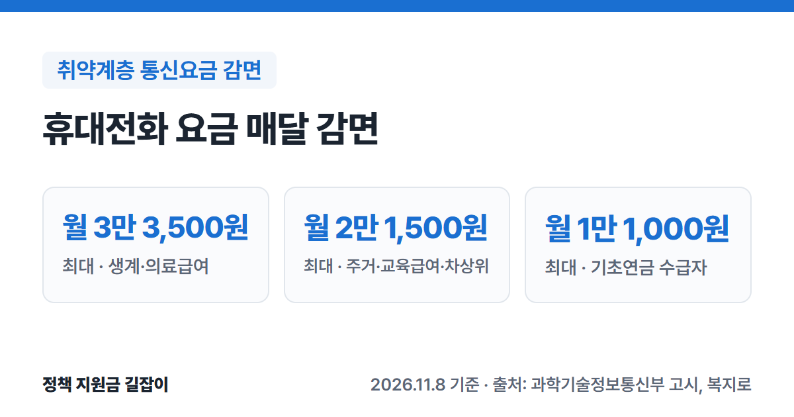

기초생활수급자, 차상위계층, 기초연금 수급자, 등록 장애인은 휴대전화 요금을 매달 감면받을 수 있어요.
다만 **자격이 있어도 신청해야** 감면이 시작돼요.
과학기술정보통신부 고시와 「전기통신사업법 시행령」 원문을 바탕으로 대상별 감면 금액과 신청 방법을 정리했어요.

{: .summary-card}

> 💡 **핵심 요약**
> - 휴대전화 요금 감면은 생계·의료급여 수급자 월 최대 **3만 3,500원**, 주거·교육급여 수급자와 차상위계층 월 최대 **2만 1,500원**, 기초연금 수급자 월 최대 **1만 1,000원**이에요. (출처①③④)
> - 등록 장애인과 일부 국가유공자는 요금제의 기본료(월정액), 음성·데이터 통화료를 각각 **35%** 감면받아요. (출처①)
> - 신청은 통신사 대리점, 주민센터, 복지로·정부24에서 할 수 있고, 휴대전화로 **1523**(통신감면 안내센터)에 걸어 신청할 수도 있어요. (출처③④)

> **출처 표시 방법**: 본문의 (출처①) 같은 표시는 글 끝 출처 목록의 번호와 같아요.
> 생계급여·기초연금 등 다른 생활비 지원은 [2026 생활비 지원 총정리]()에서 상황별로 찾을 수 있어요.

목차

* 목차
{:toc}

## 한눈에 보기

| 항목 | 내용 |
|---|---|
| 대상 | 기초생활수급자, 차상위계층, 기초연금 수급자 등록 장애인, 일부 국가유공자 등 |
| 휴대전화 | 대상에 따라 월 최대 **1만 1,000원~3만 3,500원** 장애인·국가유공자는 **35%** 감면 |
| 신청 기간 | **상시** 신청 |
| 신청 방법 | 통신사 대리점, 주민센터 복지로·정부24, 휴대전화로 **1523** |

(출처①②③④)

---

## 누가 받을 수 있나요?

「전기통신사업법 시행령」이 정한 감면 대상은 아래와 같아요. (출처②)

| 구분 | 대상 |
|---|---|
| 생계·의료급여 | **생계급여** 또는 **의료급여** 수급자 |
| 주거·교육급여 | 생계·의료급여를 받지 않는 수급자 (교육급여 수급자의 가구원 포함) |
| 차상위계층 | 아래 지원을 받는 사람이 속한 **가구의 가구원** |
| 기초연금 | **기초연금** 수급자 |
| 장애인 | 「장애인복지법」에 따라 **등록한 장애인** |
| 국가유공자 등 | 전상군경, 공상군경, 4·19혁명부상자, 공상공무원 국가사회발전 특별공로상이자, 6·18자유상이자 5·18민주화운동부상자 |

(출처②)

차상위계층은 다음 중 하나에 해당하는 사람이 있는 가구예요. (출처②)

- 자활사업에 참가하는 사람
- 희귀난치성질환자 등으로 건강보험 **본인부담 경감**을 받는 사람
- **장애수당** 또는 **장애아동수당**을 받는 사람
- **한부모가족** 지원대상자(소득인정액이 기준 중위소득 52% 이하인 사람 포함)
- **장애인연금**을 받는 사람
- 사회보장정보시스템에 차상위계층으로 등재돼 **차상위계층 확인서** 발급 대상인 사람

장애인복지시설·장애인복지단체, 특수학교, 아동복지시설, 대한민국상이군경회·4·19민주혁명회 같은 **단체**도 감면 대상이에요. (출처②)

---

## 얼마나 감면되나요?

### 휴대전화 요금

| 대상 | 감면 방식 · 월 최대 |
|---|---|
| 생계·의료급여 | 기본료(월정액) **2만 6,000원**까지 면제 음성·데이터 통화료 **50%** 감면 월 최대 **3만 3,500원** |
| 주거·교육급여 차상위계층 | 기본료(월정액) **1만 1,000원**까지 면제 넘는 금액 **35%** 감면 월 최대 **2만 1,500원** |
| 기초연금 | 청구된 이용료(기본료·음성·데이터 합계)의 **50%** 월 최대 **1만 1,000원** |
| 장애인·국가유공자 | 기본료(월정액), 음성·데이터 통화료 각각 **35%** 감면 |

(출처①③④)

감면에는 고시에 정해진 한도가 있어요. (출처①)

- **생계·의료급여**: 통화료 50% 감면은 기본료 면제금액과 음성·데이터 사용액을 합쳐 **4만 1,000원**까지 적용해요.
- **주거·교육급여·차상위계층**: 1만 1,000원을 넘는 기본료·음성·데이터 사용액을 합쳐 **3만 원**까지 35% 감면해요.
- **기초연금**: 청구된 이용료 **2만 2,000원**까지 50%를 감면해요.

이 세 가지 한도로 계산하면 월 최대 감면액이 각각 3만 3,500원, 2만 1,500원, 1만 1,000원이 돼요. (출처①③④)

### 집 전화·인터넷

| 대상 | 감면 내용 |
|---|---|
| 장애인·국가유공자 | 시내전화 통화료 **50%** 시외전화 통화료 월 **3만 원** 한도 안에서 **50%** 114 번호안내 면제 초고속인터넷 월 이용료 **30%** 인터넷전화 통화료 **50%** |
| 생계·의료급여 | 시내전화 가입비·기본료 면제, 시내통화 **75도수** 면제 시외통화 **75도수** 면제, 114 번호안내 면제 초고속인터넷 월 이용료 **30%** 인터넷전화 가입비·기본료 면제, 통화 **150도수** 면제 |

(출처①)

- 집 전화·인터넷 감면은 장애인·국가유공자·5·18민주화운동부상자는 그 사람이 속한 **세대**, 생계·의료급여 수급자는 수급자가 포함된 **가구**가 대상이에요. (출처②)
- 주거·교육급여 수급자, 차상위계층, 기초연금 수급자는 **휴대전화 요금만** 감면돼요. (출처②)

---

## 어떻게 신청하나요?

1. **신청할 곳 고르기**: 쓰고 있는 통신사 대리점, 가까운 주민센터, 복지로·정부24 온라인 중 편한 곳에서 신청해요. (출처③④)
2. **휴대전화는 1523도 가능**: 휴대전화로 국번 없이 **1523**에 걸면 감면 대상인지 확인한 뒤 신청할 수 있어요. (출처④)
3. **자격 확인 동의**: 신청할 때 감면 기간 동안 자격을 확인하기 위해 통신사와 한국정보통신진흥협회를 거쳐 행정안전부·보건복지부·국가보훈처 등의 자격 정보를 조회하는 데 동의해요. (출처①)
4. **심사와 감면 적용**: 시·군·구청이나 통신사에서 확인한 뒤 감면이 적용돼요. (출처③)

> 문의: 휴대전화로 국번 없이 **1523**(통신사 ARS), 과학기술정보통신부 민원상담센터 **1335** (출처③)

---

## 놓치기 쉬운 점

- **자격이 생겨도 저절로 깎이지 않아요.** 시행령에 요금감면은 **신청해야** 받을 수 있다고 정해져 있어요. 수급자나 기초연금 수급자로 결정됐다면 따로 신청하세요. (출처②)
- **가족도 각자 신청해요.** 주거·교육급여 수급 가구와 차상위계층 가구는 가구원 각자가 신청하고, 한 가구에서 **4명**까지 감면돼요. **만 6세 이하** 아동은 제외돼요. (출처①③)
- **한 사람당 1회선만** 감면돼요. 단체는 2회선까지예요. (출처①)
- **기초연금 감면은 요금에 따라 달라요.** 청구된 이용료의 50%를 2만 2,000원까지만 적용하므로, 요금이 2만 2,000원보다 적으면 감면액도 1만 1,000원보다 적어요. (출처①)

자격이 여러 개 겹치거나 감면이 안 된 것 같으면 쓰는 통신사 고객센터나 **1523**에 먼저 물어보세요.

---

## 자주 묻는 질문

**Q. 알뜰폰도 감면되나요?**
공식 자료에서 알뜰폰 적용 여부를 따로 확인하지 못했어요. 쓰는 알뜰폰 회사 고객센터에 감면 신청이 되는지 먼저 물어보세요.

**Q. 기초연금을 받는데 요금이 월 5만 원이에요. 얼마나 깎이나요?**
기초연금 감면은 청구된 이용료 2만 2,000원까지만 50%를 적용해요. 그래서 요금이 2만 2,000원을 넘으면 월 1만 1,000원이 감면돼요. (출처① 기준으로 계산)

**Q. 장애인 감면에는 한도가 있나요?**
고시에는 장애인·국가유공자의 휴대전화 요금을 기본료(월정액), 음성·데이터 통화료 각각 35% 감면한다고만 되어 있어요. 실제 감면액은 요금제에 따라 달라요. (출처①)

**Q. 집 인터넷 요금도 깎이나요?**
등록 장애인과 일부 국가유공자의 세대, 생계·의료급여 수급자의 가구는 초고속인터넷 월 이용료가 30% 감면돼요. 주거·교육급여 수급자, 차상위계층, 기초연금 수급자는 휴대전화 요금만 감면돼요. (출처①②)

---

## 함께 보면 좋은 글

- [2026 생활비 지원 총정리](): 생계급여·주거급여·기초연금 등 내 상황에 맞는 제도 찾기
- [2026 기초연금 총정리](): 만 65세 이상 기초연금 대상과 금액
- [2026 생계급여 총정리](): 생계급여 선정 기준과 신청 방법
- [2026 장애인연금 총정리](): 18세 이상 중증장애인 연금(받으면 차상위 통신요금 감면 대상)

---

## 출처

1. [과학기술정보통신부 - 보편적역무손실보전금 산정방법 등에 관한 기준(고시 제2026-60호, 2026.10.14.) 제5조](https://www.law.go.kr/행정규칙/보편적역무손실보전금산정방법등에관한기준) - 대상별 감면 방식·한도, 가구당 4인, 1인 1회선, 자격 확인 동의서 (확인일: 2026-11-08)
2. [국가법령정보센터 - 전기통신사업법 시행령 제2조(2026.10.1. 시행)](https://www.law.go.kr/법령/전기통신사업법시행령) - 감면 대상자, 휴대전화 요금만 감면되는 대상, 신청 의무 (확인일: 2026-11-08)
3. [복지로 - 이동통신요금감면](https://www.bokjiro.go.kr/ssis-tbu/twataa/wlfareInfo/moveTWAT52011M.do?wlfareInfoId=WLF00003257) - 대상별 월 최대 감면액, 신청 기관, 심사 절차, 문의처 (확인일: 2026-11-08)
4. [정부24 - 취약계층 통신요금감면](https://www.gov.kr/portal/rcvfvrSvc/dtlEx/172100000012) - 감면 내용, 신청 방법(1523·대리점·주민센터·복지로), 상시 신청 (확인일: 2026-11-08)

> 이 글은 2026년 11월 8일 기준입니다. 지원 조건은 바뀔 수 있으니 신청 전 통신사나 복지로에서 꼭 확인하세요.
