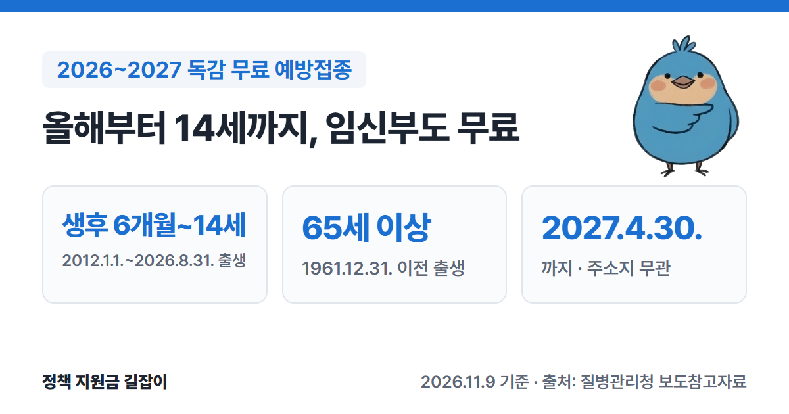
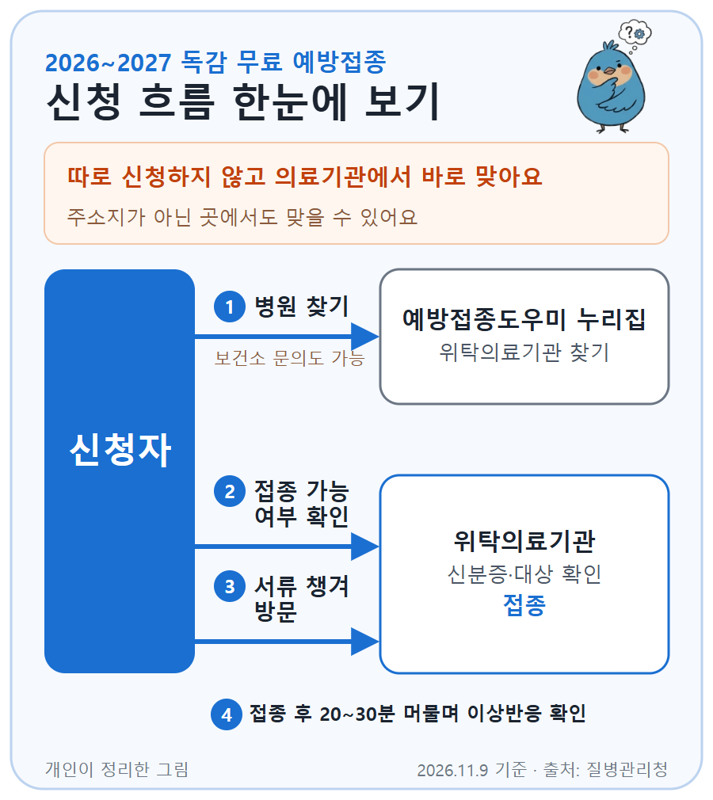

생후 6개월~14세 어린이, 임신부, 65세 이상 어르신은 독감(인플루엔자) 예방접종을 **무료**로 받을 수 있어요.
올해부터 어린이 대상이 **13세에서 14세**(중학교 2학년)까지 늘었고, 접종 기간은 **2027년 4월 30일**까지예요.
질병관리청 보도자료를 바탕으로 대상 출생연도, 접종 장소, 챙길 서류를 정리했어요.

{: .summary-card}

> 💡 **핵심 요약**
> - **생후 6개월~14세 어린이**(2012.1.1.~2026.8.31. 출생), **임신부**, **65세 이상**(1961.12.31. 이전 출생)은 무료예요. (출처①)
> - 접종 기간은 **2027년 4월 30일**까지예요. 시작일은 대상마다 달랐고, 지금(11월)은 모든 대상이 맞을 수 있어요. (출처①②)
> - **주소지와 관계없이** 가까운 위탁의료기관이나 보건소에서 맞을 수 있어요. 전국 위탁의료기관은 약 **2.3만 곳**이에요. (출처②)

> **출처 표시 방법**: 본문의 (출처①) 같은 표시는 글 끝 출처 목록의 번호와 같아요.

목차

* 목차
{:toc}

## 한눈에 보기

| 항목 | 내용 |
|---|---|
| 대상 | 생후 6개월~**14세** 어린이 **임신부** (임신 주수 상관없음) **65세 이상** 어르신 |
| 비용 | **무료** (국가예방접종) |
| 기간 | **2027년 4월 30일**까지 |
| 백신 | **3가** 백신 (9세 미만 일부 어린이는 2회) |
| 장소 | 위탁의료기관·보건소 (**주소지 무관**) |
| 준비물 | **신분증**, 어린이는 주민등록등본 등, 임신부는 산모수첩 등 |
| 문의 | 관할 보건소, 질병관리청 콜센터 **1339** |

(출처①②④)

## 누가 받을 수 있나요?

| 대상 | 출생연도 기준 |
|---|---|
| 어린이 | 생후 6개월~14세 **2012.1.1.~2026.8.31.** 출생 |
| 임신부 | 산모수첩 등으로 임신이 확인된 분 임신 주수 **상관없음** |
| 어르신 | 65세 이상 **1961.12.31. 이전** 출생 |

(출처①④)

- 지난 절기까지는 어린이 대상이 **생후 6개월~13세**였어요. 학령기 청소년 사이의 유행을 막으려고 이번 절기부터 **14세**까지 늘렸어요. (출처①)
- 주민등록상 생년월일과 실제 생년월일이 다르면 **실제 생년월일**을 기준으로 해요. (출처④)
- 위 대상이 아니면 의료기관에서 **유료**로 맞아야 해요. 일부 지자체는 독감 접종비를 따로 지원하니 관할 보건소에 물어보세요. (출처①)

## 얼마나 받을 수 있나요?

국가예방접종 대상이면 위탁의료기관이나 보건소에서 **무료**로 접종받아요. 이번 절기 백신은 세계보건기구(WHO) 권장 바이러스가 모두 들어간 **3가 백신**이에요. (출처①)

| 구분 | 접종 횟수 |
|---|---|
| 2회 접종 | 생후 6개월~**9세 미만** 중 처음 맞거나 **2025.6.30.까지** 모두 합쳐 **1회만** 맞은 어린이 |
| 1회 접종 | 2회 대상이 아닌 어린이 (14세까지) |

(출처①④)

- 전에 몇 번 맞았는지 모르겠다면 접종 전 의사 상담(예진) 때 확인하세요.
- 질병청은 이번 절기 백신 약 **1,233만 도즈**를 확보했어요. (출처②)

## 언제 맞을 수 있나요?

시작일은 대상마다 달랐지만, 마감은 모두 **2027년 4월 30일**이에요. 유행이 예년보다 일찍 시작돼 9월 16일에 시작일이 앞당겨졌어요. (출처②)

| 대상 | 접종 기간 |
|---|---|
| 어린이·임신부 | **2026.9.21.~2027.4.30.** |
| 75세 이상 | **2026.10.6.~2027.4.30.** |
| 70~74세 | **2026.10.12.~2027.4.30.** |
| 65~69세 | **2026.10.15.~2027.4.30.** |

(출처②④)

- 면역저하자 등 고위험군은 나이와 관계없이 10월 6일부터 의료진과 상담한 뒤 맞을 수 있었어요. (출처②)
- 11월 5일 오후 6시 기준 접종률은 65세 이상 **71.1%**, 어린이 **56.1%**예요. 아직 안 맞았다면 서두르는 게 좋아요. (출처③)

## 어떻게 신청하나요?

{: .flow-chart}

따로 신청하지 않고, 대상자가 의료기관에 가서 바로 맞으면 돼요.

1. **병원 찾기**: 예방접종도우미 누리집(nip.kdca.go.kr) → 예방접종관리 → 위탁의료기관 찾기에서 가까운 곳을 찾아요. 관할 보건소에 물어봐도 돼요. (출처③)
2. **접종 가능 여부 확인**: 백신은 의료기관에 순차적으로 공급돼요. 가기 전에 그 병원에서 접종할 수 있는지 꼭 확인하세요. (출처②)
3. **서류 챙겨 방문**: 신분증을 가져가요. 어린이는 주민등록등본이나 건강보험증, 임신부는 산모수첩이나 임신확인서 등으로 대상인지 확인해요. (출처②④)
4. **접종 후 20~30분 머물기**: 이상반응이 있는지 지켜본 뒤 집에 가서 충분히 쉬어요. (출처②)

- 주소지가 아닌 곳에서도 맞을 수 있어요. 직장 근처나 아이 학교 근처 병원도 괜찮아요. (출처②)
- 코로나19 백신과 같은 날 맞을 수 있어요. 이때는 서로 다른 부위에 맞아요. (출처①)

## 놓치기 쉬운 점

- **가기 전에 접종 가능한지 확인하세요**: 이번 절기는 백신 바이러스가 모두 바뀌면서 국내 생산·수입 물량이 지난 절기보다 약 **400만 도즈** 줄었어요. 민간(유료) 접종용 백신 공급도 예년보다 여유롭지 않다고 해요. 질병청은 방문하려는 기관의 접종 가능 여부를 먼저 확인하라고 권해요. (출처②)
- **이미 독감에 걸렸어도 맞는 게 좋아요**: 독감 바이러스는 여러 종류라 한 번 걸려도 다른 종류에 또 걸릴 수 있어요. 열이 내리고 회복되면 의사 예진을 거쳐 맞으세요. (출처③)
- **맞고 나서 2주는 지나야 효과가 생겨요**: 방어 항체는 접종 뒤 약 2주가 지나야 생겨요. 유행이 다시 늘고 있어 미루지 않는 게 좋아요. (출처①③)
- **임신부는 서류를 챙기세요**: 산모수첩이나 임신확인서 같은 서류로 임신 여부를 확인해요. 임신 주수는 상관없어요. (출처②④)

대상인지, 근처에 접종할 곳이 있는지 헷갈리면 **관할 보건소**나 질병관리청 콜센터 **1339**에 먼저 물어보세요. (출처①④)

## 자주 묻는 질문

**Q. 우리 아이가 중학교 2학년인데 무료인가요?**
2012년 1월 1일 이후에 태어났다면 무료 대상이에요. 이번 절기부터 14세(중학교 2학년)까지 늘었어요. (출처①)

**Q. 주민등록 주소지가 아닌 동네에서 맞아도 되나요?**
네. 국가예방접종은 주소지와 관계없이 가까운 위탁의료기관이나 보건소에서 맞을 수 있어요. (출처②)

**Q. 독감 진단을 받았어요. 언제부터 학교·회사에 가도 되나요?**
질병청은 열이 내린 뒤 **24시간**이 지날 때까지 등교·등원·출근을 하지 말고 집에서 쉬라고 권해요. 해열제를 먹었다면 마지막으로 먹은 때부터 **2일(48시간)**까지 지켜봐야 해요. 증상이 심하거나 면역저하자라면 의사 판단에 따라 기간이 달라질 수 있어요. (출처③)

**Q. 접종 후 팔이 붓고 아파요.**
접종 부위가 붉어지고 아픈 것이 가장 흔한 이상반응이에요. 대부분 1~2일 안에 사라져요. (출처①)

**Q. 고위험군 아이도 코로나19 국가예방접종을 받을 수 있나요?**
면역저하자이거나 요양병원·장애인 생활시설 등 감염취약시설에 입원·입소한 **생후 6개월~11세** 어린이는 **2026년 11월 11일부터 2027년 4월 30일**까지 코로나19 국가예방접종을 받을 수 있어요. 진단서·소견서·시설 입소 확인서 같은 증빙 서류를 가져가요. 접종 의사가 면역저하자로 판단하면 서류 없이도 맞을 수 있어요. (출처⑤)

## 함께 보면 좋은 글

- [2026 출산지원금 총정리](): 첫만남이용권, 부모급여, 아동수당 등 아이 키우는 집이 받는 지원 전체
- [2026 기초연금 총정리](): 65세 이상 어르신이 받는 월 최대 34만 9,700원

---

## 출처

1. [질병관리청 - 올겨울 인플루엔자 국가예방접종, 14세까지 확대해 9월 21일부터 순차 시행 (보도참고자료, 2026.8.25.)](https://www.korea.kr/briefing/pressReleaseView.do?newsId=156775345) - 접종 기간 2026.9.21.~2027.4.30., 어린이 대상 생후 6개월~14세(2012.1.1.~2026.8.31. 출생)로 확대(기존 13세), 65세 이상 1961.12.31. 이전 출생, 2회 접종 대상 정의, 3가 백신, 무료 접종, FAQ(비대상자 유료·지자체 추가 지원, 접종 후 약 2주 뒤 항체 형성, 코로나19 동시 접종, 이상반응 1~2일) (확인일: 2026-11-09)
2. [질병관리청 - 이른 인플루엔자 유행에 대응해 어린이와 어르신 국가예방접종 앞당긴다 (보도참고자료, 2026.9.16.)](https://www.korea.kr/briefing/pressReleaseView.do?newsId=156781925) - 변경된 시작일(어린이·임신부 9.21., 75세 이상 10.6., 70~74세 10.12., 65~69세 10.15.), 고위험군 10.6.부터, 백신 약 1,233만 도즈 확보, 생산·수입 약 400만 도즈 감소, 주소지 무관·위탁의료기관 약 2.3만 곳, 방문 전 접종 가능 여부 확인, 지참 서류, 접종 후 20~30분 관찰 (확인일: 2026-11-09)
3. [질병관리청 - 인플루엔자 발생 다시 증가! 어린이·어르신 예방접종 서두르고, 의심증상 시 신속한 진료 당부 (보도참고자료, 2026.11.6.)](https://www.korea.kr/briefing/pressReleaseView.do?newsId=156788182) - 11.5. 18시 기준 접종률(65세 이상 71.1%, 어린이 56.1%), 재감염 가능·회복 후 접종 권장, 해열 후 24시간·해열제 마지막 투약 후 48시간 (확인일: 2026-11-09)
4. [정부24 보조금24 - 인플루엔자 국가예방접종 지원 (질병관리청, 2026.10.20. 수정)](https://www.gov.kr/portal/rcvfvrSvc/dtlEx/135200000115) - 대상별 출생연도·접종 기간, 2회 접종 기준(2025.6.30.까지 총 1회 접종), 임신 주수 무관, 실제 생년월일 기준, 구비서류(임신확인서 등), 문의 1339 (확인일: 2026-11-09)
5. [질병관리청 - 고위험군 소아·영유아 코로나19 국가예방접종 시작 안내 (보도참고자료, 2026.11.5.)](https://www.korea.kr/briefing/pressReleaseView.do?newsId=156788013) - 면역저하자·감염취약시설 입원·입소자 생후 6개월~11세, 2026.11.11.~2027.4.30., 증빙 서류(진단서·소견서·시설 입소 확인서 등), 의사가 면역저하자로 판단하면 서류 없이 접종 (확인일: 2026-11-09)

> 이 글은 **2026년 11월 9일** 기준이에요. 접종 일정과 백신 공급은 바뀔 수 있으니 방문 전에 보건소나 예방접종도우미 누리집에서 꼭 확인하세요.
