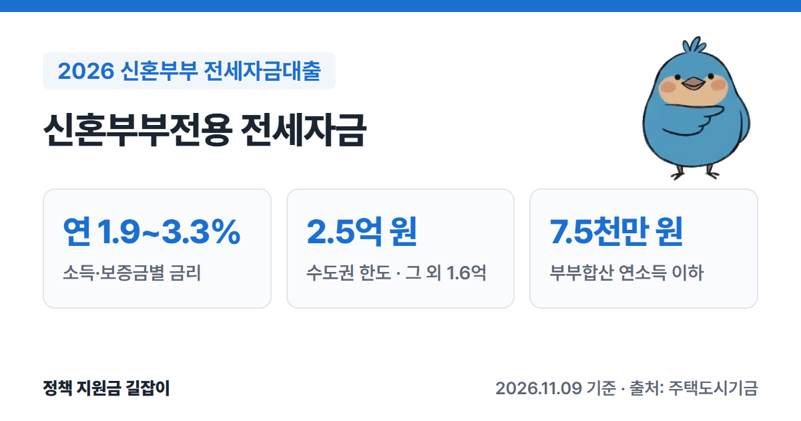
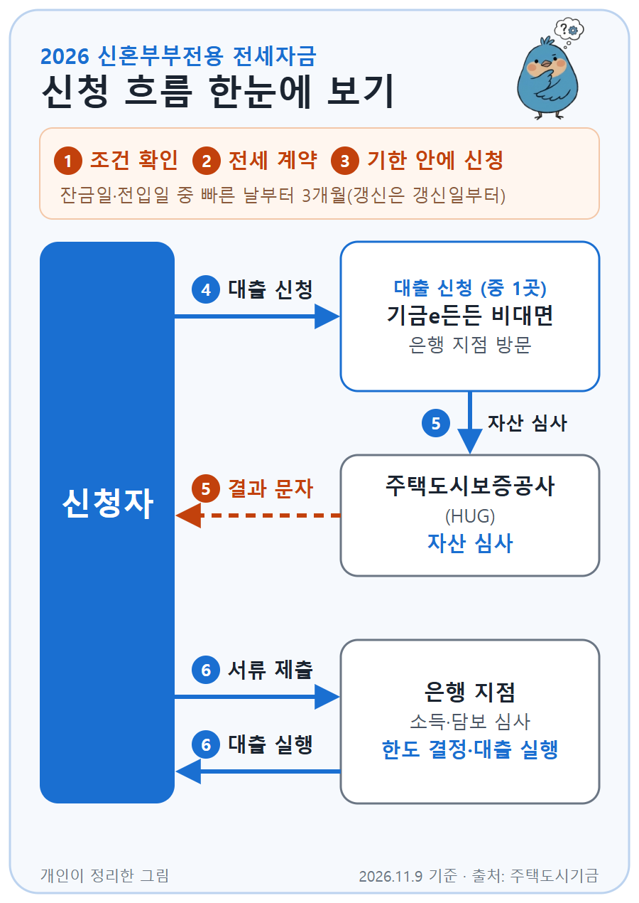

**신혼부부전용 전세자금**은 전세 보증금이 부족한 신혼부부에게 주택도시기금이 낮은 금리로 빌려주는 전세대출이에요.
결혼 3개월 전부터 신청할 수 있고, 금리는 연 1.9~3.3%로 정해져 있는 대신 소득·자산·집 조건이 있어요. (출처①)
주택도시기금 공식 상품 안내를 바탕으로 자격 조건, 한도, 금리, 신청 방법을 정리했어요.

{: .summary-card}

> 💡 **핵심 요약**
> - 혼인 **7년 이내**이거나 **3개월 안에 결혼할** 무주택 세대주, 부부합산 연소득 **7.5천만 원 이하**, 순자산 **3.45억 원 이하**면 신청할 수 있어요. (출처①)
> - 금리는 소득과 보증금에 따라 **연 1.9~3.3%**이고, 지방 주택은 **0.2%p** 더 낮아요. (출처①)
> - 한도는 수도권 **2.5억 원**, 수도권 외 **1.6억 원**이고, 보증금의 **80%**를 넘을 수 없어요. (출처①)

> **출처 표시 방법**: 본문의 (출처①) 같은 표시는 글 끝 출처 목록의 번호와 같아요.

목차

* 목차
{:toc}

## 한눈에 보기

| 항목 | 내용 |
|---|---|
| 대상 | 혼인 **7년 이내** 또는 **3개월 이내** 결혼 예정인 무주택 세대주 |
| 소득·자산 | 부부합산 연소득 **7.5천만 원 이하** 순자산 **3.45억 원 이하** (2026년 기준) |
| 대상 주택 | 전용 **85㎡ 이하** 보증금 수도권 **4억 원**, 수도권 외 **3억 원** 이하 |
| 대출 한도 | 수도권 **2.5억 원**, 수도권 외 **1.6억 원** (보증금의 80% 이내) |
| 대출 금리 | **연 1.9~3.3%** (변동금리) |
| 대출 기간 | **2년** (연장해서 최장 10년) |
| 신청 | 기금e든든 비대면 신청 후 은행 방문, 또는 은행 대면 신청 |

(출처①)

---

## 누가 받을 수 있나요?

아래 조건을 **모두** 갖춰야 해요. (출처①)

### 기본 조건

| 조건 | 내용 |
|---|---|
| 신혼 | 혼인기간 **7년 이내**, 또는 **3개월 안에** 결혼해 세대를 꾸릴 예정 |
| 세대주 | 대출 접수일 기준 성년인 **세대주** |
| 주택 | 세대주와 세대원 **모두 무주택** |
| 계약 | 임대차계약을 맺고 보증금의 **5% 이상**을 낸 상태 |
| 소득 | 본인과 배우자 합산 **7.5천만 원 이하** |
| 자산 | 본인과 배우자 합산 순자산 **3.45억 원 이하** |

(출처①)

- **혼인기간**은 혼인관계증명서로 따져요. 같은 배우자와 이혼 후 다시 결혼했다면 **처음 결혼한 날**부터 계산해요. (출처①)
- **세대주**는 배우자, 부모·조부모 같은 직계존속(배우자 쪽 포함), 자녀·손자녀 같은 직계비속으로 이루어진 세대의 세대주예요. **형제·자매는 세대원으로 치지 않아요.** 세대주의 배우자, 3개월 안에 결혼해서 세대주가 될 예정인 사람도 포함돼요. 대출 실행일부터 1개월 안에 세대를 나누거나 합쳐 세대주가 될 예정인 사람도 신청할 수 있어요. (출처①)
- 순자산 기준은 통계청 조사의 소득 3분위 가구 평균 자산으로 정하기 때문에 **해마다 바뀌어요.** 3.45억 원은 2026년 기준이에요. (출처①)

### 부부합산 소득이 7.5천만 원을 넘는 경우

부부합산 소득이 7.5천만 원을 넘어도 **대출 신청인 한 사람의 소득이 5천만 원 이하**면 신청할 수 있어요. (출처①)
다만 이 경우에는 아래처럼 조건이 달라져요.

- 금리: 처음 신규로 받을 때 보증금 구간별 **최고 소득구간(6천만~7.5천만 원) 금리에 0.3%p**를 더해요. (출처①, 출처③) 우대금리는 똑같이 적용돼요. (출처③)
- 갚을 능력 심사: 부부 소득을 합치지 않고 **신청인 한 사람의 소득과 빚**만으로 봐요. (출처③)
- 자산 심사: 그대로 **부부 합산 순자산**으로 봐요. (출처③)
- 소득을 심사받는 사람이 반드시 **임대차계약을 맺은 사람(대출받는 사람)**이어야 해요. (출처③)

부부합산 소득이 7.5천만 원 이하라면 이 방법은 쓸 수 없고, 원래대로 부부 합산 소득으로 심사해요. (출처③)

### 이런 경우는 받을 수 없어요

- 본인이나 배우자(결혼 예정 배우자 포함)가 이미 **전세대출이나 주택담보대출**을 쓰고 있는 경우 (출처①)
- 성년인 세대원 전원을 대상으로 **주택도시기금 대출** 이용 여부를 봐서, 기금 대출을 쓰고 있는 경우 (출처①)
- 연체, 대위변제, 부도 같은 **신용 문제 기록**이 남아 있는 경우 (출처①)
- 지금 **공공임대주택**에 살고 있는 경우 (그 공공임대주택에 대해 받거나, 부부가 나가는 경우는 가능) (출처①)

이미 버팀목전세자금이나 청년전용 버팀목전세대출을 쓰고 있다면, 결혼 후 새로 계약하거나 갱신할 때 **기존 대출을 갚는 조건**으로 신청할 수 있어요. (출처①)

---

## 어떤 집이어야 하나요?

| 조건 | 내용 |
|---|---|
| 면적 | 전용 **85㎡ 이하** (주거용 오피스텔 포함) 수도권 밖 도시지역이 아닌 읍·면은 **100㎡ 이하** |
| 보증금 | 수도권 **4억 원**, 수도권 외 **3억 원** 이하 |

(출처①)

채권양도협약기관(LH·SH 등)이 가진 쉐어하우스는 면적 제한이 없어요. (출처①)

---

## 얼마나 빌릴 수 있나요?

한도는 아래 세 가지 중 **가장 작은 금액**이에요. (출처①)

| 기준 | 한도 |
|---|---|
| 1집당 한도 | 수도권(서울·인천·경기) **2.5억 원** 수도권 외 **1.6억 원** |
| 보증금 비율 | 새 계약: 전세금의 **80%** 갱신: 오른 금액 안에서, 오른 뒤 보증금의 80% |
| 보증 기관 | HF·HUG 보증 규정에 따라 달라짐 |

(출처①)

예를 들어 서울에서 보증금 2억 원짜리 집을 새로 계약하면 80%인 **1.6억 원**까지예요. 보증금이 3.5억 원이면 80%는 2.8억 원이지만 1집당 한도 때문에 **2.5억 원**까지예요. (출처① 기준으로 계산)
다만 보증 기관 심사에 따라 이보다 적게 나올 수 있어요.

- **2025년 6월 27일 이전에 계약한 경우**에는 수도권 3억 원, 수도권 외 2억 원까지 적용돼요. (출처①)
- **회사에 다닌 지 1년이 안 됐다면** 한도가 2천만 원 이하로 줄어들 수 있어요. (출처①)

---

## 금리는 얼마인가요?

국토교통부가 정하는 **변동금리**예요. 부부합산 연소득과 보증금에 따라 달라요. (출처①)

| 연소득 | 금리 |
|---|---|
| 2천만 원 이하 | **연 1.9~2.2%** |
| 2천만~4천만 원 | **연 2.2~2.5%** |
| 4천만~6천만 원 | **연 2.6~2.9%** |
| 6천만~7.5천만 원 | **연 3.0~3.3%** |

(출처①, 부부합산 연소득 기준)

같은 소득 구간 안에서는 **보증금이 클수록** 금리가 0.1%p씩 높아져요. 보증금 구간은 5천만 원 이하, 5천만~1억 원, 1억~1.5억 원, 1.5억 원 초과 네 단계예요. (출처①)
예를 들어 부부합산 연소득이 4,500만 원이고 보증금이 2억 원이면 **연 2.9%**예요. (출처① 금리표 기준)

- 집이 **지방**에 있으면 위 금리에서 **0.2%p** 내려가요. (출처①)

### 금리를 더 낮추는 방법 (우대금리)

| 대상 | 우대 |
|---|---|
| 자녀 | 다자녀 **0.7%p**, 2자녀 **0.5%p**, 1자녀 **0.3%p** |
| 전자계약 | 부동산 전자계약 **0.1%p** (2026.12.31. 신규 접수분까지) |
| 적게 빌림 | 심사 금액의 30% 이하만 신청 **0.2%p**, 최대 4년 |

(출처①)

- 자녀 우대는 2025년 3월 24일 신규 접수분부터 **자녀 1명당 4년**씩, 최대 12년까지 적용돼요. (출처①)
- 전자계약과 적게 빌림 우대는 **함께** 받을 수 있어요. (출처①)
- 우대금리는 합쳐서 **최대 0.5%p**(다자녀는 0.7%p)까지만 적용돼요. 우대를 받아도 최종 금리는 **연 1.0%보다 낮아지지 않아요.** (출처①)

---

## 얼마나 오래 빌릴 수 있나요?

- 기본 **2년**이고, 임대차 계약이 끝나는 날을 넘을 수 없어요. (출처①)
- 연장해서 **최장 10년**까지 쓸 수 있어요. (출처①)
- 10년을 쓴 뒤에도 **미성년 자녀 1명당 2년**씩 더 늘려서 **최장 20년**까지 가능해요. (출처①)
- 갚는 방식은 **일시상환** 또는 **혼합상환** 중에서 골라요(자세한 방식은 은행에 확인하세요). **중도상환수수료는 없어요.** (출처①)

---

## 어떻게 신청하나요?

{: .flow-chart}

1. **조건 확인하기**: 주택도시기금 누리집이나 은행 상담으로 조건을 확인해요. '주택전세자금 계산하기'로 대략 한도를 볼 수 있어요. (출처①, 출처②)
2. **전세 계약하기**: 임대차계약을 맺고 보증금의 **5% 이상**을 내요. (출처①)
3. **기한 안에 신청하기**: 잔금 지급일과 전입신고일 중 **빠른 날부터 3개월 안**에 신청해야 해요. 갱신 계약이면 갱신일부터 3개월 안이에요. (출처①)
4. **대출 신청하기**: '기금e든든'에서 비대면으로 신청하거나 은행 지점을 찾아가 신청해요. (출처②)
5. **자산 심사 받기**: 주택도시보증공사(HUG)가 자산을 심사하고, 결과를 신청할 때 적은 휴대폰 번호로 문자로 보내 줘요. (출처②)
6. **서류 내고 대출받기**: 은행 지점에 서류를 내면 소득·담보 심사를 거쳐 한도가 정해지고 대출이 실행돼요. (출처②)

**보증도 기한 안에** 신청해야 해요. HF(한국주택금융공사)나 HUG 보증은 대출과 따로 기한이 있으니, 은행에서 같이 챙기세요. (출처①)

### 준비 서류

| 확인 | 서류 |
|---|---|
| 본인 | 주민등록증, 운전면허증, 여권 중 하나 |
| 대상자 | 주민등록등본 (단독세대주·배우자 분리세대는 가족관계증명원 추가) |
| 결혼 예정 | **예식장 계약서** 또는 **청첩장** |
| 재직 | 건강보험 자격득실 확인서 |
| 소득 | 소득금액증명원, 원천징수영수증 등 중 하나 (소득이 없으면 신고사실없음 사실증명원) |
| 집 | 확정일자 받은 임대차계약서 사본, 건물 등기사항전부증명서 |

(출처②)

심사 중에 다른 서류를 더 달라고 할 수 있어요. (출처②)

### 신청할 수 있는 은행

우리·신한·국민·농협·하나은행 등 기금 수탁은행에서 신청해요. 부산은행과 iM뱅크는 지역 은행이라 주민등록 주소와 지점이 해당 지역(부산·울산·경남, 대구·경북)에 있어야 해요. (출처②)

---

## 놓치기 쉬운 점

- **결혼 예정자는 혼인신고를 서둘러야 해요.** 대출 후 **3개월 안에** 배우자가 함께 올라간 주민등록등본을 내지 않으면 대출금을 갚아야 해요. 신혼여행 등 사유서를 내면 대출 실행일부터 최장 6개월까지 늘릴 수 있어요. (출처①)
- **신청 기한 3개월을 넘기기 쉬워요.** 잔금일과 전입일 중 **빠른 날**이 기준이라, 먼저 이사하고 늦게 신청하면 기한이 지날 수 있어요. 보증 신청 기한도 따로 있어요. (출처①)
- **기존 대출이 있으면 막혀요.** 본인이나 배우자(결혼 예정 배우자 포함)가 다른 전세대출·주택담보대출을 쓰고 있으면 신청할 수 없어요. (출처①)
- **대출 후 집을 사면 갚아야 해요.** 대출을 받은 뒤 집을 산 사실이 확인되면 대출금을 상환해야 해요. (출처①)

> 대출 심사는 **주택도시보증공사 콜센터 1566-9009**나 은행 지점에, 자산 심사는 **자산심사 전용 상담센터 1551-3119**에 먼저 물어보세요. (출처①)

자산 심사는 신청 절차 안내 페이지에 주택도시보증공사 콜센터(1566-9009)로도 안내돼 있어요. (출처②)

---

## 자주 묻는 질문

**Q. 아직 혼인신고 전인데 신청할 수 있나요?**
네. **3개월 안에 결혼할 예정**이면 신청할 수 있어요. 예식장 계약서나 청첩장을 내야 하고, 대출 후 3개월 안에 혼인신고한 주민등록등본을 내야 해요. (출처①, 출처②)

**Q. 맞벌이라 부부 소득이 7.5천만 원을 넘어요.**
신청인 한 사람의 소득이 **5천만 원 이하**면 그 사람 이름으로 신청할 수 있어요. 다만 처음 신규로 받을 때는 보증금 구간별 최고 소득구간 금리에 **0.3%p**를 더하고, 갚을 능력도 신청인 한 사람 기준으로 심사해요. (출처①, 출처③)

**Q. 청년전용 버팀목과 무엇이 다른가요?**
신혼부부전용은 나이 상한이 없고(성년인 세대주면 가능), 한도가 수도권 **2.5억 원**까지예요. (출처①) 만 19~34세라면 청년전용 버팀목도 함께 비교해 보세요. 자세한 조건은 [2026 청년 전세자금대출 총정리]()에서 볼 수 있어요.

**Q. 아이를 낳으면 혜택이 있나요?**
자녀 수에 따라 금리를 **0.3~0.7%p** 낮춰 주고, 10년을 쓴 뒤에도 미성년 자녀 1명당 2년씩 더 쓸 수 있어요. (출처①) 최근 2년 안에 아이를 낳았다면 신생아 특례 버팀목대출도 비교해 보세요. 자세한 조건은 [2026 신생아 특례 전세대출]()에서 볼 수 있어요.

**Q. 계약한 뒤 마음이 바뀌면 취소할 수 있나요?**
네. 대출계약서를 받은 날, 계약일, 대출 실행일 등 가장 늦은 날부터 **14일 안**에 철회할 수 있어요. 원금과 이자, 부대비용을 모두 돌려줘야 철회가 끝나요. (출처①)

---

## 함께 보면 좋은 글

- [2026 신혼부부 주택구입자금대출 총정리](): 전세 다음으로 집을 산다면, 연 2.55~3.85% 신혼부부전용 구입자금
- [2026 신혼희망타운 청약](): 전세로 살면서 신혼부부 전용 분양주택 청약을 준비한다면
- [2026 청년 전세자금대출 총정리](): 만 19~34세라면 청년전용 버팀목 조건과 비교
- [2026 청년 주거 지원 총정리](): 월세 지원·공공임대·청약통장까지 상황별로 정리한 안내
- [2026 출산지원금 총정리](): 아이를 계획 중이라면 부모급여·첫만남이용권 등 출산 지원 확인

---

## 출처

1. [주택도시기금 - 신혼부부전용 전세자금 대출안내](https://nhuf.molit.go.kr/FP/FP05/FP0502/FP05020401.jsp) - 대출 대상, 소득·자산 기준, 신청 시기, 대상 주택, 한도, 금리표, 우대금리, 기간, 유의사항, 상담 전화 (확인일: 2026-11-09)
2. [주택도시기금 - 신혼부부전용 전세자금 이용절차 및 제출서류](https://nhuf.molit.go.kr/FP/FP05/FP0502/FP05020402.jsp) - 신청 방법, 이용 절차, 준비 서류, 취급 은행 (확인일: 2026-11-09)
3. [주택도시기금 - 신혼부부전용 전세자금 자주하는 질문](https://nhuf.molit.go.kr/FP/FP05/FP0502/FP05020408.jsp) - 부부 중 1인 소득 기준 적용 시 금리·자산·상환능력 심사 (확인일: 2026-11-09)
4. [기금e든든 (주택도시기금 대출 신청)](https://enhuf.molit.go.kr)

> 이 글은 **2026년 11월 9일** 기준이에요. 금리와 자산 기준은 국토교통부 고시에 따라 바뀔 수 있으니 신청 전에 주택도시기금 누리집과 은행에서 꼭 확인하세요.
