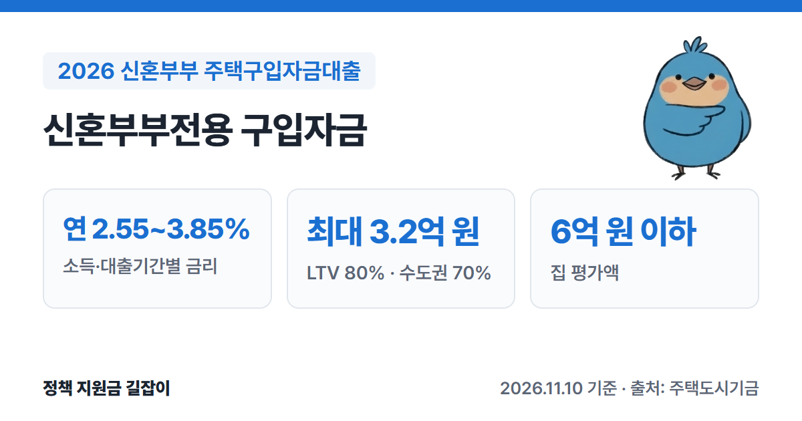
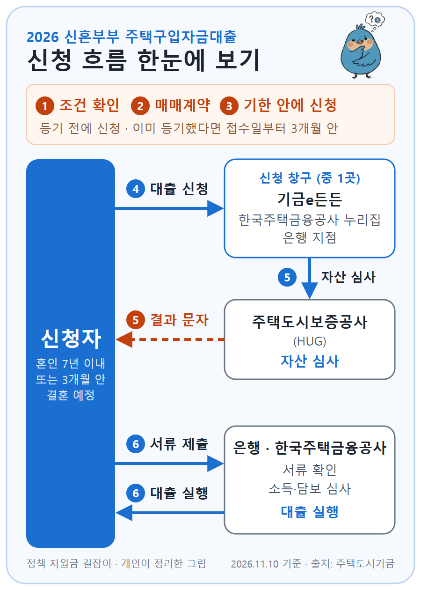

**신혼부부전용 구입자금**은 처음 집을 사는 신혼부부에게 주택도시기금이 낮은 금리로 빌려주는 주택구입대출이에요.
결혼 3개월 전부터 신청할 수 있고, 금리는 연 2.55~3.85%로 정해져 있는 대신 소득·자산·집값 조건이 있어요. (출처①)
주택도시기금 공식 상품 안내를 바탕으로 자격 조건, 한도, 금리, 신청 방법을 정리했어요.

{: .summary-card}

> 💡 **핵심 요약**
> - 혼인 **7년 이내**이거나 **3개월 안에 결혼할** 무주택 세대주로, **처음 집을 사는** 경우 신청할 수 있어요. 부부합산 연소득 **8.5천만 원 이하**, 순자산 **5.11억 원 이하**여야 해요. (출처①)
> - 금리는 소득과 대출기간에 따라 **연 2.55~3.85%**이고, 지방 주택은 **0.2%p** 더 낮아요. (출처①)
> - 한도는 **최대 3.2억 원**이고, 평가액 **6억 원 이하**·전용 **85㎡ 이하** 집만 가능해요. (출처①)

> **출처 표시 방법**: 본문의 (출처①) 같은 표시는 글 끝 출처 목록의 번호와 같아요.

목차

* 목차
{:toc}

## 한눈에 보기

| 항목 | 내용 |
|---|---|
| 대상 | 혼인 **7년 이내** 또는 **3개월 이내** 결혼 예정 무주택 세대주, 생애최초 주택구입자 |
| 소득·자산 | 부부합산 연소득 **8.5천만 원 이하** 순자산 **5.11억 원 이하** (2026년 기준) |
| 대상 주택 | 전용 **85㎡ 이하**, 평가액 **6억 원 이하** |
| 대출 한도 | **최대 3.2억 원** (LTV 80%, 수도권·규제지역 70%, DTI 60%) |
| 대출 금리 | **연 2.55~3.85%** |
| 대출 기간 | **10·15·20·30년** (1년 거치 또는 비거치) |
| 신청 | 기금e든든 비대면 신청 후 은행 방문, 또는 은행 대면 신청 |

(출처①)

---

## 누가 받을 수 있나요?

아래 조건을 **모두** 갖춰야 해요. (출처①)

### 기본 조건

| 조건 | 내용 |
|---|---|
| 계약 | 집을 사려고 **매매계약**을 맺은 상태 (상속·증여·재산분할은 안 됨) |
| 신혼 | 혼인기간 **7년 이내**, 또는 **3개월 안에** 결혼해 세대를 꾸릴 예정 |
| 세대주 | 대출 접수일 기준 성년인 **세대주** |
| 주택 | 세대주와 세대원 **모두 무주택** |
| 생애최초 | 세대원 모두 **처음 집을 사는** 경우 |
| 소득 | 본인과 배우자 합산 **8.5천만 원 이하** |
| 자산 | 본인과 배우자 합산 순자산 **5.11억 원 이하** |

(출처①)

- **무주택**을 따질 때는 **분양권과 조합원 입주권도 집으로 쳐요.** (출처①)
- **생애최초**는 세대원 모두 처음 집을 사고, 기금의 최초주택구입·중도금 대출을 쓴 적(이미 갚은 경우 포함)이 없어야 해요. (출처①)
- **세대주**는 배우자, 부모·조부모 같은 직계존속(배우자 쪽 포함), 자녀·손자녀 같은 직계비속으로 이루어진 세대의 세대주예요. **형제·자매는 세대원으로 치지 않아요.** 세대주의 배우자, 3개월 안에 결혼해서 세대주가 될 예정인 사람도 세대주로 봐요. (출처①)
- **만 30세 미만 단독세대주**는 대출에서 빠져요. 다만 미성년인 형제·자매 1명 이상과 같은 세대로 6개월 이상 계속 산 경우는 가능해요. (출처①)
- 순자산 기준은 통계청 조사의 소득 4분위 가구 평균 자산으로 정하기 때문에 **최근 통계 발표에 따라 바뀔 수 있어요.** 5.11억 원은 2026년 기준이에요. (출처①)

### 부부합산 소득이 8.5천만 원을 넘는 경우

부부합산 소득이 8.5천만 원을 넘어도 **대출 신청인 한 사람의 소득이 6천만 원 이하**면 신청할 수 있어요. (출처①)
다만 이 경우에는 아래처럼 조건이 달라져요.

- 금리: 대출기간별 **최고 금리에 0.3%p**를 더해요. (출처①)
- DTI(갚을 능력 심사): **신청인 한 사람의 소득과 빚**만으로 봐요. (출처①)

### 이런 경우는 받을 수 없어요

- 성년인 세대원 전원을 대상으로 **주택도시기금 대출** 이용 여부를 봐서, 기금 대출을 쓰고 있는 경우. 다만 기금 전세자금대출은 대출 실행일에 갚는 조건이면 가능해요. (출처①)
- 본인이나 배우자(결혼 예정 배우자 포함)가 **다른 집으로 주택담보대출**을 쓰고 있는 경우 (출처①)
- 연체, 대위변제, 부도 같은 **신용 문제 기록**이 남아 있거나, 개인신용평가 점수가 기준에 못 미치는 경우 (출처①)

---

## 어떤 집이어야 하나요?

| 조건 | 내용 |
|---|---|
| 면적 | 전용 **85㎡ 이하** 수도권 밖 도시지역이 아닌 읍·면은 **100㎡ 이하** |
| 집값 | 대출 접수일 기준 평가액 **6억 원 이하** |

(출처①)

평가액은 시세 정보, 국토교통부 공시가격, 분양가, 감정가 순서로 정해요. (출처①)

---

## 얼마나 빌릴 수 있나요?

한도는 아래 중 **가장 작은 금액**이에요. (출처①)

| 기준 | 한도 |
|---|---|
| 1집당 한도 | **3.2억 원** |
| LTV | 집 평가액의 **80%** (수도권·규제지역 **70%**) |
| DTI | 연간 원리금 상환액이 소득의 **60%** 이내 |
| 매매가 | 매매(분양)가격 이내 |

(출처①)

예를 들어 평가액 4억 원인 지방 아파트라면 LTV 80%로 3.2억 원이에요. 같은 4억 원이라도 수도권이면 70%인 **2.8억 원**까지예요. (출처① 기준으로 계산)
실제 한도는 DTI와 먼저 잡힌 대출·임대보증금을 빼고 정해져서 이보다 적을 수 있어요. (출처①)

- **2025년 6월 27일 이전에 계약한 경우**에는 4억 원까지 적용돼요. (출처①)

---

## 금리는 얼마인가요?

부부합산 연소득과 대출기간에 따라 달라요. (출처①)

| 연소득 | 금리 (10년 → 30년) |
|---|---|
| 2천만 원 이하 | **연 2.55~2.80%** |
| 2천만~4천만 원 | **연 2.90~3.15%** |
| 4천만~7천만 원 | **연 3.25~3.50%** |
| 7천만~8.5천만 원 | **연 3.60~3.85%** |

(출처①, 부부합산 연소득 기준)

대출기간이 길수록 금리가 높아요. 예를 들어 연소득 4,500만 원이 30년으로 빌리면 **연 3.50%**, 10년으로 빌리면 **연 3.25%**예요(금리 방식 가산·우대 적용 전). (출처① 금리표 기준)

- 집이 **지방**에 있으면 위 금리에서 **0.2%p** 내려가요. (출처①)
- 금리 방식에 따라 더해지는 금리가 있어요. **5년 단위 변동금리 0.1%p**, **10년 고정금리 0.2%p**, **순수 고정금리 0.3%p**예요. 10년 고정 후 변동금리를 고르면서 대출기간을 10년으로 하면 **0.3%p**가 더해져요. (출처①)

### 금리를 더 낮추는 방법 (우대금리)

| 대상 | 우대 |
|---|---|
| 자녀 | 다자녀 **0.7%p**, 2자녀 **0.5%p**, 1자녀 **0.3%p** |
| 청약통장 | (회차 기준) 5년·60회 이상 **0.3%p** 10년·120회 이상 **0.4%p** 15년·180회 이상 **0.5%p** |
| 전자계약 | 부동산 전자계약 **0.1%p** (2026.12.31. 신규 접수분까지) |
| 적게 빌림 | 심사 금액의 30% 이하만 신청 **0.1%p** |
| 일찍 갚음 | 1년 지난 뒤 원금의 40% 이상 갚으면 **0.2%p** |
| 지방 미분양 | 지방 준공 후 미분양주택 **0.2%p** |

(출처①)

- 자녀 우대는 2025년 3월 24일 신규 접수분부터 **자녀 1명당 5년**씩, 최대 15년까지 적용돼요. (출처①)
- 청약통장 우대는 본인이나 배우자 통장이면 되고, 대출 실행일부터 최대 5년 적용돼요. 대출 접수일 전 6개월 안에 한꺼번에 낸 회차는 세지 않고, 미리 낸 회차(선납)는 세요. 민영주택 청약 지역별 최소 예치금을 채운 날부터 5년·10년·15년이 지난 경우에도 같은 우대(0.3·0.4·0.5%p)를 받아요. (출처①)
- 자녀 아래의 추가 우대 5가지는 **함께** 받을 수 있어요. (출처①)
- 우대금리는 합쳐서 **최대 0.5%p**(다자녀는 0.7%p)까지만 적용돼요. 우대를 받아도 최종 금리는 **연 1.2%보다 낮아지지 않아요.** (출처①)

---

## 얼마나 오래, 어떻게 갚나요?

- 대출기간은 **10년, 15년, 20년, 30년** 중에서 골라요. (출처①)
- **1년 거치**(이자만 내는 기간) 또는 비거치로, 원리금균등·원금균등·체증식 분할상환 중에서 골라요. (출처①)
- 중도상환수수료는 원래 3년 안에 갚은 원금에 최대 0.6%예요. 다만 **2026년 12월 31일까지 갚는 원금은 면제**예요. (출처①)

---

## 어떻게 신청하나요?

{: .flow-chart}

1. **조건 확인하기**: 주택도시기금 누리집이나 은행 상담으로 조건을 확인해요. '주택구입자금 계산하기'로 대략 한도를 볼 수 있어요. (출처①, 출처②)
2. **매매계약 맺기**: 집을 사는 매매계약을 맺어요. (출처①)
3. **기한 안에 신청하기**: **소유권이전등기 전**에 신청해요. 이미 등기를 했다면 등기 접수일부터 **3개월 안**에 신청해야 해요. (출처①)
4. **대출 신청하기**: '기금e든든'이나 한국주택금융공사 누리집에서 신청하거나, 은행 지점을 찾아가 신청해요. (출처②)
5. **자산 심사 받기**: 주택도시보증공사(HUG)가 자산을 심사하고, 결과를 문자로 보내 줘요. (출처②)
6. **서류 내고 대출받기**: 은행이나 한국주택금융공사에 서류를 내면 소득·담보 심사를 거쳐 대출이 실행돼요. (출처②)

### 준비 서류

| 확인 | 서류 |
|---|---|
| 본인 | 주민등록증, 운전면허증, 여권 중 하나 |
| 대상자 | 주민등록등본 (단독세대주·배우자 분리세대는 가족관계증명원 추가) |
| 결혼 예정 | **예식장 계약서** 또는 **청첩장** |
| 재직 | 건강보험 자격득실 확인서 |
| 소득 | 소득금액증명원, 원천징수영수증 등 중 하나 (소득이 없으면 신고사실없음 사실증명원) |
| 집 | 토지·건물 등기사항전부증명서, 매매(분양)계약서, 인감증명서 |

(출처②)

심사 중에 다른 서류를 더 달라고 할 수 있어요. (출처②)

### 신청할 수 있는 은행

우리·국민·신한·농협·하나은행, 부산은행, iM뱅크에서 신청해요. 부산은행과 iM뱅크는 주민등록 주소와 지점이 해당 지역(부산·울산·경남, 대구·경북)에 있어야 해요. (출처②)

---

## 놓치기 쉬운 점

- **분양권도 집으로 쳐요.** 분양권이나 조합원 입주권이 있으면 무주택이 아니에요. (출처①)
- **실거주 의무를 미리 확인하세요.** 공식 안내 유의사항에는 '디딤돌 대출 차주'가 대출받은 날부터 1개월 안에 전입해 2년 이상 살아야 한다고 적혀 있어요. 정당한 사유 없이 지키지 않으면 대출금을 갚아야 해요. 이 상품에도 똑같이 적용되는지는 1566-9009나 은행에 확인하세요. (출처①)
- **대출 기간에는 1주택을 유지해야 해요.** 2024년 6월 19일 신규 접수분부터, 대출 후 다른 집을 얻으면 6개월 안에 처분해야 하고 처분하지 않으면 대출금을 돌려줘야 해요. 혼인신고 전에 배우자가 갖고 있던 집은 국토교통부 확인을 받은 날부터 **3년 안에** 처분하면 돼요. (출처①)
- **결혼 예정자는 혼인신고를 서둘러야 해요.** 대출 후 **3개월 안에** 배우자가 함께 올라간 주민등록등본을 내지 않으면 대출금을 갚아야 해요. 사유서를 내면 대출 실행일부터 최장 6개월까지 늘릴 수 있어요. (출처①)

> 대출 심사는 **주택도시보증공사 콜센터 1566-9009**나 은행 지점에, 자산 심사는 **자산심사 전용 상담센터 1551-3119**에 먼저 물어보세요. (출처①)

자산 심사는 신청 절차 안내 페이지에 주택도시보증공사 콜센터(1566-9009)로도 안내돼 있어요. (출처②)

---

## 자주 묻는 질문

**Q. 아직 혼인신고 전인데 신청할 수 있나요?**
네. **3개월 안에 결혼할 예정**이면 신청할 수 있어요. 예식장 계약서나 청첩장을 내야 하고, 대출 후 3개월 안에 혼인신고한 주민등록등본을 내야 해요. (출처①, 출처②)

**Q. 맞벌이라 부부 소득이 8.5천만 원을 넘어요.**
신청인 한 사람의 소득이 **6천만 원 이하**면 그 사람 이름으로 신청할 수 있어요. 다만 대출기간별 최고 금리에 **0.3%p**를 더하고, DTI도 신청인 한 사람 기준으로 심사해요. (출처①)

**Q. 지금 신혼부부 전세대출을 쓰고 있어요.**
기금 전세자금대출은 구입자금 대출 **실행일에 갚는 조건**이면 신청할 수 있어요. (출처①) 전세대출 조건은 [2026 신혼부부 전세자금대출 총정리]()에서 볼 수 있어요.

**Q. 아이를 낳으면 혜택이 있나요?**
자녀 수에 따라 금리를 **0.3~0.7%p** 낮춰 줘요. 2025년 3월 24일 신규 접수분부터는 자녀 1명당 5년씩 적용돼요. (출처①)

**Q. 계약한 뒤 마음이 바뀌면 취소할 수 있나요?**
네. 대출계약서를 받은 날, 계약일, 대출 실행일 등 가장 늦은 날부터 **14일 안**에 철회할 수 있어요. 원금과 이자, 부대비용을 모두 돌려줘야 철회가 끝나요. (출처①)

---

## 함께 보면 좋은 글

- [2026 신생아 특례 디딤돌 대출 총정리](): 2년 안에 아이를 낳았다면, 소득·집값 기준이 더 넓은 신생아 특례 구입자금과 비교
- [2026 신혼부부 전세자금대출 총정리](): 집을 사기 전 전세로 시작한다면, 연 1.9~3.3% 신혼부부전용 전세자금
- [2026 신혼희망타운 청약](): 기존 집 대신 신혼부부 전용 분양주택에 청약한다면, 11월 안산·시흥 공고 자격과 일정
- [2026 청년 주택드림 청약통장 총정리](): 만 34세 이하라면 청년 주택드림 청약통장으로 청약을 준비하고, 당첨되면 청년 주택드림 디딤돌 대출도 비교해 보세요
- [2026 출산지원금 총정리](): 아이를 계획 중이라면 부모급여·첫만남이용권 등 출산 지원 확인

---

## 출처

1. [주택도시기금 - 신혼부부전용 구입자금 대출안내](https://nhuf.molit.go.kr/FP/FP05/FP0503/FP05030601.jsp) - 대출 대상, 소득·자산 기준, 신청 시기, 대상 주택, 한도, 금리표, 우대금리, 기간·상환, 중도상환수수료, 유의사항, 상담 전화 (확인일: 2026-11-10)
2. [주택도시기금 - 신혼부부전용 구입자금 이용절차 및 제출서류](https://nhuf.molit.go.kr/FP/FP05/FP0503/FP05030602.jsp) - 신청 방법, 이용 절차, 준비 서류, 취급 은행 (확인일: 2026-11-10)
3. [기금e든든 (주택도시기금 대출 신청)](https://enhuf.molit.go.kr)

> 이 글은 **2026년 11월 10일** 기준이에요. 금리와 자산 기준은 국토교통부 고시에 따라 바뀔 수 있으니 신청 전에 주택도시기금 누리집과 은행에서 꼭 확인하세요.
