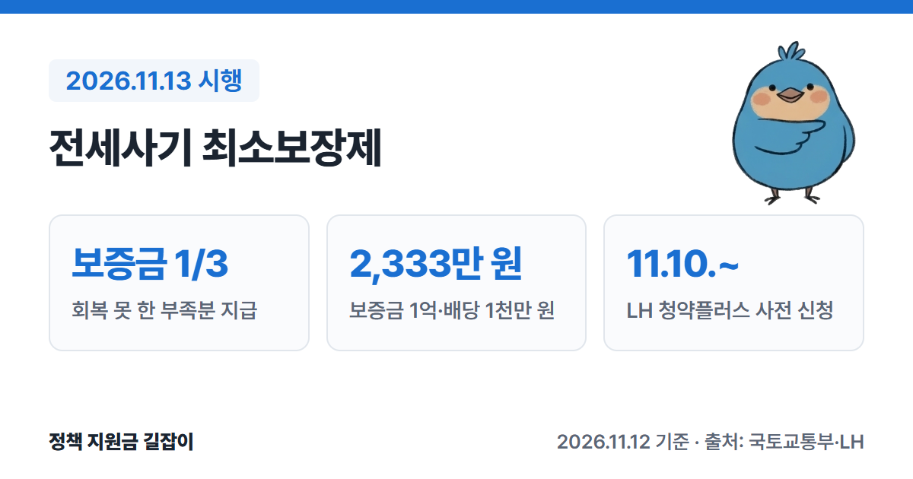
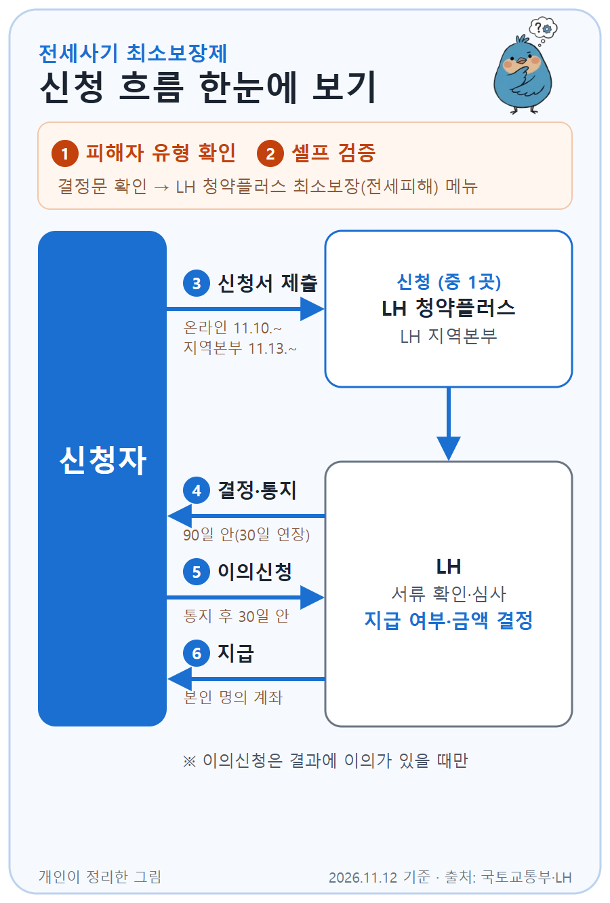

**전세사기 최소보장제**는 전세사기피해자가 돌려받은 보증금이 너무 적을 때, 최소한 **임차보증금의 3분의 1**은 국가가 채워 주는 제도예요. (출처①)
2026년 11월 13일부터 시행되고, LH 청약플러스에서 11월 10일부터 사전 신청을 받고 있어요. (출처①②)
국토교통부 보도자료와 LH 신청 공고문을 바탕으로 누가, 얼마를, 언제 신청할 수 있는지 정리했어요.

{: .summary-card}

> 💡 **핵심 요약**
> - 경매 등으로 돌려받은 보증금이 **임차보증금의 3분의 1**에 못 미치면, 그 부족분을 현금(**최소지원금**)으로 받아 최소한 3분의 1을 회복할 수 있어요. (출처①)
> - 예를 들어 보증금 **1억 원**에 경매 배당이 **1천만 원**이면 최소지원금은 **2,333만 원**이에요. (출처①)
> - **11월 13일** 시행, LH 청약플러스 온라인 사전 신청은 **11월 10일**부터예요. 피해자로 결정된 날부터 **3년** 안에 신청해요. (출처①②)

> **출처 표시 방법**: 본문의 (출처①) 같은 표시는 글 끝 출처 목록의 번호와 같아요.

목차

* 목차
{:toc}

## 한눈에 보기

| 항목 | 내용 |
|---|---|
| 대상 | 전세사기피해자(또는 피해자등 다목)로 결정된 임차인 중 회복한 금액이 보증금의 **1/3** 미만인 사람 |
| 지원 내용 | **최소지원금**: 보증금의 1/3 − 회복한 금액 **선지급금**: 신탁사기·무권계약 피해자는 경·공매 **종료 전에** 1/3(변제받은 금액 등은 뺌)을 먼저 지급 |
| 시행 | **2026.11.13.** (사전 신청 **11.10.**부터) |
| 신청 기한 | 피해자 결정일부터 **3년** 이내 (시행 전 결정자는 **2029.11.13.**까지) |
| 신청 | LH 청약플러스 온라인 또는 LH 지역본부 |

(출처①②)

---

## 누가 받을 수 있나요?

먼저 특별법에 따라 **전세사기피해자** 또는 **전세사기피해자등 다목**으로 **결정**을 받은 사람이어야 해요. (출처①②)

| 제도 | 신청할 수 있는 사람 |
|---|---|
| 최소지원금 | 전세사기피해자 또는 피해자등 다목(신탁사기·무권계약 피해자 포함) 중 회복한 금액의 합계가 보증금의 **1/3** 미만인 사람 |
| 선지급금 | 피해자등 다목 중 **신탁사기·무권계약 피해자**로, 회복한 금액의 합계가 보증금의 **1/3** 미만인 사람 |

(출처②)

- **피해자등 다목**은 보증금이 **5억 원 이하**이고, 임대인이 보증금을 돌려줄 의도가 없었던 것이 확인되며, 전입신고·확정일자 등을 갖춰 피해자등으로 인정된 임차인이에요. (출처①)
- **무권계약 피해자**는 집을 빌려줄 권한이 없는 사람과 계약한 피해자예요. 신탁사기가 대표적이에요. (출처①)
- 내가 어느 유형인지는 **피해자 결정문**의 결정주문("전세사기피해자로 결정" 또는 "전세사기피해자등으로 결정")과 결정이유 문구로 확인해요. (출처②)
- 제도 시행(**2026.11.13.**) 전에 이미 피해자로 결정됐거나 경·공매가 끝난 사람도 요건을 갖추면 신청할 수 있어요. (출처①②)

### 신청할 수 없는 사람

| 구분 | 내용 |
|---|---|
| 외국인 | 대한민국 국적이 없는 임차인 |
| 직접 매수 | 피해주택을 본인이 직접 산 피해자 |
| 배당 미요구 | 우선변제권 행사를 소홀히 해서 경매·공매 때 배당·배분 요구를 하지 않은 피해자 (최소지원금만 해당, 2026.11.13. 전에 첫 경매개시결정·공매공고가 있었으면 예외) |
| 고액 임차인 | 피해자등 나목(보증금 5억 원 초과) |
| 선지급 받은 사람 | 선지급금을 받은 사람은 최소지원금을 따로 신청할 수 없어요 (차액은 후정산) |

(출처①②)

---

## 얼마나 받을 수 있나요?

### 최소지원금 = 보증금의 1/3 − 회복한 금액

보증금의 3분의 1(**최소보장금**)에서 이미 회복한 금액(**피해회복금**)을 빼고, 남는 부족분을 현금으로 줘요. (출처①②)

| 피해회복금에 들어가는 것 | 내용 |
|---|---|
| 배당·배분금 | 경매·공매에서 받은 배당액 또는 배분액 |
| 변제받은 금액 | 임대인·공인중개사 등에게 돌려받은 금액 (공인중개사 손해배상금 포함) |
| 법에 따른 지원액 | LH 피해주택 매입 때의 **경매차익**, 공공임대 거주 때의 **임대료 재정지원액** |

(출처①②)

- 지방정부 지원금이나 금융지원처럼 법에서 피해회복금으로 정하지 않은 돈은 계산에 넣지 않아요. (출처①)
- 최소보장금은 보증금의 3분의 1에서 **원 단위 미만을 버린** 금액이에요. (출처②)

### 계산 예시 (국토부 보도자료)

| 경우 | 최소지원금 |
|---|---|
| 보증금 **1억 원**, 경매 배당 **1천만 원** | **2,333만 원** (최종 회복 3,333만 원) |
| 보증금 **1억 원**, 회복금 없음 | **3,333만 원** |

(출처①, 배당 외 회복금이 없다고 가정한 예시)

### 선지급금 (신탁사기·무권계약 피해자)

신탁사기·무권계약 피해자는 경매 배당으로 보증금을 돌려받기 어려워서, 집이 처분되기 **전에** 보증금의 3분의 1을 먼저 줘요. (출처①)

- 선지급금은 보증금의 1/3에서 **변제받은 금액**과 **선지급 전까지의 임대료 재정지원액**(해당할 때)을 뺀 금액이에요. (출처①②)
- 나중에 배당·변제·LH 매입 차익 등으로 회복한 금액(정산대상액)이 선지급금보다 많으면 그 **차액을 더 줘요**(후정산). 같거나 적으면 추가 지급은 없어요. (출처①②)
- 보증금 1억 원에 회복금이 없으면 선지급금은 **3,333만 원**이에요. (출처①)

> 위 예시는 이해를 돕기 위한 계산이에요. 실제 금액은 LH가 서류와 지원 내역을 확인해 정해요. (출처②)

---

## 어떻게 신청하나요?

{: .flow-chart}

1. **피해자 유형 확인**: 피해자 결정문으로 "전세사기피해자"인지, "피해자등 다목"(일반·무권·신탁)인지 확인해요. (출처②)
2. **셀프 검증**: LH 청약플러스 → 최소보장(전세피해) → (신청 전)셀프 검증하기에서 대상 여부와 신청 방법을 확인해요(로그인 필요). (출처②)
3. **신청서 제출**: LH 청약플러스(apply.lh.or.kr) 온라인으로 신청하거나 LH 지역본부에 내요. 온라인은 **11.10.**부터, 지역본부 방문·우편 제출은 **11.13.**부터예요. 다만 피해 유형에 따라 온라인 신청·현장(우편) 접수·LH 별도 안내로 방법이 달라서, 아래 "언제 신청하나요?"와 공고문 표를 확인하세요. (출처①②)
4. **심사·결정**: LH가 신청받은 날부터 **90일** 안에 지급 여부와 금액을 정해 알려 줘요. 서류 보완이 필요하면 **30일** 안에서 한 번 늘어날 수 있어요. 사전 신청했다면 시행일(11.13.)부터 세요. (출처②)
5. **이의신청**: 결과에 이의가 있으면 통지서를 받은 날부터 **30일** 안에 LH에 이의신청서를 내요. (출처①②)
6. **지급**: 신청서에 적은 **본인 명의 계좌**로 받아요. (출처②)

### 언제 신청하나요?

| 상황 | 신청 시기 |
|---|---|
| LH가 피해주택을 매입한 경우 | 경매차익 산정이 끝난 뒤 (LH가 따로 안내) |
| 제3자 낙찰 등 LH가 매입하지 않은 경우 | 경·공매 배당·배분이 끝난 뒤 |
| 신탁사기·무권계약 피해자(선지급) | 경·공매 등이 끝나기 **전** |

(출처①②)

- 신탁사기 피해자의 선지급 신청은 LH에 피해주택 **매입을 요청할 때 함께** 현장(우편)으로 내요. 무권계약 피해자는 온라인으로 신청해요. (출처②)
- LH 임대주택에 살면서 주거지원을 받고 있다면, 퇴거(해약) 신청 때 LH가 따로 신청 방법을 안내해요. (출처②)

### 내야 하는 서류

| 구분 | 서류 |
|---|---|
| 공통(필수) | 개인정보 동의서, 지급신청서(본인 명의 계좌), 피해자 결정문, 임대차계약서 사본, 주민등록표 초본, 신분증, 피해주택 등기사항전부증명서, 본인 명의 통장 사본 |
| 해당할 때 | 배당표 또는 배분계산서, 임대인 등에게 돌려받은 내역, 신탁원부(신탁사기), 위임장(대리인) |

(출처②, 양식은 LH 공고 별첨)

---

## 놓치기 쉬운 점

- **받으면 공공임대주택 지원은 더 받을 수 없어요.** 최소지원금이나 선지급금을 받으면 특별법에 따른 공공임대주택 지원을 받을 수 없어요. 다만 원하면 긴급주거지원(최장 2년)이나 임시거주(6개월)는 가능해요. (출처②)
- **배당 요구를 안 했으면 막힐 수 있어요.** 경매·공매 때 배당·배분 요구를 하지 않으면 최소지원금을 신청할 수 없어요. 단, 제도 시행일(2026.11.13.) **전에** 처음 경매개시결정이나 공매공고가 있었다면 이 제한을 받지 않아요. (출처②③)
- **돌려받은 돈은 빠짐없이 적고, 나중에 더 받으면 신고해요.** 회복한 금액을 숨기거나 받은 뒤 추가로 돌려받은 사실을 신고하지 않으면 벌칙(5년 이하 징역 또는 5천만 원 이하 벌금)이나 과태료(3천만 원 이하)를 받을 수 있어요. 더 돌려받은 금액은 받은 최소지원금 한도에서 반납해요. (출처②)
- **신청 기한은 결정일부터 3년이에요.** 경·공매가 길어지는 등 부득이한 경우엔 경·공매가 끝난 날부터 1년 안에 신청할 수 있어요. 시행 전에 결정된 사람은 2029.11.13.까지예요. (출처①③)

자신의 상황이 복잡하면 LH 청약플러스의 **셀프 검증**을 먼저 해 보고, **LH 콜센터(1600-1004)**나 피해주택이 있는 지역의 **LH 지역본부**(상담 10:00~17:00, 점심 12~13시 제외)에 물어보세요. LH 공고문은 상담 과정에서 오류가 생길 수 있으니 공고문을 꼭 확인하라고 적고 있어요. (출처①②)

---

## 자주 묻는 질문

**Q. 이미 경매가 다 끝났는데도 받을 수 있나요?**
네. 시행(2026.11.13.) 전에 경·공매가 끝난 피해자도 요건을 갖추면 지원 대상이에요. (출처①)

**Q. 지자체에서 받은 지원금도 회복한 금액으로 빼나요?**
아니요. 지방정부 지원금이나 금융지원처럼 특별법·시행령에서 피해회복금으로 정하지 않은 돈은 계산에 넣지 않아요. (출처①)

**Q. 선지급금을 받고 나서 최소지원금도 따로 받을 수 있나요?**
아니요. 선지급금을 받으면 최소지원금은 따로 신청할 수 없고, 나중에 생긴 차액은 후정산으로 처리해요. (출처②)

**Q. 받은 돈이 압류될 수도 있나요?**
최소지원금·선지급금과 이를 받을 권리는 남에게 넘기거나 담보로 잡힐 수 없고, 압류할 수 없어요. (출처②)

---

## 함께 보면 좋은 글

- [2026 생활비 지원 총정리](): 주거급여·긴급복지 등 상황별로 받을 수 있는 생활비 지원
- [2026 주거급여 총정리](): 피해 이후 월세 부담이 크다면 소득 기준에 맞는지 확인
- [2026 청년 주거 지원 총정리](): 새 전셋집·월세를 구할 때 쓸 수 있는 청년 주거 지원

---

## 출처

1. [정책브리핑(국토교통부 보도자료) - 전세사기피해자 최소보장제 시행, 10일부터 최소지원금 신청하세요!](https://www.korea.kr/briefing/pressReleaseView.do?newsId=156788424) (배포: 2026-11-09, 참고2 Q&A 포함, 확인일: 2026-11-12)
2. [LH 청약플러스 - 최소지원금 및 선지급금 신청 공고문](https://apply.lh.or.kr/lhapply/apply/lohScamDmg/list.do?mi=1202084) (게시: 2026-11-10, 확인일: 2026-11-12)
3. [국가법령정보센터 - 전세사기피해자 지원 및 주거안정에 관한 특별법](https://www.law.go.kr/법령/전세사기피해자지원및주거안정에관한특별법) (제14조의2·제25조의9, 2026-11-13 시행, 확인일: 2026-11-12)

> 이 글은 2026년 11월 12일 기준입니다. 지원 조건은 바뀔 수 있으니 신청 전 LH 청약플러스 공고문을 꼭 확인하세요.
