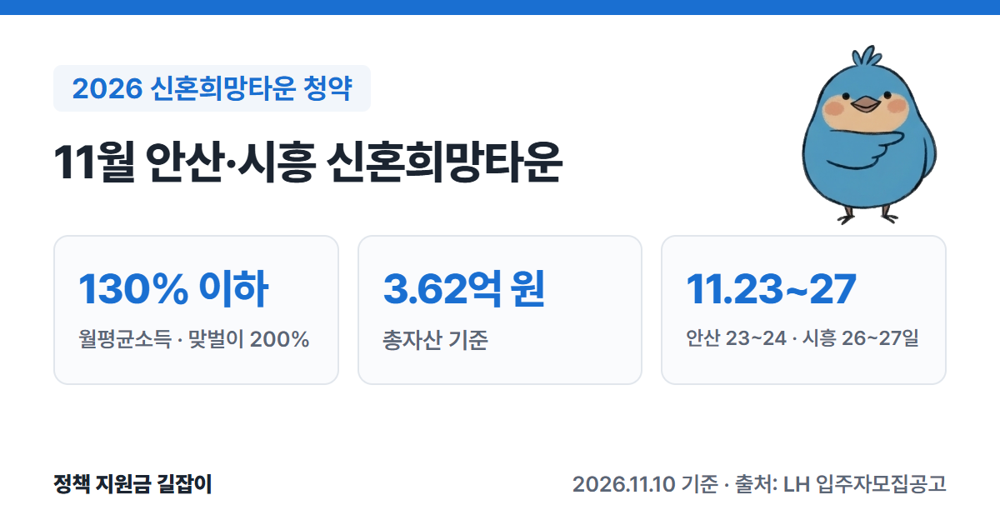
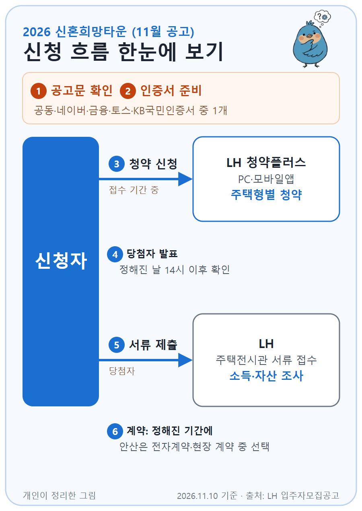

이번 11월 공고의 **신혼희망타운(공공분양)**은 신혼부부·예비신혼부부·한부모가족이 청약할 수 있는 분양 주택이에요. 같은 단지의 나머지 세대는 나중에 행복주택(임대)으로 따로 모집해요. (출처①②)
소득과 자산 기준이 있고, 혼인기간과 자녀 나이에 따라 우선공급·일반공급·추첨으로 나눠 뽑아요. (출처①)
지금 접수를 앞둔 LH 공고 두 곳(안산신길2·시흥거모)의 공고문을 바탕으로 자격, 기준 금액, 당첨 방법, 일정을 정리했어요.

{: .summary-card}

> 💡 **핵심 요약**
> - 혼인 **7년 이내**이거나 **6세 이하 자녀**(태아 포함)를 둔 신혼부부, 예비신혼부부, 6세 이하 자녀를 둔 한부모가족이 **무주택**이면 신청할 수 있어요. (출처①②)
> - 가구 월평균소득 **130%**(맞벌이 **200%**) 이하, 총자산 **3.62억 원** 이하여야 해요. 3인 이하 가구의 130%는 월 **9,793,892원**이에요. (출처①②)
> - 11월 공고 접수: 안산신길2 A-6 **11월 23~24일**, 시흥거모 A-6 **11월 26~27일** (LH 청약플러스) (출처①②)

> **출처 표시 방법**: 본문의 (출처①) 같은 표시는 글 끝 출처 목록의 번호와 같아요.

목차

* 목차
{:toc}

## 한눈에 보기

| 항목 | 내용 |
|---|---|
| 대상 | 신혼부부·예비신혼부부·한부모가족 세대 전원 **무주택** |
| 청약통장 | 가입 **6개월** 지나고 **6회** 이상 납입 |
| 소득 | 월평균소득 **130%** 이하 (맞벌이 **200%** 이하) |
| 자산 | 총자산 **3.62억 원** 이하 |
| 뽑는 방법 | 우선공급 **30%** → 일반공급 **60%** → 남은 물량 추첨 |
| 11월 공고 | 안산신길2 A-6 **251세대**(신규 220) 시흥거모 A-6 **480세대**(신규 356) |
| 신청 | LH 청약플러스(PC·모바일앱) |

(출처①②)

---

## 누가 받을 수 있나요?

아래 세 유형 중 하나에 해당하고, 나머지 조건을 **모두** 갖춰야 해요. (출처①)

| 유형 | 기본 조건 |
|---|---|
| 신혼부부 | 혼인기간 **7년 이내**, 또는 **6세 이하**(만 7세 미만) 자녀(태아 포함)를 둔 부부 |
| 예비신혼부부 | 결혼을 준비 중이고, 공고일부터 **입주 전까지** 혼인 사실을 증명할 수 있는 사람 |
| 한부모가족 | **6세 이하** 자녀(태아 포함)를 둔 한부모가족의 부 또는 모 |

(출처①)

### 함께 갖춰야 하는 조건

| 조건 | 내용 |
|---|---|
| 거주 | 공고일 현재 **수도권**(서울·인천·경기) 거주 (11월 안산·시흥 공고 기준) |
| 무주택 | 세대 전원이 집과 분양권·입주권이 없어야 해요 |
| 청약통장 | 가입 **6개월** 경과, 월납입금 **6회** 이상 납입 |
| 소득 | 월평균소득 **130%** 이하 (맞벌이 **200%** 이하) |
| 자산 | 총자산 **3.62억 원** 이하 |

(출처①②)

- **혼인기간**은 공고일 기준으로 따져요. 안산 공고는 2019.10.30.~2026.10.30., 시흥 공고는 2019.11.06.~2026.11.06. 사이에 결혼한 경우예요. (출처①②)
- **무주택**을 볼 때는 신청자, 배우자, 등본에 함께 있는 부모·자녀까지 봐요. 배우자가 세대를 따로 쓰고 있어도 배우자와 그 등본의 부모·자녀를 포함해요. (출처①)
- 예비신혼부부는 **결혼해서 함께 살 세대 전원**을 기준으로 무주택·소득·자산을 봐요. (출처①)
- 당첨되면 **입주할 때까지** 무주택을 유지해야 해요. (출처①)

### 소득 기준 (전년도 도시근로자 가구당 월평균소득)

무주택 세대원 중 **19세 이상 전원의 소득을 합쳐서** 봐요. 임신 중인 태아도 가구원 수에 넣어요. (출처①)

| 가구원 | 130% | 맞벌이 200% |
|---|---|---|
| 3인 이하 | **9,793,892** | **15,067,526** |
| 4인 | **11,442,863** | **17,604,404** |
| 5인 | **12,125,081** | **18,653,970** |

(출처①②, 월 기준, 단위: 원)

- **맞벌이**는 본인과 배우자가 **모두** 근로소득이나 사업소득이 있는 경우예요. (출처①)
- 다만 아래에서 설명할 **우선공급·일반공급**은 소득이 **130%(맞벌이 140%) 이하**인 사람만 대상이에요. 맞벌이로 140%를 넘고 200% 이하라면 **추첨공급**에만 들어가요. (출처①)
- 맞벌이 140%는 3인 이하 **10,547,268원**, 4인 **12,323,083원**이에요. (출처①)

### 자산 기준

세대가 가진 **부동산 + 금융자산 + 기타자산 + 자동차**를 더하고 **부채**를 뺀 금액이 **3억 6,200만 원** 이하여야 해요. (출처①)

| 항목 | 들어가는 것 |
|---|---|
| 부동산 | 건물 시가표준액, 토지 공시지가 |
| 금융자산 | 예금, 적금, 주식, 펀드, 보험 해약환급금, IRP 등 |
| 기타자산 | **전세보증금·임차보증금**, 회원권, 분양권 납부액 등 |
| 자동차 | 보건복지부 기준 차량가액 |
| 부채 | 금융회사 대출, 공공기관 대출 등 |

(출처①)

### 2023년 3월 28일 이후 아이를 낳았다면 (출산가구 완화)

2023.3.28. 이후 출생한 자녀(태아 포함)가 있으면 소득·자산 기준이 넓어져요. 관련 서류(출생·입양·임신)로 증명해야 해요. (출처①)

| 구분 | 소득 기준 | 자산 기준 |
|---|---|---|
| 자녀 1명 | **10%p** 가산 | **3.97억 원** 이하 |
| 자녀 2명 이상 | **20%p** 가산 | **4.31억 원** 이하 |

(출처①)

- **2명 이상**에는 2023.3.28. 이후 낳은 자녀가 1명이고 그 전에 낳은 자녀가 있는 경우도 들어가요. (출처①)

---

## 얼마에 살 수 있나요?

분양가는 단지·주택형·층마다 달라요. 안산신길2 A-6블록(전용 55㎡) 기본형은 **4억 2,073만~4억 6,658만 원**이에요(발코니 확장비·세금 제외). (출처①)

### 집값이 3.62억 원을 넘으면 전용 대출에 꼭 가입해야 해요

분양가가 총자산 기준(**3.62억 원**)을 넘는 주택은 **신혼희망타운 전용 주택담보 장기대출**(수익공유형 모기지)에 반드시 가입해야 해요. 11월 안산·시흥 두 단지 모두 의무 가입 대상이에요. (출처①②)

| 항목 | 내용 |
|---|---|
| 금리 | 연 **1.3%** 고정 |
| 기간 | 최장 **30년** |
| 한도 | 집값의 **70%** 이내, 최대 **4억 원** |
| 정산 | 집을 팔거나 대출을 갚을 때 시세차익의 **10~50%**를 기금과 나눠요 |
| 취급은행 | 우리·국민·신한은행 |

(출처①②)

- 정산 비율은 **대출기간이 길수록, 자녀가 많을수록** 낮아져요. 대출을 적게 받을수록(담보인정비율 70%→30%)도 낮아져요. (출처①)
- 두 공고 모두 집값의 **최소 30% 이상** 가입해야 하고, 주택도시기금 융자금(5,500만 원)은 받을 수 없다고 적고 있어요. (출처①②)
- 이 대출은 기금운영계획에 따라 조건이 일부 바뀔 수 있어요. (출처①)

---

## 어떻게 뽑나요?

3단계로 나눠 뽑고, 1·2단계에서 떨어지면 다음 단계에 자동으로 다시 들어가요. (출처①)

| 단계 | 대상과 물량 |
|---|---|
| 1단계 우선공급 | 예비신혼부부, 혼인 **2년 이내** 또는 **2세 이하** 자녀를 둔 신혼부부, 2세 이하 자녀를 둔 한부모가족 주택형별 물량의 **30%** |
| 2단계 일반공급 | 혼인 **2년 초과~7년 이내** 또는 **3~6세** 자녀를 둔 신혼부부·한부모가족 + 1단계 낙첨자 물량의 **60%** |
| 3단계 추첨공급 | 자격을 갖춘 모든 신청자 + 2단계 낙첨자 **남은 물량** 추첨 |

(출처①)

- 1·2단계는 **소득 130%(맞벌이 140%) 이하**만 대상이고, 경쟁이 있으면 **점수가 높은 순**으로 뽑아요. 점수가 같으면 추첨해요. (출처①)
- 각 단계 안에서도 **지역 우선**이 있어요. 안산 공고는 안산시 1년 이상 거주자 **30%**, 경기도 6개월 이상 거주자 **20%**, 나머지 수도권 거주자 **50%** 순이에요. (출처①)

### 점수표 (항목마다 최대 3점)

| 단계 | 점수 항목 |
|---|---|
| 1단계 | 가구소득(낮을수록 높음) 해당 시·도 연속 거주기간 청약통장 납입 횟수 |
| 2단계 | 미성년 자녀 수(태아 포함) 무주택기간 해당 시·도 연속 거주기간 청약통장 납입 횟수 |

(출처①)

- 청약통장 납입 횟수는 **24회 이상**이면 3점, 12~23회 2점, 6~11회 1점이에요. (출처①)
- 무주택기간은 만 30세가 된 날(그 전에 결혼했으면 혼인신고일)부터 세요. 만 30세 미만이고 결혼한 적이 없으면 0점이에요. (출처①)

---

## 어떻게 신청하나요?

{: .flow-chart}

1. **공고문 확인**: LH 청약플러스(apply.lh.or.kr)에서 단지별 입주자모집공고를 열어 자격과 분양가를 확인해요. (출처①)
2. **인증서 준비**: 공동인증서·네이버·금융·토스·KB국민인증서 중 1개를 미리 발급받아요. (출처①)
3. **청약 신청**: 접수 기간에 LH 청약플러스(PC·모바일앱)에서 주택형(타입)별로 신청해요. 접수 기간 중에는 밤(17:00~10:00)에도 신청할 수 있어요. (출처①②)
4. **당첨자 발표**: 정해진 날 14시 이후 확인해요. (출처①②)
5. **서류 제출**: 당첨자는 주택전시관에 서류를 내고, LH가 사회보장정보시스템으로 소득·자산을 조사해요. (출처①)
6. **계약**: 정해진 기간에 계약해요. 안산은 전자계약과 현장 계약 중 고를 수 있고, 시흥 일정표에는 현장 계약으로 나와 있어요. (출처①②)

### 11월 공고 일정

| 구분 | 안산신길2 A-6 | 시흥거모 A-6 |
|---|---|---|
| 공고일 | 10.30. | 11.6. |
| 공급 | **251세대** (55㎡, 신규 220) | **480세대** (55㎡ 318·59㎡ 162, 신규 356) |
| 본청약 접수 | **11.23.~11.24.** | **11.26.~11.27.** |
| 당첨 발표 | 12.4. | 12.8. |
| 서류 접수 | 12.11.~12.15. | 12.11.~12.17. |
| 계약 | '27.3.30.~4.2. | '27.3.11.~3.14. |

(출처①②, 접수는 첫날 10:00~마지막 날 17:00)

- 위 접수 기간은 **신규 신청자(본청약)** 기준이에요. 사전청약 당첨자는 이보다 먼저 따로 접수해요. (출처①②)
- 공급 세대 수에는 사전청약 당첨자 몫(안산 31, 시흥 124세대)이 들어 있어요. 신규 신청자 몫은 안산 **220세대**, 시흥 **356세대**이고, 사전청약 당첨자가 신청하지 않은 물량은 신규 몫으로 넘어와 늘 수 있어요. (출처①②)

---

## 놓치기 쉬운 점

- **전세보증금도 자산에 들어가요.** 지금 사는 집의 전세금·월세 보증금이 기타자산으로 합산돼요. 마이너스통장 같은 한도대출은 부채로 빼 주지 않아요. (출처①)
- **소득·자산은 당첨 뒤에 LH가 조회해요.** 청약할 때는 본인이 입력한 내용만으로 당첨자를 정하고, 나중에 기준을 넘은 게 확인되면 계약할 수 없고 최대 1년 동안 다른 청약 당첨이 제한될 수 있어요. 소득은 건강보험 보수월액이 가장 먼저 반영돼요. (출처①)
- **신혼희망타운에 당첨되면 특별공급을 쓴 것으로 봐요.** 앞으로 다른 주택의 특별공급은 받을 수 없어요. 안산 공고는 재당첨 제한 **10년**, 전매 제한 **3년**이에요. (출처①)
- **세대에서 한 사람만 신청해요.** 같은 세대에서 두 사람 이상 신청해 한 곳이라도 당첨되면 모두 부적격이에요. 다만 부부(예비신혼부부 제외)는 발표일이 같은 주택에 각각 신청할 수 있고, 둘 다 당첨되면 먼저 접수한 쪽만 인정해요. (출처①)

헷갈리면 안산은 **LH 콜센터(1600-1004)**, 시흥은 **분양 상담 전화(1661-5596)**에 먼저 물어보세요. 다만 두 공고문 모두 상담 내용은 참고용이고, 자격은 공고문과 서류로 본인이 직접 확인해야 한다고 적혀 있어요. (출처①②)

---

## 자주 묻는 질문

**Q. 아이가 없는 신혼부부도 신청할 수 있나요?**
네. 혼인기간 **7년 이내**면 자녀가 없어도 신혼부부로 신청할 수 있어요. 혼인 2년 이내면 1단계 우선공급 대상이에요. (출처①)

**Q. 결혼 전인데 신청할 수 있나요?**
예비신혼부부로 신청할 수 있어요. 공고일부터 **입주 전까지** 청약 때 입력한 예비배우자와의 혼인 사실을 증명해야 하고, 증명하지 못하면 계약이 취소돼요. (출처①)

**Q. 맞벌이라 소득이 140%를 넘어요.**
맞벌이 **200%** 이하면 자격은 돼요. 다만 1·2단계(우선·일반공급)에는 들어가지 못하고 **3단계 추첨**으로만 뽑혀요. (출처①)

**Q. 전용 대출(수익공유형 모기지)에 꼭 가입해야 하나요?**
분양가가 **3.62억 원**을 넘는 주택에 당첨되면 의무예요. 입주할 때까지 가입 사실을 증명하지 못하면 입주자 선정에서 빠지고 계약이 취소돼요. (출처①)

분양이 아니라 이미 지어진 집을 사려면 [2026 신혼부부 주택구입자금대출]() 글에서 기금 대출 조건을 볼 수 있어요.

---

## 함께 보면 좋은 글

- [2026 신혼부부 주택구입자금대출](): 분양이 아니라 기존 집을 살 때 쓰는 신혼부부 전용 기금 대출
- [2026 신혼부부 전세자금대출 총정리](): 입주 전까지 전세로 살 집을 구할 때
- [2026 신생아 특례 전세대출](): 2년 안에 아이를 낳았다면, 입주 전 전셋집을 구할 때 소득 기준이 넓은 전세대출
- [2026 청년 주택드림 청약통장 총정리](): 청약통장 가입·납입 횟수를 미리 채우고 싶다면

---

## 출처

1. [LH 청약플러스 - 안산신길2 A-6블록 신혼희망타운(공공분양) 입주자모집공고](https://apply.lh.or.kr/lhapply/apply/wt/wrtanc/selectWrtancInfo.do?panId=0000061189&ccrCnntSysDsCd=02&uppAisTpCd=39&aisTpCd=39&mi=1027) (공고일: 2026-10-30, 확인일: 2026-11-12)
2. [LH 청약플러스 - 시흥거모 A-6블록 신혼희망타운(공공분양) 입주자모집공고](https://apply.lh.or.kr/lhapply/apply/wt/wrtanc/selectWrtancInfo.do?panId=0000061204&ccrCnntSysDsCd=02&uppAisTpCd=39&aisTpCd=39&mi=1027) (공고일: 2026-11-06, 확인일: 2026-11-12)

> 이 글은 2026년 11월 10일 기준입니다. 소득·자산 기준과 일정은 공고마다 다를 수 있으니 신청 전 해당 단지 입주자모집공고문을 꼭 확인하세요.
