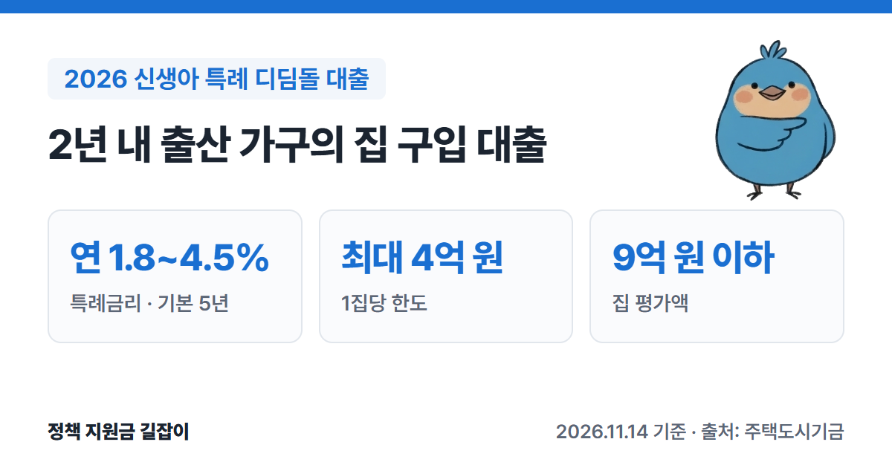
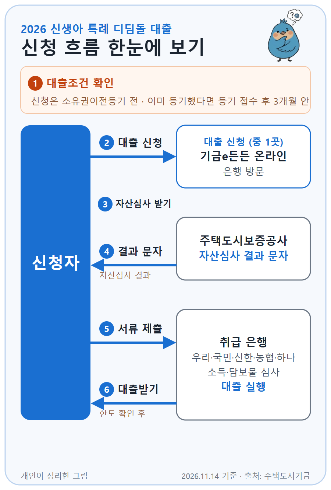

**신생아 특례 디딤돌 대출**은 최근 2년 안에 아이를 낳거나 입양한 가구가 집을 살 때 주택도시기금이 낮은 금리로 빌려주는 주택구입대출이에요.
신혼부부전용 구입자금(부부합산 8.5천만 원 이하)보다 소득 기준이 넓고(맞벌이 최대 2억 원), 처음 5년은 특례금리가 적용돼요. (출처①④)
주택도시기금 공식 상품 안내를 바탕으로 자격 조건, 한도, 금리, 신청 방법을 정리했어요.

{: .summary-card}

> 💡 **핵심 요약**
> - 대출 접수일 기준 **2년 안에** 아이를 낳거나 입양한 무주택 세대주가 신청할 수 있어요. 부부합산 연소득 **1.3억 원 이하**(맞벌이 **2억 원 이하**), 순자산 **5.11억 원 이하**여야 해요. (출처①)
> - 특례금리는 소득과 대출기간에 따라 **연 1.8~4.5%**이고, 기본 **5년** 적용돼요. 대출 접수일 기준 2년 안에 아이를 더 낳은 경우 1명당 5년씩, 최장 **20년**까지 늘릴 수 있어요. (출처①)
> - 한도는 **최대 4억 원**이고, 평가액 **9억 원 이하**·전용 **85㎡ 이하** 집이어야 해요. (출처①)

> **출처 표시 방법**: 본문의 (출처①) 같은 표시는 글 끝 출처 목록의 번호와 같아요.
> 출산·육아 지원 전체는 [2026 출산지원금 총정리]()에서 함께 확인하세요.

목차

* 목차
{:toc}

## 한눈에 보기

| 항목 | 내용 |
|---|---|
| 대상 | 대출 접수일 기준 **2년 내** 출산·입양 (2023.1.1. 이후 출생아) 무주택 세대주 |
| 소득·자산 | 부부합산 연소득 **1.3억 원 이하** (맞벌이 **2억 원 이하**) 순자산 **5.11억 원 이하** (2026년 기준) |
| 대상 주택 | 전용 **85㎡ 이하**, 평가액 **9억 원 이하** |
| 대출 한도 | **최대 4억 원** (LTV 70%, 생애최초 80% 수도권·규제지역 70%, DTI 60%) |
| 대출 금리 | **연 1.8~4.5%** (특례금리, 기본 5년) |
| 대출 기간 | **10·15·20·30년** (1년 거치 또는 비거치) |

(출처①)

---

## 누가 받을 수 있나요?

아래 조건을 **모두** 갖춰야 해요. (출처①)

### 기본 조건

| 조건 | 내용 |
|---|---|
| 계약 | 집을 사려고 **매매계약**을 맺은 상태 (상속·증여·재산분할은 안 됨) |
| 세대주 | 대출 접수일 기준 성년인 **세대주** |
| 출산 | 대출 접수일 기준 **2년 안에** 출산·입양한 가구 |
| 주택 | 세대주와 세대원 **모두 무주택** |
| 소득 | 부부합산 **1.3억 원 이하** 맞벌이는 **2억 원 이하**(각자 1.3억 원 이하) |
| 자산 | 부부합산 순자산 **5.11억 원 이하** |

(출처①)

### '출산'으로 인정되는 범위

- **2023년 1월 1일 이후 태어난 아이**부터 해당해요. **임신 중인 태아는 들어가지 않아요.** (출처①)
- 2023년 1월 1일 이후 태어난 아이를 **입양**한 경우도 돼요. 이때 입양한 아이는 대출 접수일 기준 **만 2살 미만**이어야 해요. (출처①)
- **혼인신고를 하지 않고** 아이를 낳거나 입양한 경우에도 신청할 수 있어요. 이때는 아이의 가족관계증명서에 올라간 부모 두 사람의 소득·자산·주택을 함께 봐요. (출처①)
- 신생아 특별공급이나 우선공급에 당첨된 경우는 대출 접수일에 아이가 만 2세를 넘었어도 신청할 수 있어요. (출처①)

### 조건을 따질 때 알아 둘 점

- **무주택**을 따질 때는 **분양권과 조합원 입주권도 집으로 쳐요.** (출처①)
- **맞벌이**는 부부가 모두 소득이 있고, 한 사람씩 소득이 **1.3억 원 이하**인 경우예요. (출처①)
- 순자산 기준은 통계청 조사의 소득 4분위 가구 평균 자산으로 정해서 **최근 통계에 따라 바뀌어요.** 5.11억 원은 2026년 기준이에요. (출처①)

### 이런 경우는 받을 수 없어요

- 성년인 세대원 전원을 대상으로 **주택도시기금 대출** 이용 여부를 봐서, 기금 대출을 쓰고 있는 경우. 다만 기금 전세자금대출은 대출 실행일에 갚는 조건이면 가능해요. (출처①)
- 본인이나 배우자(결혼 예정·분리된 배우자 포함)가 **다른 집으로 주택담보대출(중도금대출 포함)**을 쓰고 있는 경우 (출처①)
- 연체, 대위변제, 부도 같은 **신용 문제 기록**이 남아 있거나, 개인신용평가 점수가 기준에 못 미치는 경우 (출처①)

이미 집이 한 채 있는 가구는 기존 주택담보대출을 이 대출로 갈아타는 **1주택자 대환대출**을 따로 알아볼 수 있어요. 이 글은 집을 새로 사는 경우를 다뤄요. (출처①⑥)

---

## 어떤 집이어야 하나요?

| 조건 | 내용 |
|---|---|
| 면적 | 전용 **85㎡ 이하** 수도권 밖 도시지역이 아닌 읍·면은 **100㎡ 이하** |
| 집값 | 대출 접수일 기준 평가액 **9억 원 이하** |

(출처①)

평가액은 가격정보(시세), 국토교통부 공시가격, 분양가, 감정가 순서로 정해요. (출처①)

---

## 얼마나 빌릴 수 있나요?

한도는 아래 중 **작은 금액**이에요. (출처①)

| 기준 | 한도 |
|---|---|
| 1집당 한도 | **4억 원** |
| LTV | 집 평가액의 **70%** 생애최초 구입자 **80%** (수도권·규제지역은 생애최초도 **70%**) |
| DTI | 연간 원리금 상환액이 소득의 **60%** 이내 |
| 매매가 | 매매(분양)가격 이내 |

(출처①)

예를 들어 처음 집을 사는 가구가 규제지역이 아닌 지방에서 평가액 4억 원인 집을 사면 LTV 80%로 **3.2억 원**이에요. 같은 집이 수도권이면 70%인 **2.8억 원**까지예요. (출처① 기준으로 계산)
실제 한도는 DTI와 먼저 잡힌 대출·임대보증금을 빼고 정해져서 이보다 적을 수 있어요. (출처①)

- **2025년 6월 27일 이전에 계약한 경우**에는 5억 원까지 적용돼요. (출처①)

---

## 금리는 얼마인가요?

### 특례금리 (기본 5년)

부부합산 연소득과 대출기간에 따라 달라요. (출처①)

| 부부합산 연소득 | 금리 (10년 → 30년) |
|---|---|
| 2천만 원 이하 | **연 1.80~2.05%** |
| 2천만~4천만 원 | **연 2.15~2.40%** |
| 4천만~6천만 원 | **연 2.40~2.65%** |
| 6천만~8.5천만 원 | **연 2.65~2.90%** |
| 8.5천만~1억 원 | **연 2.90~3.20%** |
| 1억~1.3억 원 | **연 3.20~3.50%** |
| (맞벌이) 1.3억~1.5억 원 | **연 3.50~3.80%** |
| (맞벌이) 1.5억~1.7억 원 | **연 3.85~4.15%** |
| (맞벌이) 1.7억~2억 원 | **연 4.20~4.50%** |

(출처①)

- 집이 **지방**에 있으면 위 금리에서 **0.2%p** 내려가요. (출처①)
- 대출 접수일 기준 **2년 안에 아이를 더 낳은 경우** 1명당 특례금리 기간을 **5년씩** 늘릴 수 있고, 최장 **20년**까지 쓸 수 있어요. (출처①)

### 특례금리가 끝나면

특례금리 기간이 끝나면 대출받을 때의 부부합산 연소득에 따라 금리가 바뀌어요. (출처①)

- **8.5천만 원 이하**: 신혼부부 디딤돌(신혼부부전용 구입자금) 금리 수준으로 올라가요. (출처①)
- **8.5천만 원 초과**: 시중 주택담보대출 금리 지표를 기준으로 정해요. (출처①)

자세한 금리는 주택도시기금의 '특례금리 적용 종료 후 적용금리' 안내에서 볼 수 있어요. (출처②)

### 금리를 더 낮추는 방법 (우대금리)

아래는 **함께** 받을 수 있지만, 우대금리는 합쳐서 **0.5%p까지**만 적용돼요. (출처①)

| 대상 | 우대 |
|---|---|
| 청약통장 | (회차 기준) 5년·60회 이상 **0.3%p** 10년·120회 이상 **0.4%p** 15년·180회 이상 **0.5%p** |
| 추가 출산 | 대출 접수일 기준 2년 내 추가 출산 1명당 **0.2%p** |
| 기존 자녀 | 출생 후 2년 지난 미성년 자녀 1명당 **0.1%p** (3자녀부터 **0.2%p**) |
| 전자계약 | 부동산 전자계약 **0.1%p** (2026.12.31. 신규 접수분까지) |
| 적게 빌림 | 심사 금액의 30% 이하만 신청 **0.1%p** |
| 일찍 갚음 | 1년 지난 뒤 원금의 40% 이상 갚으면 **0.2%p** |
| 지방 미분양 | 지방 준공 후 미분양주택 **0.2%p** (5년간) |

(출처①)

- 청약통장(본인 또는 배우자 명의)·전자계약·기존 자녀·적게 빌림 우대는 대출 실행일부터 **최대 5년**, 추가 출산 우대는 자녀 1명당 **최대 5년**(최장 20년) 적용돼요. (출처①)

- 청약통장 우대는 가입 기간·회차 대신 **최소 예치금을 채운 날부터의 기간**(5년 0.3%p, 10년 0.4%p, 15년 0.5%p)으로도 받을 수 있어요. (출처①)
- 대출받은 뒤 아이를 더 낳으면 **은행에 가서 조건 변경을 신청**해 금리 우대를 받을 수 있어요. (출처①)
- 우대를 받아도 최종 금리는 **연 1.2%보다 낮아지지 않아요.** (출처①)

---

## 얼마나 오래, 어떻게 갚나요?

- 대출기간은 **10년, 15년, 20년, 30년** 중에서 골라요. (출처①)
- **1년 거치**(이자만 내는 기간) 또는 비거치로, 원리금균등·원금균등·체증식 분할상환 중에서 골라요. (출처①)
- 중도상환수수료는 원래 3년 안에 갚은 원금에 최대 0.6%예요. 다만 **2026년 12월 31일까지 갚는 원금은 면제**예요. (출처①)

---

## 어떻게 신청하나요?

{: .flow-chart}

1. **대출조건 확인하기**: 주택도시기금 누리집이나 은행 상담으로 기본 조건을 확인해요. (출처③)
2. **대출 신청하기**: '기금e든든'에서 온라인으로 신청하거나 은행에 가서 신청해요. **소유권이전등기 전**에 신청하고, 이미 등기했다면 등기 접수일부터 **3개월 안**에 신청해야 해요. (출처①③)
3. **자산심사 받기**: 자산 정보를 모아 심사해요. (출처③)
4. **자산심사 결과 받기**: 주택도시보증공사가 신청할 때 적은 휴대폰 번호로 결과 문자를 보내요. (출처③)
5. **서류 내고 추가 심사 받기**: 은행 영업점에 서류를 내면 은행이 소득과 담보물(집)을 심사해요. (출처③)
6. **대출받기**: 대출 가능 여부와 한도가 확인되면 대출이 실행돼요. (출처③)

### 준비 서류

| 확인 | 서류 |
|---|---|
| 본인 | 주민등록증, 운전면허증, 여권 중 하나 |
| 대상자 | 주민등록등본 (단독세대주·배우자 분리세대는 가족관계증명원) |
| 출산·입양 | 출생증명서(병원 발급) 입양은 입양관계증명서 또는 친양자입양관계증명서 |
| 재직 | 건강보험 자격득실 확인서 |
| 소득 | 소득금액증명원, 원천징수영수증 등 중 하나 (소득이 없으면 신고사실없음 사실증명원) |
| 집 | 등기사항전부증명서, 매매계약서(또는 분양계약서), 인감증명서 |

(출처③)

심사 중에 다른 서류를 더 달라고 할 수 있어요. (출처③)

### 신청할 수 있는 은행

우리·국민·신한·농협·하나은행에서 신청해요. 기금e든든 온라인 신청도 이 5개 은행으로 이어져요. (출처③)

---

## 놓치기 쉬운 점

- **태아는 아직 안 돼요.** 이 대출은 2023년 1월 1일 이후 태어난 아이(입양 포함)가 있어야 해요. 임신 중에는 신청할 수 없어요. (출처①)
- **'2년'은 대출 접수일 기준이에요.** 아이가 태어난 날부터 대출 접수일까지 2년 안이어야 해요. 집을 알아보다 2년을 넘기면 신생아 특례가 아니라 다른 대출을 알아봐야 해요. (출처①)
- **1개월 안에 이사해서 2년 살아야 해요.** 대출받은 날부터 1개월 안에 그 집에 전입하고 2년 이상 살아야 해요. 정당한 사유 없이 지키지 않으면 대출금을 갚아야 해요. 기존 세입자 퇴거 지연 같은 사정이 있으면 사유서를 내고 전입을 2개월 늦출 수 있어요. (출처①)
- **대출 기간에는 1주택을 유지해야 해요.** 대출 후 다른 집을 얻으면 6개월 안에 처분해야 하고, 처분하지 않으면 대출금을 돌려줘야 해요. 혼인신고 전에 배우자가 갖고 있던 집은 국토교통부 확인을 받은 날부터 **3년 안에** 처분하면 돼요. (출처①)

> 대출 심사는 **주택도시보증공사 콜센터 1566-9009**나 은행 지점에, 자산 심사는 **자산심사 전용 상담센터 1551-3119**에 먼저 물어보세요. (출처①)

---

## 자주 묻는 질문

**Q. 결혼하지 않고 아이를 낳았는데 받을 수 있나요?**
네. 혼인신고를 하지 않은 경우에도 신청할 수 있어요. 이때는 아이의 가족관계증명서에 올라간 부모 두 사람의 소득과 자산을 합쳐서 보고, 같은 아이로 부모가 각각 대출받을 수는 없어요. (출처①)

**Q. 지금 신생아 특례 버팀목(전세대출)을 쓰고 있어요.**
기금 전세자금대출은 디딤돌 대출 **실행일에 갚는 조건**이면 신청할 수 있어요. (출처①) 전세대출 조건은 [2026 신생아 특례 전세대출(버팀목) 총정리]()에서 볼 수 있어요.

**Q. 신혼부부전용 구입자금과 뭐가 다른가요?**
신혼부부전용 구입자금은 부부합산 연소득 **8.5천만 원 이하**(넘어도 신청인 한 사람 소득이 6천만 원 이하면 가능), 집값 **6억 원 이하**, 한도 **3.2억 원**이에요. (출처④) 2년 안에 아이를 낳았다면 소득·집값 기준이 더 넓은 신생아 특례도 함께 비교해 보세요. 자세한 내용은 [신혼부부 주택구입자금대출 글]()에 있어요.

**Q. 계약한 뒤 마음이 바뀌면 취소할 수 있나요?**
네. 대출계약서를 받은 날, 계약일, 대출 실행일 등 가장 늦은 날부터 **14일 안**에 철회할 수 있어요. 원금과 이자, 부대비용을 모두 돌려줘야 철회가 끝나요. (출처①)

---

## 함께 보면 좋은 글

- [2026 신생아 특례 전세대출(버팀목) 총정리](): 집을 사기 전까지 전세로 산다면 같은 신생아 특례 전세대출
- [2026 신혼부부 주택구입자금대출 총정리](): 아이가 없거나 2년이 지났다면 신혼부부전용 구입자금
- [2026 신혼희망타운 청약 총정리](): 집을 사는 대신 신혼부부·한부모 가구 전용 분양주택에 청약한다면
- [2026 출산지원금 총정리](): 첫만남이용권·부모급여·아동수당 등 출산·육아 지원 전체

---

## 출처

1. [주택도시기금 - 신생아 특례 디딤돌대출 대출 안내](https://nhuf.molit.go.kr/FP/FP05/FP0503/FP05030801.jsp) - 대출 대상, 출산 범위, 소득·자산 기준, 신청 시기, 대상 주택, 한도, 특례금리표, 특례금리 종료 후 금리, 우대금리, 기간·상환, 중도상환수수료, 유의사항, 상담 전화 (확인일: 2026-11-14)
2. [주택도시기금 - 신생아 특례 디딤돌대출 특례금리 적용 종료 후 적용 금리](https://nhuf.molit.go.kr/FP/FP05/FP0503/FP05030808.jsp) (확인일: 2026-11-14)
3. [주택도시기금 - 신생아 특례 디딤돌대출 이용절차 및 준비서류](https://nhuf.molit.go.kr/FP/FP05/FP0503/FP05030805.jsp) - 신청 방법, 이용 절차, 준비 서류, 취급 은행 (확인일: 2026-11-14)
4. [주택도시기금 - 신혼부부전용 구입자금 대출 안내](https://nhuf.molit.go.kr/FP/FP05/FP0503/FP05030601.jsp) - 비교용 소득·집값·한도 기준 (확인일: 2026-11-14)
5. [기금e든든 (주택도시기금 대출 신청)](https://enhuf.molit.go.kr) (확인일: 2026-11-14)
6. [주택도시기금 - 신생아 특례 디딤돌대출 1주택자 대환대출 안내](https://nhuf.molit.go.kr/FP/FP05/FP0503/FP05030802.jsp) - 대환대출 용도·한도 (확인일: 2026-11-14)

> 이 글은 **2026년 11월 14일** 기준이에요. 금리와 자산 기준은 바뀔 수 있으니 신청 전에 주택도시기금 누리집과 은행에서 꼭 확인하세요.
