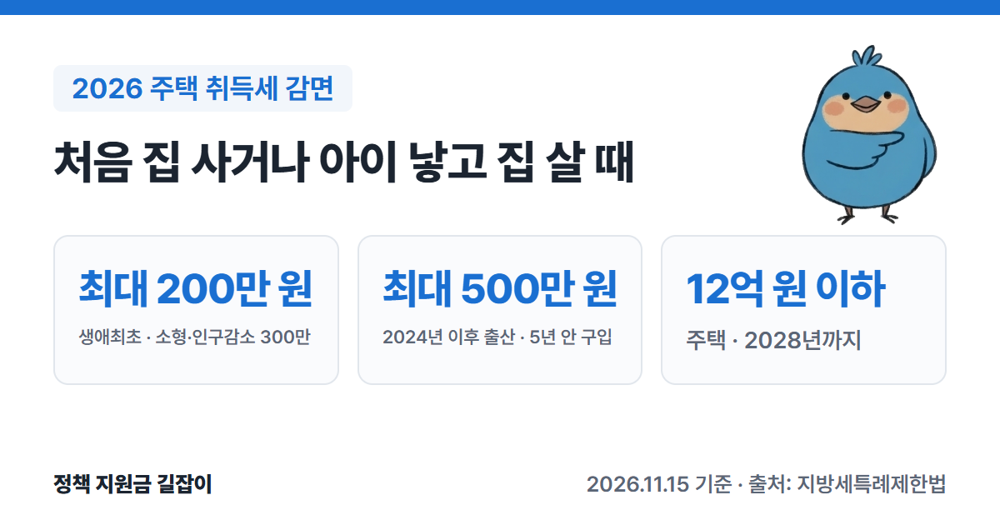
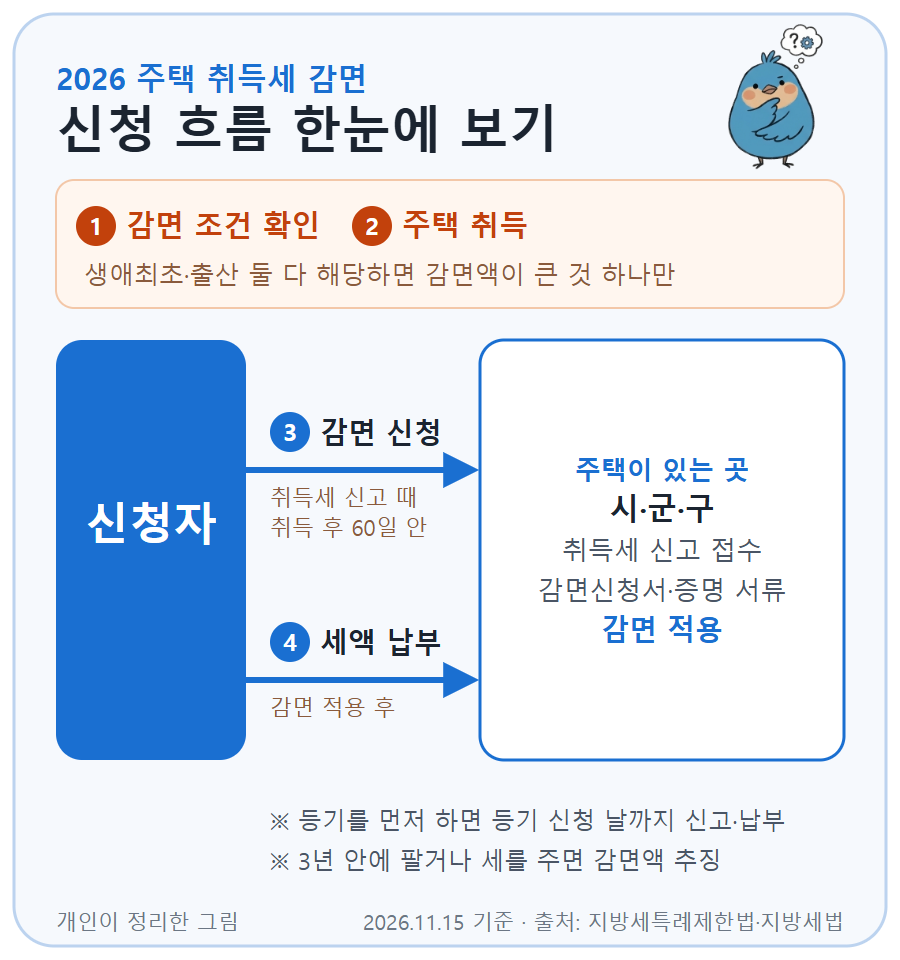

집을 사면 잔금과 함께 **취득세**를 내야 해요. 처음 집을 사거나, 아이를 낳고 집을 사는 가구는 이 취득세를 깎아 주는 제도가 있어요.
지방세특례제한법 조문을 바탕으로 누가, 얼마나 감면받는지와 신청 방법을 정리했어요. (출처①②)

{: .summary-card}

> 💡 **핵심 요약**
> - 본인과 배우자 모두 집을 가져 본 적 없는 사람이 **12억 원 이하** 주택을 사면 취득세를 최대 **200만 원**(소형 주택·인구감소지역 **300만 원**) 줄여 줘요. **2028년 12월 31일**까지 적용돼요. (출처①)
> - **2024년 1월 1일 이후** 아이를 낳은 부모가 출산일부터 **5년 안**(출산 전 1년 안 포함)에 12억 원 이하 주택을 사서 1가구 1주택이 되면 최대 **500만 원**을 줄여 줘요. (출처②⑨)
> - 두 감면에 모두 해당해도 **감면액이 큰 것 하나만** 받을 수 있어요. (출처④)

> **출처 표시 방법**: 본문의 (출처①) 같은 표시는 글 끝 출처 목록의 번호와 같아요.
> 집을 살 때 쓰는 대출은 [신혼부부 주택구입자금대출]()과 [신생아 특례 디딤돌 대출]() 글에 정리해 두었어요.

목차

* 목차
{:toc}

## 한눈에 보기

| 항목 | 생애최초 주택 구입 | 출산·양육 주택 구입 |
|---|---|---|
| 대상 | 본인·배우자 **집 가진 적 없음** | 출산 **5년 안**에 구입 |
| 주택 | **12억 원 이하** | **12억 원 이하** |
| 감면 | 최대 **200만 원** (소형·인구감소지역 **300만 원**) | 최대 **500만 원** |
| 기한 | **2028.12.31.**까지 취득 | **2024.1.1.~** **2028.12.31.** 출산 |

(출처①②⑨)

신청은 취득세를 **신고할 때** 감면신청서를 함께 내는 방식이에요. (출처⑤)

---

## 누가 받을 수 있나요?

### 생애최초 주택 구입

아래 조건을 **모두** 갖춰야 해요. (출처①)

| 조건 | 내용 |
|---|---|
| 무주택 이력 | 주택 취득일 현재 본인과 배우자 모두 **집을 가져 본 적이 없음** |
| 사는 사람 | **대한민국 국민**, 미성년자 제외 |
| 목적 | 본인이 **거주할 목적** |
| 주택 | 취득 당시 가액 **12억 원 이하** |
| 취득 방법 | **사고파는 거래**(유상거래) 부담부증여는 제외 |
| 기한 | **2028년 12월 31일**까지 취득 |

배우자에는 가족관계등록부로 혼인이 확인되는 외국인 배우자도 포함돼요. (출처①)

예전에 집을 가졌어도 아래 같은 경우는 **집을 가진 적 없는 것으로 봐 줘요**. (출처①)
- 상속으로 받은 주택 지분을 모두 처분한 경우
- 전용 **20㎡ 이하** 주택 한 채를 가졌거나 처분한 경우
- 시가표준액 **100만 원 이하** 주택을 가졌거나 처분한 경우
- 전세사기피해주택을 가졌거나 처분한 경우
- 도시지역이 아닌 곳 등의 오래된·작은 단독주택이나 상속받은 주택을 가진 사람이 다른 지역으로 이사한 경우(감면받을 집을 사기 전이나 산 뒤 3개월 안에 처분해야 함)
- 2024~2025년에 세 들어 1년 이상 살던 2억 원(수도권 3억 원) 이하 소형 주택을 사서 이 감면을 받은 경우(추징된 경우 제외)

무주택 여부를 확인하는 자세한 기준은 행정안전부장관이 정해요. (출처①)

### 출산·양육 주택 구입

아래 조건을 **모두** 갖춰야 해요. (출처②③⑨)

| 조건 | 내용 |
|---|---|
| 사는 사람 | 자녀를 낳은 **부모** (미혼모·미혼부 포함) |
| 출산 | **2024년 1월 1일~2028년 12월 31일** 출산 가족관계등록부로 출생 확인 |
| 시기 | 출산일부터 **5년 안**에 취득 (출산일 전 **1년 안** 취득도 포함) |
| 목적 | 그 자녀와 **거주할 목적** |
| 주택 | 취득 당시 가액 **12억 원 이하** |
| 주택 수 | **1가구 1주택** (취득일부터 3개월 안에 1가구 1주택이 되면 포함) |

- **1가구**는 같은 세대별 주민등록표에 있는 가족(동거인 제외)이에요. 배우자와 30세 미만 미혼 자녀는 주민등록이 따로 있어도 같은 가구로 봐요. (출처③)
- 주택의 부속토지만 가지고 있어도 주택을 가진 것으로 봐요. (출처③)
- 생애최초와 달리 **전에 집을 가져 본 적이 있어도** 1가구 1주택 요건만 맞으면 돼요. (출처②)

---

## 얼마나 감면받나요?

### 생애최초 주택 구입

| 주택 | 감면 |
|---|---|
| 소형 주택·인구감소지역 주택 | 취득세 **300만 원** 이하면 면제 넘으면 **300만 원** 공제 |
| 그 밖의 주택 | 취득세 **200만 원** 이하면 면제 넘으면 **200만 원** 공제 |

(출처①)

**300만 원을 공제하는 소형 주택**은 아래 중 하나예요. (출처①)
- 전용 **60㎡ 이하**, 취득 당시 가액 **3억 원**(수도권 **6억 원**) 이하인 공동주택(**아파트는 제외**)
- 전용 **60㎡ 이하**, 3억 원(수도권 6억 원) 이하인 **도시형 생활주택**
- 3억 원(수도권 6억 원) 이하 **다가구주택** 중 호수별로 면적이 나뉘어 있는 전용 60㎡ 이하 부분
- **인구감소지역**에 있는 주택

두 사람 이상이 함께 사면(공동명의) 그 주택의 **감면액 합계**가 300만 원(소형 등) 또는 200만 원을 넘지 않아요. (출처①)

### 출산·양육 주택 구입

취득세가 **500만 원 이하면 면제**, 넘으면 **500만 원을 공제**해요. 자녀 1명당 **먼저 감면을 신청한 주택 1채**만 받을 수 있어요. (출처②)

### 계산해 보면

유상거래로 주택을 살 때 취득세율은 **6억 원 이하 1%**, 6억 원 초과~9억 원 이하는 계산식에 따른 세율, **9억 원 초과 3%**예요. (출처⑥) 아래는 취득세만 계산한 예시예요.

| 예시 (5억 원 아파트) | 취득세 |
|---|---|
| 감면 전 | **500만 원** (5억 원 × 1%) |
| 생애최초 | **300만 원** (200만 원 공제) |
| 출산·양육 | **0원** (500만 원 이하라 면제) |

(출처①②⑥)

인구감소지역이 아닌 5억 원 아파트를 사고 각 감면 요건을 모두 갖춘 경우예요. 인구감소지역 주택이면 생애최초 감면은 300만 원 공제라 200만 원이 돼요. 두 감면에 모두 해당하면 감면액이 큰 출산·양육 감면 하나만 적용돼요. (출처④)

---

## 어떻게 신청하나요?

{: .flow-chart}

1. **감면 조건 확인하기**: 생애최초와 출산·양육 중 어느 감면에 해당하는지 확인해요. 둘 다 해당하면 감면액이 큰 것 하나만 받아요. (출처①②④)
2. **주택 취득하기**: 주택을 취득해요. 생애최초 감면은 사고파는 거래(유상거래)로 취득한 경우만 해당해요. (출처①)
3. **취득세 신고하며 감면 신청하기**: 취득한 날부터 **60일 안**에 취득세를 신고하고 내야 해요. 그 전에 등기를 하려면 **등기 신청서를 내는 날까지** 신고·납부해야 해요. (출처⑦) 감면은 취득세를 **신고하는 때** 감면신청서에 감면 사유를 증명하는 서류를 붙여 주택이 있는 곳(납세지)의 시·군·구에 내요. (출처⑤⑥)
4. **감면된 세액 내기**: 감면을 적용한 세액으로 납부해요. 시·군·구가 감면 대상임을 알 수 있으면 직권으로 감면할 수도 있어요. (출처⑤)

> 필요한 증명 서류와 신청 창구는 시·군·구마다 안내가 다를 수 있어요. 집이 있는 곳의 **시·군·구청 세무 부서**에 먼저 물어보세요.

---

## 놓치기 쉬운 점

- **3년 안에 팔거나 세를 주면 감면액을 다시 내요.** 두 감면 모두 취득일부터 **3년 안에** 그 집을 팔거나 증여하거나(배우자에게 지분을 팔거나 증여하는 경우는 제외), 임대 등 다른 용도로 쓰면 감면받은 취득세를 추징해요. 세입자가 있는 집을 사서 남은 임대 기간이 1년 이내면 그 임대 기간이 끝난 날부터 3년을 따져요. (출처①②)
- **추징되면 60일 안에 신고해야 해요.** 감면받은 뒤 추징 대상이 되면 그 사유가 생긴 날부터 **60일 안**에 감면받은 세액을 신고·납부해야 해요. (출처⑦)
- **인구감소지역이 아닌 아파트는 최대 200만 원이에요.** 소형 주택 300만 원 공제는 아파트를 뺀 공동주택·도시형 생활주택·다가구주택(각 전용 60㎡ 이하·가액 기준 충족)과 인구감소지역 주택만 해당해요. (출처①)
- **출산 감면은 1가구 1주택이어야 해요.** 기존 집이 있으면 새 집 취득일부터 **3개월 안**에 1가구 1주택이 되어야 해요. (출처②)

---

## 자주 묻는 질문

**Q. 부부 중 한 사람만 예전에 집이 있었어요. 생애최초 감면을 받을 수 있나요?**
생애최초 감면은 취득일 현재 **본인과 배우자 모두** 집을 가진 적이 없어야 해요. 다만 전용 20㎡ 이하 주택처럼 법에서 정한 경우는 가진 적 없는 것으로 봐요. (출처①) 2024년 이후 아이를 낳았다면 무주택 이력을 묻지 않는 출산·양육 감면도 확인해 보세요. (출처②)

**Q. 임신 중인데 집을 먼저 사도 되나요?**
출산·양육 감면은 출산일 **전 1년 안**에 산 주택도 포함해요. 출생 사실이 가족관계등록부로 확인되어야 해요. (출처②) 아이가 태어나기 전에 취득세를 이미 냈다면, 감면 신청 방법을 집이 있는 곳의 시·군·구청 세무 부서에 확인하세요. (출처⑤)

**Q. 앞으로 바뀌는 내용이 있나요?**
행정안전부는 '2026년 지방세제 개편안'에서 생애최초 감면 대상을 **주거용 오피스텔**까지 넓히고, **40세 미만 청년**의 감면 한도를 200만 원에서 **300만 원**으로 올리겠다고 발표했어요(2026.8.26.). 정부 개정안은 2026년 10월 16일 국회에 제출됐고, 아직 **확정되지 않았어요**. 확정되면 이 글에 반영할게요. (출처⑧⑩)

---

## 함께 보면 좋은 글

- [2026 신혼부부 주택구입자금대출 총정리](): 처음 집을 사는 신혼부부의 기금 대출 조건
- [2026 신생아 특례 디딤돌 대출](): 2년 안에 아이를 낳은 가구의 집 구입 대출
- [2026 신혼희망타운 청약 총정리](): 집을 사는 대신 신혼부부 전용 분양주택에 청약한다면
- [2026 출산지원금 총정리](): 첫만남이용권·부모급여·아동수당 등 출산·육아 지원 전체

---

## 출처

1. [국가법령정보센터 - 지방세특례제한법 제36조의3(생애최초 주택 구입에 대한 취득세 감면)](https://www.law.go.kr/법령/지방세특례제한법) - 대상(본인·배우자 무주택, 국민, 거주 목적, 12억 원 이하, 유상거래, 미성년자 제외), 2028.12.31. 기한, 300만·200만 원 감면, 소형 주택·인구감소지역, 공동 취득 한도, 무주택으로 보는 경우, 3년 안 추징 (2025.12.31. 개정·2026.1.1. 시행 조문, 확인일: 2026-11-14)
2. [국가법령정보센터 - 지방세특례제한법 제36조의5(출산·양육을 위한 주택 취득에 대한 취득세 감면)](https://www.law.go.kr/법령/지방세특례제한법) - 2028.12.31.까지 출산, 출산일부터 5년(전 1년 포함), 12억 원 이하, 자녀 1명당 1주택, 500만 원 감면, 1가구 1주택, 3년 안 추징 (확인일: 2026-11-14)
3. [국가법령정보센터 - 지방세특례제한법 시행령 제17조의4(출산·양육을 위한 주택 취득세 감면 요건)](https://www.law.go.kr/법령/지방세특례제한법시행령) - 1가구 1주택의 범위 (확인일: 2026-11-14)
4. [국가법령정보센터 - 지방세특례제한법 제180조(중복 특례의 배제)](https://www.law.go.kr/법령/지방세특례제한법) - 둘 이상 감면 규정이 적용되면 감면액이 큰 것 하나만 적용 (확인일: 2026-11-14)
5. [국가법령정보센터 - 지방세특례제한법 제183조 및 같은 법 시행령 제126조(감면 신청)](https://www.law.go.kr/법령/지방세특례제한법시행령) - 신고하는 때 감면신청서·증명 서류 제출, 직권 감면 (확인일: 2026-11-14)
6. [국가법령정보센터 - 지방세법 제11조(부동산 취득의 세율)](https://www.law.go.kr/법령/지방세법) - 유상거래 주택 세율 6억 원 이하 1%, 9억 원 초과 3%, 제8조(납세지: 부동산 소재지) (확인일: 2026-11-14)
7. [국가법령정보센터 - 지방세법 제20조(신고 및 납부)](https://www.law.go.kr/법령/지방세법) - 취득일부터 60일 안 신고·납부, 등기 전 신고, 추징 사유 발생일부터 60일 (확인일: 2026-11-14)
8. [정책브리핑 - 주거용 오피스텔도 생애최초 취득세 감면…지방 세제 지원 강화 (행정안전부, 2026.8.26.)](https://www.korea.kr/news/policyNewsView.do?newsId=148970644) - 2026년 지방세제 개편안(오피스텔 확대, 40세 미만 300만 원), 입법예고 뒤 국회 제출 예정 (확인일: 2026-11-14)
9. [국가법령정보센터 - 지방세특례제한법 부칙(법률 제19862호, 2023.12.29.) 제5조](https://www.law.go.kr/법령/지방세특례제한법/(19862,20231229)) - 출산·양육 감면은 2024.1.1. 이후 출산한 경우부터 적용, 출산 전 1년 안 취득은 2024.1.1. 이후 취득분부터 (확인일: 2026-11-14)
10. [국민참여입법센터 - 지방세특례제한법 일부개정법률안(정부 제출 제2221925호, 2026.10.16.)](https://opinion.lawmaking.go.kr/gcom/nsmLmSts/out/2221925/detailRP) - 국회 제출·행정안전위원회 회부(2026.10.19.), 오피스텔 생애최초 감면 확대 (확인일: 2026-11-14)

> 이 글은 **2026년 11월 15일** 기준이에요. 이 글은 공식 법령을 개인이 정리한 것이며 세무 상담이 아니에요. 감면 여부는 집이 있는 곳의 시·군·구청 세무 부서에서 꼭 확인하세요.
