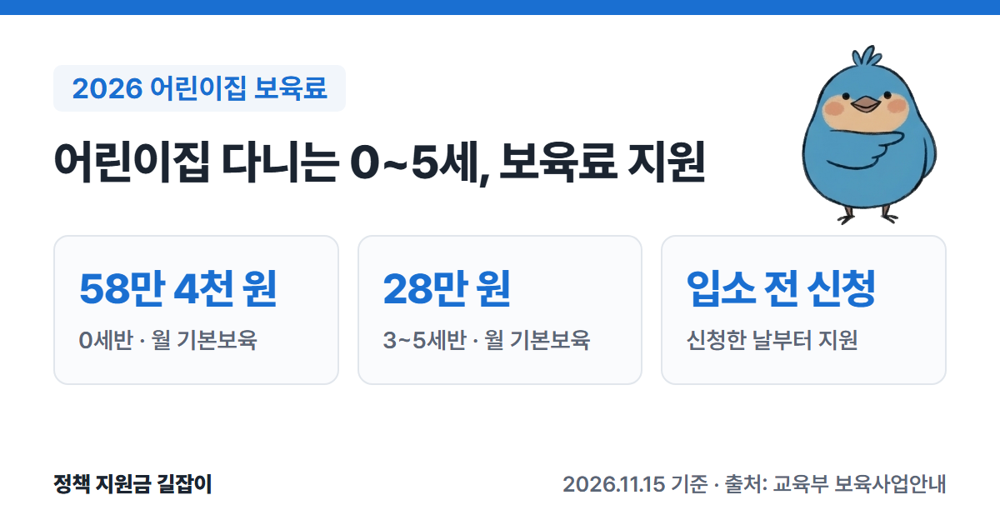
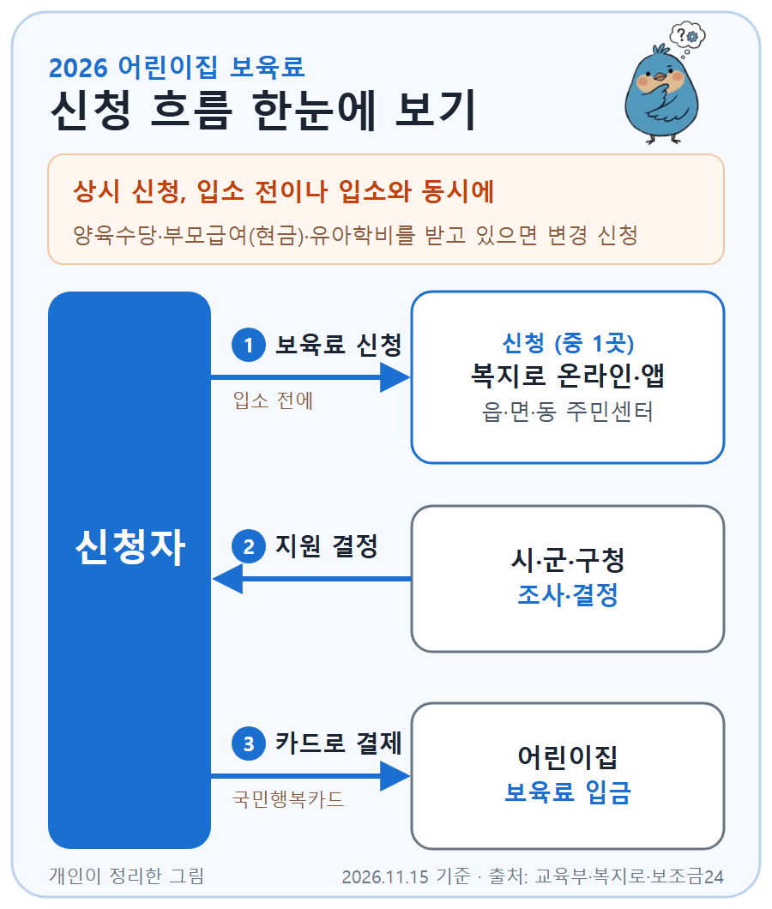

**영유아 보육료 지원**은 어린이집에 다니는 0~5세 아이의 보육료를 정부가 대신 내주는 제도예요.
부모가 **국민행복카드**로 결제하면 그 돈이 어린이집으로 들어가요.
교육부 「2026년도 보육사업안내」를 바탕으로 반별 금액, 신청 시기, 부모가 따로 내는 돈을 정리했어요.

{: .summary-card}

> 💡 **핵심 요약**
> - 어린이집에 다니는 0~5세 아이의 보육료를 국민행복카드로 지원해요. 기본보육 월 단가는 **0세반 58만 4천 원, 1세반 51만 5천 원, 2세반 42만 6천 원, 3~5세반 28만 원**이에요. (출처①②)
> - 보육료는 **신청한 날부터** 지원해요. 어린이집 **입소 전이나 입소와 동시에** 신청해야 그사이 보육료를 부모가 내는 일이 생기지 않아요. (출처①③)
> - 부모급여(현금), 양육수당, 유치원 유아학비, 종일제 아이돌봄서비스와는 **함께 받을 수 없어요**. (출처①)

> **출처 표시 방법**: 본문의 (출처①) 같은 표시는 글 끝 출처 목록의 번호와 같아요.
> 출산·육아 지원 전체는 [2026 출산지원금 총정리]()에서 함께 확인하세요.

목차

* 목차
{:toc}

## 한눈에 보기

| 항목 | 내용 |
|---|---|
| 지원 대상 | 어린이집에 다니는 **0~5세** 아이 (대한민국 국적·주민등록번호) |
| 지원 내용 | 반별 보육료를 **국민행복카드**로 지원 0세반 **58만 4천 원** ~ 3~5세반 **28만 원** (월) |
| 신청 기간 | **상시 신청** 입소 전이나 입소와 동시에 |
| 신청 방법 | **복지로**(온라인·앱) 또는 **읍·면·동 주민센터** 방문 |

(출처①②③)

---

## 누가 받을 수 있나요?

**대한민국 국적**을 가지고 **주민등록번호**를 정상적으로 받은 **0~5세** 아이가 어린이집을 이용하면 **소득과 관계없이** 받을 수 있어요. (출처①)
주민등록이 된 재외국민 아이도 포함돼요(재외국민 출국자는 제외). 난민 아이 등도 예외적으로 지원 대상에 들어가요. (출처①)

어느 반인지는 **태어난 해**로 정해요. 2026년 기준은 아래와 같아요. 어린이집 반 편성 예외로 윗반이나 아랫반에 편성되면, 편성된 반의 단가로 지원해요. (출처①③)

| 반 | 태어난 날 |
|---|---|
| 0세반 | **2025.1.1.** 이후 |
| 1세반 | **2024년** 1.1.~12.31. |
| 2세반 | **2023년** 1.1.~12.31. |
| 3세반 | **2022년** 1.1.~12.31. |
| 4세반 | **2021년** 1.1.~12.31. |
| 5세반 | **2020년** 1.1.~12.31. (취학을 미룬 아이는 2019년생) |

(출처①③)

### 이런 경우는 받을 수 없어요

- 유치원에 다니며 **유아학비**를 받는 아이 (출처①)
- **부모급여(현금)**나 가정·농어촌·장애아동 **양육수당**을 받는 아이 (출처①)
- **종일제 아이돌봄서비스** 정부지원을 받는 아이 (출처①)
- 특수교육법에 따라 특수교육·특수교육 관련서비스를 받는 아이 (장애영유아 어린이집을 이용하면서 순회교육을 받는 경우는 지원 가능) (출처①)
- **해외에 머무는** 아이: 출국 후 **91일째** 되는 날 지원이 멈춰요(출국일 포함). (출처①)
- 다른 기관을 주로 다니는 아이: 예를 들어 **주 3회 이상** 유아 영어학원 같은 사설 기관에 다닌 뒤 오후에 등원하는 경우예요. (출처①)

---

## 얼마나 받을 수 있나요?

2026년 기본보육 정부 지원 단가는 아래와 같아요. (출처①②)

| 반 | 월 지원 단가 |
|---|---|
| 0세반 | **58만 4천 원** |
| 1세반 | **51만 5천 원** |
| 2세반 | **42만 6천 원** |
| 3~5세반 | **28만 원** |

(출처①②)

24시간 지정 어린이집에서 하는 야간 12시간 보육과 24시간 보육은 단가와 이용 기준이 따로 있어요. (출처①)

- 돈은 부모 통장으로 들어오지 않아요. 부모가 **국민행복카드**로 결제하면 어린이집으로 입금돼요. (출처①)
- 3~5세반 보육료는 **누리과정** 보육료예요. 유치원·어린이집 누리과정 지원은 **3년을 넘을 수 없어요**. (출처①②)
- 0~2세반이 맞벌이 등 사유로 **연장보육**을 이용하면 시간당 연장보육료를 따로 더 지원해요. (출처①)

0세·1세(0~23개월) 아이는 **부모급여**와 이어져 있어요. 어린이집에 다니면 부모급여(현금)와 보육료를 함께 받을 수 없어요. (출처①) 그래서 받는 현금이 줄거나 없어질 수 있는데, 반별로 얼마가 남는지는 [2026 출산지원금 총정리]()의 부모급여 부분에서 확인하세요.

### 부모가 따로 내는 돈이 있나요?

- **0~2세반**은 정부 단가 안에서 보육료가 정해져서, 보육료 차액을 따로 내지 않아요. (출처①)
- **3~5세반**은 정부가 인건비를 지원하지 않는 어린이집(기관보육료 지원 어린이집)이면, 시·도지사가 정한 한도 안에서 어린이집 보육료와 정부 지원금의 **차액**을 부모가 낼 수 있어요. 법정 저소득층과 장애아동은 내지 않아요. (출처①)
- **필요경비**는 보육료와 별도예요. 입학준비금, 특별활동비, 현장학습비, 차량운행비, 부모부담행사비, 아침·저녁 급식비 등이 해당해요. (출처①)
- **4~5세는 2026년 3월부터 무상교육·보육 지원**을 받아요. 어린이집 지원 단가는 기타 필요경비 1인당 **월 7만 원**이에요. 따로 신청하지 않아도 부모가 내던 기타 필요경비에서 무상교육·보육비만큼 빠져요. 2027년에는 3~5세로 넓힐 계획이에요. (출처④)
- **3~5세반은 월 5만 원을 더 지원**해요. 유아학비·누리보육료를 받는 유아 1인당 **월 5만 원**이고, 2026.3.1.~2027.2.28. 동안이에요. (출처⑤⑥)

### 출석일수에 따라 달라져요

계속 다니는 아이는 한 달 출석일수에 따라 지원 비율이 달라져요. 다만 0·1세(0~23개월) 아이는 출석일수와 관계없이 지원해요. (출처①)

| 출석일수 | 지원 비율 |
|---|---|
| **11일** 이상 | 월 단가의 **100%** |
| 6~10일 | **50%** |
| 1~5일 | **25%** |
| 0일 | 지원 없음 |

(출처①)

아이가 아프거나 집안에 일이 있어 결석하면 **출석 인정 특례**로 출석한 것으로 봐줘요. 예를 들어 아이 질병·부상은 최대 **90일**, 부모 입원은 최대 **60일**까지예요. (출처①)
결석 시작일을 포함해 **3일 안에** 어린이집에 사유를 알리고, 등원할 때 진단서 같은 증빙 서류를 내면 돼요. (출처①)

---

## 어떻게 신청하나요?

{: .flow-chart}

1. **입소 전에 보육료 신청하기**: [복지로](https://www.bokjiro.go.kr)(온라인·앱) 또는 가까운 **읍·면·동 주민센터**에 신청해요. 주소지와 관계없이 신청할 수 있고, 온라인 신청은 **부모만** 할 수 있어요. (출처①③)
   - 서류: 사회보장급여(사회서비스이용권) 신청(변경)서, 국민행복카드 발급 신청 및 개인신용정보 조회·제공·이용 동의서 (출처①)
   - 0~2세반 연장보육을 신청하면 연장보육 신청 사유서와 증빙 서류를 함께 내요. (출처①)
2. **시·군·구청 조사와 결정**: 담당 시·군·구청이 조사하고 지원을 결정해요. (출처②)
3. **국민행복카드로 결제하기**: 매달 국민행복카드로 보육료를 결제하면 어린이집으로 입금돼요. (출처①)

> 💡 이미 양육수당이나 부모급여(현금), 유아학비를 받고 있다면 새로 신청하는 게 아니라 **보육료로 변경 신청**을 해야 해요. 변경 신청을 빠뜨려 생긴 비용은 소급해서 지원하지 않아요. (출처①③)

---

## 놓치기 쉬운 점

- **입소한 뒤에 신청하면 그사이 보육료는 부모가 내요.** 보육료는 신청일부터 지원하기 때문이에요. 입소일 전에 신청하면 입소일부터, 입소일 당일에 신청하면 그날부터 지원해요. (출처①③)
- **양육수당·부모급여(현금)에서 바꿀 때는 15일이 기준이에요.** 그 달 15일 안에 변경 신청하면 신청일부터 보육료를 지원하고 그 달 현금은 받지 않아요. 16일 이후에 신청하면 그 달 현금은 전액 받고, 보육료는 다음 달 1일부터라 그 달 어린이집 보육료는 부모가 내요. (출처①)
- **누리과정 지원은 3년까지예요.** 기준보다 윗반(누리과정 반)에 일찍 편성돼 누리과정을 먼저 시작하면 3년이 먼저 끝나서, 그 뒤 보육료를 부모가 낼 수 있어요. (출처①)
- **출석일수가 모자라면 차액을 낼 수 있어요.** 출석일수 때문에 보육료가 100% 지원되지 않으면, 어린이집은 미리 알린 기준에 따라 모자란 금액을 부모에게 받을 수 있어요. (출처①)

> 이런 경우는 **주민센터(시·군·구)**나 **교육부 민원상담 02-6222-6060**에 먼저 물어보세요: 보육료·양육수당·유아학비·아이돌봄 사이를 바꾸는 시점이 헷갈릴 때. 복지로 안내에는 보건복지콜센터 129도 적혀 있어요. (출처②③)

---

## 자주 묻는 질문

**Q. 맞벌이가 아니어도 받을 수 있나요?**
A. 기본보육료는 0~5세 지원 대상이면 **소득과 관계없이** 받을 수 있어요. 다만 0~2세반 **연장보육**은 부모 모두 일하거나 구직 중인 경우, 다자녀·한부모·조손가구, 저소득층 등 필요 사유를 증빙해야 자격이 생겨요. (출처①)

**Q. 집과 다른 시·군·구의 어린이집에 다녀도 되나요?**
A. 네. 신청은 주소지와 관계없이 할 수 있고, 보육료는 **어린이집이 있는 시·군·구**에서 지원해요. (출처①)

**Q. 어린이집을 그만두고 집에서 키우면 어떻게 되나요?**
A. **양육수당**(0~23개월은 부모급여)으로 변경 신청을 해야 해요. 신청을 빠뜨리면 양육수당은 소급해서 지원하지 않아요. 양육수당 금액은 [2026 가정양육수당 총정리]()에서 확인하세요. (출처①)

**Q. 유치원으로 옮기면요?**
A. 유치원은 보육료가 아니라 **유아학비**로 지원해요. 보육료와 유아학비는 함께 받을 수 없어서, 옮길 때 변경 신청 단계를 꼭 거쳐야 해요. (출처①) 유아학비 금액과 신청 방법은 [2026 유치원 유아학비 지원 총정리]()에서 확인하세요.

---

## 함께 보면 좋은 글

- [2026 출산지원금 총정리](): 부모급여·아동수당 등 출산·육아 지원 전체와 부모급여 차액 계산
- [2026 유치원 유아학비 지원 총정리](): 유치원에 다니는 3~5세 유아학비와 2026년 추가지원
- [2026 가정양육수당 총정리](): 어린이집에 안 다니고 집에서 키울 때 받는 수당
- [2026 시간제보육 총정리](): 집에서 키우다 잠깐 맡길 때 시간당 2천 원
- [2026 아이돌봄서비스 총정리](): 돌보미가 집으로 오는 돌봄 서비스

---

## 출처

1. [교육부 - 2026년도 보육사업안내 (복지로 첨부)](https://bokjiro.go.kr/ssis-tbu/CmmFileUtil/getDownload.do?atcflId=20260319UUWBM1603140181336882&atcflSn=1) - Ⅸ 주요 내용 표(소득무관 전계층), Ⅸ-1 수급자 선정기준, Ⅸ-2 보육료 지원 개요(지원 방식, 출석일수별 지원, 출석 인정 특례, 중복지원 불가·지원제외, 지원 행정관청), Ⅸ-3 0~5세반 보육료(지원대상, 기준 연령, 지원단가), Ⅸ-4 연장보육 필요사유, Ⅸ-8 그 밖의 연장형 보육료(야간 12시간·24시간 보육), Ⅸ-1 신청 장소·시기·구비서류, Ⅱ-3 보육료 수납(부모부담 차액, 변경 신청 안내문), Ⅱ-4 필요경비 (확인일: 2026-11-15)
2. [복지로 - 영유아보육료 지원 (교육부 영유아재정과, 2026년 기준)](https://www.bokjiro.go.kr/ssis-tbu/twataa/wlfareInfo/moveTWAT52011M.do?wlfareInfoId=WLF00003250) - 지원 대상, 2026년 지원 단가, 신청·조사·결정 기관, 문의처 (확인일: 2026-11-15)
3. [정부24 보조금24 - 영유아보육료 지원 (교육부, 수정일 2026.2.4.)](https://www.gov.kr/portal/rcvfvrSvc/dtlEx/134200005036) - 연령 기준, 상시 신청, 신청 방법, 입소일·신청일별 지원 시작일, 변경 신청 누락 시 소급 불가 (확인일: 2026-11-15)
4. [대한민국 정책브리핑 - 2026년부터 유아 무상교육·보육 지원 대상이 4~5세로 확대됩니다 (교육부 보도자료, 2026.3.3.)](https://www.korea.kr/briefing/pressReleaseView.do?newsId=156746963) - 4~5세 확대, 2026년 3월부터 지원, 어린이집 기타 필요경비 1인당 월 7만 원(예산 산정 기준), 별도 신청 없이 차감, 2027년 3~5세 확대 계획 (첨부 보도자료 원문 확인, 확인일: 2026-11-15)
5. [정부24 보조금24 - 유아교육비·보육료 추가지원 (교육부, 수정일 2026.9.2.)](https://www.gov.kr/portal/rcvfvrSvc/dtlEx/134200005047) - 유아학비·누리보육료 지원 대상 유아 1인당 월 5만 원 (확인일: 2026-11-17)
6. [교육부 - 2026학년도 유아학비 지원계획(안) (2026.1., 복지로 첨부)](https://bokjiro.go.kr/ssis-tbu/CmmFileUtil/getDownload.do?atcflId=20260129UUWBM1426020173479961&atcflSn=1) - Ⅳ 유아학비·보육료 5만 원 추가지원(어린이집 3~5세 포함, 지원기간 2026.3.1.~2027.2.28.) (확인일: 2026-11-17)

> 이 글은 **2026년 11월 17일** 기준이에요. 보육료 단가와 기준은 해마다 바뀔 수 있으니, 신청 전에 복지로나 주민센터에서 꼭 확인하세요.
