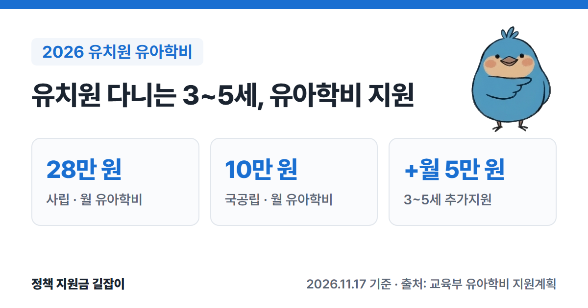
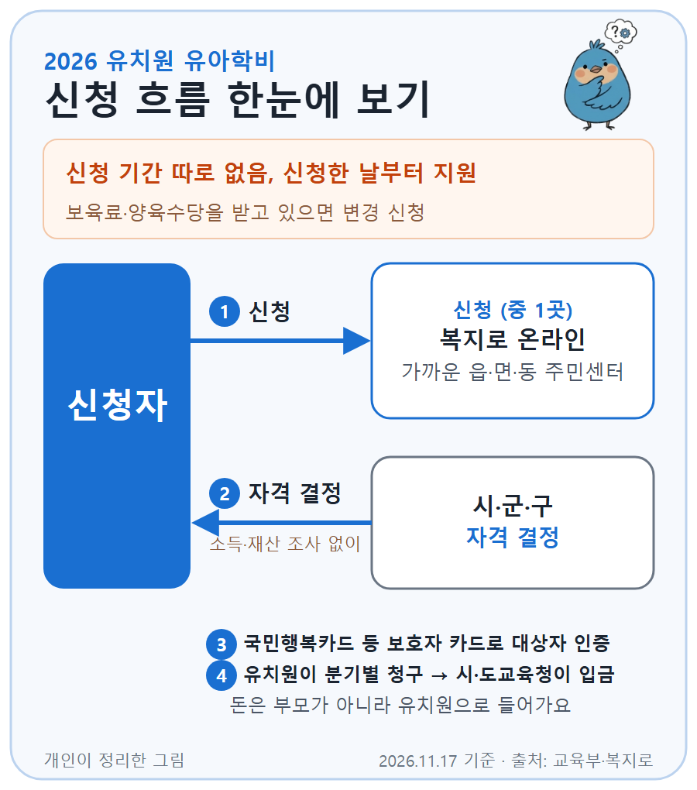

**유아학비 지원**은 유치원에 다니는 3~5세 아이의 교육비를 정부가 유치원에 대신 내주는 제도예요.
어린이집의 보육료와 짝을 이루는 **누리과정** 지원이에요.
교육부 「2026학년도 유아학비 지원계획」과 보도자료를 바탕으로 금액, 2026년에 더 받는 돈, 신청 방법을 정리했어요.

{: .summary-card}

> 💡 **핵심 요약**
> - 유치원에 다니는 3~5세는 소득과 관계없이 유아학비를 받아요. 월 **국공립 10만 원, 사립 28만 원**이고, 방과후 과정을 이용하면 **국공립 5만 원, 사립 7만 원**을 더 받아요. (출처①②)
> - 2026년에는 3~5세 모두 **월 5만 원**을 더 받아요. 4~5세는 무상교육·보육 지원도 받아요. 지원 단가는 **사립 월 11만 원, 공립 월 2만 원(방과후 과정비)**이고, 따로 신청하지 않아도 내던 원비에서 빠져요. (출처①③④)
> - 유아학비는 **신청한 날부터** 지원하고 소급하지 않아요. 보육료·양육수당을 받던 아이는 **유아학비로 변경 신청**을 해야 해요. (출처①)

> **출처 표시 방법**: 본문의 (출처①) 같은 표시는 글 끝 출처 목록의 번호와 같아요.
> 출산·육아 지원 전체는 [2026 출산지원금 총정리]()에서 함께 확인하세요.

목차

* 목차
{:toc}

## 한눈에 보기

| 항목 | 내용 |
|---|---|
| 지원 대상 | 국공립·사립 유치원에 다니는 **3~5세** 유아 (소득·재산 조사 없음) |
| 지원 내용 | 월 유아학비 국공립 **10만 원**, 사립 **28만 원** 방과후 과정비 국공립 **5만 원**, 사립 **7만 원** 3~5세 추가 **5만 원** |
| 신청 기간 | 따로 정해진 기간 없음 **신청한 날부터** 지원 |
| 신청 방법 | **복지로**(온라인) 또는 가까운 **읍·면·동 주민센터** 방문 |

(출처①②③)

---

## 누가 받을 수 있나요?

국공립·사립 **유치원에 다니는 3~5세** 유아예요. 보호자의 **소득·재산을 조사하지 않고** 출생일과 신청자만 확인해 자격을 만들어요. (출처①)
주민등록이 된 재외국민 유아도 포함돼요. (출처①)

2026학년도(2026.3.1.부터) 나이별 기준은 아래와 같아요. (출처①)

| 나이 | 태어난 날 |
|---|---|
| 5세 | **2020년** 1.1.~12.31. |
| 4세 | **2021년** 1.1.~12.31. |
| 3세 | **2022.1.1.~2023.2.28.** |

(출처①)

- **2023년 1~2월생**이 유치원 3세반에 들어가도 지원 대상이에요. 다만 전체 지원 기간 3년은 그대로예요. (출처①)
- 초등학교 입학을 1년 미룬 **2019년생**은 취학유예 통지서를 내면 미룬 1년 동안 지원받아요. 이때도 전체 3년을 넘을 수 없어요. (출처①)
- 미숙아는 일찍 태어난 기간을 뺀 **교정연령**으로 입학·재원할 수 있어요. (출처①)

### 이런 경우는 받을 수 없어요

- 대한민국 국적이 없는 유아 (난민, 법무부장관이 인정한 특별기여자 등은 예외) (출처①)
- **가정양육수당**이나 어린이집 **보육료**를 받고 있는 유아 (출처①)
- 유치원 이용 시간에 **아이돌봄서비스** 등을 함께 지원받는 경우 (출처①)
- 유치원에 학적은 있지만 **휴학**한 경우 (출처①)
- **해외에 머무는** 유아: 출국일을 포함해 **31일째** 되는 날 자격이 멈춰요. (출처①)

---

## 얼마나 받을 수 있나요?

2026년 월 지원액이에요. 돈은 부모 통장으로 들어오지 않고, **시·도교육청이 유치원에 입금**해요. (출처①④)

| 구분 | 국공립 | 사립 |
|---|---|---|
| 유아학비 | **10만 원** | **28만 원** |
| 방과후 과정비 | **5만 원** | **7만 원** |
| 3~5세 추가 | **5만 원** | **5만 원** |
| 4~5세 무상 | **2만 원** (공립, 방과후) | **11만 원** |
| 저소득층 | - | 최대 **20만 원** |

(출처①③④)

교육부 계획에 적힌 월 총 지원금은 국공립 **20만 원**, 사립 **40만 원**이에요(유아학비+방과후 과정비+5만 원 추가). 저소득층 지원은 이 금액 외에 따로 더해져요. 4~5세 무상교육 지원도 이 표에는 들어 있지 않고, 학부모가 추가로 내던 비용을 지원하는 거예요. (출처①④)

### 방과후 과정비는 언제 받나요?

교육과정이 끝난 뒤의 **방과후 과정**을 이용하고, 교육과정을 포함해 **하루 8시간 이상** 교육을 받을 때 받아요. (출처①)
병원 진료처럼 보호자가 따로 요청해 방과후 과정 시간을 **2시간 안에서** 줄인 경우에도 받을 수 있어요. (출처①)

### 2026년에 넓어진 지원 두 가지

- **3~5세 월 5만 원 추가지원**: 유아학비·누리보육료를 받는 3~5세 모두 유아 1인당 **월 5만 원**을 더 받아요. 지원 기간은 **2026.3.1.~2027.2.28.**이에요. 대상이 2025년 4~5세에서 2026년 3~5세로 넓어졌어요. (출처①③)
- **4~5세 무상교육·보육**: 2025년 7월 5세로 시작해 2026년 3월부터 4~5세로 넓혔어요. 지원 단가는 사립유치원 유아교육비 **월 11만 원**, 공립유치원 방과후 과정비 **월 2만 원**이에요. **따로 신청하지 않아도** 내던 원비에서 무상교육비만큼 빠져요. 2027년에는 3~5세로 넓힐 계획이에요. (출처④)

### 저소득층은 사립유치원에서 더 받아요

**사립유치원**에 다니는 기초생활수급자, 차상위계층, 한부모 가정 유아는 **월 최대 20만 원**을 더 받아요. 부모가 내는 원비(입학경비, 교육과정비, 방과후 과정비, 기타 경비)가 20만 원보다 적으면 실제 낸 만큼만 지원해요. (출처①)
이 지원은 유아학비와 **별도로 신청**해야 해요. (출처①)

### 출석일수에 따라 달라져요

한 달 교육일수가 **15일 이상**이면 전액, 결석으로 15일보다 적으면 날짜만큼 나눠 계산해요. (출처①)
아이가 아프거나 다쳐서 결석하면 원장 판단으로 **1년에 30일**까지 교육일수로 인정받을 수 있어요. 진단서 같은 증빙 서류를 유치원에 내야 해요. (출처①)

---

## 어떻게 신청하나요?

{: .flow-chart}

1. **유아학비 신청하기**: [복지로](https://www.bokjiro.go.kr)(온라인) 또는 **가까운 읍·면·동 주민센터**에 신청해요. 주소지 주민센터가 아니어도 돼요(출처①). 온라인 신청은 **부모만** 할 수 있어요. (출처②)
   - 서류: 사회보장급여(사회서비스이용권) 신청(변경)서, 신분증, (사실상 보호자가 직계존속이 아니면) 개인정보 수집·이용 및 제공 동의서 (출처①)
2. **시·군·구 자격 결정**: 지자체 담당 공무원이 출생일과 신청자를 확인하고 소득·재산 조사 없이 자격을 만들어요. (출처①②)
3. **카드로 인증하기**: 보호자의 **국민행복카드** 등 은행 카드로 지원 대상자 인증을 해요. (출처①)
4. **유치원 청구와 입금**: 유치원이 분기별로 청구하면 **시·도교육청**이 유치원에 지원금을 넣어요. (출처①)

> 💡 2025년에 유아학비를 받아 자격이 있는 아이는 **다시 신청하지 않아도** 2026년에 지원받아요. 2025년에 저소득층 유아학비를 받던 아이도 자격이 이어져요(수급 자격이 바뀌면 중단될 수 있어요). 처음 받으려면 저소득층 지원은 별도로 신청해야 해요. (출처①)

---

## 놓치기 쉬운 점

- **보육료·양육수당을 받던 아이는 변경 신청을 해야 해요.** 어린이집에서 옮기거나 집에서 키우다 입학하면 유아학비로 바꿔 신청해야 하고, 신청을 빠뜨린 기간은 소급해서 지원하지 않아요. (출처①)
- **저소득층 지원은 따로 신청해요.** 유아학비 자격이 있어도 저소득층 유아학비를 별도로 신청하지 않으면 지원받지 못하고, 빠진 기간은 소급하지 않아요. (출처①)
- **해외에 31일 이상 머물면 다시 신청해야 해요.** 출국일을 포함해 31일째 되는 날 자격이 멈추고, 재신청을 빠뜨린 기간은 소급하지 않아요. (출처①)
- **유치원을 그만둘 때는 학적 정리가 먼저예요.** 학적을 정리하기 전에 양육수당 등으로 바꾸면 신청한 날부터 유아학비가 끊겨요. 학적 중단이 끝난 뒤 양육수당·보육료로 변경 신청하세요. (출처①)

> 이런 경우는 **에듀콜 1544-0079**나 **교육부 민원상담 02-6222-6060**, 가까운 **주민센터**에 먼저 물어보세요: 보육료·양육수당·유아학비 사이를 바꾸는 시점이 헷갈릴 때. (출처①②③)

---

## 자주 묻는 질문

**Q. 소득이 많아도 받나요?**
A. 네. 유아학비는 보호자의 **소득 수준과 관계없이** 지원해요. 소득·재산 조사 없이 자격을 만들어요. 소득 기준이 있는 건 사립유치원 **저소득층 추가 지원**뿐이에요. (출처①)

**Q. 몇 년 동안 받을 수 있나요?**
A. 초등학교 입학 직전 **3년**이에요. 유치원·어린이집 누리과정 지원을 합쳐 3년을 넘을 수 없어요. 2023년 1~2월생처럼 일찍 입학하면 3년이 먼저 끝나 부모 부담이 생길 수 있어요. (출처①)

**Q. 학기 중에 어린이집으로 옮기면요?**
A. 어린이집은 **보육료**로 지원해요. 보육료를 신청하면 그 전날까지 유아학비를 날짜만큼 계산해 줘요. 보육료 신청 방법은 [2026 어린이집 보육료 지원 총정리]()에서 확인하세요. (출처①)

**Q. 3월 입학이면 언제 신청해야 하나요?**
A. **3월 1일까지** 신청하고 개학일에 입학하면 3월 1일부터 지원해요(개학일이 3월 15일 이후면 개학일부터). 신청일보다 입학일이 늦으면 입학일부터 지원해요. (출처①)

**Q. 양육수당을 받다가 유치원에 들어가면 언제부터 받나요?**
A. 그 달 **15일 안에** 변경 신청하면 그 달 양육수당은 받지 않고 신청일부터 유아학비를 받아요. **16일 이후**에 신청하면 그 달 양육수당은 전액 받고, 유아학비는 다음 달 1일부터예요. (출처①)

---

## 함께 보면 좋은 글

- [2026 어린이집 보육료 지원 총정리](): 어린이집에 다니는 0~5세 보육료와 변경 신청
- [2026 가정양육수당 총정리](): 유치원·어린이집에 안 다니고 집에서 키울 때 받는 수당
- [2026 온동네 초등돌봄·교육(옛 늘봄학교)](): 초등학교에 들어가면 이어지는 초1·2 매일 2시간 무료 프로그램
- [2026 출산지원금 총정리](): 부모급여·아동수당 등 출산·육아 지원 전체

---

## 출처

1. [교육부 - 2026학년도 유아학비 지원계획(안) (2026.1., 복지로 첨부)](https://bokjiro.go.kr/ssis-tbu/CmmFileUtil/getDownload.do?atcflId=20260129UUWBM1426020173479961&atcflSn=1) - Ⅰ 2026년 지원내용·세부 지원내용(지원단가, 나이별 출생일, 총 지원금, 5만 원 추가지원), 신청·지급 방법, 지원기간 3년, Ⅱ-1 지원대상·지원제외·변경 기준·지원금 산정·지원절차, Ⅱ-2 방과후 과정비, Ⅲ 저소득층 유아학비, Ⅳ 5만 원 추가지원, Ⅴ 신청 서류, 붙임1 교육일수 인정 특례 (확인일: 2026-11-17)
2. [복지로 - 유아학비 지원(3~5세 누리과정 지원) (교육부 영유아재정과, 2026년 기준)](https://www.bokjiro.go.kr/ssis-tbu/twataa/wlfareInfo/moveTWAT52011M.do?wlfareInfoId=WLF00000969) - 지원 대상, 지원 금액, 온라인 신청은 부모만, 신청·결정 기관, 문의처 (확인일: 2026-11-17)
3. [정부24 보조금24 - 유아교육비·보육료 추가지원 (교육부, 수정일 2026.9.2.)](https://www.gov.kr/portal/rcvfvrSvc/dtlEx/134200005047) - 유아학비·누리보육료 지원 대상 유아 1인당 월 5만 원, 문의처 (확인일: 2026-11-17)
4. [대한민국 정책브리핑 - 2026년부터 유아 무상교육·보육 지원 대상이 4~5세로 확대됩니다 (교육부 보도자료, 2026.3.3.)](https://www.korea.kr/briefing/pressReleaseView.do?newsId=156746963) - 2026년 3월부터 4~5세, 사립유치원 유아교육비 월 11만 원·공립유치원 방과후 과정비 월 2만 원(예산 산정 기준), 별도 신청 없이 차감, 2027년 3~5세 확대 계획 (첨부 보도자료 원문 확인, 확인일: 2026-11-17)

> 이 글은 **2026년 11월 17일** 기준이에요. 지원 금액과 기준은 해마다 바뀔 수 있으니, 신청 전에 복지로나 주민센터에서 꼭 확인하세요.
