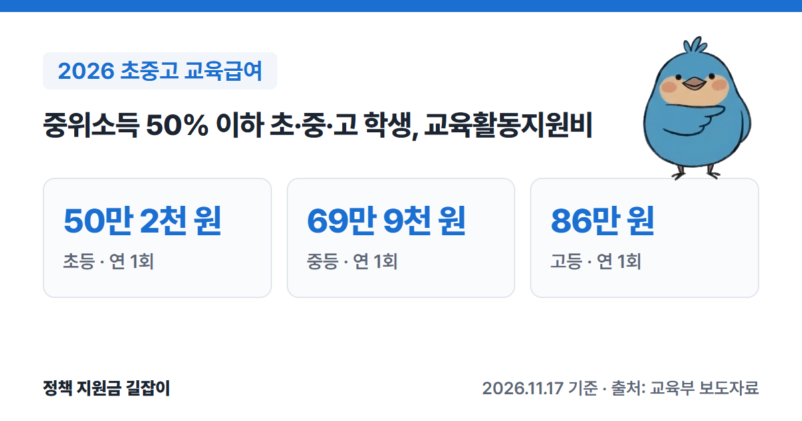
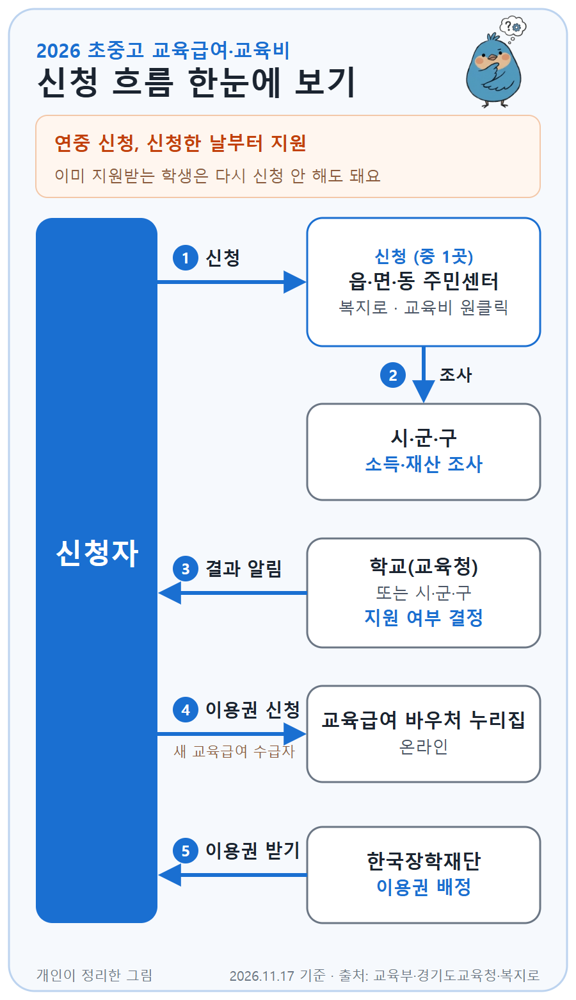

초·중·고 학생이 있는 저소득 가구는 **교육급여**와 **교육비 지원**을 함께 신청할 수 있어요.
이름은 비슷하지만 교육급여는 나라가 법으로 주는 급여이고, 교육비 지원은 시·도교육청이 자체 기준으로 하는 사업이에요.
교육부 보도자료와 교육청 지원 계획을 바탕으로 두 제도의 차이, 금액, 지금 신청해도 되는지 정리했어요.

{: .summary-card}

> 💡 **핵심 요약**
> - 교육급여를 받는 초·중·고 학생은 교육활동지원비를 1년에 한 번 **초 50만 2천 원, 중 69만 9천 원, 고 86만 원** 받아요. 기준 중위소득 50% 이하 가구의 학생이 대상이에요. (출처①)
> - 교육비 지원은 기초생활수급자, 한부모가족 보호대상자, 법정 차상위와 통상 **기준 중위소득 50~80% 이하** 가구 학생에게 방과후학교 자유수강권, 교육정보화비 등을 지원해요. 기준은 시·도교육청마다 달라요. (출처①)
> - 1년 내내 신청할 수 있지만 **신청한 날부터** 지원해요. 2026년에 새로 교육급여 수급자가 되면 교육활동지원비 **이용권(바우처)을 따로 신청**해야 해요. (출처①)

> **출처 표시 방법**: 본문의 (출처①) 같은 표시는 글 끝 출처 목록의 번호와 같아요.
> 생활비 지원 전체는 [2026 생활비 지원 총정리]()에서 함께 확인하세요.

목차

* 목차
{:toc}

## 한눈에 보기

| 항목 | 내용 |
|---|---|
| 지원 대상 | 교육급여: 기준 중위소득 **50% 이하** 가구 초·중·고 학생 교육비: 수급자·한부모·법정 차상위, 통상 중위소득 **50~80% 이하** |
| 지원 내용 | 교육활동지원비 초 **50만 2천 원**, 중 **69만 9천 원**, 고 **86만 원**(연 1회) 교육비: 방과후 자유수강권, 교육정보화비, 일부 고교 학비·급식비 |
| 신청 기간 | **연중** 신청 신청한 날부터 지원 |
| 신청 방법 | **주민센터** 방문, **복지로**, **교육비 원클릭** 중 1곳 |

(출처①)

---

## 누가 받을 수 있나요?

### 교육급여와 교육비 지원은 이렇게 달라요

| 구분 | 교육급여 | 교육비 지원 |
|---|---|---|
| 근거 | 국민기초생활보장법 | 초·중등교육법 |
| 성격 | 나라의 **법정 급여** | 시·도교육청 **재량 사업** |
| 소득 기준 | 중위소득 **50% 이하** | 통상 **50~80% 이하** |

(출처①)

교육급여 기준은 4인 가구 기준 소득인정액 **월 324만 7,369원 이하**예요. (출처①) 가구원 수별 금액과 2027년 기준은 [2027 기준 중위소득 정리]()에 표로 정리해 두었어요.

교육비 지원은 아래 세 가지 중 하나에 해당하면 받을 수 있어요. 다만 지원 범위는 시·도교육청마다 달라요. (출처③)

1. **저소득층 자격**: 학생이나 가구원 중 1명 이상이 아래 자격을 가진 경우
   - 생계·의료·주거·교육급여 수급자
   - 한부모가족 보호대상자(법정 한부모)
   - 법정 차상위 대상자(차상위 자활, 차상위 본인부담 경감, 차상위 장애수당·장애연금, 차상위계층 확인서 발급 대상자)
2. **소득 기준**: 소득인정액이 시·도교육감이 정한 기준에 해당하는 가구
3. **학교장 추천**: 소득·재산 조사에서 떨어졌지만 학생복지심사위원회를 거쳐 학교장 추천 대상자로 뽑힌 학생

외국인 등록번호를 받은 경우에도 신청할 수 있고, 법무부장관이 추천하는 난민 인정자나 그 자녀도 대상이에요. (출처③)

### 교육비 지원을 받을 수 없는 경우

- 공무원이거나 기업체·은행 등 직장에서 **학비 보조**를 받는 사람의 자녀 (출처③)
- 다른 부처·지방자치단체·공공기관의 **학비 지원** 대상자의 자녀 (출처③)
- 다른 법령에 따라 학비 전부나 일부를 지원받고 있거나 받기로 한 학생 (출처③)
- 일정 이상의 소득·재산이 있어 학비 부담에 어려움이 없는 사람의 자녀 (출처③)

---

## 얼마나 받을 수 있나요?

### 교육급여

| 학교 | 교육활동지원비 (연 1회) |
|---|---|
| 초등학교 | **50만 2천 원** |
| 중학교 | **69만 9천 원** |
| 고등학교 | **86만 원** |

(출처①)

- 초·중·고 평균으로 2025년보다 **6%** 올랐어요. (출처①)
- 현금이 아니라 신용·체크카드, 선불카드, 간편결제에 넣어 주는 **이용권(바우처)**으로 받아요. (출처①)
- 고등학교 무상교육에서 빠지는 학교에 다니면 **입학금·수업료·교과서비**도 지원해요. (출처①)

경기도교육청 계획에는 교육활동지원비를 유흥·사행업종, 청소년 출입 불가 업종, 상품권·성인용품 등에만 못 쓰고, 그 밖의 곳은 원칙적으로 쓸 수 있다고 적혀 있어요. (출처②)

### 예시로 계산해 보면

| 상황 | 한 해 교육활동지원비 |
|---|---|
| 초 1명 + 중 1명 | 50만 2천 + 69만 9천 = **120만 1천 원** |
| 중 1명 + 고 1명 | 69만 9천 + 86만 = **155만 9천 원** |

> 위 공식 금액으로 직접 계산한 예시예요. 실제 금액은 개인 상황에 따라 달라질 수 있어요. (출처①)

### 교육비 지원

시·도교육청이 자체 기준으로 아래 항목을 지원해요. (출처①)

- **방과후학교 자유수강권**
- **교육정보화비**: 컴퓨터(PC), 인터넷 통신비
- 무상교육·무상급식 대상이 아닌 고등학교의 **학비**(입학금·수업료·학교운영지원비)와 **급식비**

교육급여 수급자는 교육비 지원의 고교 학비 가운데 **학교운영지원비만** 받아요. 교육급여 지원 내용에 입학금·수업료가 들어 있어요. (출처① 비교표)

### 지역별 교육비 지원 기준

교육부가 정리한 2026년 시·도교육청 기준 가운데 방과후학교 자유수강권과 인터넷 통신비예요. (출처①)

| 지역 | 방과후 자유수강권 | 인터넷 통신비 |
|---|---|---|
| 서울 | 법정, **80%**, 학교장 | 법정, **60%** |
| 부산 | 법정, **90%**, 학교장 | 법정, 학교장 |
| 대구 | 법정, **80%**, 학교장 | 법정, 학교장 |
| 인천 | 법정, **90%**, 학교장 | 법정, **60%** |
| 광주 | 법정, **80%**, 학교장 | 법정 |
| 대전 | 법정, **80%**, 학교장 | 법정 |
| 울산 | 법정, **80%**, 학교장, 다자녀 | 법정 |
| 세종 | 법정, **80%**, 학교장 | 법정 |
| 경기 | 법정, **80%**, 학교장 | 기초, 한부모 |
| 강원 | 법정, **100%**, 학교장, 다자녀 | 법정 |
| 충북 | 법정, **80%**, 학교장, 다자녀 | 법정 |
| 충남 | 법정, **100%**, 학교장, 다자녀 | 법정 |
| 전북 | 법정, **80%**, 학교장, 다자녀 | 법정 |
| 전남 | 법정, **100%**, 학교장 | 법정, 학교장 |
| 경북 | 법정, **80%**, 학교장, 다자녀 | 법정, **60%** |
| 경남 | 법정, **80%**, 학교장 | 법정 |
| 제주 | 법정, **80%**, 학교장 | 법정 |

(출처①)

- **법정**: 기초생활수급자(기초), 한부모가족 보호대상자, 법정 차상위 대상자예요. (출처①)
- **%**: 기준 중위소득 몇 % 이하 가구 학생인지예요. (출처①)
- **학교장**: 학교장 추천, **다자녀**: 다자녀 가족 지원이에요. (출처①)
- 교육청 여건에 따라 **예산 범위 안에서** 지원해요. (출처①)

---

## 어떻게 신청하나요?

{: .flow-chart}

1. **교육급여·교육비 신청하기**: 학생이나 보호자가 **읍·면·동 주민센터**에 가거나, 온라인 [복지로](https://www.bokjiro.go.kr) 또는 [교육비 원클릭](https://oneclick.neis.go.kr)에서 신청해요. (출처①)
2. **소득·재산 조사**: 시·군·구가 가구의 소득과 재산을 조사해요. (출처②③)
3. **결정·통지**: 학교(교육청)나 시·군·구가 지원 여부를 결정해 알려 줘요. 교육급여는 학교(교육청)가 알려 줘요. (출처①③)
4. **이용권(바우처) 신청하기**: 2026년에 새로 교육급여 수급자가 됐다면 학교(교육청)와 한국장학재단 안내에 따라 [교육급여 바우처 누리집](https://e-voucher.kosaf.go.kr)에서 교육활동지원비 이용권을 **반드시 따로** 신청해요. (출처①)
5. **이용권 배정**: 한국장학재단이 이용권을 배정해 줘요. (출처①)

> 💡 이미 지원을 받고 있는 학생은 **다시 신청하지 않아도** 돼요. 초등학교 입학생처럼 2026년에 새로 지원이 필요한 학생이 신청 대상이에요. (출처①)

---

## 놓치기 쉬운 점

- **신청한 날부터 지원해요.** 1년 내내 신청할 수 있지만 지원은 신청일을 기준으로 해요. 그래서 교육부는 학기가 시작하는 3월에 신청하라고 권해요. (출처①)
- **새 수급자는 바우처를 한 번 더 신청해요.** 교육급여 수급자로 결정돼도 교육급여 바우처 누리집에서 이용권을 따로 신청해야 교육활동지원비를 받아요. (출처①)
- **바우처에는 신청·사용 기한이 있어요.** 경기도교육청 계획에는 2026년 교육급여 신청 기간이 **2026.12.31.까지**, 바우처 신청은 **2027.2.28.까지**, 사용은 **2027.3.31.까지**로 적혀 있어요. 사는 지역 기한은 교육청이나 바우처상담센터에 확인하세요. (출처②)
- **한부모 학용품비와 겹치면 차액을 받아요.** 경기도교육청 계획에는 시·군·구가 소득인정액이 기준 중위소득 65% 이하인 한부모가족의 초·중·고 자녀에게 학용품비 연 **10만 원**을 주고, 이걸 받으면 교육활동지원비는 차액만큼 받을 수 있다고 적혀 있어요. (출처②)

> 이런 경우는 **교육비 중앙상담센터 1544-9654**, **보건복지상담센터 129**, **교육급여 바우처상담센터(한국장학재단) 1599-2000**, 가까운 **주민센터**에 먼저 물어보세요: 우리 지역 교육비 지원 기준이나 바우처 신청 기한이 헷갈릴 때. (출처①)

---

## 자주 묻는 질문

**Q. 지금(11월)에 신청해도 되나요?**
A. 네. 교육급여와 교육비는 **1년 내내** 신청할 수 있고, 신청한 날부터 지원해요. (출처①) 경기도교육청 계획에는 교육활동지원비 바우처 사업이 학년도가 아닌 **연도 단위**(지자체 신청일 기준)라고 적혀 있어요. (출처②)

**Q. 교육급여와 교육비 지원은 따로 신청해야 하나요?**
A. 같은 창구(주민센터, 복지로, 교육비 원클릭)에서 신청할 수 있어요. (출처①) 경기도교육청은 두 사업을 함께 신청하도록 안내하고 있어요. (출처②)

**Q. 교육급여도 부양의무자 기준이 있나요?**
A. 없어요. 주거급여와 교육급여는 부양의무자 기준이 폐지됐어요. (출처④) 자세한 내용은 [2027 기준 중위소득 정리]()에서 확인하세요.

**Q. 한부모가족인데 무엇을 받을 수 있나요?**
A. 한부모가족 보호대상자는 교육비 지원의 **법정 대상**이에요(지역별 항목은 위 표 참고). (출처①③) 자녀 1인당 월 23만 원인 아동양육비와 학용품비는 [2026 한부모가족 아동양육비 총정리]()에 정리해 두었어요.

**Q. 교육활동지원비는 어디에 쓸 수 있나요?**
A. 경기도교육청 계획에는 유흥·사행업종, 청소년 출입 불가 업종, 상품권·성인용품 등만 막혀 있고, 그 밖의 곳은 원칙적으로 쓸 수 있다고 적혀 있어요. (출처②)

---

## 함께 보면 좋은 글

- [2026 한부모가족 아동양육비 총정리](): 자녀 1인당 월 23만 원, 학용품비 연 10만 원
- [2027 기준 중위소득 정리](): 교육급여 가구원 수별 소득 기준과 2027년 교육활동지원비
- [2026 생계급여 총정리](): 교육급여와 함께 보는 기초생활보장 급여
- [2026 온동네 초등돌봄·교육(옛 늘봄학교)](): 초등학생 방과후 돌봄과 초3 방과후 이용권 연 50만 원
- [2026 생활비 지원 총정리](): 상황별 생활비 지원 전체

---

## 출처

1. [대한민국 정책브리핑 - 3월! 2026년 초·중·고 학생 교육급여와 교육비 지원 신청하세요! (교육부 보도자료, 2026.3.2.)](https://www.korea.kr/briefing/pressReleaseView.do?newsId=156746765) - 집중 신청 기간, 연중 신청·신청일 기준 지원, 신청 창구, 교육급여·교육비 비교표, 교육활동지원비 금액·평균 6% 인상·바우처 방식, 신규 수급자 바우처 별도 신청, 신청 절차, 교육비 지원 항목, 붙임1 시·도교육청 교육비 지원 기준, 문의처 (첨부 보도자료 원문 확인, 확인일: 2026-11-17)
2. [경기도교육청 - 2026학년도 교육급여 지원 계획 (복지협력과, 2026.2.)](https://www.goe.go.kr/resource/goe/na/bbs_2675/2026/05/1d4e385d-9b72-4d67-84b8-50ff8432fca7.pdf) - 교육급여 신청 기간·바우처 신청·사용 기간, 연도 단위 사업, 지급 절차(시·군·구 소득·재산 조사), 사용처 제한, 한부모 학용품비 연 10만 원과 차액 지급, 두 사업 함께 신청 안내 (확인일: 2026-11-17)
3. [복지로 - 초중고 교육비 지원사업(고교학비 지원) (교육부 학생지원총괄과, 2026년 기준)](https://www.bokjiro.go.kr/ssis-tbu/twataa/wlfareInfo/moveTWAT52011M.do?wlfareInfoId=WLF00001103) - 지원 대상·제외 대상, 저소득층 수급 자격 기준, 학교장 추천, 외국인 등록번호, 시·군·구 조사 (확인일: 2026-11-17)

4. [보건복지부 보도자료 - 내년 기준 중위소득 6.70% 역대 최대 인상, "가장 어려운 국민 생활 더욱 두텁게 보호" (2026.7.28.)](https://www.mohw.go.kr/board.es?mid=a10503010100&bid=0027&act=view&list_no=1491453) - 주거급여·교육급여 부양의무자 기준 폐지 (첨부 보도자료 붙임 확인, 확인일: 2026-11-17)

> 이 글은 **2026년 11월 17일** 기준이에요. 지원 금액과 기준은 해마다 바뀔 수 있으니, 신청 전에 주민센터나 교육비 원클릭에서 꼭 확인하세요.
