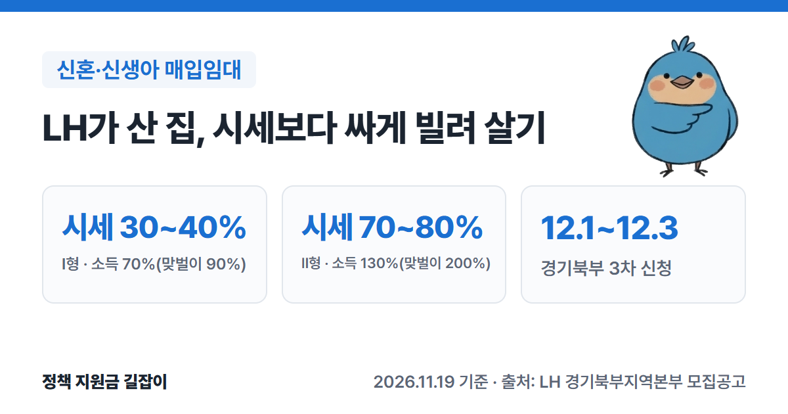
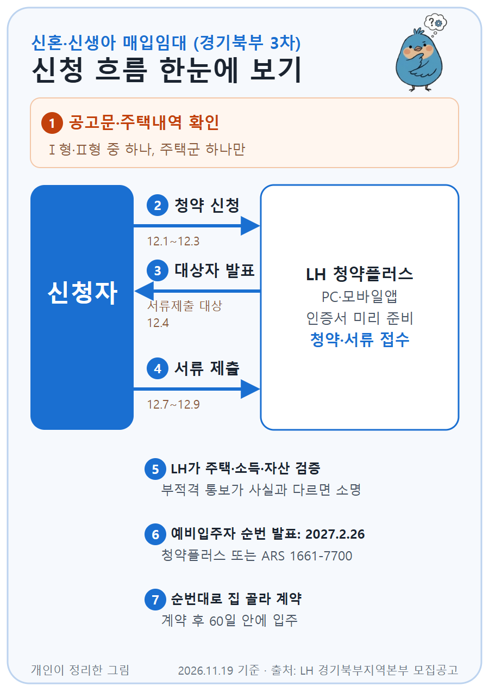

**신혼·신생아 매입임대**는 LH가 도심의 집을 사들여 신혼부부 등에게 시세보다 싸게 빌려주는 공공임대주택이에요. (출처①②)
월세가 싼 **Ⅰ형**(시세 30~40%)과 보증금 위주의 **Ⅱ형 전세형**(시세 70~80%)이 있고, 두 유형은 소득·자산 기준과 거주 기간이 달라요. (출처①②)
지금 공고 중인 LH 경기북부지역본부 3차 예비입주자 모집공고(2026.11.19.)를 바탕으로 자격, 기준 금액, 일정을 정리했어요.

{: .summary-card}

> 💡 **핵심 요약**
> - 신혼부부·예비신혼부부·한부모가족·신생아 가구 등이 **무주택**이고 소득·자산 기준을 충족하면, LH가 사들인 집을 **Ⅰ형은 시세 30~40%**, **Ⅱ 전세형은 시세 70~80%**로 빌려 살 수 있어요. (출처①②)
> - 소득 기준은 Ⅰ형 월평균소득 **70%**(맞벌이 **90%**) 이하, Ⅱ형 **130%**(맞벌이 **200%**) 이하예요. 총자산은 Ⅰ형 **3.45억 원**, Ⅱ형 **3.62억 원** 이하예요. (출처①②)
> - 경기북부 3차 공고는 **12월 1일(화) 10시 ~ 3일(목) 16시** LH 청약플러스로 신청해요. Ⅰ형과 Ⅱ형은 둘 중 하나만 신청할 수 있어요. (출처①②)

> **출처 표시 방법**: 본문의 (출처①) 같은 표시는 글 끝 출처 목록의 번호와 같아요.

목차

* 목차
{:toc}

## 한눈에 보기

| 항목 | Ⅰ형 | Ⅱ형(전세형) |
|---|---|---|
| 임대료 | 시세 **30~40%** | 시세 **70~80%** |
| 소득 | **70%** 이하 (맞벌이 **90%**) | **130%** 이하 (맞벌이 **200%**) |
| 총자산 | **3.45억 원** 이하 | **3.62억 원** 이하 |
| 최장 거주 | **20년** | **10년** (자녀 있으면 **14년**) |
| 경기북부 물량 | **167호** | **62호** |

- 신청: **2026.12.1.(화) 10:00 ~ 12.3.(목) 16:00**, LH 청약플러스(PC·모바일앱) (출처①②)
- 소득은 전년도 도시근로자 가구원수별 월평균소득 대비 비율이에요. (출처①②)

(출처①②)

---

## 누가 받을 수 있나요?

공고일(2026.11.19.) 현재 **무주택세대구성원**이고 소득·자산 기준을 충족하면서, 아래 중 하나에 해당해야 해요. (출처①②)

| 유형 | 조건 |
|---|---|
| 신혼부부 | 혼인 **7년 이내** (혼인신고일 2019.11.19.~2026.11.19.) |
| 예비신혼부부 | 혼인 예정이고 **입주일 전날까지** 혼인신고 |
| 한부모가족 | **6세 이하** 자녀(2019.11.20. 이후 출생, 태아 포함)를 둔 모자·부자가족, 또는 지원대상 한부모가족 |
| 유자녀 혼인가구 | **6세 이하** 자녀(태아 포함)가 있는 혼인가구 |
| 신생아 가구 | **2년 이내** 출산한 자녀(2024.11.19. 이후 출생·입양, 태아 포함)가 있는 가구 |
| 혼인가구 | 공고일 현재 혼인한 가구 (**Ⅱ형만**) |

무주택세대구성원은 신청자와 배우자(세대가 분리돼 있어도 포함), 주민등록표등본에 함께 오른 직계존속·직계비속 등이 **모두 집(분양권 등 포함)이 없는** 세대를 말해요. (출처①②)

신청할 수 없는 경우도 있어요: 외국인, 주민등록이 거주불명·말소인 사람, 같은 시·군·구에서 이미 신혼·신생아 매입임대를 계약한 사람(배우자 포함), 배우자가 국내에 살지 않는 재외국민이거나 외국인 등록을 하지 않은 외국인인 경우. (출처①②)

### 입주 순위

| 순위 | 대상 |
|---|---|
| 1순위 | 신생아 가구, 지원대상 한부모가족 |
| 2순위 | 미성년 자녀가 있는 신혼부부·예비신혼부부, 6세 이하 자녀가 있는 한부모가족 |
| 3순위 | 미성년 자녀가 없는 신혼부부·예비신혼부부 |
| 4순위 | 6세 이하 자녀가 있는 혼인가구 |
| 5순위 | 혼인가구 (**Ⅱ형만**) |

같은 순위 안에서 경쟁하면 배점(수급자 여부, 자녀 수, 청약통장 납입 횟수, 해당 시·군 연속 거주 기간, 장애인 등록, 65세 이상 직계존속 부양)이 높은 순으로 뽑고, 같으면 추첨해요. (출처①②)

### 소득 기준 (월평균소득)

**Ⅰ형**은 **70%** 이하, 본인과 배우자 모두 소득이 있으면 **90%** 이하예요. (출처①)

| 가구 | 70% | 90% (맞벌이) |
|---|---|---|
| 1인 | **3,432,027원** | **4,194,699원** |
| 2인 | **4,693,016원** | **5,866,270원** |
| 3인 | **5,717,900원** | **7,351,586원** |
| 4인 | **6,161,541원** | **7,921,982원** |

**Ⅱ형**은 **130%** 이하, 본인과 배우자 모두 소득이 있으면 **200%** 이하예요. (출처②)

| 가구 | 130% | 200% (맞벌이) |
|---|---|---|
| 1인 | **5,720,045** | **8,389,399** |
| 2인 | **8,212,778** | **12,319,167** |
| 3인 | **10,618,958** | **16,336,858** |
| 4인 | **11,442,863** | **17,604,404** |

(표 금액 단위: 원)

- 1인 가구는 20%p, 2인 가구는 10%p를 더한 금액이에요. (출처①②)
- 수급자, 지원대상 한부모가족, 차상위계층은 소득·자산 검증을 하지 않아요(예비신혼부부는 제외). (출처①②)
- 5~6인 가구 금액은 공고문에서 확인하세요. (출처①②)

### 자산 기준

| 구분 | Ⅰ형 | Ⅱ형 |
|---|---|---|
| 총자산 | **3억 4,500만 원** 이하 | **3억 6,200만 원** 이하 |
| 자동차 | **4,542만 원** 이하 | 따로 없음(총자산에 합산) |

2023.3.28. 이후 출산(입양·태아 포함)한 자녀가 있으면 자산 기준이 올라가요. (출처①②)

| 출산 자녀 | Ⅰ형 총자산 | Ⅱ형 총자산 |
|---|---|---|
| 1명 | **3억 7,900만 원** | **3억 9,600만 원** |
| 2명 이상 | **4억 1,300만 원** | **4억 3,100만 원** |

출산 자녀 수는 2023.3.28. 이후 낳은 자녀가 있으면 그 전에 태어난 미성년 자녀도 함께 세서 최대 2명까지 인정해요(신청자·배우자와 같은 주민등록표에 있는 자녀만). (출처①②)

Ⅰ형 자동차 기준도 1명이면 **4,996만 원**, 2명 이상이면 **5,451만 원** 이하로 올라가요. (출처①)

---

## 얼마나 싸게 살 수 있나요?

### Ⅰ형: 시세 30~40%

| 대상 | 임대 조건 |
|---|---|
| 수급자, 지원대상 한부모가족, 차상위계층 | 시세 **30%** |
| 그 외 | 시세 **40%** |

- 보증금을 더 내고 월세를 낮출 수 있어요. 기본 월세의 **최대 60%**까지 보증금으로 바꿀 수 있고, 전환이율은 연 **6%**예요(예: 보증금 300만 원 추가 → 월세 **15,000원** 감소). (출처①)
- 처음 2년 계약하고, 자격을 유지하면 **9번** 재계약해 **최장 20년** 살 수 있어요. (출처①)

### Ⅱ형(전세형): 시세 70~80%

보증금 비율을 **80%**로 하는 준전세 방식이에요. (출처②)

| 대상 | 임대 조건 |
|---|---|
| 수급자, 지원대상 한부모가족, 차상위계층, 월평균소득 80% 이하 | 시세 **70%** |
| 월평균소득 80% 초과 | 시세 **80%** |

- 보증금을 더 내고 월세를 낮추는 방식은 쓸 수 없어요(전세형이라서). 반대로 월세를 더 내고 보증금을 낮출 수는 있어요. (출처②)
- 처음 2년 계약하고 **4번** 재계약해 **최장 10년**, 자녀가 있으면 **2번 더** 재계약해 **최장 14년** 살 수 있어요. (출처②)

집마다 실제 보증금·월세는 공고에 첨부된 "주택내역"에서 확인할 수 있어요. 관리비·청소용역비는 따로 내요. (출처①②)

---

## 어떻게 신청하나요?

경기북부 3차 공고 기준이에요. 일정은 진행 상황에 따라 바뀔 수 있어요. (출처①②)

1. **공고문·주택내역 확인**: LH 청약플러스에서 Ⅰ형·Ⅱ형 공고문과 주택 목록을 보고, 둘 중 하나와 시·군·구 안의 주택군(모집 단위) 하나를 고릅니다.
2. **청약 신청**: **12월 1일(화) 10시 ~ 3일(목) 16시**, LH 청약플러스(PC·모바일앱). 공동인증서나 민간인증서(금융·네이버·토스·KB국민)를 미리 준비하세요.
3. **서류제출 대상자 발표**: **12월 4일(금)** 16시 이후 LH 청약플러스에서 확인합니다.
4. **서류 제출**: **12월 7일(월) 10시 ~ 9일(수) 16시**, 온라인 제출 또는 MyMy서비스(공공 마이데이터). MyMy서비스는 세대원 전원이 동의해야 쓸 수 있고, 혼인관계증명서처럼 이 서비스로 낼 수 없는 서류도 있어요. 공고일(11.19.) 이후 발급한 서류만 인정돼요.
5. **자격 검증**: LH가 주택 소유와 소득·자산을 전산으로 조회해 확인합니다. 부적격 통보를 받았는데 사실과 다르면 소명 기간 안에 증명 서류를 내야 해요.
6. **예비입주자 순번 발표**: **2027년 2월 26일(금)** 16시 이후 LH 청약플러스 또는 ARS(1661-7700)로 확인합니다.
7. **계약·입주**: 순번이 오면 계약 안내를 받고, 순번대로 원하는 집을 골라 계약합니다. 계약 후 **60일 안에** 입주해야 해요(100세대 이상 공동주택 일부는 입주 기간이 계약일부터 1개월 뒤로 정해질 수 있어요).

{: .flow-chart}

---

## 놓치기 쉬운 점

- **Ⅰ형과 Ⅱ형은 동시에 못 넣어요.** 두 공고에 중복 신청할 수 없고, 한 세대가 중복 신청하면 전부 무효 처리돼요. 서류 제출까지 마치면 순번 발표 때까지 다른 신혼·신생아 매입임대(Ⅰ·Ⅱ) 공고에도 신청할 수 없어요(서류 제출 기간이 끝나기 전에는 신청서 삭제 가능). (출처①②)
- **순위를 잘못 고르면 바꿀 수 없어요.** 신청할 때 입력한 순위는 나중에 변경이 안 되고, 증빙서류를 안 내면 순위와 배점이 인정되지 않아요. (출처①②)
- **예비신혼부부는 입주 전날까지 혼인신고를 해야 해요.** 하지 않으면 계약이 취소돼요. (출처①②)
- **예비입주자 자격은 60일 동안만 유지돼요.** 순번 발표일부터 60일이 지나면 지위가 사라지고, 선정돼도 기존 세입자 퇴거나 수리 상황에 따라 입주까지 오래 걸릴 수 있어요. (출처①②)
- **주택도시기금 대출이 있으면 입주 전에 갚아야 해요.** 은행이 대출 대상 주택 변경을 승인하면 예외예요. (출처①②)

이런 경우는 LH 콜센터(1600-1004)에 먼저 물어보세요: 세대구성원 범위가 헷갈릴 때, 맞벌이 소득 기준(90%·200%) 적용 여부, 자녀 출산에 따른 자산 기준 완화 대상인지.

---

## 자주 묻는 질문

**Q. 다른 지역에 살아도 경기북부 공고에 신청할 수 있나요?**
공고문에 신청자 거주지 제한은 따로 적혀 있지 않아요. 다만 배점 항목 중 "해당 시·군에 연속 거주한 기간"이 있어서, 신청하는 주택이 있는 시·군에 오래 산 사람이 같은 순위에서 유리해요. (출처①②)

**Q. 재계약 때 소득이 올라 기준을 넘으면 나가야 하나요?**
Ⅰ형은 재계약 때 월평균소득 **105%** 이하와 자산 기준을 충족해야 해요. 기준을 넘으면 **1번만** 더 재계약할 수 있고, 이때 보증금·임대료가 **80%** 할증돼요. (출처①) Ⅱ형은 재계약 때 자산 기준을 봐요. 두 유형 모두 소득이 입주 당시 기준을 넘으면 임대료가 할증돼요. (출처①②)

**Q. 살다가 아이가 태어나면요?**
두 유형 모두, 매입임대에 사는 동안 2024.1.1. 이후 태어난 자녀(태아 포함, 같은 세대)가 있으면 그 자녀가 성년이 되기 전까지 계속 재계약할 수 있어요. (출처①②)
사는 동안 태어난 2세 이하 자녀가 있으면 같은 시·군·구 안의 더 넓은 매입임대(전세형·분양전환형 제외)로 옮겨 달라고 신청할 수도 있어요. 옮기려는 집에 예비입주자가 있으면 가장 후순위 예비입주자로 등록돼요. (출처①②)

**Q. 다른 지역 공고는 어디서 보나요?**
이 글은 LH 경기북부지역본부 공고 기준이에요. 다른 지역 공고는 LH 청약플러스 → 청약 → 임대주택에서 확인하세요. (출처①②)

---

## 함께 보면 좋은 글

- [2026 신혼희망타운 청약](): 신혼부부용 공공분양·행복주택, 소득 130%(맞벌이 200%) 기준
- [2026 신혼부부전용 전세자금](): 공공임대 대신 전셋집을 구한다면
- [청년 매입임대주택 2026](): 결혼 전이라면 청년 매입임대·행복주택·전세임대

## 출처

1. [LH 경기북부지역본부 - 2026년 3차 신혼·신생아 매입임대Ⅰ 예비입주자 모집공고 (2026.11.19.)](https://apply.lh.or.kr/lhapply/apply/wt/wrtanc/selectWrtancInfo.do?panId=2015122300021072&ccrCnntSysDsCd=03&uppAisTpCd=13&aisTpCd=26&mi=1026) - LH 청약플러스 (확인일: 2026-11-19)
2. [LH 경기북부지역본부 - 2026년 3차 신혼·신생아 매입임대Ⅱ(전세형) 예비입주자 모집공고 (2026.11.19.)](https://apply.lh.or.kr/lhapply/apply/wt/wrtanc/selectWrtancInfo.do?panId=2015122300021074&ccrCnntSysDsCd=03&uppAisTpCd=13&aisTpCd=26&mi=1026) - LH 청약플러스 (확인일: 2026-11-19)

> 이 글은 2026년 11월 19일 기준입니다. 지원 조건은 바뀔 수 있으니 신청 전 공식 사이트에서 꼭 확인하세요.
> 문의: LH 콜센터 1600-1004 (평일 9~18시)
