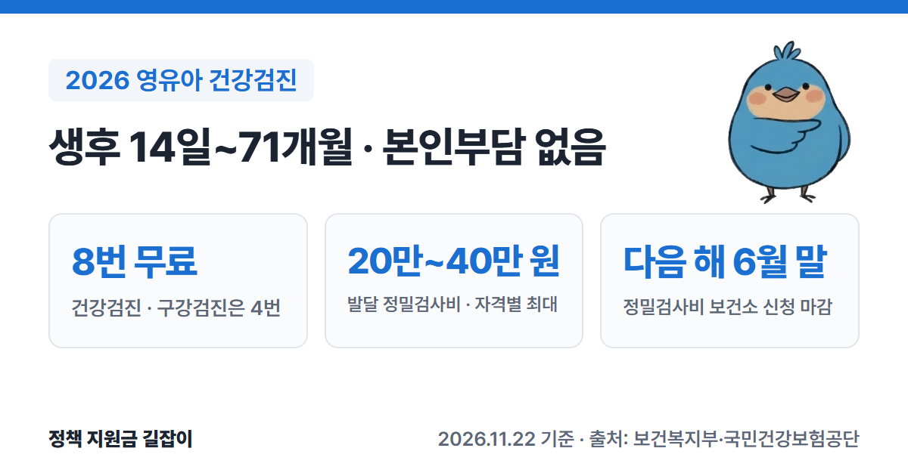

**영유아 건강검진**은 6세 미만 아이가 자라는 시기에 맞춰 키·몸무게, 시각·청각, 발달 상태를 살펴보는 국가 검진이에요.
생후 14일부터 71개월까지 **8번**, 구강검진은 **4번** 받을 수 있고 **본인부담이 없어요.**
발달평가에서 '심화평가 권고'가 나오면 정밀검사비도 **최대 20만~40만 원** 지원받아요. 보건복지부 「2026 건강검진 사업안내」를 바탕으로 정리했어요.

{: .summary-card}

> 💡 **핵심 요약**
> - 6세 미만(생후 14일~71개월) 영유아는 건강보험 가입자든 의료급여 수급자든 **본인부담 없이** 건강검진 **8번**, 구강검진 **4번**을 받아요. (출처①②)
> - 발달평가 결과가 **'심화평가 권고'**면 정밀검사비를 건강보험 가입자는 **최대 20만 원**, 기초생활수급자(의료·주거·생계)·차상위계층은 **최대 40만 원** 지원받아요. 2024년부터 건강보험료 기준이 없어졌어요. (출처①)
> - 정밀검사는 검진받은 날부터 **1년 안**에 받고, 검사한 해의 **다음 해 6월 말**까지 보건소에 신청해요. (출처①)

> **출처 표시 방법**: 본문의 (출처①) 같은 표시는 글 끝 출처 목록의 번호와 같아요.

목차

* 목차
{:toc}

## 한눈에 보기

| 항목 | 내용 |
|---|---|
| 대상 | 6세 미만 영유아 (생후 **14일~71개월**) 건강보험 가입자·의료급여 수급권자 모두 |
| 검진 횟수 | 건강검진 **8번**, 구강검진 **4번** |
| 비용 | **본인부담 없음** |
| 정밀검사비 | 발달평가 '심화평가 권고' 아이 건강보험 가입자 **최대 20만 원** 수급자·차상위 **최대 40만 원** |
| 신청 | 검진: 공단이 보내는 **검진표**를 들고 검진기관 방문 정밀검사비: **주소지 보건소** |
| 문의 | 국민건강보험공단 **1577-1000**, 보건복지상담센터 **129** |

(출처①②③)

## 누가 받을 수 있나요?

### 영유아 건강검진

- **6세 미만 영유아**가 대상이에요. 생후 14일부터 71개월까지 검진 시기별로 대상자를 정해요. (출처①②)
- 건강보험 가입자는 국민건강보험공단이, 의료급여 수급권자는 시·군·구 보건소가 맡아요(보건소 몫도 공단이 위탁받아 진행). 어느 쪽이든 검진 시기와 항목은 같아요. (출처①)
- 0~6세 **전체 영유아**가 대상이라 가구 소득은 따지지 않아요. (출처①)
- 해당 월령 중에 건강보험과 의료급여 사이에 자격이 바뀌어도, 검진 대상자로 정해질 때의 자격으로 검진을 받아요. (출처①)

### 발달 정밀검사비

- 영유아 건강검진 **발달평가(한국 영유아 발달선별검사, K-DST)**에서 **'심화평가 권고'**를 받은 아이가 대상이에요. (출처①)
- 2024년부터 건강보험료 기준 없이 **건강보험 가입자 전체**로 넓어졌어요. (출처①)
- 다음 아이는 제외돼요. (출처①)
  - 같은 유형으로 이미 **발달장애인으로 등록**된 아이
  - 같은 영역에서 **발달지연 확진**을 받아 치료 중인 아이

## 얼마나 받을 수 있나요?

### 검진 시기와 비용

| 차수 | 건강검진 (구강검진) |
|---|---|
| 1차 | 생후 **14~35일** |
| 2차 | 생후 **4~6개월** |
| 3차 | 생후 **9~12개월** |
| 4차 | 생후 **18~24개월** (구강 18~29개월) |
| 5차 | 생후 **30~36개월** (구강 30~41개월) |
| 6차 | 생후 **42~48개월** (구강 42~53개월) |
| 7차 | 생후 **54~60개월** (구강 54~65개월) |
| 8차 | 생후 **66~71개월** |

(출처①②)

- 검진비는 **본인부담이 없어요.** 건강보험 가입자는 건강보험 재정으로, 의료급여 수급권자는 국가와 지방자치단체가 내요. (출처①②)
- 검진할 때마다 키·몸무게·머리둘레를 재고, 월령에 맞춘 시각·청각 문진과 진찰, 건강교육을 해요. **발달평가**는 3차(9~12개월)부터 8차까지 해요. (출처①)
- 각 차수는 정해진 기간 안에 받아요. 1차는 생후 14일이 되는 날부터 35일이 되는 날까지예요. 사업안내 예시로 2026년 1월 1일생은 1차가 1월 14일~2월 4일, 2차가 5월 1일~7월 31일이에요. (출처①)
- 우리 아이의 정확한 검진 날짜는 검진표나 국민건강보험공단 누리집 '영유아 검진일자 조회'에서 확인하세요. (출처②)

### 발달 정밀검사비

| 구분 | 지원 한도 |
|---|---|
| 기초생활수급자(의료·주거·생계)·차상위계층 | 최대 **40만 원** |
| 건강보험 가입자·피부양자 | 최대 **20만 원** |

(출처①)

- **신청할 때의 자격**을 기준으로 지원해요. (출처①)
- 정밀검사에 직접 필요한 **검사비와 진찰료**를 지원해요. 법정 본인부담금과 비급여도 들어가요. (출처①)
- 발달평가에서 여러 영역이 '심화평가 권고'면 한도 안에서 영역마다 검사비를 받을 수 있어요. (출처①)
- 차수가 다르면 다시 받을 수 있어요. 예를 들어 3차 검진 뒤 정밀검사비를 받고, 6차에서 또 '심화평가 권고'가 나오면 다시 지원돼요. (출처①)
- 2026년 정밀검사비 예산(국비)은 **5억 9,500만 원**이에요. (출처①)

## 어떻게 신청하나요?

1. **검진표 받기**: 국민건강보험공단이 검진 시작 전에 **영유아 건강검진표**를 전자문서로 보내요. 열어 보지 않으면 우편으로 다시 보내요. 1차 검진 대상자에게는 안내문이나 알림톡을 보내요. (출처①②)
2. **검진받기**: 검진표(1차는 안내문·알림톡)와 **보호자 신분증**을 들고 영유아 검진기관에 가서 정해진 기간 안에 검진을 받아요. (출처①)
3. **결과 받기**: 검진기관이 결과를 **검진 바로 뒤** 보호자에게 알려 줘요. 발달평가가 '심화평가 권고'면 건강보험 가입자에게는 공단이 결과 안내문도 보내요. (출처①②)
4. **의뢰서 받기**: **지정 검사기관**(시·도가 지정)을 이용하려면 **주소지 보건소**에서 정밀검사 의뢰서를 받아요. (출처①③)
5. **정밀검사 받기**: 검진 결과통보서(지정 검사기관이면 의뢰서도)를 들고 정밀검사 의료기관에서 검진일부터 **1년 안**에 검사를 받아요. (출처①)
6. **검사비 청구**: 의뢰서를 받아 지정 검사기관에서 검사했다면 기관이 보건소에 청구해요. 그 밖에는 검사비를 먼저 내고, 검사한 해의 **다음 해 6월 말**까지 보건소에 청구해요. (출처①)
7. **지급**: 보건소가 서류를 확인하고 청구일부터 **7일 안**에 계좌로 보내요. (출처①)

{: .flow-chart}

- 정밀검사 의료기관은 국민건강보험공단 누리집 **건강모아 → 검진기관/병원찾기 → 검진기관/병(의)원 찾기 → 특성별 기관찾기 → 영유아 발달정밀검사 의료기관 찾기**나 **The건강보험 앱**에서 찾아요. (출처①)
- 의뢰서 없이 검사를 받았어도 결과통보서에서 '심화평가 권고'가 확인되면 지원받을 수 있어요. (출처①)

### 정밀검사비 청구 서류 (내가 청구할 때)

| 구분 | 서류 |
|---|---|
| 신청서 | 영유아 발달 정밀검사비 **청구서** |
| 검사 결과 | **정밀검사 결과통보서** (다른 진단서면 전문의의 검사 항목·결과가 적혀 있어야 함) |
| 검진 결과 | 영유아 건강검진 결과통보서 |
| 비용 | **진료비 영수증**, 통장 사본 |
| 필요할 때 | 검사기관이 다른 전문 검사기관에 검사를 맡긴 경우 그 **검사비 영수증**과 기관 간 발달정밀검사 의뢰서 사본 |
| 자격 | 의료급여증·수급자 증명서·차상위계층확인서·건강보험증 등 (보건소 전산으로 확인되면 안 내도 됨) |

(출처①)

## 놓치기 쉬운 점

- **출생신고 전에는 1차 검진 대상자 등록부터 해야 해요.** 보호자가 공단 고객센터(1577-1000)나 지사, 검진기관에서 등록한 뒤 검진받아요. 부모의 주민등록번호가 필요해 되도록 부모가 등록하고, 어려우면 조부모·외조부모나 부모의 형제자매도 할 수 있어요. (출처①)
- **연말에 신청하면 지급이 다음 해로 넘어갈 수 있어요.** 연말 신청으로 회계연도를 넘기거나 그해 예산이 모자라면 다음 해 예산 집행 뒤에 지급될 수 있어요. (출처①)
- **치료비는 정밀검사비 지원에 들어가지 않아요.** 장애인진단서 발급비, 상급병실료 차액, 제증명서류 발급비도 빠져요. (출처①)
- **같은 차수에서 검사를 다시 받아도 1번만 인정돼요.** 검사가 실패하거나 재검을 해도 검사비는 1번만 지원돼요. 다만 검사 방법을 달리해 여러 날 나눠 받거나, 다른 검사를 위해 기관을 달리하면 한도 안에서 지원돼요. (출처①)
- **검진표를 잃어버렸으면 공단 지사에서 '검진확인서'를 받을 수 있어요.** (출처①)

자격이나 검진 기간이 헷갈리면 국민건강보험공단(**1577-1000**)에, 정밀검사비는 주소지 보건소나 보건복지상담센터(**129**)에 먼저 물어보세요. (출처①③)

## 자주 묻는 질문

**Q. 어린이집·유치원에 건강검진 결과를 따로 내야 하나요?**
영유아 건강검진 결과로 어린이집·유치원 건강진단을 대신할 수 있어요. 결과는 보육통합정보시스템이나 유아학비지원시스템에서 조회해 출력한 자료로 대신할 수 있어요. 아직 검진 기간이 오지 않았다면 먼저 입소·입학하고 기간 안에 검진받아 내면 돼요. (출처①)

**Q. 부모 소득이 높아도 정밀검사비를 받을 수 있나요?**
네. 2024년부터 건강보험료 기준 없이 건강보험 가입자 전체가 대상이에요. 금액 한도만 자격에 따라 달라요(건강보험 가입자 20만 원, 수급자·차상위 40만 원). (출처①)

**Q. 정밀검사 결과 발달지연이 의심되면 그다음엔요?**
보건소가 행정복지센터나 특수교육지원센터에서 받을 수 있는 발달재활·특수교육 지원 서비스를 안내해요. 정밀검사 결과통보서나 발달지연 의심 소견이 적힌 진단서를 들고 가면 신청할 수 있어요. 지역사회서비스(바우처)는 지역마다 다를 수 있어요. (출처①)

## 함께 보면 좋은 글

- [신생아 선천성 대사이상·난청 검사비 지원 총정리](): 출생 직후 대사이상·청각 검사비
- [시간제보육 총정리](): 집에서 키우는 6~36개월 미만 아기를 병원 갈 때 등 잠깐 맡기기
- [아동 보청기 지원 총정리](): 난청 진단 뒤 만 12세 미만 보청기 지원
- [어린이 국가예방접종 무료 지원](): 검진과 함께 챙길 12세 이하 무료 예방접종과 일정
- [2026 출산지원금 총정리](): 첫만남이용권·부모급여 등 출산·육아 지원 전체

---

## 출처

1. [보건복지부 - 2026 건강검진 사업안내 (2026년 건강검진사업 주요내용, 생애주기별 국가건강검진 실시체계, 3-1 영유아건강검진 사업, 3-2 영유아 발달 정밀검사비 지원사업, PDF)](https://bokjiro.go.kr/ssis-tbu/CmmFileUtil/getDownload.do?atcflId=20260407TTWAT1346110010193774&atcflSn=1) - 6세 미만·생후 14일~71개월 8회, 검진주기·구강검진 4회, 본인부담 없음(건강보험 재정·국고 및 지방비), 검진가능 기간, 검진표 전자문서·우편 발송·1차 알림톡, 출생신고 전 1차 대상자 등록, 검진표·보호자 신분증 지참, 결과 검진 즉시 통보, 검진확인서, 어린이집·유치원 전산연계, 발달평가 3~8차(K-DST), 정밀검사비 대상(심화평가 권고, 2024년 건보료 기준 폐지, 제외 대상), 지원항목·제외 항목, 최대 40만 원·20만 원, 신청 당시 자격, 검진일 1년 이내 검사·다음 해 6월 말 신청, 의뢰서·청구 절차·서류, 7일 이내 지급, 정밀검사기관 찾기, 예산 595백만 원 (확인일: 2026-11-22)
2. [국민건강보험공단 - 영유아 건강검진 안내](https://www.nhis.or.kr/nhis/healthin/wbhaca04800m01.do) - 생후 14일~71개월, 차수별 검진·구강검진 시기, 본인부담 없음(건강보험가입자 공단 전액, 의료급여수급권자 국가 및 지자체), 검진표 전자문서·우편 발송, 결과 보호자 통보 (확인일: 2026-11-22)
3. 정부24 보조금24 - [영유아 발달 정밀검사비 지원 (보건복지부, 수정일 2026.5.13.)](https://www.gov.kr/portal/rcvfvrSvc/dtlEx/SD0000016095) / 복지로 - [의료급여수급권자 영유아건강검진비 지원](https://www.bokjiro.go.kr/ssis-tbu/twataa/wlfareInfo/moveTWAT52011M.do?wlfareInfoId=WLF00001185) - 정부24: 지원 금액·신청 기한·주소지 보건소 신청 교차 확인 / 복지로: 검진 대상·주기 / 문의처 129·1577-1000 (확인일: 2026-11-22)

> 이 글은 **2026년 11월 22일** 기준이에요. 지원 조건은 바뀔 수 있으니 검진·신청 전에 국민건강보험공단(1577-1000)이나 보건소에서 꼭 확인하세요.
