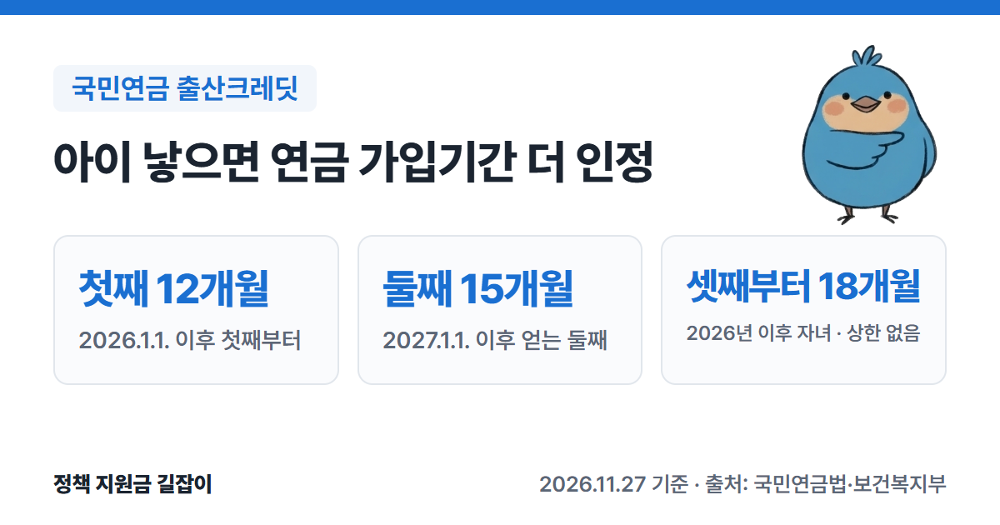
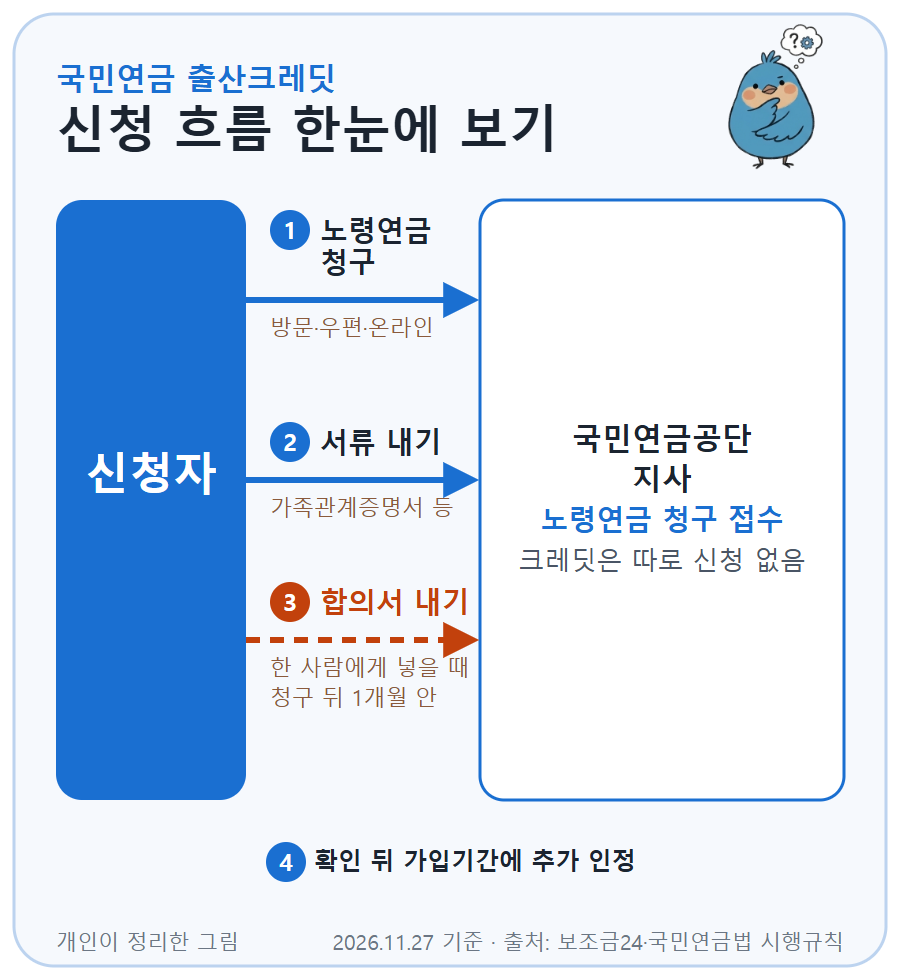

**국민연금 출산크레딧**은 아이를 낳거나 입양한 국민연금 가입자에게, 노령연금을 받을 때 가입기간을 더 인정해 주는 제도예요. 가입기간이 길어지면 받는 연금도 늘어나요.
2026년부터 첫째 아이도 인정되고, 2027년부터는 둘째 인정 기간이 늘어나요. 첫째를 언제 낳았느냐에 따라 계산이 달라서, 국민연금법 조문과 부칙을 바탕으로 자녀 수별로 정리했어요.

{: .summary-card}

> 💡 **핵심 요약**
> - **2026.1.1. 이후** 첫째 자녀를 낳거나 입양하면 첫째부터 **12개월**, 셋째부터 1명당 **18개월**을 노령연금 받을 때 국민연금 가입기간에 더해 줘요. 예전의 **50개월 상한**은 없어졌어요. (출처①②⑦)
> - **2027.1.1. 이후** 얻는 둘째 자녀는 **15개월**로 늘어나요. (출처①②③)
> - 지금 따로 신청하지 않아요. **노령연금을 청구할 때** 확인해 인정해요. (출처④)

> **출처 표시 방법**: 본문의 (출처①) 같은 표시는 글 끝 출처 목록의 번호와 같아요.

목차

* 목차
{:toc}

## 한눈에 보기

| 항목 | 내용 |
|---|---|
| 대상 | 자녀(출산·입양)가 있는 국민연금 **가입자·가입자였던 사람** 노령연금 받을 자격이 생길 때 |
| 지원 | 국민연금 **가입기간 추가 인정** 첫째 **12개월**부터 (2026년 이후 첫째) |
| 기간 | **노령연금 청구 때** 인정 지금 따로 신청 없음 |
| 방법 | 국민연금공단 지사에 노령연금 청구 방문·우편·온라인 |

(출처①④)

## 누가 받을 수 있나요?

**자녀가 있는 국민연금 가입자 또는 가입자였던 사람**이 노령연금을 받을 자격(수급권)을 얻을 때 인정돼요. (출처①)

- **노령연금 자격**: 노령연금은 원래 가입기간이 **10년 이상**이어야 받아요. 출산크레딧을 더해서 10년을 채우게 되는 경우도 포함돼요. (출처①)
- **인정되는 자녀**: 친생자, 인지된 출생자, 양자·친양자, 「국내입양에 관한 특별법」·「국제입양에 관한 법률」에 따라 입양된 자녀예요. 이미 세상을 떠난 자녀도 포함돼요. (출처⑥)
- **인정되지 않는 경우**: 부모가 노령연금 자격을 얻을 때 그 자녀가 다른 사람의 양자가 됐거나 파양됐다면, 그 부모에게는 더해지지 않아요. (출처⑥)
- **2008년 이후 자녀**부터 적용돼요. 2007년 이전에 얻은 자녀가 있으면 계산법이 따로 있어요(아래 "놓치기 쉬운 점"). (출처②)

## 얼마나 받을 수 있나요?

돈을 바로 주는 제도가 아니라, **국민연금 가입기간을 더 쳐 주는** 제도예요. 더해 주는 기간에 드는 돈은 **국가가 전부 또는 일부**를 부담하도록 법에 정해져 있어요. (출처①)

첫째 아이를 **언제** 얻었느냐에 따라 계산이 달라요.

### 첫째를 2026년 이후에 얻었다면

| 자녀 수 | 더해 주는 가입기간 |
|---|---|
| 1명 | **12개월** |
| 2명 | **24개월** 둘째를 2027년 이후 얻으면 **27개월** |
| 3명 이상 | 둘째까지 기간 + 셋째부터 1명마다 **18개월** 상한 없음 |

(출처①②)

- 2026년부터는 자녀가 2명 이하면 1명마다 12개월, 3명 이상이면 첫째·둘째 24개월에 셋째부터 1명마다 18개월을 더해요. (출처①)
- **2027.1.1.부터** 바뀐 법이 시행돼서, 둘째가 2027년 이후 태어나면(입양 포함) 첫째 12개월에 둘째 **15개월**을 더한 **27개월**이 돼요. 셋째부터는 그대로 1명마다 18개월이에요. (출처①②③)

### 첫째를 2008~2025년에 얻었다면

이 경우 첫째는 인정되지 않고, **둘째부터** 세요. (출처②⑦)

| 둘째를 얻은 때 | 더해 주는 가입기간 |
|---|---|
| 2025년 이전 | 둘째 **12개월**, 셋째부터 1명마다 **18개월** 자녀를 모두 2025년 이전에 얻었다면 최대 **50개월** (2026년 이후 얻은 자녀는 상한 없음) |
| 2026년 | 둘째 **12개월**, 셋째부터 1명마다 **18개월** |
| 2027년 이후 | 둘째 **15개월**, 셋째부터 1명마다 **18개월** |

(출처②⑦)

- 2026.1.1. 이후에 얻은 자녀에게는 예전의 **50개월 상한**을 적용하지 않아요. 다만 2026.1.1. 전에 이미 노령연금 수급권을 얻은 사람은 예전 규정을 따라요. (출처②⑦)

### 예시로 계산해 보면

아래는 위 법 조문과 부칙을 그대로 적용해 직접 계산한 예시예요. 실제 인정 기간은 노령연금을 청구할 때 국민연금공단이 확인해요.

- **2026년 첫째(외동)**: 12개월 (출처①)
- **2026년 첫째, 2028년 둘째**: 12 + 15 = **27개월** (출처①②)
- **2026년 첫째, 2028년 둘째, 2030년 셋째**: 27 + 18 = **45개월** (출처①②)
- **2020년 첫째, 2026년 둘째**: 첫째는 인정되지 않고 둘째 **12개월** (출처②⑦)
- **2020년 첫째, 2027년 둘째**: 둘째 **15개월** (출처②)
- **2020년 첫째, 2027년 둘째, 2029년 셋째**: 15 + 18 = **33개월** (출처②)
- **2010~2020년에 다섯 자녀(모두 2025년 이전)**: 12 + 18 × 3 = 66개월이지만 상한 때문에 **50개월** (출처②④)

### 연금이 얼마나 늘까요?

보건복지부는 **12개월**을 더하면 월 연금액이 **34,330원**, **15개월**을 더하면 월 **42,910원** 오르는 효과가 있다고 밝혔어요. 2026년 A값 3,193,511원, 소득대체율 43%를 기준으로 한 추정이에요. 실제 금액은 사람마다 달라요. (출처③)

## 어떻게 신청하나요?

출산크레딧은 **따로 신청하지 않아요.** 나중에 노령연금을 청구할 때 확인해 인정해요. (출처④)

1. **노령연금 청구하기**: 노령연금을 받을 때가 되면 국민연금공단 지사에 노령연금을 청구해요. 방문, 우편, 온라인으로 할 수 있어요. (출처④)
2. **서류 내기**: 가족관계증명서 등 법령·지침에 정해진 서류를 내요. (출처④)
3. **합의서 내기(부부 모두 가입자이거나 가입자였던 경우)**: 한 사람에게 모두 넣기로 했다면, 노령연금을 청구한 날부터 **1개월 이내**에 합의서를 국민연금공단에 내요. (출처⑤)
4. **가입기간 추가 인정**: 노령연금 청구 때 확인한 뒤 가입기간에 더해 인정해요. (출처④)

{: .flow-chart}

## 놓치기 쉬운 점

- **부부가 모두 가입자(가입자였던 사람 포함)면 나눠 받을 수 있어요.** 부부가 합의하면 두 사람 중 한 명의 가입기간에만 넣고, 합의하지 않으면 반씩 나눠 각자 넣어요. 노령연금 청구한 날부터 1개월 안에 합의서를 내지 않으면 합의하지 않은 것으로 봐요. 정당한 사유로 기간 안에 낼 수 없었음을 증명하면 그 사유가 없어진 날부터 1개월 안에 낼 수 있어요. (출처①⑤)
- **2025년 이전에 첫째를 낳았다면 첫째는 세지 않아요.** 2026년에 생긴 첫째 인정은 2026.1.1. 이후 첫째 자녀를 얻은 사람부터 적용돼요. 그 전에 첫째를 얻었다면 둘째부터 세요. (출처②⑦)
- **한 자녀는 한 번만 인정돼요.** 가입기간에 넣은 자녀를 다른 사람이 다시 넣을 수 없어요. (출처⑥)
- **2007년 이전 자녀는 계산법이 따로 있어요.** 2007년 이전 자녀가 1명이면 2008년 이후 자녀와 합쳐서 자녀 수를 세요. 2007년 이전 자녀가 2명 이상이면 2008년 이후 자녀 1명마다 18개월을 더하되 최대 50개월이에요. (출처②)

내 경우 몇 개월이 인정될지 헷갈리면 국민연금공단 콜센터(**1355**)에 먼저 물어보세요. (출처④)

## 자주 묻는 질문

**Q. 아이를 낳았는데 지금 국민연금공단에 신고해야 하나요?**
보조금24 안내에는 노령연금 청구 때 확인해 인정하고 별도 신청은 필요 없다고 적혀 있어요. (출처④)

**Q. 2026년에 둘째를 낳으면 12개월인가요, 15개월인가요?**
둘째 15개월은 2027.1.1. 이후 둘째 자녀를 얻은 사람부터 적용돼요. 2026년에 얻은 둘째는 12개월이에요. (출처①②③)

**Q. 이미 노령연금을 받고 있는데 늘어난 기준이 적용되나요?**
2026.1.1. 전에 노령연금 수급권을 얻은 경우에는 예전 규정을 적용한다고 안내돼요. (출처②⑦)

## 함께 보면 좋은 글

- [2026 출산지원금 총정리](): 첫만남이용권·부모급여·아동수당 등 아이 낳은 뒤 바로 받는 지원
- [육아휴직 급여·출산휴가 급여](): 출산 전후 일을 쉬는 동안 받는 급여와 신청 방법
- [기초연금](): 만 65세 이후 소득 기준으로 받는 또 다른 노후 연금

---

## 출처

1. [국가법령정보센터 - 국민연금법 제19조(출산에 대한 가입기간 추가 산입)·제61조(노령연금 수급권자)](https://www.law.go.kr/법령/국민연금법) · [2026.1.1. 시행본](https://www.law.go.kr/법령/국민연금법/%2820260101,20903,20250402%29) - 2026.1.1. 시행본 제19조제1항(자녀 2명 이하 1명마다 12개월, 3명 이상 24개월+2자녀 초과 1명마다 18개월), 법률 제22096호(2026.10.20.)로 2027.1.1. 시행 제19조제1항(1명 12개월, 2명 12개월+15개월, 3명 이상 27개월+1명마다 18개월), 제2항(부모 합의 시 1명, 미합의 시 균등 배분), 제3항(재원 국가가 전부 또는 일부 부담), 제1항 괄호(추가 산입으로 수급권을 얻는 경우 포함), 제61조(가입기간 10년 이상) (확인일: 2026-11-27)
2. [국가법령정보센터 - 국민연금법 부칙](https://www.law.go.kr/법령/국민연금법) · [개정 전 조문(2025.11.25. 시행본)](https://www.law.go.kr/법령/국민연금법/%2820251125,21146,20251125%29) - 법률 제20903호(2025.4.2.) 부칙 제1조(2026.1.1. 시행)·제3조(시행 이후 첫째 자녀를 얻은 사람부터 적용, 2008.1.1.~시행 전 첫째를 얻은 사람이 시행 이후 얻은 자녀는 종전 50개월 단서 미적용, 시행 전 노령연금 수급권 취득 시 예외), 법률 제22096호(2026.10.20.) 부칙 제1조(제19조제1항 2027.1.1. 시행)·제3조(2027.1.1. 이후 둘째 자녀를 얻은 사람부터 적용, 2025.12.31. 이전 첫째+2027.1.1. 이후 둘째는 2명 15개월·3명 이상 15개월+1명마다 18개월), 개정 전 제19조(2명 12개월, 3명 이상 12개월+18개월, 50개월 상한), 법률 제8541호 부칙 제19조(2008.1.1. 이후 자녀에 한해 적용, 2007.12.31. 이전 자녀 1명이면 합산, 2명 이상이면 1명마다 18개월·50개월 초과 불가) (확인일: 2026-11-27)
3. [보건복지부 보도자료 - 군복무 기간 전체로 국민연금 크레딧 확대 등 국민연금법, 기초연금법 개정안 국회 본회의 통과 (2026.10.1., 국민연금정책과)](https://www.mohw.go.kr/board.es?mid=a10503000000&bid=0027&list_no=1492125&act=view) - 2027년 이후 얻게 되는 둘째 자녀부터 15개월, 2027.1.1. 시행, 12개월 가산 월 34,330원·15개월 가산 월 42,910원 인상 효과('26년 A값 3,193,511원, 소득대체율 43% 기준) (확인일: 2026-11-27)
4. [정부24 보조금24 - 국민연금출산크레딧 (보건복지부, 수정일 2026.11.12.)](https://www.gov.kr/portal/rcvfvrSvc/dtlEx/WII000000260) - 노령연금 수급 시점에 자녀 수에 따라 가입기간 추가 인정, ('08.1.1. 이후) 둘째 12개월·셋째부터 18개월(상한 50개월), ('26.1.1. 이후) 첫째·둘째 12개월·셋째부터 18개월(상한 폐지), 노령연금 청구 시 확인 후 인정(별도신청 불필요), 연금청구 방법 방문·우편·온라인, 구비서류 가족관계증명서 등, 접수기관 국민연금공단 지사, 문의 1355 (확인일: 2026-11-27)
5. [국가법령정보센터 - 국민연금법 시행규칙 제12조(합의 절차 등)](https://www.law.go.kr/법령/국민연금법시행규칙) - 노령연금 지급을 청구한 날부터 1개월 이내 합의서 제출, 기간 내 미제출 시 합의하지 않은 것으로 봄, 정당한 사유 소멸일부터 1개월 이내 (확인일: 2026-11-27)
6. [국가법령정보센터 - 국민연금법 시행령 제25조(자녀의 인정 범위 등)](https://www.law.go.kr/법령/국민연금법시행령) - 친생자·인지된 출생자·양자·친양자·입양 자녀(사망한 자녀 포함), 다른 사람의 양자·파양 시 추가 산입 불가, 이미 추가 산입한 자녀는 다른 사람이 산입 불가 (확인일: 2026-11-27)
7. [국민연금공단 - 연금개혁 안내(특별부록)](https://www.nps.or.kr/pnsinfo/ntpsklg/getOHAF0104M0.do) - 2026.1.1. 이후 출생·입양한 첫째·둘째 각각 12개월, 셋째 이상 1명당 18개월, 상한 폐지, 2026.1.1. 전 노령연금 수급권 취득 시 종전 규정, 2008.1.1.~2025.12.31. 첫째를 얻은 가입자가 2026.1.1. 이후 자녀를 얻으면 둘째 12개월·셋째부터 18개월(상한 없음) (확인일: 2026-11-27)

> 이 글은 **2026년 11월 27일** 기준이에요. 법과 인정 기준은 바뀔 수 있으니 국민연금공단 누리집이나 1355에서 꼭 확인하세요.
